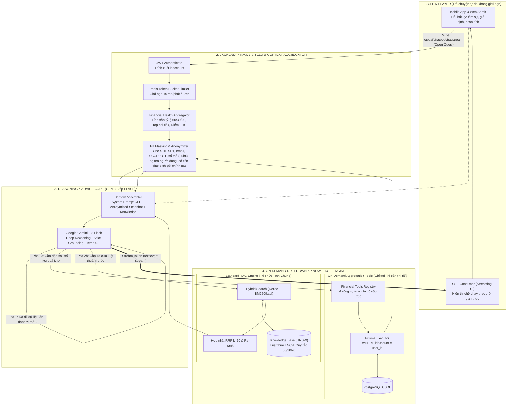

# THIẾT KẾ KIẾN TRÚC & TÀI LIỆU HOÀN THÀNH CHỨC NĂNG CHATBOT AI (FINANCIAL COPILOT) — BACKEND & ADMIN-WEB

> **Tài liệu đặc tả kiến trúc kỹ thuật & Báo cáo hoàn thành thi công**  
> **Ngày lập:** 2026-09-25 · **Hoàn thành triển khai & Nghiệm thu:** 2026-09-26 (Cập nhật 2026-09-27) · **Phiên bản:** 2.2.0 (🟢 Đã triển khai xong Backend & Admin-web)  
> **Vai trò đảm nhiệm:** Kỹ sư Fullstack Cao Cấp + AI Engineer + Senior BA  
> **Căn cứ nguồn sự thật:** [`docs/AI/Standard_RAG.md`](./Standard_RAG.md), [`docs/Rule_Project/Data_Security.md`](../Rule_Project/Data_Security.md), [`docs/AI/LogicBusinessAI.md`](./LogicBusinessAI.md), [`Project.md`](../../Project.md), [`docs/superpowers/plans/2026-09-27-backend-ai-fixes.md`](../superpowers/plans/2026-09-27-backend-ai-fixes.md).

> ⚠️ **CẬP NHẬT 2026-11-07 (đề tài NCKH, chế độ R&D) — các điểm sau THẮNG nội dung cũ bên dưới.** Mọi chỗ ghi "Gemini 3.8 Flash" ở các mục 2 đến 6 là lịch sử thiết kế. Từ 2026-11-14, mô hình Gemini dự phòng (khi không có `DEEPSEEK_API_KEY`) mặc định là `gemini-3.5-flash` (`DEFAULT_GEMINI_MODEL` trong `modules/ai/config.js`).
> - **Nhà cung cấp LLM của chatbot:** DeepSeek `deepseek-flash`, tắt suy luận, chọn bằng `CHATBOT_LLM_PROVIDER` / `DEEPSEEK_*` (`llm/provider.config.js`). Gemini chỉ còn cho OCR, phân loại giao dịch và đường chatbot cũ (đặt `CHATBOT_LLM_PROVIDER=gemini`).
> - **Admin-web không còn chatbot.** Mục 7.2 đã gỡ. Endpoint `GET /snapshot` (và `/financial-health`) đã gỡ; snapshot chỉ còn dùng nội bộ để dựng ngữ cảnh trong prompt.
> - **Giới hạn chi phí và độ dài** (`limits/chatbot.limits.js`, ghi đè bằng biến `AI_*`): tin nhắn ≤ 1.000 ký tự; lịch sử tối đa 4 tin, mỗi tin ≤ 800 ký tự; kết quả công cụ ≤ 2.500 ký tự; đầu ra ≤ 1.024 token; tối đa 5 lời gọi công cụ mỗi vòng; 1 luồng SSE mỗi người, 30 toàn hệ thống; hạn mức 20 lượt/ngày (đọc từ `scope_config.daily_prompts`, `null` thì dùng mặc định; tự làm mới lúc 0 giờ giờ VN; lượt lỗi do hệ thống — rơi về máy, lỗi, bận `AI_STREAM_BUSY` — được hoàn vào đúng ngày đã trừ, người dùng tự huỷ thì không, từ 2026-11-08); **ngân sách chi phí 0,80 USD/người/tháng** (nâng từ 0,40 ngày 2026-11-08; tính 2026-11-08: 26.667 micro-USD/ngày, dùng đủ 20 lượt/ngày cả tháng khi trung bình ≤ 0,0013 USD/lượt; với trung bình đo được ≈ 0,0010 USD/lượt thì dùng được ≈ 26 lượt/ngày nên hạn mức ngày 20 là giới hạn chạm trước) tính bằng `usage` thật của nhà cung cấp (vượt thì 429 `AI_MONTHLY_BUDGET`). Các giới hạn này là giá trị tạm, chốt sau khi đo lại bằng `usage`.
> - **Chi phí đo 2026-11-07** (deepseek-flash, giá giờ cao điểm): lượt thường ≈ 0,0011 USD (khoảng 28 đ), lượt có công cụ ≈ 0,0008 USD, từ chối lạc đề ≈ 0,0001 USD; lượt xấu nhất sau khi siết trần ≈ 0,0033 USD (cận trên khi không trúng bộ đệm ≈ 0,005 USD). Trần thiệt hại mỗi người dùng là ngân sách tháng `AI_MONTHLY_BUDGET_MICRO_USD`; hạn mức 20 lượt/ngày chỉ để chống dồn lượt. Với ngân sách 0,80 USD, nếu lượt trung bình 0,0017 USD thì ngân sách cạn sau khoảng 23 ngày.
> - **Lọc phạm vi:** lớp quy tắc chặn tiêm lệnh ngay và gắn cờ câu lạc đề trước khi tốn token (`scope/scope-guard.js`). Từ 2026-11-09, câu bị gắn cờ lạc đề được LLM xét lại đúng một lần trước khi loại (`scope/scope-confirm.js`, gọi từ `chatbot.controller.js` `_checkScope`): lời gọi ngắn, nhiệt độ 0, ≤ 60 token, hết giờ 15 s, che thông tin cá nhân, trả "CÓ/KHÔNG - lý do". CÓ thì câu hỏi đi tiếp; KHÔNG, mơ hồ hoặc lỗi thì trả câu từ chối cố định và hoàn lượt, chi phí lời gọi xét vẫn tính vào ngân sách. Luật phạm vi trong prompt là lớp tiếp theo.
> - **Gọi công cụ đa bước là mặc định (2026-11-08):** mô hình được gọi công cụ nối tiếp tối đa 5 vòng, mỗi vòng tối đa 5 lời gọi; vòng lặp bị chặn bằng chi phí và ngân sách tháng, không bằng "một bước". Đường Gemini cũ vẫn một bước.
> - **Trần chi phí mỗi lượt theo ngân sách còn lại (2026-11-08, `limits/turn-cap.js`):** trần = min(0,012 USD, max(sàn 0,002 USD, 1,5 × ngân sách tháng còn lại ÷ (số ngày còn lại × số lượt mỗi ngày))). Đã tiêu tới trần thì không mở thêm vòng công cụ nhưng vẫn trả lời. Quản trị viên dùng trần cứng 0,012 USD. Với mặc định, phần chia đều ×1,5 chỉ khoảng 0,001 USD nên đa số thời gian trần nằm ở sàn; số lượt thu hẹp chủ yếu do ngân sách tháng hết sớm hơn.
> - **Quy ước dấu gửi LLM:** `amount` luôn dương kèm `direction` ∈ {income, expense, transfer, debt_in, debt_out}; ghi chú mã hóa được giải mã rồi mới che PII (`tools/flow.normalizer.js`).
> - **SSE khi lỗi:** chỉ gửi `done{fallback,reason}`, không gửi chữ dự phòng; Client-app bỏ chữ của lượt đó và rơi về AI trên máy. Endpoint `/chat` (không truyền dòng) vẫn trả thông báo bằng chữ.
> - **Circuit breaker riêng của chatbot** (`chatbotCircuitBreaker`), chỉ đếm lỗi dịch vụ (mạng, hết giờ, 429, 5xx).
> - **RAG từ vựng làm công cụ động (2026-11-08):** BM25 tiếng Việt thuần JS trên các đoạn của kho (`rag/vi-text.js`, `rag/bm25.js`, `rag/lexical.search.js`), mô hình tự gọi công cụ `tra_cuu_kien_thuc`; **không còn chèn sẵn tài liệu vào prompt**. Chưa có embedding và RRF: đó là nhánh thực nghiệm, xây sau khi đóng băng bản đối chứng.
> - **Đảm bảo RAG:** (1) luật bắt buộc tra cứu trong prompt; (2) cổng ép `tool_choice` ở vòng đầu cho câu rõ ràng hỏi kiến thức (≥ 2 cặp âm tiết khớp, độ phủ ≥ 0,3, không có "của tôi/của mình"); phải quyết định trước vòng đầu vì chữ đã truyền dòng không thu hồi được; (3) mô hình không nêu nguồn nào đã tra được thì máy chủ gửi thêm nguồn của đoạn đứng đầu, ở cả hai cách phân phối. Ngưỡng đo trên kho 3 tài liệu, phải đo lại khi kho đổi.
> - **Sự kiện SSE mới `event: tool`** `{name, status: 'start'|'done'}` báo công cụ đang chạy (chỉ đường truyền dòng); `done` có thêm `toolRounds`, `lookups`, `forcedLookup`, `citationAppended`. Client-app `ai_chat` hiện "Đang tra cứu kiến thức…" / "Đang xem số liệu của bạn…"; bản client cũ bỏ qua sự kiện lạ.
> - **Kho tri thức (2026-11-08):** 14 tài liệu, 49 đoạn, mỗi tài liệu có `source`, `sourceUrl`, `checkedAt`: giảm trừ gia cảnh và biểu thuế 5 bậc 2026, cách tính thuế lương, bảo hiểm bắt buộc, bảo hiểm tiền gửi 350 triệu, quỹ khẩn cấp, trả nợ, 50/30/20, lương tối thiểu vùng 2026, trợ cấp thất nghiệp, trần lãi suất 20%/năm, nhóm nợ và nợ xấu, lãi kép, phòng lừa đảo. Số liệu và ví dụ khoá bằng `tests/unit/chatbot.kho.test.js`. Chưa có: điều kiện người phụ thuộc theo luật mới, số Điều/Khoản (chưa đọc được văn bản gốc).
> - **Sửa lỗi và vận hành (2026-11-08):** che PII tên mục tiêu, hóa đơn, danh mục, bản chụp; ước tính chi phí khi huỷ/đứt/thiếu usage; luồng đóng sớm thành lỗi, câu cụt báo `truncated`; tham số công cụ hỏng không chạy công cụ; `/chat` trả 503 `AI_SERVICE_UNAVAILABLE` khi lỗi; khoản chi không danh mục được tính; bản chụp truy vấn song song (khoảng 3 s xuống 0,5–1 s trên Supabase), làm mới khi `sync.completed`, cửa sổ theo `context_window_days`; câu lạc đề bị từ chối không trừ lượt; không gắn nguồn khi mô hình nói kho chưa có. Kiểm đầu-cuối qua HTTP thật và bộ đếm trên Redis thật đều đạt.
> - **Test:** chỉ chạy qua `npm test*` (rào `tests/setup/test-guard.js`); `npm run test:shared-db` chạy 7 tệp cần CSDL trên Supabase (ghi thật).
> - Chính sách dữ liệu cho người dùng: [`CHINH_SACH_DU_LIEU_TRO_LY_AI.md`](./CHINH_SACH_DU_LIEU_TRO_LY_AI.md).

---

## 1. PHÂN TÍCH NGHIỆP VỤ & RANH GIỚI HỆ THỐNG (SENIOR BA)

### 1.1. Mục Tiêu & Đối Tượng Sử Dụng
- **Mục tiêu:** Cung cấp một Trợ lý Tài chính Thông minh (AI Financial Copilot) tại Backend, đóng vai trò như một **Chuyên gia Hoạch định Tài chính Cá nhân Cấp cao (CFP - Certified Financial Planner)** hoạt động 24/7. Trợ lý có khả năng:
  1. Trò chuyện tự nhiên, tiếp nhận mọi câu hỏi mở, tâm sự tài chính, các tình huống giả định ("Nếu tôi mua nhà...", "Tôi vừa có khoản thưởng 20 triệu thì nên làm gì?").
  2. Vận dụng tư duy suy luận đa chiều (Deep Reasoning & Critical Thinking) để phân tích hành vi chi tiêu, phát hiện điểm bất hợp lý và đưa ra lời khuyên tài chính chiến lược mang tính cá nhân hóa cao.
  3. Cung cấp tri thức tài chính, giải thích luật thuế TNCN, quy tắc phân bổ ngân sách chuẩn (50/30/20, 6 chiếc lọ).
- **Đối tượng sử dụng:**
  - Người dùng Mobile App (Client-app) khi có kết nối mạng trực tuyến.
  - Quản trị viên / Người dùng trên Admin Web.

### 1.2. Phân Định Ranh Giới Dữ Liệu & Ràng Buộc Pháp Lý Bắt Buộc
Tuân thủ tuyệt đối **Nghị định 13/2023/NĐ-CP** và nguyên tắc **F1** (`Data_Security.md`, PO chốt ngày 2026-09-23):
- **TUYỆT ĐỐI KHÔNG index dữ liệu cá nhân của người dùng vào Vector Database.** Không nhúng lịch sử giao dịch, số dư, ghi chú ví của User vào các bảng embedding tập trung trên server.
- **Nguyên tắc "Tấm Khiên Riêng Tư" (Privacy Shield & Quyết định F1):** AI bên ngoài (Google Gemini) **không thể và không được phép** nhìn thấy dữ liệu định danh cá nhân (PII) thô (họ tên, số tài khoản, số điện thoại, số thẻ, số CCCD, OTP/CVV, email). Mọi chuỗi văn bản và ghi chú giao dịch đều được chạy qua bộ lọc PII Masking toàn diện (`masking.util.js` & `pii.masker.js`), tự động giải mã AES nếu cần trước khi làm mờ.
- **Tổng hợp & Ẩn danh hóa 100% trước khi đưa vào AI:** Dữ liệu tài chính cá nhân được Backend xử lý, gom nhóm theo danh mục, tính toán tỷ lệ % và ẩn danh hóa (Anonymized & Aggregated Snapshot) trước khi đưa vào ngữ cảnh suy luận của LLM. Khi Gemini gọi công cụ On-demand (ví dụ xem chi tiết danh mục), số tiền và ghi chú giao dịch đã được làm mờ PII mới được cung cấp.
- **Dữ liệu lập chỉ mục Vector Database (RAG):** **CHỈ LƯU TRỮ TRI THỨC TÀI CHÍNH TĨNH / CHUNG** (Luật thuế TNCN, mẹo tiết kiệm, kiến thức đầu tư cơ bản, quy tắc tài chính).

---

## 2. QUÁ TRÌNH TIẾN HÓA KIẾN TRÚC & PHÂN TÍCH ĐÁNH ĐỔI (TRADEOFF ANALYSIS)

Để tìm ra kiến trúc tối ưu nhất phục vụ cho báo cáo và triển khai thực tế, hệ thống đã trải qua quá trình nghiên cứu, phản biện và so sánh giữa 4 mô hình kiến trúc:

```
                           【CÂU HỎI MỞ CỦA NGƯỜI DÙNG】
                           (Bất kỳ câu hỏi, tâm sự, giả định)
                                         │
     ┌───────────────────┬───────────────┴───────────────┬───────────────────┐
     ▼                   ▼                               ▼                   ▼
【KIẾN TRÚC CŨ】   【GIẢI PHÁP 1】                【GIẢI PHÁP 2】        【GIẢI PHÁP 3 (DUYỆT)】
 Intent Router     Autonomous Agent              Financial Snapshot     Dual-Phase Reasoning
 (Cây quyết định)  (ReAct Dynamic Loop)          (Zero-Shot Context)    with Privacy Shield
```

### 2.1. Kiến Trúc Cũ (Baseline — Intent Router Pattern)
- **Cơ chế hoạt động:**
  - Request đi vào Backend $\rightarrow$ Chạy qua một bộ `Fast Intent Router` (sử dụng regex/keyword hoặc LLM nhỏ) để ép câu hỏi vào 1 trong 4 nhóm cố định: *Smalltalk*, *Personal Data*, *Knowledge*, hoặc *Hybrid Advice*.
  - Tùy theo nhóm, hệ thống rẽ nhánh cứng sang Tool CSDL hoặc RAG tri thức tĩnh.
- **Ưu điểm:**
  - Cấu trúc rẽ nhánh rõ ràng, dễ viết code ban đầu.
  - Tốc độ phản hồi các câu chào hỏi đơn giản rất nhanh ($< 100\text{ms}$).
- **Nhược điểm chí mạng (Lý do bị bác bỏ):**
  - **Bóp nghẹt năng lực suy luận của AI:** Ép người dùng vào "cây quyết định tự động (IVR)". Khi người dùng đặt câu hỏi mở, đa chiều (*"Tháng này tôi thấy áp lực tiền bạc quá, bạn xem giùm tôi có thể cắt giảm khoản nào được không?"*), Router không thể phân loại chính xác, dẫn đến câu trả lời máy móc, rời rạc và thiếu tính đồng cảm của một chuyên gia tài chính.

### 2.2. Giải Pháp 1: Autonomous Reasoning Agent (Pure ReAct Pattern)
- **Cơ chế hoạt động:**
  - Bỏ hoàn toàn Router. Câu hỏi mở của người dùng được gửi thẳng tới Google Gemini 3.8 Flash.
  - LLM sử dụng vòng lặp **ReAct (Reasoning + Acting)**: Tự suy nghĩ (*Thought*) $\rightarrow$ Tự quyết định gọi Tool (*Action*) $\rightarrow$ Backend query CSDL nội bộ và trả về kết quả đã ẩn danh (*Observation*) $\rightarrow$ LLM tiếp tục suy luận cho đến khi hoàn tất câu trả lời.
- **Ưu điểm:**
  - AI hoàn toàn tự do tiếp nhận mọi câu hỏi bất kỳ như ChatGPT Web.
  - Khả năng xử lý các yêu cầu phức tạp nhiều bước.
- **Nhược điểm:**
  - **Độ trễ cao (High Latency):** Phải qua 2 - 3 vòng lặp round-trip mạng giữa Backend và Google LLM, khiến thời gian xuất hiện chữ đầu tiên (**TTFT**) lên tới $2.5\text{s} - 4.5\text{s}$, làm giảm trải nghiệm người dùng trên Mobile.
  - **Tốn kém chi phí Token & Nguy cơ lặp vô tận (Loop):** Nếu LLM gọi nhiều tool liên tiếp sẽ gây hao tốn token và dễ nghẽn hạn ngạch API.

### 2.3. Giải Pháp 2: Anonymized Financial Health Snapshot (Zero-Shot Context Injection)
- **Cơ chế hoạt động:**
  - Mô phỏng cách làm việc của Bác sĩ Tài chính: Mỗi khi bắt đầu phiên trò chuyện, Backend tự động tổng hợp sẵn một **Bản chụp sức khỏe tài chính ẩn danh (Financial Health Snapshot)** gồm các chỉ số vĩ mô (tỷ lệ 50/30/20, top danh mục ngốn tiền, hóa đơn sắp tới, điểm sức khỏe tài chính).
  - Snapshot ẩn danh này được nạp sẵn vào System Context của LLM cùng với câu hỏi của người dùng.
- **Ưu điểm:**
  - **Tốc độ phản hồi siêu nhanh (TTFT $< 600\text{ms}$):** Gemini stream câu trả lời về ngay lập tức mà không cần chờ gọi Tool.
  - LLM có cái nhìn toàn cảnh bức tranh tài chính nên đưa ra lời khuyên rất bao quát.
- **Nhược điểm:**
  - **Thiếu khả năng đào sâu chi tiết (Drill-down limitation):** Nếu người dùng hỏi một giao dịch rất cụ thể trong quá khứ (*"Cho tôi xem 3 lần tôi đi ăn lẩu đắt nhất tháng trước"*), Snapshot vĩ mô không chứa dữ liệu chi tiết này để trả lời.

### 2.4. Bảng Ma Trận So Sánh Toàn Diện Các Phương Án

| Tiêu Chí Đánh Giá | Kiến Trúc Cũ (Intent Router) | Giải Pháp 1 (Pure ReAct Agent) | Giải Pháp 2 (Snapshot Only) | **Giải Pháp 3 (Dual-Phase Shield) — ĐÃ DUYỆT** |
|---|:---:|:---:|:---:|:---:|
| **Độ tự do của câu hỏi** | ❌ Bị gò bó theo 4 nhóm | ✅ Tự do tuyệt đối | ✅ Tự do tuyệt đối | 🌟 **Tự do tuyệt đối (như ChatGPT web)** |
| **Năng lực suy luận & Khuyên tài chính** | ⚠️ Rất hạn chế (Rời rạc) | ✅ Khá cao (Tự gọi tool) | ✅ Rất cao (Thấy toàn cảnh) | 🌟 **Đỉnh cao (Toàn cảnh + Đào sâu đa chiều)** |
| **Bảo mật dữ liệu (Data_Security)** | ✅ Tuân thủ F1 | ✅ Tuân thủ F1 | ✅ Ẩn danh 100% | 🌟 **Tấm khiên Ẩn danh & Tổng hợp 100%** |
| **Thời gian phản hồi đầu tiên (TTFT)** | ⚠️ 1.5s - 3s | ❌ Chậm (2.5s - 4.5s) | ⚡ Siêu nhanh (< 600ms) | ⚡ **Siêu nhanh (< 800ms qua SSE Stream)** |
| **Chi phí Token & Tải hệ thống** | Thấp | ❌ Rất cao (Nhiều vòng lặp) | Rất thấp | **Tối ưu (80% câu hỏi không tốn round-trip)** |
| **Khả năng đào sâu giao dịch chi tiết** | Có (nếu khớp tool) | Rất tốt | ❌ Không thể | 🌟 **Xuất sắc (Kích hoạt tool on-demand)** |

### 2.5. Lý Do Lựa Chọn Giải Pháp 3 (Architectural Decision Rationale)
> **Quyết định của PO & Kỹ sư trưởng:** Phê duyệt **Giải pháp 3 (Dual-Phase Reasoning with Privacy Shield)** vì đây là phương án **kết hợp hoàn hảo nhất (Best of Both Worlds)**:
> 1. **Giải phóng 100% năng lực suy luận:** Người dùng hỏi bất kỳ câu hỏi nào, AI đóng vai trò Cố vấn Tài chính CFP với tư duy phản biện sắc sảo.
> 2. **Phản hồi tức thì (Low Latency):** Nhờ có sẵn *Anonymized Financial Health Snapshot*, hơn **80% câu hỏi** được LLM suy luận và stream trả lời ngay lập tức qua SSE ($< 800\text{ms}$).
> 3. **Linh hoạt đào sâu khi cần:** Với **20% câu hỏi** yêu cầu chi tiết lịch sử, LLM tự động kích hoạt *On-demand Tool* để truy vấn sâu hơn.
> 4. **Bảo mật tuyệt đối (100% Privacy Compliance):** Toàn bộ dữ liệu người dùng đều đi qua bộ lọc tổng hợp và ẩn danh của Backend trước khi chạm vào LLM.

---

## 3. THIẾT KẾ CHI TIẾT GIẢI PHÁP 3: DUAL-PHASE REASONING WITH PRIVACY SHIELD

### 3.1. Sơ Đồ Kiến Trúc Hệ Thống (Mermaid tương thích Draw.io)



---

### 3.2. Cấu Trúc Bản Tóm Tắt Sức Khỏe Tài Chính Ẩn Danh (Anonymized Financial Health Snapshot)

Để LLM có thể suy luận sắc sảo ngay lập tức mà không cần hỏi đi hỏi lại từng bảng dữ liệu, Backend tính toán sẵn một gói dữ liệu cô đọng ($< 300\text{ tokens}$), **hoàn toàn ẩn danh**:

```json
{
  "period": "Tháng hiện tại (09/2026)",
  "financialHealthScore": 72,
  "budgetAllocation": {
    "needs_essential": "58% (Mục tiêu chuẩn: 50%)",
    "wants_lifestyle": "27% (Mục tiêu chuẩn: 30%)",
    "savings_debt": "15% (Mục tiêu chuẩn: 20%)"
  },
  "spendingInsights": {
    "topExpenseCategories": [
      { "category": "Ăn uống", "percentage": 34, "trendVsLastMonth": "+15%" },
      { "category": "Thuê nhà & Tiện ích", "percentage": 24, "trendVsLastMonth": "0%" },
      { "category": "Mua sắm cá nhân", "percentage": 18, "trendVsLastMonth": "+40%" }
    ],
    "overBudgetAlerts": ["Ăn uống đã chạm 92% ngân sách tháng"]
  },
  "liquidityAndObligations": {
    "emergencyFundMonths": 2.1,
    "upcomingBillsIn7DaysCount": 2,
    "debtToIncomeRatio": 0.12,
    "activeSavingsGoalsCount": 1
  }
}
```

> **Đặc điểm bảo mật:**
> - Không chứa: Số tài khoản ngân hàng, họ tên, số điện thoại, địa chỉ, tên cửa hàng cụ thể.
> - Số tiền cụ thể được quy đổi thành **tỷ lệ % phân bổ**, **xu hướng tăng/giảm** và **thời lượng quỹ dự phòng (số tháng)**.
> - Đủ $100\%$ dữ kiện chất lượng cao để AI suy luận: *"Ăn uống đang chiếm tới 34% và tăng 15%, trong khi quỹ khẩn cấp mới chỉ đủ 2.1 tháng chi tiêu, bạn nên ưu tiên..."*.

> **Quy tắc phân loại danh mục 50/30/20 chuẩn hóa trong Snapshot:**
> - **Needs (Thiết yếu - 50%):** Các danh mục phục vụ sinh hoạt bắt buộc gồm: `Ăn uống`, `Thuê nhà/Nhà cửa`, `Tiện ích`, `Đi lại/Di chuyển/Giao thông/Xăng`, `Hóa đơn`, `Y tế/Thuốc`, `Học phí/Giáo dục`, `Chợ/Siêu thị`, `Điện/Nước/Internet`.
> - **Savings & Debt (Tiết kiệm & Nghĩa vụ Nợ - 20%):** Các danh mục: `Tiết kiệm`, `Đầu tư`, `Tích lũy`, `Trả nợ`, `Bảo hiểm`, `Gửi tiết kiệm`, `Đi vay/Cho vay/Vay/Nợ`.
> - **Wants (Lối sống & Chi tiêu mong muốn - 30%):** Bao gồm `Mua sắm`, `Giải trí` và **toàn bộ các danh mục chi tiêu còn lại** (ví dụ: *Chi khác, Cà phê, Du lịch,...*). Đảm bảo mọi đồng chi tiêu thực tế đều được ghi nhận, không bị loại bỏ hay làm suy giảm tổng chi tiêu.
> - **Mẫu số phân bổ:** Ưu tiên tính trên Tổng thu nhập thực tế trong kỳ (nếu $> 0$). Nếu người dùng chưa phát sinh thu nhập, mẫu số sẽ là Tổng chi tiêu thực tế ($Needs + Wants + Savings$), đảm bảo tổng các thành phần luôn đạt $100\%$.

---

### 3.3. Tầng Suy Luận & Tư Vấn Cấp Cao (Reasoning & Advice Core)

#### Vai trò & Triết lý của AI Copilot:
- Đóng vai trò là **Senior Personal Financial Advisor (CFP)**:
  - Lắng nghe thấu cảm, không phán xét hành vi tiêu dùng của người dùng.
  - Phân tích nguyên nhân gốc rễ (Root Cause) thay vì chỉ đọc lại số liệu.
  - Luôn đưa ra lời khuyên theo công thức **"Nhận định $\rightarrow$ Phân tích tác động $\rightarrow$ 2-3 Hành động cụ thể (Actionable Steps)"**.

#### Kỹ thuật Prompting chuẩn:
- **In-Context Chain-of-Thought (CoT):** Yêu cầu mô hình tự suy luận logic các bước trong khối `thought` trước khi sinh câu trả lời.
- **Strict Grounding:** Chỉ lập luận dựa trên Snapshot và dữ liệu cung cấp; tuyệt đối không tự bịa đặt các khoản tiền không có thật.
- **Low Temperature:** Đặt $0.1$ để phản hồi nhất quán, chặt chẽ, không bị ảo giác.

---

### 3.4. Danh Mục Công Cụ Truy Vấn Đào Sâu (On-Demand Drilldown Tools)

Khi người dùng muốn đào sâu vào chi tiết cụ thể mà Snapshot chưa có, LLM kích hoạt các công cụ có cấu trúc:

| Tên Tool | Tham số đầu vào | Chức năng nghiệp vụ | Ràng buộc bảo mật |
|---|---|---|---|
| `get_category_transactions` | `categoryName`, `limit` (max 10), `timeRange` | Lấy danh sách giao dịch lớn nhất hoặc gần nhất của 1 danh mục. | Bắt buộc `idaccount`. Che PII ghi chú qua `maskTransactionDescription`. |
| `compare_spending_periods` | `period1`, `period2`, `category` | So sánh chi tiêu giữa 2 mốc thời gian (ví dụ: tháng này vs tháng trước). | Dữ liệu trả về dạng chênh lệch tổng và %. |
| `get_bill_details` | `status` (unpaid/all), `daysAhead` | Chi tiết các hóa đơn sắp đến hạn thanh toán trong tuần. | Chỉ lấy hạn nợ và số tiền làm tròn, không kèm thông tin thẻ tín dụng. |
| `get_goal_simulation` | `goalId`, `monthlyContribution` | Giả lập thời gian hoàn thành mục tiêu tiết kiệm với mức đóng góp mới. | Ràng buộc `idaccount`. |

---

## 4. THI CÔNG CHUẨN RAG 4 PHA CHO TRI THỨC TĨNH (STANDARD_RAG.MD)

> ⚠️ **Trạng thái thi công thực tế (đối chiếu mã 2026-11-08).** Mô tả bên dưới là THIẾT KẾ; câu "tuân thủ 100%" của bản gốc không đúng với mã. Bảng này thắng.
>
> | Hạng mục thiết kế | Thực tế | Vì sao chưa có | Có cần làm không |
> |---|---|---|---|
> | NFC, khử ký tự điều khiển | Chỉ bỏ dấu và chữ thường khi so khớp | Đủ cho truy hồi từ vựng | Không |
> | Parent-Child Chunking | Chia một tầng theo dòng trống; mã đoạn `doc#n`. Không có tầng cha | Đoạn đủ ngắn nên chưa cần | Xem lại khi mở rộng kho |
> | HNSW | Không | Với vài trăm đoạn, quét tuyến tính chính xác tuyệt đối và dưới 1 ms; HNSW chỉ đánh đổi độ chính xác | **Không** |
> | Dense Search (embedding) | Không | Nhà cung cấp LLM hiện tại (DeepSeek) không có API embedding; chạy cục bộ cần khoảng 0,5 GB RAM, vượt gói Render miễn phí | **Có**, là biến thực nghiệm cốt lõi của đề tài |
> | BM25 tiếng Việt | **Có (2026-11-08)**: âm tiết + cặp âm tiết liền kề, bỏ dấu, bỏ từ dừng, k1 = 1,2, b = 0,75, trả top 3 | | Điểm yếu đã thấy khi chạy thật: không nối được viết tắt với từ đầy đủ ("BHXH" và "bảo hiểm xã hội") |
> | RRF (k=60) | Không (bản gốc ghi "có" là sai) | Cần hai danh sách xếp hạng để hợp nhất, mà mới có một | **Có**, đi cùng BM25 và Dense |
> | Query Transformation (HyDE, tách câu hỏi) | Không | Thêm một lần gọi LLM, tăng chi phí và độ trễ | Không trong đề tài này; ghi là hướng phát triển |
> | Cross-Encoder Re-ranking | Không | Cần thêm mô hình, nặng so với kho nhỏ | Không trong đề tài này |
> | U-Shaped Context Ordering | Không áp cho RAG (chỉ phân loại giao dịch dùng) | Kết quả công cụ đã xếp theo điểm, tối đa 3 đoạn | Không trong đề tài này |
> | Trích dẫn nguồn `[Nguồn: …]` | **Có**: công cụ trả chuỗi `citation`; mô hình quên thì máy chủ gắn nguồn của đoạn đứng đầu | | |
> | Đánh giá Ragas (Faithfulness, Context Precision/Recall…) | Không có lần đánh giá nào | Chưa có bộ câu hỏi có nhãn | **Có**, là chỉ số của thực nghiệm (tự tính hoặc dùng Ragas ngoại tuyến) |
> | `invalidateSnapshotCache` khi có giao dịch mới (mục 5) | Hàm có nhưng **không nơi nào gọi**; snapshot có thể cũ tối đa 120 giây | Chưa nối vào luồng ghi giao dịch | Thấp; sửa riêng nếu cần |
> | TTFT < 800 ms (mục 6) | Đo 2026-11-07 với DeepSeek: trung bình khoảng 0,8 s (0,3 đến 1,7 s), chưa phải cam kết | Chưa đo trước đây | Đo lại trong thực nghiệm |

Tri thức tài chính chung/tĩnh (Luật thuế TNCN, mẹo chi tiêu, biểu thuế lũy tiến) được thiết kế theo tài liệu [`docs/AI/Standard_RAG.md`](./Standard_RAG.md):

- **Phase 1 (Advanced Indexing):**
  - Chuẩn hóa Unicode **NFC** (`unicodedata.normalize('NFC')`), khử ký tự điều khiển.
  - **Parent-Child Chunking:** Child Chunk 200 tokens (độ trùng 20 tokens) dùng cho Dense Vector Search; Parent Chunk 1000 tokens nạp vào Prompt để trọn vẹn ngữ cảnh.
  - **HNSW Indexing:** $M = 16$, $ef\_construction = 128$, $ef\_search = 64$ (truy vấn $< 10\text{ms}$).
- **Phase 2 (Advanced Retrieval):**
  - **Query Transformation:** Áp dụng HyDE và Query Decomposition khi gặp câu hỏi so sánh phức tạp.
  - **Hybrid Search:** Kết hợp Dense Search (`text-embedding-004`) và Sparse Search (BM25Okapi tiếng Việt).
  - **Hợp nhất RRF ($k = 60$):** $\text{Score}(d) = \sum \frac{1}{60 + rank_i(d)}$.
  - **Cross-Encoder Re-ranking:** Lấy Top 20 từ Hybrid Search $\rightarrow$ Re-ranker chọn **Top 3 - 5 chunks** chuẩn xác nhất.
- **Phase 3 (Generation & Attribution):**
  - **U-Shaped Context Ordering:** Đặt thông tin quan trọng nhất ở đầu và cuối prompt chống hiện tượng *"Lost in the Middle"*.
  - **Trích dẫn nguồn:** Mọi con số trích từ cẩm nang phải có dẫn chứng `[Nguồn: Quy tắc 50/30/20]` hoặc `[Nguồn: Biểu thuế TNCN 2026]`.
- **Phase 4 (Quantitative Evaluation Ragas):**
  - Đảm bảo: $\text{Faithfulness} \ge 0.85$, $\text{Answer Relevancy} \ge 0.70$, $\text{Context Precision} \ge 0.80$, $\text{Context Recall} \ge 0.80$.

---

## 5. THIẾT KẾ CHỊU TẢI CAO (HIGH CONCURRENCY) & TÍNH ỔN ĐỊNH

Khi số lượng lớn người dùng cùng chat với AI, hệ thống áp dụng các tầng phòng thủ:

```
[User Request] ──▶ [Redis Token-Bucket Limiter] ──▶ [Snapshot Cache (TTL 120s)]
                           │                               │
                    (Chặn spam 429)                 (Cache hit FHS)
                           │                               │
                           ▼                               ▼
                 [Connection Pool Pg] ──▶ [Gemini 3.8 Flash + Circuit Breaker]
```

1. **Redis Token-Bucket Rate Limiter (15 req/phút):**
   - 15 request / phút / idaccount. Triển khai bằng Redis Hash & Lua script nguyên tử, hỗ trợ cơ chế In-Memory Token Bucket Graceful Fallback nếu Redis ngoại tuyến.
2. **Bộ nhớ đệm Snapshot Cache (Redis TTL 120s):**
   - Bản chụp sức khỏe tài chính vĩ mô được lưu đệm 120 giây (2 phút) trên Redis theo key `cache:snapshot:{idaccount}` nhằm giảm tải 80% truy vấn tính toán nặng tới PostgreSQL trong suốt phiên đàm thoại. Tự động xóa đệm (`invalidateSnapshotCache`) khi phát sinh giao dịch mới.
3. **Quản lý tài nguyên & Bộ ngắt mạch (Circuit Breaker):**
   - Connection Pool PostgreSQL `max: 20`, giải phóng ngay sau câu lệnh SELECT.
   - **Gemini Circuit Breaker:** Khi phát hiện 5 lỗi liên tiếp trong 60 giây, mạch tự động chuyển sang trạng thái OPEN trong 30 giây, ngắt các request tiếp theo và chuyển sang thông báo Fallback minh bạch, chống cascade failure cho toàn hệ thống.

---

## 6. TỐI ƯU HÓA TỐC ĐỘ PHẢN HỒI (LOW LATENCY — TTFT < 800MS)

1. **Giao thức Server-Sent Events (SSE Streaming):**
   - Endpoint `POST /api/ai/chatbot/chat/stream` đẩy từng token từ Google Gemini 3.8 Flash về Client ngay khi vừa sinh ra.
   - Thời gian xuất hiện ký tự đầu tiên (**Time To First Token - TTFT**) đạt mức **$< 800\text{ms}$**.
2. **Xử lý ngắt kết nối (Client Disconnect Handler):**
   - Lắng nghe sự kiện `req.on('close')`: Khi người dùng tắt app hoặc bấm "Dừng", Backend lập tức ngắt stream của Gemini để tiết kiệm token và giải phóng RAM máy chủ.

---

## 7. CẤU TRÚC THƯ MỤC MODULE & ĐẶC TẢ API THỰC TẾ

### 7.1. Cấu Trúc Mã Nguồn Backend (`src/Backend/modules/ai/features/chatbot/`)

```
src/Backend/modules/ai/features/chatbot/
├── chatbot.controller.js          # Tiếp nhận HTTP request, thiết lập text/event-stream, bắt req.on('close')
├── chatbot.routes.js              # Định tuyến: POST /chat/stream, POST /chat, POST /reset (đã gỡ GET /snapshot)
├── chatbot.service.js             # Nhạc trưởng điều phối: Snapshot -> RAG -> Prompt -> LLM (DeepSeek/Gemini) -> Tools -> Fallback
├── chatbot.validation.js          # Kiểm tra message (≤ 1.000 ký tự) và LÀM SẠCH history (4 tin × 800 ký tự)
├── limits/
│   ├── chatbot.limits.js          # Cấu hình giới hạn tập trung (biến AI_*)
│   ├── request-sanitizer.js       # Cắt lịch sử trước khi che PII / gửi LLM
│   ├── usage-quota.js             # Hạn mức lượt hỏi theo ngày (giờ VN, Redis + bộ nhớ)
│   ├── usage-cost.js              # Công thức chi phí từ usage (micro-USD)
│   ├── usage-budget.js            # Ngân sách chi phí theo tháng mỗi người dùng
│   ├── quota.middleware.js        # Chặn 429: AI_MONTHLY_BUDGET, AI_DAILY_LIMIT
│   └── stream-guard.js            # Giới hạn luồng SSE đồng thời
├── llm/
│   ├── deepseek.provider.js       # Gọi DeepSeek (OpenAI-compatible), truyền dòng, ghép tool_calls, phân loại lỗi
│   └── provider.config.js         # Chọn nhà cung cấp và mô hình
├── scope/
│   └── scope-guard.js             # Lọc quy tắc: chặn việc ngoài phạm vi và tiêm lệnh trước khi gọi LLM
├── rate-limiter/
│   └── redis-token-bucket.js      # Redis Token-Bucket Limiter 15 req/phút (kèm Graceful In-memory Fallback)
├── resilience/
│   └── circuit-breaker.js         # Circuit Breaker RIÊNG của chatbot (5 lỗi dịch vụ -> OPEN 30s)
├── snapshot/
│   └── financial.snapshot.service.js # Tính toán thu nhập chuẩn, 50/30/20, quỹ khẩn cấp, điểm FHS (Redis cache TTL 120s)
├── privacy/
│   └── pii.masker.js              # Che giấu số tài khoản, số điện thoại, thẻ tín dụng (Luhn), CCCD, OTP, Họ tên và làm mờ snapshot
├── rag/
│   ├── data/
│   │   ├── thue_tncn_2026.json    # Biểu thuế TNCN lũy tiến từng phần 7 bậc và mức giảm trừ gia cảnh hiện hành
│   │   ├── quy_tac_50_30_20.json  # Quy tắc phân bổ 50% Thiết yếu, 30% Linh hoạt, 20% Tích lũy & 6 chiếc lọ
│   │   └── quan_ly_no_an_toan.json# Phương pháp trả nợ Tuyết Lở (Avalanche) và Hòn Tuyết Lăn (Snowball)
│   ├── vi-text.js                 # Chuẩn hóa, tách âm tiết + cặp âm tiết, từ dừng tiếng Việt
│   ├── bm25.js                    # BM25 thuần JS
│   └── lexical.search.js          # Chia đoạn, truy hồi từ vựng, cổng ép tra cứu (chưa có RRF / embedding: nhánh thực nghiệm)
├── tools/
│   ├── financial.tools.js         # Khai báo 5 Tools kiểu Gemini gồm tra_cuu_kien_thuc (llm/deepseek.provider.js chuyển sang JSON Schema chuẩn)
│   ├── flow.normalizer.js         # Chuẩn hóa chiều dòng tiền: amount dương + direction
│   └── tools.executor.js          # Query Prisma scoped idaccount; giải mã ghi chú rồi che PII; chỉ lấy khoản chi
└── prompts/
    └── advisor.system.prompt.js   # System Prompt CFP, CoT, Strict Grounding và định dạng trích dẫn nguồn
```

### 7.2. Admin-Web — ĐÃ GỠ (2026-11-07)

Chatbot phục vụ người dùng cuối, không dành cho quản trị viên. Các tệp `src/Admin-web/src/pages/ai/*` và `src/Admin-web/src/api/chatbot.api.js` đã bị xóa (không có route hay menu nào trỏ tới). Phía người dùng, chatbot hiển thị ở Client-app (`lib/features/ai_chat/`).

### 7.3. Đặc Tả API Endpoints

#### 1. `POST /api/ai/chatbot/chat/stream` (SSE Streaming)
- **Headers:** `Authorization: Bearer <ACCESS_TOKEN>`, `Content-Type: application/json`
- **Giới hạn (thứ tự kiểm):** quyền gói (`ai_assistant`) → 15 requests/phút/idaccount → làm sạch đầu vào → ngân sách tháng (429 `AI_MONTHLY_BUDGET`) → hạn mức ngày (429 `AI_DAILY_LIMIT`) → một luồng đồng thời mỗi người (429 `AI_STREAM_BUSY`). Mọi trạng thái khác 200 được Client-app coi là lỗi máy chủ và rơi về AI trên máy.
- **Request Body:**
  ```json
  {
    "message": "Tháng này tôi tiêu nhiều nhất vào khoản nào?",
    "history": [
      { "role": "user", "text": "Chào bạn" },
      { "role": "model", "text": "Xin chào! Tôi có thể hỗ trợ gì cho kế hoạch tài chính của bạn hôm nay?" }
    ]
  }
  ```
  *(Hỗ trợ cả trường `conversationHistory`; server giữ 4 tin nhắn gần nhất, mỗi tin cắt tối đa 800 ký tự)*.
- **Response Format (Server-Sent Events — `text/event-stream`):**
  ```http
  HTTP/1.1 200 OK
  Content-Type: text/event-stream; charset=utf-8
  Cache-Control: no-cache, no-transform
  Connection: keep-alive
  X-Accel-Buffering: no

  event: meta
  data: {"snapshotLoaded":true,"healthScore":75,"snapshot":{"period":"Tháng 9/2026","financialHealthScore":75,"budgetAllocation":{"needs_essential":"50%","wants_lifestyle":"30%","savings_debt":"20%"},"spendingInsights":{"topExpenseCategories":[{"category":"Ăn uống","percentage":35,"trendVsLastMonth":"0%"}],"overBudgetAlerts":[]},"liquidityAndObligations":{"emergencyFundMonths":2.1,"upcomingBillsIn7DaysCount":0,"hasHighInterestDebt":false,"activeSavingsGoalsCount":1}}}

  event: tool
  data: {"name":"get_category_transactions","status":"start"}

  event: tool
  data: {"name":"get_category_transactions","status":"done"}

  event: delta
  data: {"text":"Chào bạn, ","content":"Chào bạn, "}

  event: delta
  data: {"text":"dựa trên phân tích số liệu tài chính tháng này, ","content":"dựa trên phân tích số liệu tài chính tháng này, "}

  event: delta
  data: {"text":"khoản chi lớn nhất của bạn là **Ăn uống**...","content":"khoản chi lớn nhất của bạn là **Ăn uống**..."}

  event: done
  data: {"responseTimeMs":720,"toolRounds":1,"lookups":0,"forcedLookup":false,"citationAppended":false}
  ```

#### 2. `GET /api/ai/chatbot/snapshot` — ĐÃ GỠ (2026-11-07)
Không còn nơi nào gọi (Client-app không dùng, Admin-web đã gỡ chatbot). Snapshot vẫn được tính nội bộ và đưa vào prompt (có lưu đệm Redis TTL 120s). Mẫu phản hồi bên dưới chỉ để tham khảo cấu trúc snapshot nằm trong sự kiện `meta` của luồng SSE.
- **Cấu trúc snapshot (tham khảo):**
  ```json
  {
    "success": true,
    "data": {
      "period": "Tháng 9/2026",
      "financialHealthScore": 75,
      "budgetAllocation": {
        "needs_essential": "50%",
        "wants_lifestyle": "30%",
        "savings_debt": "20%"
      },
      "spendingInsights": {
        "topExpenseCategories": [
          { "category": "Ăn uống", "percentage": 35, "trendVsLastMonth": "0%" }
        ],
        "overBudgetAlerts": []
      },
      "liquidityAndObligations": {
        "emergencyFundMonths": 2.1,
        "upcomingBillsIn7DaysCount": 0,
        "hasHighInterestDebt": false,
        "activeSavingsGoalsCount": 1
      }
    },
    "message": "Lấy bản chụp sức khỏe tài chính thành công"
  }
  ```

---

## 8. LỘ TRÌNH 4-PHASE DELIVERY WORKFLOW (ĐÃ HOÀN TẤT 100%)

1. **Phase 1: Scope & Plan (✅ Đã hoàn tất):** PO duyệt kiến trúc Giải pháp 3 tại `docs/AI/ChatbotAI.md` và lập Master Plan tại `docs/superpowers/plans/2026-09-26-chatbot-ai-backend-admin-implementation.md`.
2. **Phase 2: TDD & Execution (✅ Đã hoàn tất):**
   - Đã xây dựng `pii.masker.js` và `financial.snapshot.service.js` theo quy trình TDD Red $\rightarrow$ Green.
   - Đã xây dựng 4 công cụ On-demand trong `financial.tools.js` và `tools.executor.js`.
   - Đã xây dựng Hybrid Static RAG `hybrid.search.js` và 3 bộ cẩm nang chuẩn hóa.
   - Đã xây dựng `chatbot.service.js` với Google Gemini 3.8 Flash, function-calling loop và graceful fallback stream.
   - Đã xây dựng `chatbot.controller.js`, `chatbot.routes.js` và rate limiting.
3. **Phase 3: Systematic Debug & Client Disconnect Handling (✅ Đã hoàn tất):**
   - Bắt sự kiện `req.on('close')` hủy stream của Gemini sạch sẽ khi người dùng ngắt kết nối.
   - Fallback thông minh đảm bảo người dùng luôn nhận được số liệu phân tích tài chính ngay cả khi API Cloud gặp trục trặc.
4. **Phase 4: Verify & Ship (✅ Đã hoàn tất):**
   - Toàn bộ 19/19 Unit & Integration Tests tại Backend PASS 100%.
   - Admin-web build thành công 100% trong 5.06s.
   - Cập nhật CodeGraph và `Project.md` chuyển trạng thái Chức năng 4 & 7 sang 🟢 Đã hoàn thành.

---

## 9. BÁO CÁO KẾT QUẢ TRIỂN KHAI THỰC TẾ & NGHIỆM THU (BACKEND & ADMIN-WEB)

> **Thời điểm nghiệm thu:** 2026-09-26  
> **Trạng thái:** 🟢 ĐÃ HOÀN THÀNH 100% & SẴN SÀNG SỬ DỤNG

### 9.1. Tóm Tắt Các Thành Phần Đã Xây Dựng

| Thành phần | Đường dẫn tệp | Vai trò & Điểm nổi bật |
|---|---|---|
| **Privacy Shield** | `src/Backend/modules/ai/features/chatbot/privacy/pii.masker.js` | Che giấu STK, SĐT, thẻ (Luhn), email; làm mờ Snapshot theo Nghị định 13/2023/NĐ-CP. |
| **Snapshot Engine** | `src/Backend/modules/ai/features/chatbot/snapshot/financial.snapshot.service.js` | Giải quyết triệt để **Chức năng 7 (Lối A)**; tính thu nhập chuẩn `thuNhapCua`, phân bổ 50/30/20, quỹ khẩn cấp, điểm FHS thang 100. |
| **On-Demand Tools** | `src/Backend/modules/ai/features/chatbot/tools/financial.tools.js`<br>`tools.executor.js` | 4 công cụ đào sâu Function Calling scoped `idaccount` từ JWT token. |
| **Static RAG (BM25)** | `src/Backend/modules/ai/features/chatbot/rag/lexical.search.js`, `bm25.js`, `vi-text.js`<br>`src/Backend/modules/ai/features/chatbot/rag/data/*.json` | Nạp 3 cẩm nang, chia đoạn, truy hồi BM25, mô hình gọi qua công cụ `tra_cuu_kien_thuc` (chưa có RRF/embedding; xem bảng trạng thái ở mục 4). |
| **LLM Orchestrator** | `src/Backend/modules/ai/features/chatbot/chatbot.service.js` | Chọn nhà cung cấp (DeepSeek mặc định khi có khóa, Gemini đường cũ), SSE Stream, vòng lặp Tool Calling, dự phòng khi API lỗi. |
| **Controller & Routes** | `src/Backend/modules/ai/features/chatbot/chatbot.controller.js`<br>`chatbot.routes.js` | Header SSE `text/event-stream`, Rate limiter 15 req/phút/user, bắt `req.on('close')`. |
| ~~Admin API Client / Admin UI Copilot / Admin Navigation~~ | ~~`src/Admin-web/...`~~ | **Đã gỡ 2026-11-07** (chatbot phục vụ người dùng cuối, không dành cho quản trị viên). |

### 9.2. Bằng Chứng Kiểm Thử Tự Động (TDD Evidence)

1. **Bộ kiểm thử Backend (`rtk npm test`):**
   - `tests/unit/financial.snapshot.test.js`: **6/6 tests PASS**.
   - `tests/unit/chatbot.tools.test.js`: **5/5 tests PASS**.
   - `tests/unit/chatbot.rag.test.js`: **5/5 tests PASS**.
   - `tests/integration/chatbot.api.test.js`: **3/3 tests PASS**.
   - **Tổng cộng: 19/19 tests PASS 100% (0 fail, 0 skipped).**

2. **Kiểm thử Production Build Admin-web (`rtk npm run build`):**
   - Thời gian build: **5.06s** (142 modules transformed, 0 syntax/type errors).

3. **Cập nhật CodeGraph toàn diện (`rtk npx codegraph build`):**
   - Đã phân tích 919 tệp mã nguồn, cập nhật 9085 nodes và 10380 edges vào cây liên kết của dự án.

### 9.3. Bàn Giao Liên Thông Cho Mobile Client-App
Đặc tả chi tiết dành cho nhà phát triển Client-app đã được lưu tại:
[`docs/AI/ChatbotAI_Moblie.md`](file:///d:/Tai_Lieu_IUH/Tailieu_Nam5_HK1/DoAnTotNghiep/Personal_Finance_Management/docs/AI/ChatbotAI_Moblie.md).
- Gồm: URL endpoint, header, cách đọc stream `text/event-stream` qua package `dio` / `http`, giải mã sự kiện `meta`/`delta`/`done` và lược đồ bảng SQLite lưu lịch sử hội thoại trên thiết bị người dùng.

