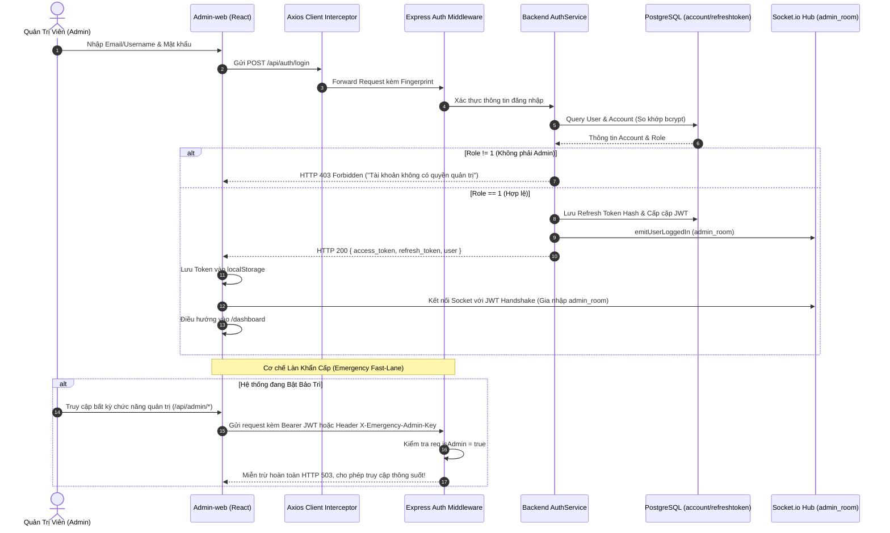

# 🔐 Chức Năng 01: Xác Thực, Phân Quyền Quản Trị & Làn Khẩn Cấp (Authentication, Authorization & Emergency Fast-Lane)

> **Mã chức năng:** `ADMIN-FEAT-01`  
> **Phiên bản tài liệu:** `v2.6` (Cập nhật ngày 23/10/2026)  
> **Module phụ trách:**  
> - Frontend: `src/Admin-web/src/pages/auth/LoginPage.jsx`, `ForgotPasswordPage.jsx`, `src/Admin-web/src/components/common/SecurityConfirmModal.jsx`, `FirstLoginModal.jsx`, `src/Admin-web/src/store/auth.context.jsx`, `src/Admin-web/src/api/axios-client.js`  
> - Backend: `src/Backend/modules/auth/auth.service.js`, `auth.controller.js`, `src/Backend/middleware/auth.js`, `src/Backend/middleware/maintenance.middleware.js`  

---

## 📌 1. TỔNG QUAN & MỤC ĐÍCH NGHIỆP VỤ

Chức năng **Xác Thực & Phân Quyền Quản Trị** là cổng kiểm soát an ninh tối cao bảo vệ toàn bộ dữ liệu tài chính của nền tảng. Hệ thống đảm bảo rằng **chỉ những tài khoản có vai trò Quản trị viên (`idrole === 1`)** mới được phép truy cập vào Admin-web, nhận luồng thông tin giám sát và thực thi các mệnh lệnh quản trị hệ thống. 

Đồng thời, chức năng thiết lập cơ chế **Làn Khẩn Cấp (Emergency Fast-Lane)** cho phép quản trị viên luôn truy cập được hệ thống điều hành ngay cả khi toàn bộ máy chủ đang trong tình trạng bảo trì khẩn cấp hoặc chịu tải nặng.

---

## ⚙️ 2. CƠ CHẾ HOẠT ĐỘNG CHI TIẾT (END-TO-END FLOW)

### 2.1. Chu kỳ quay vòng Token kép (Dual Token Rotation)
1. **Access Token (JWT):** Có thời gian sống ngắn (15 phút), chứa các claims: `{ idaccount, idrole, username, jti }`. Dùng để xác thực trên từng request qua header `Authorization: Bearer <token>`.
2. **Refresh Token (Opaque Hash):** Có thời gian sống 30 ngày. Được băm SHA-256 (`token_hash`) trước khi lưu vào bảng `refreshtoken` trong PostgreSQL, không lưu bản rõ (Plaintext) để tuân thủ `Data_Security.md`.
3. **Cơ chế Silent Refresh:** `axios-client.js` bắt mã lỗi `401 Unauthorized`. Khi Access Token hết hạn, client tự động đưa request vào hàng đợi và gọi `POST /api/auth/refresh` bằng Refresh Token để lấy cặp token mới mà không làm gián đoạn trải nghiệm của Admin.

### 2.2. Cơ chế Làn Ưu Tiên Quản Trị (Admin Priority Fast-Lane)
Khi chế độ bảo trì toàn cục được kích hoạt (cắt đứt kết nối người dùng thông thường bằng HTTP 503), middleware `adminPriorityMiddleware` tại `src/Backend/middleware/maintenance.middleware.js` tự động nhận diện Admin qua 2 cơ chế:
- **Cơ chế 1:** Request có tiền tố URL bắt đầu bằng `/api/admin` hoặc chứa JWT có `idrole === 1`.
- **Cơ chế 2 (Cứu hộ khẩn cấp):** Header `X-Emergency-Admin-Key` khớp với khóa bí mật cấu hình trong môi trường server (`ADMIN_EMERGENCY_KEY`), cho phép Admin truy cập ngay cả khi cơ chế xác thực JWT gặp sự cố.

---

## 📐 3. CÁC CHỈ SỐ, THÔNG SỐ & CÔNG THỨC TÍNH TOÁN

| Thông số / Thuộc tính | Giá trị cấu hình | Ý nghĩa & Cơ chế bảo vệ |
|---|---|---|
| **Access Token TTL** | `15m` (900 giây) | Giảm thiểu cửa sổ nguy hiểm nếu token bị rò rỉ trên client. |
| **Refresh Token TTL** | `30d` (2,592,000 giây) | Duy trì phiên làm việc cho quản trị viên, tự động thu hồi khi đổi mật khẩu hoặc đăng xuất. |
| **Băm mật khẩu** | `bcrypt` (10 rounds) | Chống tấn công Rainbow Table và Brute-force offline. |
| **Băm Refresh Token** | `SHA-256` | Token hash lưu tại database: `token_hash = SHA256(raw_token)`. |
| **Ngưỡng khóa đăng nhập Brute-force** | $\ge 5$ lần thất bại / 10s | Kích hoạt tường lửa AIOps phong tỏa IP nguồn 15 phút. |

---

## ⛔ 4. CÁC GIỚI HẠN KỸ THUẬT & RÀNG BUỘC VẬN HÀNH

1. **Khóa chức năng Quên mật khẩu tự phục vụ (Self-service Reset):**
   - Tài khoản Admin **tuyệt đối không được phép tự đặt lại mật khẩu** qua Email/SMS tại trang `/forgot-password`.
   - Lý do: Ngăn chặn triệt để nguy cơ chiếm đoạt hộp thư quản trị viên hoặc tấn công giả mạo (Phishing). Giao diện hiển thị số điện thoại Hotline kỹ thuật xác thực danh tính trực tiếp.
2. **Cô lập bộ nhớ đệm xác thực (Auth Invalidation Cache):**
   - Khi tài khoản bị vô hiệu hóa hoặc đổi quyền, hàm `invalidateAccountCache(idaccount)` được kích hoạt ngay lập tức, xóa phiên trên Redis và In-Memory để vô hiệu hóa mọi request tiếp theo chỉ sau $< 1\text{ms}$.
3. **Phân quyền tuyệt đối (RBAC):**
   - Chỉ `idrole === 1` mới được phép vượt qua middleware `authorize('admin')`. Mọi tài khoản `idrole === 2` (Người dùng di động) cố tình đăng nhập vào Admin-web đều bị từ chối với mã HTTP 403.

---

## 💼 5. CÔNG DỤNG & GIÁ TRỊ NGHIỆP VỤ

- **Bảo vệ tài nguyên trung tâm:** Ngăn chặn kẻ xâm nhập can thiệp vào cấu trúc tài chính, số dư và nhật ký hệ thống.
- **Không bao giờ bị "tự nhốt ngoài cửa" (Lockout Prevention):** Nhờ cơ chế Làn ưu tiên và Khóa cứu hộ `X-Emergency-Admin-Key`, đội ngũ kỹ thuật luôn có quyền truy cập để gỡ lỗi khi hệ thống gặp thảm họa hoặc bảo trì khẩn cấp.
- **Truy vết trách nhiệm pháp lý:** Mọi hành động của Admin đều gắn liền với định danh `idaccount` duy nhất trong JWT, ghi nhận Append-only vào `audit_log`.

---

## 🧩 6. TÍNH NĂNG ĐI KÈM & GIAO DIỆN LIÊN QUAN

1. **Giao diện Đăng nhập Hiện đại (`LoginPage.jsx`):**
   - Layout chia đôi màn hình (Split-screen) với visual nhận diện thương hiệu `FinanceAdmin`.
   - Toggle hiển thị/ẩn mật khẩu an toàn.
   - Bắt lỗi trực tiếp và hiển thị thông báo tiếng Việt trực quan.
2. **Modal Bắt Buộc Đổi Mật Khẩu & Mã PIN Khi Đăng Nhập Lần Đầu (`FirstLoginModal.jsx`):**
   - **Cơ sở dữ liệu (Migration 34):** Cột `is_first_login` (Boolean) và `created_by_admin_id` (Int) trong bảng `account`.
   - **Cơ chế cưỡng chế an toàn:** Khi tài khoản Admin mới được cấp (`is_first_login = true`), ngay sau khi đăng nhập thành công, hệ thống chặn toàn bộ điều hướng và hiển thị Modal bắt buộc đổi mật khẩu và thiết lập mã PIN bảo mật 6 số.
   - **Chống gian lận & Bỏ qua:** Modal không có nút đóng (X), không thể click ra ngoài backdrop, và nếu F5 tải lại trang thì trạng thái `is_first_login` vẫn khóa giao diện cho đến khi Admin đổi mật khẩu và mã PIN thành công.
   - **Xác thực dữ liệu:** Mật khẩu mới tối thiểu 6 ký tự; mã PIN phải đúng 6 chữ số (chỉ gồm số 0-9). Khi đổi thành công, hệ thống cập nhật `is_first_login = false`, băm an toàn vào CSDL và mở khóa truy cập toàn diện.
3. **Tab Quản Trị Admin Trong Cài Đặt Hệ Thống (`SettingsModal.jsx`):**
   - Tích hợp trực tiếp vào hộp thoại Cài đặt (Settings Center), cung cấp 3 tác vụ an ninh cốt lõi:
     + **Đổi mã PIN bảo mật:** Yêu cầu xác thực đồng thời mật khẩu đăng nhập hiện tại và mã PIN cũ trước khi cập nhật mã PIN 6 số mới.
     + **Đổi mật khẩu tài khoản:** Yêu cầu xác thực mật khẩu cũ và mã PIN cũ, ngăn chặn việc bị đổi mật khẩu khi rời máy tính.
     + **Cấp tài khoản Admin mới:** Quản trị viên cấp cao có thể tạo tài khoản Admin cho đồng nghiệp bằng cách nhập Username/Email và xác thực bằng **Mã PIN bảo mật của chính người cấp**. Tài khoản mới được khởi tạo mật khẩu/PIN mặc định (`123456`), gán `is_first_login = true` để bắt buộc người nhận phải đổi thông tin ngay lần đầu đăng nhập.
4. **Cơ Chế Khóa Màn Hình An Toàn & Bảo Toàn Phiên (`LockScreenModal.jsx` & `axios-client.js`):**
   - Tự động kích hoạt màn hình khóa khi Admin không tương tác quá thời gian quy định (5 / 15 / 30 phút).
   - **Bảo toàn phiên làm việc:** Axios interceptor được cấu hình cơ chế bỏ qua redirect 401 khi cờ `isLocked === true`. Khi Admin mở khóa màn hình bằng mật khẩu, phiên làm việc (Tokens) được khôi phục nguyên vẹn 100% mà không bị đá về trang Login.
   - **Tinh chỉnh giao diện chuẩn Enterprise (PO Directives):**
     + **Biểu tượng trung tâm:** Loại bỏ hoàn toàn avatar cá nhân "A", thay thế bằng biểu tượng Ổ khóa An ninh trung tâm (`lock`) viền vàng hổ phách trang trọng.
     + **Dữ liệu thật từ CSDL:** Hiển thị chính xác `username` và `email` lấy từ CSDL PostgreSQL (truy vấn tươi mới từ endpoint `/api/auth/me`), tuyệt đối không dùng giá trị gán cứng giả lập.
     + **Tối ưu ô nhập liệu:** Loại bỏ icon `key` rườm rà trong ô nhập mật khẩu, tối ưu padding thanh thoát.
     + **Tối giản thông tin:** Loại bỏ dòng subtitle phụ không cần thiết.
     + **Bố cục nút điều khiển:** Đưa nút "Đăng xuất" lên cùng một hàng ngang với nút "Mở Khóa Màn Hình" (Flexbox 2 nút cân đối), loại bỏ thẻ footer cũ.
5. **Giao diện Chính sách Quên Mật Khẩu (`ForgotPasswordPage.jsx`):**
   - Banner cảnh báo bảo mật màu vàng Amber.
   - Thẻ hiển thị số điện thoại Hotline hỗ trợ kỹ thuật (+84 355 281 276).
6. **Đăng xuất Cưỡng chế & Tự nguyện:**
   - Xóa token khỏi `localStorage`, xóa phiên Socket.io và điều hướng về trang Login ngay lập tức.
7. **Modal Xác Thực Mã PIN Bảo Mật Cấp 2 Trước Thao Tác Chí Mạng (`SecurityConfirmModal.jsx`):**
   - **Nguyên tắc an ninh tối cao:** Mọi hành động có tác động hệ thống lớn hoặc thay đổi trạng thái nhạy cảm (Khóa/Mở khóa tài khoản người dùng, Xóa mềm người dùng, Khôi phục danh mục đã xóa, Lưu thay đổi phân quyền gói cước Staged Changes, Kích hoạt bảo trì khẩn cấp) **bắt buộc phải qua xác thực mã PIN quản trị viên 6 chữ số**.
   - **Quy trình hoạt động:** Frontend hiển thị popup `SecurityConfirmModal`, Admin nhập mã PIN, gọi API `POST /api/admin/verify-security-action` kèm mã PIN đã băm SHA-256 (`pin_hash`). Nếu khớp, hệ thống cấp vé thông hành thực thi hành động; nếu sai, từ chối thực thi và cảnh báo ngay lập tức.
8. **Quy Trình Cấp Tài Khoản Quản Trị Viên Mới (`SettingsModal.jsx`):**
   - **Giao diện Modal chuẩn hóa Grid 2 cột (`max-w-lg` 512px):**
     + `FullName`: Họ và tên quản trị viên (Bắt buộc, tối thiểu 2 ký tự).
     + `Username`: Tên đăng nhập Admin mới (Bắt buộc, tối thiểu 3 ký tự).
     + `Email`: Email quản trị viên (Bắt buộc, đúng định dạng RFC).
     + `Country code`: Mã vùng / Quốc gia (Tối đa 4 ký tự, mặc định `+84`).
     + `Phone`: Số điện thoại liên hệ (Bắt buộc, 8-15 chữ số).
     + `Address`: Địa chỉ liên hệ (Tùy chọn).
   - **Bảo mật & Mã hóa CSDL:** Dữ liệu `Phone` và `Address` được mã hóa AES-256-GCM trước khi ghi vào CSDL PostgreSQL nhằm tuân thủ trigger CSDL `trg_check_phone_encrypted` và Nghị định 13/2023/NĐ-CP.
   - **Quy trình phê duyệt 2 bước:** Bước 1 Nhập thông tin quản trị viên -> Bước 2 Xác thực mã PIN bảo mật 6 số của Admin người cấp -> Khởi tạo tài khoản với Mật khẩu & PIN khởi tạo mặc định `123456`, cắm cờ `is_first_login = true` và lưu `created_by_admin_id`.

---

## 📱 7. ẢNH HƯỞNG ĐẾN HỆ THỐNG & MOBILE APP (CLIENT-APP)

- **Đến Backend:**
  - Giảm tải DB nhờ cơ chế xác thực JWT phi trạng thái (Stateless), chỉ truy vấn DB khi refresh token hoặc lấy thông tin tài khoản tươi mới `/api/auth/me`.
  - Quản lý mã PIN bảo mật Admin với băm `bcrypt` an toàn (`pin_hash`), bảo vệ các tác vụ chí mạng (Hoàn tiền, Xóa người dùng, Khởi tạo bảo trì).
- **Đến Cơ sở dữ liệu:**
  - Bảng `account` mở rộng trường `is_first_login`, `created_by_admin_id`, `pin_hash`.
  - Bảng `refreshtoken` được làm sạch tự động định kỳ, thu hồi các token hết hạn (`Status = true`).
- **Đến Mobile App (Client-app):**
  - Cơ chế phân quyền cách ly hoàn toàn người dùng di động khỏi các route quản trị (`/api/admin/*`). Nếu người dùng Client-app thử gọi API Admin, server trả về ngay HTTP 403 mà không tốn tài nguyên xử lý logic.
  - Khi Admin thực hiện khóa hoặc vô hiệu hóa tài khoản của người dùng từ Admin-web (`PATCH /api/admin/updatestatus/:id`), Backend phát lệnh Socket (`account.disabled` / `account.status_changed`) và thu hồi Refresh Token, cưỡng chế đăng xuất Mobile App tức thời. (Lưu ý: Tuân thủ nguyên tắc bảo mật Zero-Knowledge, Admin tuyệt đối không có quyền can thiệp hay đổi mật khẩu người dùng).

---

## 📡 8. DANH MỤC API & SOCKET.IO PHỤ TRÁCH

### REST API Endpoints
| Phương thức | Endpoint | Chức năng | Phân quyền |
|---|---|---|---|
| `POST` | `/api/auth/login` | Đăng nhập hệ thống & Cấp cặp JWT | Công khai (Rate-limited) |
| `POST` | `/api/auth/refresh` | Đổi Refresh Token lấy Access Token mới | Có Refresh Token hợp lệ |
| `GET` | `/api/auth/me` | Lấy thông tin tài khoản tươi mới từ CSDL PostgreSQL | Authenticated |
| `POST` | `/api/auth/logout` | Đăng xuất & Thu hồi Refresh Token | Authenticated |
| `GET` | `/api/auth/profile` | Lấy thông tin chi tiết tài khoản Admin | Admin (`idrole === 1`) |
| `POST` | `/api/admin/change-first-login` | Đổi mật khẩu & PIN bắt buộc lần đầu | Admin mới (`is_first_login = true`) |
| `POST` | `/api/admin/change-pin` | Đổi mã PIN bảo mật Admin 6 số | Admin (`idrole === 1`) |
| `POST` | `/api/admin/change-password` | Đổi mật khẩu tài khoản Admin | Admin (`idrole === 1`) |
| `POST` | `/api/admin/create-admin` | Cấp tài khoản Admin mới kèm xác thực PIN | Admin (`idrole === 1`) |
| `POST` | `/api/admin/verify-security-action` | Xác thực mã PIN trước hành động chí mạng | Admin (`idrole === 1`) |

### Socket.io Events
- **Lắng nghe (`Client -> Server`):** Handshake gửi kèm `token` qua query/auth header.
- **Phát tán (`Server -> admin_room`):**
  - `admin.user_logged_in`: Phát tới toàn bộ Admin khi có lượt đăng nhập mới thành công.
  - `account.force_logout`: Cưỡng chế đăng xuất người dùng khi bị khóa tài khoản.
