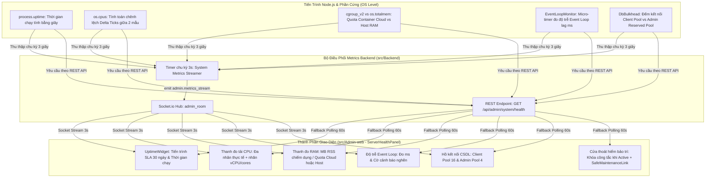

# 🖥️ Chức Năng 03: Giám Sát Sức Khỏe Máy Chủ & Đo Lường Uptime SLA 30 Ngày (Server Health & SLA Monitoring)

> **Mã chức năng:** `ADMIN-FEAT-03`  
> **Phiên bản tài liệu:** `v2.6` (Cập nhật ngày 23/10/2026)  
> **Module phụ trách:**  
> - Frontend: `src/Admin-web/src/components/common/ServerHealthPanel.jsx`, `DashboardPage.jsx`  
> - Backend: `src/Backend/modules/admin/admin.service.js`, `src/Backend/core/resilience/event-loop-monitor.js`, `src/Backend/core/resilience/db-bulkhead.js`, `src/Backend/index.js`  

---

## 📌 1. TỔNG QUAN & MỤC ĐÍCH NGHIỆP VỤ

**Giám Sát Sức Khỏe Máy Chủ & Đo Lường Uptime SLA** là bảng chỉ số hạ tầng thời gian thực cung cấp cho quản trị viên cái nhìn trực diện về trạng thái vận hành của máy chủ Node.js và CSDL PostgreSQL. 

Điểm nổi bật của chức năng này:
1. **Công thức tính tỷ lệ hoạt động liên tục (Uptime Percentage) theo tiêu chuẩn cam kết dịch vụ SLA 30 ngày**, loại bỏ các con số ảo 100% khi server vừa mới được deploy hoặc restart, phản ánh độ tin cậy thực tế của nền tảng dịch vụ.
2. **Giám sát phần cứng chính xác theo môi trường (Hardware Metric Calibration):** Tự động phân biệt giữa môi trường Cloud Container (cgroup_v2 quota) và Host vật lý, tính toán CPU delta ticks thay vì cumulative ticks, tránh hiện tượng RAM 0/100 MB ảo.
3. **Cửa thoát hiểm khẩn cấp (Emergency Maintenance Outpost):** Tích hợp công tắc bật bảo trì khẩn cấp độc lập với cơ chế khóa công tắc an toàn tại Dashboard khi bảo trì đang hoạt động, hướng dẫn quản trị viên chuyển hướng sang trang Quản trị Bảo trì.

---

## ⚙️ 2. CƠ CHẾ HOẠT ĐỘNG CHI TIẾT (END-TO-END FLOW)

### 2.1. Luồng truyền tải kép (Dual-Path Delivery)
1. **Luồng Real-time Stream chính (Primary):** `System Metrics Streamer` chạy ngầm định kỳ **3 giây/lần** trong `index.js`, phát sự kiện `admin.metrics_stream` trực tiếp vào room `admin_room`. Bảng điều khiển cập nhật kim đo và phần trăm ngay lập tức mà không cần gửi request HTTP.
2. **Luồng REST Fallback dự phòng (Secondary):** Định kỳ **60 giây/lần** (hoặc khi mất kết nối mạng Socket), component tự động gọi API `GET /api/admin/system/health` để bảo toàn tính toàn vẹn dữ liệu.

---

## 📐 3. CÁC CHỈ SỐ, CÔNG THỨC & CÁCH TÍNH TOÁN

### 3.1. Công thức tính Uptime SLA 30 Ngày Chuẩn Hóa
Nhiều hệ thống thường hiển thị "100% Uptime" ngay cả khi server vừa restart được 2 phút. Trong ManagementFinance, công thức phản ánh chính xác chu kỳ cam kết chất lượng dịch vụ (SLA Window 30 ngày):

$$\text{SLA Window (seconds)} = 30 \times 24 \times 3600 = 2,592,000 \text{ giây}$$

$$\text{Uptime Percentage (\%)} = \left(\frac{\text{uptimeSeconds}}{\max(\text{uptimeSeconds}, 2,592,000)} \times 100\right)$$

- **Ý nghĩa vận hành:**
  - Nếu server vừa restart chạy được 1 giờ (3,600s) $\implies \text{Uptime} \approx 0.139\%$.
  - Nếu server duy trì hoạt động ổn định liên tục đủ 30 ngày $\implies \text{Uptime} = 100.000\%$.
  - Khuyến khích đội ngũ kỹ thuật duy trì server bền vững, không restart bừa bãi.

### 3.2. Định Dạng Chuỗi Thời Gian Hoạt Động (`formatUptimeDuration`)
Chuyển đổi số giây thực tế `process.uptime()` thành định dạng tiếng Việt tự nhiên:
- Số ngày: $\lfloor \text{seconds} / 86400 \rfloor$
- Số giờ: $\lfloor (\text{seconds} \pmod{86400}) / 3600 \rfloor$
- Số phút: $\lfloor (\text{seconds} \pmod{3600}) / 60 \rfloor$
- *Kết quả hiển thị:* `5 ngày 12 giờ 34 phút`.
- *Thời điểm khởi động (`startedAt`):* Tự động format theo múi giờ Việt Nam `Asia/Ho_Chi_Minh` (`HH:mm dd/MM/yyyy`).

### 3.3. Tải CPU Delta Ticks Đa Nhân
Thay vì đọc `os.cpus()` tĩnh (vốn là tích lũy từ thời điểm bật máy chủ OS), hệ thống lưu lại snapshot trước và tính chênh lệch Delta sau 1 giây:

$$\Delta \text{Idle} = \text{idle}_{\text{now}} - \text{idle}_{\text{prev}}$$
$$\Delta \text{Total} = \text{total}_{\text{now}} - \text{total}_{\text{prev}}$$
$$\text{CPU \%} = \left(1 - \frac{\Delta \text{Idle}}{\Delta \text{Total}}\right) \times 100$$

- Tự động nhận diện số nhân vCPU trên Cloud hoặc Core vật lý trên Host.

### 3.4. Bộ Nhớ RAM & Nhận Diện Môi Trường (Cloud vs Host)
Hệ thống tự động phát hiện `cgroup_v2` memory quota trên các dịch vụ Cloud Container (Docker, Render, AWS ECS, GCP Cloud Run):
- **Cloud Container:** `totalMb = memory.max / (1024 * 1024)` (Quota giới hạn container).
- **Host Server:** `totalMb = os.totalmem() / (1024 * 1024)` (RAM vật lý máy chủ).
- **RAM sử dụng (RSS - Resident Set Size):** Đo lường lượng RAM vật lý thực tế mà tiến trình Node.js đang chiếm giữ: `Math.round(process.memoryUsage().rss / 1024 / 1024)` (MB).
- Tránh hoàn toàn lỗi phổ biến hiển thị `0/100 MB` hoặc tính sai tỷ lệ phần trăm trên container.

### 3.5. Độ Trễ Event Loop & DB Connection Pool
- **Event Loop Lag:** Micro-timer kiểm tra độ trễ thực tế giữa chu kỳ `setTimeout`:
  - `lagMs < 20ms`: Event Loop mượt mà.
  - `lagMs >= 50ms`: Cảnh báo nghẽn I/O.
  - `lagMs >= 100ms`: Quá tải nghiêm trọng (`critical = true`).
- **Database Bulkhead Isolation:**
  - `Client Pool`: Tối đa 16 kết nối dành cho người dùng thông thường.
  - `Admin Pool`: Dành riêng 4 kết nối độc lập cho quản trị viên, đảm bảo Admin luôn truy cập được bảng điều khiển ngay cả khi Client Pool chạm ngưỡng $100\%$.

---

## ⛔ 4. CÁC GIỚI HẠN KỸ THUẬT & NGƯỠNG CẢNH BÁO

| Chỉ số | Ngưỡng Bình thường | Ngưỡng Cảnh báo (Warning) | Ngưỡng Nguy cấp (Critical) |
|---|:---:|:---:|:---:|
| **Uptime SLA** | $\ge 99.5\%$ (Xanh ngọc) | $95.0\% - 99.4\%$ (Vàng hổ phách) | $< 95.0\%$ (Đỏ hồng) |
| **CPU Sử Dụng** | $< 70\%$ | $70\% - 84\%$ | $\ge 85\%$ |
| **RAM Sử Dụng** | $< 70\%$ | $70\% - 84\%$ | $\ge 85\%$ |
| **Event Loop Lag** | $< 25\text{ms}$ | $25\text{ms} - 49\text{ms}$ | $\ge 50\text{ms}$ (Bật cờ quá tải) |
| **Client DB Pool** | $< 12/16$ | $12/16 - 15/16$ | $16/16$ (Kích hoạt Bulkhead) |

---

## 🛡️ 5. CỬA THOÁT HIỂM BẢO TRÌ & CƠ CHẾ KHÓA CÔNG TẮC AN TOÀN

### 5.1. Bật Bảo Trì Khẩn Cấp Tại Chỗ (Emergency Switch)
Ngay tại `ServerHealthPanel`, quản trị viên có thể kích hoạt chế độ bảo trì khẩn cấp lập tức:
- **Yêu cầu nhập lý do:** Bắt buộc nhập lý do vào ô text input trước khi gạt công tắc.
- **Xác thực mã PIN cấp 2:** Khi bật công tắc, hệ thống kích hoạt `SecurityConfirmModal` yêu cầu nhập đúng mã PIN quản trị viên (6 chữ số).

### 5.2. Khóa Công Tắc Khi Đang Trong Trạng Thái Bảo Trì (Toggle Lock Protection)
- **Vấn đề an toàn:** Tránh trường hợp quản trị viên vô tình click vào công tắc tại Dashboard làm tắt bảo trì sai quy trình khi hệ thống chưa khắc phục xong sự cố.
- **Giải pháp triển khai:**
  - Khi `maintenance.active = true`, công tắc `#btn-maintenance-toggle` chuyển sang trạng thái **disabled (`disabled={true}`)**, con trỏ chuột chuyển thành `cursor-not-allowed`, độ mờ `opacity-70`.
  - Tooltip giải thích: *"Chế độ bảo trì đang kích hoạt. Khóa công tắc tại Dashboard. Vui lòng vào trang Quản trị & Lên lịch bảo trì."*
  - Cung cấp component điều hướng an toàn `SafeMaintenanceLink` (tương thích cả trong và ngoài Router context) để quản trị viên nhấp vào và chuyển trực tiếp tới trang Quản trị Bảo Trì `/broadcast`.

### 5.3. Phân Biệt Trực Quan: Khẩn Cấp vs Thông Thường
Khối bảo trì tự động đổi diện mạo dựa trên cờ `isEmergency`:
- **Bảo trì Khẩn Cấp (`isEmergency = true`):**
  - Viền và nền: `border-rose-300 bg-rose-50/90`.
  - Icon: `crisis_alert` màu đỏ nhấp nháy (`animate-pulse`).
  - Badge: Thẻ đỏ `Khẩn cấp`.
- **Bảo trì Thông Thường (`isEmergency = false`):**
  - Viền và nền: `border-amber-300 bg-amber-50/90`.
  - Icon: `construction` màu hổ phách.
  - Badge: Thẻ vàng `Thông thường`.

---

## 📱 6. ẢNH HƯỞNG ĐẾN HỆ THỐNG & MOBILE APP (CLIENT-APP)

- **Đến Backend:**
  - Nhịp tim Stream 3s chạy bằng timer non-blocking (`unref()`), payload siêu nhẹ $< 450$ bytes, tiêu tốn $< 0.1\%$ CPU máy chủ.
- **Đến Cơ sở dữ liệu:**
  - Giám sát CSDL thông qua biến In-Memory của `DbBulkhead`, hoàn toàn không phát sinh câu lệnh SQL `SELECT` thăm dò, không làm tốn Connection Pool của người dùng.
- **Đến Mobile App (Client-app):**
  - Bảo vệ tức thì các giao dịch tài chính: Khi máy chủ rơi vào tình trạng quá tải hoặc Admin kích hoạt bảo trì khẩn cấp từ Panel này, Mobile App lập tức nhận tín hiệu và hiển thị màn hình bảo trì toàn màn hình, ngăn người dùng thao tác gây đứt gãy dữ liệu.

---

## 📡 7. DANH MỤC API & SOCKET.IO PHỤ TRÁCH

### REST API Endpoints
| Phương thức | Endpoint | Chức năng | Phân quyền |
|---|---|---|---|
| `GET` | `/api/admin/system/health` | Lấy chi tiết thông số phần cứng, uptime SLA, và DB pool | Admin |
| `GET` | `/api/admin/maintenance/status` | Lấy trạng thái bảo trì độc lập hiện tại | Public / Admin |
| `POST` | `/api/admin/maintenance/toggle` | Bật/tắt bảo trì khẩn cấp (yêu cầu mã PIN) | Super Admin / Admin |

### Socket.io Events
- **Nhận từ Server (`admin_room`):**
  - Sự kiện `admin.metrics_stream`: Nhận gói tin nhịp tim mỗi 3 giây chứa đầy đủ Uptime, CPU, RAM, Event Loop Lag, Load Shedding và DB Pool.
  - Sự kiện `admin.maintenance_changed`: Cập nhật trạng thái bảo trì tức thì khi có thay đổi từ bất kỳ phiên làm việc nào.
