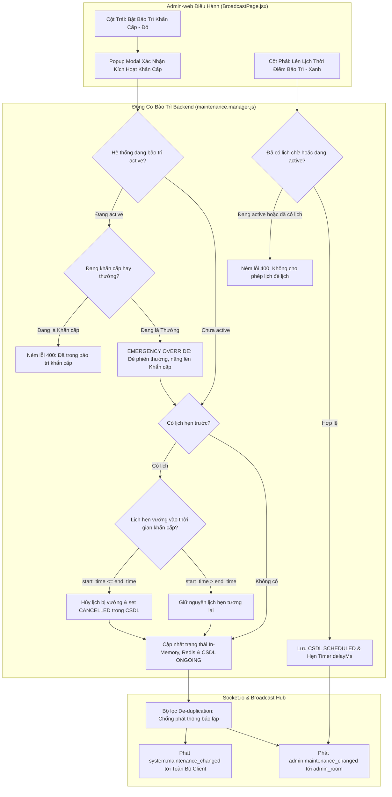

# ⚙️ Chức Năng 07: Quản Trị Chế Độ Bảo Trì & Cứu Hộ Khẩn Cấp (Maintenance & Resilience Management)

> **Mã chức năng:** `ADMIN-FEAT-07`  
> **Module phụ trách:**  
> - Frontend: `src/Admin-web/src/pages/system/BroadcastPage.jsx` (Tab 1), `src/Admin-web/src/components/common/ServerHealthPanel.jsx`  
> - Backend: `src/Backend/core/resilience/maintenance.manager.js`, `src/Backend/middleware/maintenance.middleware.js`, `src/Backend/api/admin.routes.js`  

---

## 📌 1. TỔNG QUAN & MỤC ĐÍCH NGHIỆP VỤ

Chức năng **Quản Trị Chế Độ Bảo Trì & Cứu Hộ Khẩn Cấp** là công tắc ngắt mạch trung tâm (Circuit Breaker) của toàn bộ nền tảng. Khi hệ thống cần nâng cấp phiên bản, thực hiện migrate cơ sở dữ liệu lớn hoặc đối mặt với sự cố an ninh nghiêm trọng, chức năng này cho phép quản trị viên cách ly an toàn máy chủ khỏi lưu lượng người dùng di động.

Đặc biệt, hệ thống triển khai **Quy Tắc Quản Trị Bảo Trì Chuẩn Hóa (Nghiệp vụ Mục 43)**:
1. **Đặc quyền Cứu hộ Khẩn cấp (Emergency Override):** Duy nhất **Bảo trì khẩn cấp** có quyền kích hoạt đè khi hệ thống đang trong phiên bảo trì thông thường nhằm xử lý ngay lập tức các tình huống rủi ro bảo mật hoặc thảm họa máy chủ. Ngược lại, nếu hệ thống đã đang ở chế độ khẩn cấp thì không cho phép kích hoạt khẩn cấp đè lần 2.
2. **CẤM TUYỆT ĐỐI bảo trì theo lịch đè nhau (No Overlapping Schedules):** Nếu hệ thống đang trong phiên bảo trì hoặc đã có một lịch bảo trì tương lai đang chờ kích hoạt (`SCHEDULED`), hệ thống từ chối mọi yêu cầu lên lịch mới để loại trừ xung đột thời gian. Quản trị viên phải hủy lịch cũ trước khi đặt lịch mới.
3. **Bảo toàn lịch hẹn tương lai:** Khi kích hoạt bảo trì khẩn cấp, hệ thống **không hủy toàn bộ lịch tương lai**. Chỉ những lịch bị giao thoa (`scheduled.start_time <= emergency.end_time`) mới bị hủy tự động (`CANCELLED`). Các lịch xa hơn trong tương lai được bảo toàn nguyên vẹn.
4. **Khử trùng lặp thông báo (Broadcast De-duplication):** Tích hợp bộ lọc khử trùng lặp thông minh trong `NotificationService` và Socket.IO, ngăn chặn hoàn toàn hiện tượng gửi lặp lại thông báo bảo trì gây spam người dùng.
5. **Lưu trữ CSDL & Vòng đời 4 trạng thái:** Mọi lịch bảo trì đều được lưu trực tiếp vào CSDL PostgreSQL (`maintenance_history`) ngay khi tạo lịch với trạng thái `SCHEDULED`, sau đó chuyển tiếp qua `ONGOING`, `COMPLETED` hoặc `CANCELLED`.
6. **Giao diện phân định 2 Cột Độc Lập:** Cột Trái dành riêng cho **Kích Hoạt Bảo Trì Khẩn Cấp** (Nút đỏ trực tiếp kèm popup modal xác nhận); Cột Phải dành riêng cho **Lên Lịch Thời Điểm Bảo Trì** (Form datetime-local chuẩn xác).

---

## ⚙️ 2. CƠ CHẾ HOẠT ĐỘNG CHI TIẾT (END-TO-END FLOW)

### 2.1. Hai Loại Bảo Trì & Vòng Đời Trạng Thái CSDL
1. **Bảo trì Khẩn Cấp (Emergency Maintenance):**
   - Kích hoạt tại Cột Trái qua nút **"Bật Bảo Trì Khẩn Cấp"** màu ĐỎ (`bg-red-600`), yêu cầu xác nhận qua Popup Modal trước khi gửi lệnh.
   - Có đặc quyền ghi đè (Emergency Override) nếu hệ thống đang trong phiên bảo trì thông thường.
   - Chỉ hủy những lịch bảo trì tương lai bị giao thoa (vướng) vào khoảng thời gian khẩn cấp; giữ nguyên các lịch bảo trì sau khoảng thời gian đó.
2. **Bảo trì Theo Lịch (Scheduled Maintenance):**
   - Lên lịch tại Cột Phải; tự động từ chối nếu hệ thống đang có lịch hẹn hoặc đang trong bảo trì (Cấm lịch đè lịch).
   - Được lưu vào bảng `maintenance_history` của CSDL PostgreSQL ngay khi tạo với trạng thái ban đầu là `SCHEDULED`.
   - Vòng đời trạng thái:
     - `SCHEDULED`: Đã lên lịch, lưu CSDL, đang đếm ngược timer.
     - `ONGOING`: Đến giờ hẹn, tự động kích hoạt bảo trì, cắt tải Client và gửi cảnh báo.
     - `COMPLETED`: Kết thúc bảo trì đúng dự kiến hoặc được tắt thủ công.
     - `CANCELLED`: Bị hủy chủ động bởi Admin hoặc bị hủy do vướng vào phiên khẩn cấp.
3. **Phân trang Bảng Lịch Sử Bảo Trì:**
   - Mặc định phân trang 5 bản ghi/trang mỗi khi tải trang (hỗ trợ tùy chọn linh hoạt [5, 10, 20, 50]).

---

## 📐 3. CÁC THÔNG SỐ KỸ THUẬT & HEADERS

| Thuộc tính / Header | Giá trị | Mục đích & Ý nghĩa |
|---|---|---|
| **HTTP Status Code** | `503 Service Unavailable` | Báo cho Client và Web Crawler biết server tạm thời bảo trì, không bị đánh tụt SEO. |
| **Header `Retry-After`** | `3600` (giây) | Hướng dẫn client thời gian quay lại thử lại. |
| **Error Code Payload** | `MAINTENANCE_MODE` | Mã chuẩn hóa cho Client-app bắt exception. |
| **Redis Cache Key** | `system:maintenance:status` | Lưu trữ bền bỉ phân tán trên Redis (nếu có nhiều server node). |
| **Scheduled Timer** | `setTimeout().unref()` | Non-blocking timer, không gây treo tiến trình Node.js khi shutdown. |
| **Database Table** | `maintenance_history` | Bảng lưu trữ nhật ký vĩnh viễn trên PostgreSQL Supabase. |

---

## ⛔ 4. CÁC GIỚI HẠN & NGUYÊN TẮC AN TOÀN

1. **Chặn thời gian trong quá khứ:** Form lên lịch bảo trì tự động kiểm tra thời điểm hẹn. Nếu thời gian chọn nhỏ hơn thời điểm hiện tại (`targetDate <= Date.now()`), hệ thống từ chối với lỗi HTTP 400.
2. **Miễn trừ Route kiểm tra sức khỏe:** Route `/health`, `/health/admin` luôn mở 100% để bộ cân bằng tải (Load Balancer / Kubernetes / Render) không hiểu nhầm container đã chết mà restart liên tục.
3. **Đồng bộ đa tiến trình (Cross-Process Hydration):** Khi khởi động, Backend tự động gọi `hydrateFromRedis()` để nạp lại trạng thái bảo trì nếu trước đó server bị restart bất ngờ.
4. **Bảo toàn CSDL (DB Guard & In-Memory Fallback):** Nhật ký bảo trì lưu trữ tại PostgreSQL với cơ chế in-memory fallback thông minh, đảm bảo server không bao giờ bị nghẽn nếu CSDL có sự cố đường truyền tạm thời.

---

## 💼 5. CÔNG DỤNG & GIÁ TRỊ NGHIỆP VỤ

- **Bảo toàn dữ liệu tài chính:** Khi thực hiện migrate schema bảng giao dịch hoặc nâng cấp thuật toán mã hóa, việc ngắt kết nối Client giúp loại bỏ 100% nguy cơ tranh chấp dữ liệu (Race Condition).
- **Phản ứng thảm họa tức thì:** Cho phép cô lập hệ thống chỉ trong $< 1$ giây khi phát hiện các cuộc tấn công phá hoại CSDL.
- **Tiện lợi cho quản trị:** Có thể lên lịch bảo trì vào lúc 2h sáng và đi ngủ, hệ thống sẽ tự động bật bảo trì đúng giờ mà không cần thức canh.
- **Truy vết & Minh bạch quản trị:** Nhật ký lịch sử lưu trữ vĩnh viễn ai là người kích hoạt, thời điểm bắt đầu/kết thúc, thời lượng và lý do bảo trì.

---

## 🧩 6. TÍNH NĂNG ĐI KÈM TRÊN GIAO DIỆN (`BroadcastPage.jsx`)

1. **Banner Trạng Thái Động Toàn Cục:**
   - Đổi màu thời gian thực: Xanh lá (Bình thường), Cam (Bảo trì Kỹ thuật), Đỏ nhấp nháy Animation Pulse (Bảo trì Khẩn cấp).
   - Nút **"Tắt Bảo Trì Khẩn Cấp"** màu xanh ngọc xuất hiện nổi bật ngay trên banner và cột điều khiển khi bảo trì đang bật.
2. **Cột Trái — Kích Hoạt Bảo Trì Khẩn Cấp:**
   - Ô nhập lý do gửi tới người dùng.
   - Nút bấm **LUÔN ĐỎ** (`bg-red-600`) mang tên **"Bật Bảo Trì Khẩn Cấp"**, không còn checkbox thừa.
3. **Cột Phải — Lên Lịch Thời Điểm Bảo Trì:**
   - Input `datetime-local` chọn ngày giờ bắt đầu và kết thúc dự kiến chuẩn xác.
   - Chặn form lên lịch nếu hệ thống đang trong phiên bảo trì trực tiếp để tránh xung đột.
4. **Bảng Lịch Sử Các Phiên Bảo Trì Hệ Thống (PostgreSQL Persistence):**
   - **Lưu trữ CSDL vĩnh viễn:** Đọc trực tiếp từ bảng `maintenance_history` trên PostgreSQL Supabase.
   - **Các cột hiển thị:**
     - `#`: Mã phiên bảo trì.
     - `Loại bảo trì`: Badge đỏ (Khẩn cấp) hoặc Badge xanh (Theo lịch).
     - `Người kích hoạt`: Tên tài khoản quản trị viên kích hoạt phiên bảo trì (`activated_by`).
     - `Lý do / Thông điệp`: Nội dung giải thích nguyên nhân bảo trì.
     - `Thời điểm bắt đầu` & `Thời điểm kết thúc`: Chuyển đổi theo định dạng ngày giờ Việt Nam.
     - `Thời lượng`: Đo lường chi tiết phiên bảo trì (Ví dụ: `25 phút`, `1 giờ 15 phút`, hoặc `Đang diễn ra...`).
     - `Trạng thái`: Badge màu (Đang diễn ra, Đã hoàn thành, Đã hủy).
   - **Tính năng mở rộng:** Bộ lọc theo Loại (Tất cả / Khẩn cấp / Theo lịch), Bộ lọc Trạng thái (Tất cả / Đang diễn ra / Đã hoàn thành / Đã hủy), và Nút làm mới dữ liệu.
    - **Bộ Phân Trang Chuẩn (`Pagination.jsx`):** Bổ sung bộ phân trang hoàn chỉnh gồm hiển thị dải phần tử (`1 - 10 of {total}`), lựa chọn số dòng hiển thị (5, 10, 20, 50 phiên/trang), điều hướng Trước/Sau và chọn trang.
5. **Tối Giản Giao Diện:** Đã loại bỏ hoàn toàn các khối ghi chú màu đỏ (Nguyên tắc bảo trì) và khối quy tắc màu vàng (PO Policy) rườm rà để giao diện tinh gọn, tập trung vào điều hành.
6. **Cơ Chế Thông Báo & Ngăn Chặn Thao Tác Toàn Hệ Thống:**
   - **Khi Bắt Đầu Bảo Trì:** Backend tự động gửi Broadcast khẩn cấp (`⚠️ BẢO TRÌ HỆ THỐNG KHẨN CẤP`) và Socket.IO; Admin-web hiển thị Global Banner màu cam/đỏ trên toàn bộ trang.
   - **Khi Kết Thúc Bảo Trì:** Backend tự động phát sóng thông báo khôi phục (`✅ HỆ THỐNG ĐÃ KẾT THÚC BẢO TRÌ`) qua NotificationService và Socket.IO; Admin-web hiển thị Toast xanh thông báo hệ thống đã trở lại hoạt động bình thường.
   - **Ngăn Chặn Xung Đột Dữ Liệu:** Client-app bị chặn 100% request ghi/đọc (HTTP 503 `MAINTENANCE_MODE`); trên Admin-web, form và các nút thao tác lên lịch mới bị vô hiệu hóa hoàn toàn trong suốt phiên bảo trì.

---

## 📱 7. ẢNH HƯỞNG ĐẾN HỆ THỐNG & MOBILE APP (CLIENT-APP)

- **Đến Backend:**
  - Middleware kiểm tra cờ `active` bằng biến In-Memory tốc độ $O(1)$ ($< 0.05\text{ms}$), không tốn tài nguyên DB.
- **Đến Mobile App (Client-app):**
  - **Khi bật Khẩn cấp:** Ứng dụng nhận sự kiện Socket, hiển thị ngay Dialog đỏ không thể bỏ qua: *"Hệ thống đang bảo trì khẩn cấp để bảo vệ an toàn tài khoản"*. Toàn bộ tính năng đồng bộ bị tạm dừng, người dùng vẫn có thể xem lại các giao dịch đã lưu trong máy (Offline-first).
  - **Khi tắt bảo trì:** Ứng dụng tự động kết nối lại, mở khóa các tính năng và đồng bộ hóa các giao dịch đang chờ trong SQLite lên máy chủ.

---

## 📡 8. DANH MỤC API & SOCKET.IO PHỤ TRÁCH

### REST API Endpoints
| Phương thức | Endpoint | Chức năng | Phân quyền |
|---|---|---|---|
| `GET` | `/api/admin/system/maintenance` | Lấy chi tiết trạng thái bảo trì & lịch hẹn hiện tại | Admin |
| `POST` | `/api/admin/system/maintenance` | Bật hoặc Tắt bảo trì khẩn cấp tức thì | Admin |
| `POST` | `/api/admin/system/maintenance/schedule` | Lên lịch hẹn bảo trì tự động | Admin |
| `DELETE` | `/api/admin/system/maintenance/schedule` | Hủy bỏ lịch bảo trì đã hẹn | Admin |
| `GET` | `/api/admin/system/maintenance/history` | Lấy danh sách lịch sử các phiên bảo trì (có phân trang, bộ lọc) | Admin |

### Socket.io Events
- **Phát tán tới Toàn Hệ Thống (`broadcast`):**
  - `system.maintenance_changed`: Bắn tới toàn bộ người dùng di động khi trạng thái bảo trì bật/tắt.
- **Phát tán tới Phòng Quản Trị (`admin_room`):**
  - `admin.maintenance_changed`: Cập nhật trạng thái công tắc và card lịch hẹn trên mọi tab Admin-web đang mở.
