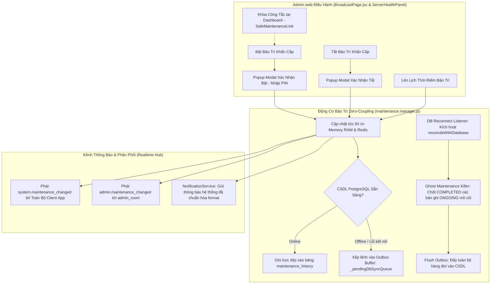

# ⚙️ Chức Năng 07: Quản Trị Chế Độ Bảo Trì & Cứu Hộ Khẩn Cấp (Maintenance & Resilience Management)

> **Mã chức năng:** `ADMIN-FEAT-07`  
> **Phiên bản tài liệu:** `v2.6` (Cập nhật ngày 23/10/2026)  
> **Module phụ trách:**  
> - Frontend: `src/Admin-web/src/pages/system/BroadcastPage.jsx` (Tab 1), `src/Admin-web/src/components/common/ServerHealthPanel.jsx`  
> - Backend: `src/Backend/core/resilience/maintenance.manager.js`, `src/Backend/middleware/maintenance.middleware.js`, `src/Backend/api/admin.routes.js`  

---

## 📌 1. TỔNG QUAN & MỤC ĐÍCH NGHIỆP VỤ

Chức năng **Quản Trị Chế Độ Bảo Trì & Cứu Hộ Khẩn Cấp** là công tắc ngắt mạch trung tâm (Circuit Breaker) của toàn bộ nền tảng. Khi hệ thống cần nâng cấp phiên bản, thực hiện migrate cơ sở dữ liệu lớn hoặc đối mặt với sự cố an ninh nghiêm trọng, chức năng này cho phép quản trị viên cách ly an toàn máy chủ khỏi lưu lượng người dùng di động.

Hệ thống được xây dựng trên nền tảng **Kiến trúc Zero-Coupling & Cứu hộ Bất biến**:
1. **Kiến trúc Độc Lập Hoàn Toàn Khỏi CSDL (Zero-Coupling Out-of-Band Gatekeeper):** Trạng thái bảo trì được quản lý trực tiếp bằng biến In-Memory và Redis với độ trễ $O(1) < 0.05\text{ms}$. Ngay cả khi CSDL PostgreSQL gặp sự cố sập hoàn toàn, Admin vẫn có thể bật/tắt bảo trì bình thường.
2. **Bộ Đệm Ngoại Tuyến (Outbox Buffer `_pendingDbSyncQueue`):** Mọi lệnh thay đổi trạng thái khi CSDL offline được xếp vào hàng đợi bộ đệm để ghi bù ngay khi kết nối CSDL phục hồi.
3. **Cơ Chế Triệt Tiêu Bản Ghi Ma (Ghost Maintenance Killer - `reconcileWithDatabase`):** Khi CSDL khôi phục, hệ thống tự động đối soát chéo giữa RAM/Redis và CSDL. Nếu phiên bảo trì đã kết thúc trong thời gian CSDL mất kết nối, hệ thống tự động cập nhật dứt điểm các bản ghi `ONGOING` thành `COMPLETED`, xóa bỏ hoàn toàn rủi ro xuất hiện "phiên bảo trì ma" kéo dài sai thực tế.
4. **Phân Định Rõ Ràng Hai Loại Hình Bảo Trì (PO Mandatory):**
   - **Bảo trì khẩn cấp (`isEmergency: true`):** Tiêu đề chuẩn PO: **"HỆ THỐNG ĐANG BẢO TRÌ KHẨN CẤP"**, giao diện tông đỏ `rose`, badge `[KHẨN CẤP]`, tự động phát broadcast cấp độ `critical` tới toàn bộ người dùng.
   - **Bảo trì theo lịch (`isEmergency: false`):** Tiêu đề chuẩn PO: **"HỆ THỐNG ĐANG BẢO TRÌ"** (tuyệt đối không hiển thị từ "khẩn cấp"), giao diện tông cam `amber`, badge `[THEO LỊCH]`, broadcast cấp độ `warning`.
   - **Lưu trữ thời lượng thực tế (Migration 36 - `actual_duration_seconds`):** Bổ sung cột `actual_duration_seconds` trong bảng `maintenance_history` để ghi nhận chính xác từng giây thời gian gián đoạn thực tế khi kết thúc phiên. Đối với phiên đang diễn ra (`ONGOING`), giao diện tích hợp Live Timer đếm thời lượng thực tế theo thời gian thực ($T_{\text{hiện tại}} - T_{\text{bắt đầu}}$).
5. **Ràng Buộc Thời Gian Lập Lịch Khắt Khe (PO Rule - Cập nhật 23/10/2026):**
   - Bắt buộc lập lịch trước thời điểm kích hoạt ít nhất **3 tiếng** (`scheduledAt >= now + 3h`).
   - Mỗi phiên bảo trì theo lịch phải cách nhau ít nhất **12 tiếng** (`Math.abs(start_b - start_a) >= 12h`).
   - Hủy lịch bảo trì: Chỉ cho phép hủy khi còn cách thời điểm bắt đầu tối thiểu **3 tiếng** (`hoursUntilStart >= 3`). Dưới 3 tiếng hiển thị badge `< 3h`.
6. **Cảnh Báo Lịch Bảo Trì Sắp Diễn Ra (Imminent Maintenance Warning):**
   - Card/Banner cảnh báo "LỊCH BẢO TRÌ SẮP DIỄN RA" **CHỈ HIỂN THỊ KHI CÒN $\le 1$ TIẾNG** trước thời điểm bắt đầu.
   - Nếu còn xa hơn 1 tiếng (> 1h), **ẨN HOÀN TOÀN** card này.
   - Khi kích hoạt Card cảnh báo: **TUYỆT ĐỐI KHÔNG ĐƯỢC LÀM MẤT FORM LẬP LỊCH BẢO TRÌ ĐỊNH KỲ**.
7. **Đa Lịch Bảo Trì (Multi-Schedule Management):**
   - Form lập lịch bảo trì định kỳ luôn luôn hiện diện và sẵn sàng tiếp nhận lịch mới.
   - Bảng danh sách các lịch bảo trì đã hẹn hiển thị chi tiết (bắt đầu, kết thúc, thời lượng, lý do, người tạo) kèm nút hủy riêng biệt theo ID (`DELETE /api/admin/system/maintenance/schedule/:id`).
8. **Đặc quyền Cứu hộ Khẩn cấp (Emergency Override):** Duy nhất **Bảo trì khẩn cấp** có quyền kích hoạt đè khi hệ thống đang trong phiên bảo trì thông thường nhằm xử lý ngay lập tức các tình huống rủi ro bảo mật hoặc thảm họa máy chủ. Kích hoạt khẩn cấp bảo toàn các lịch hẹn tương lai.

---

## ⚙️ 2. CƠ CHẾ HOẠT ĐỘNG CHI TIẾT (END-TO-END FLOW)



### 2.1. Kiến Trúc Failover & Ghost Maintenance Killer Chi Tiết
Khi cơ sở dữ liệu bị mất kết nối hoặc quá tải:
1. **Giai đoạn CSDL Ngoại Tuyến (Offline Phase):**
   - Quản trị viên thực hiện bật hoặc tắt bảo trì trên Admin-web.
   - `MaintenanceManager` lập tức cập nhật biến In-Memory và Redis, phát tán Socket.io tới Client-app và Admin-web.
   - Request API trả về thành công ngay lập tức ($< 5\text{ms}$), không bị treo chờ CSDL.
   - Thao tác cập nhật lịch sử được đẩy vào hàng đợi bộ nhớ `_pendingDbSyncQueue = [{ action: 'TOGGLE', active, reason, time }]`.
2. **Giai đoạn CSDL Hồi Phục (Self-Healing & Reconciliation Phase):**
   - Cơ chế giám sát CSDL phát hiện kết nối PostgreSQL đã hoạt động trở lại và gọi `reconcileWithDatabase()`.
   - **Thực thi Ghost Maintenance Killer:**
     ```javascript
     if (!this.state.active) {
       // Nếu bộ nhớ xác nhận đã tắt bảo trì, đóng ngay mọi bản ghi còn mở trong CSDL
       await prisma.maintenance_history.updateMany({
         where: { status: 'ONGOING' },
         data: { status: 'COMPLETED', end_time: new Date() }
       });
     }
     ```
   - **Xả hàng đợi Outbox (`flushPendingDbSyncQueue`):** Duyệt tuần tự các lệnh trong hàng đợi `_pendingDbSyncQueue` và đồng bộ an toàn vào bảng `maintenance_history`.

---

## 📐 3. CÁC THÔNG SỐ KỸ THUẬT & HEADERS

| Thuộc tính / Header | Giá trị | Mục đích & Ý nghĩa |
|---|---|---|
| **HTTP Status Code** | `503 Service Unavailable` | Báo cho Client và Web Crawler biết server tạm thời bảo trì, không bị đánh tụt SEO. |
| **Header `Retry-After`** | `3600` (giây) | Hướng dẫn client thời gian quay lại thử lại. |
| **Error Code Payload** | `MAINTENANCE_MODE` | Mã chuẩn hóa cho Client-app bắt exception. |
| **Redis Cache Key** | `system:maintenance:status` | Lưu trữ bền bỉ phân tán trên Redis cluster. |
| **Outbox Buffer** | `_pendingDbSyncQueue` | Mảng In-Memory đệm các thao tác CSDL khi Postgres bị ngắt kết nối. |
| **Scheduled Timer** | `setTimeout().unref()` | Non-blocking timer, không gây treo tiến trình Node.js khi shutdown. |
| **Database Table** | `maintenance_history` | Bảng lưu trữ nhật ký vĩnh viễn trên PostgreSQL Supabase. |

---

## ⛔ 4. CÁC GIỚI HẠN & NGUYÊN TẮC AN TOÀN

1. **Chặn thời gian trong quá khứ:** Form lên lịch bảo trì tự động kiểm tra thời điểm hẹn. Nếu thời gian chọn nhỏ hơn thời điểm hiện tại (`targetDate <= Date.now()`), hệ thống từ chối với lỗi HTTP 400.
2. **Miễn trừ Route kiểm tra sức khỏe:** Route `/health`, `/health/admin` luôn mở 100% để bộ cân bằng tải (Load Balancer / Kubernetes / Render) không hiểu nhầm container đã chết mà restart liên tục.
3. **Đồng bộ đa tiến trình (Cross-Process Hydration):** Khi khởi động, Backend tự động gọi `hydrateFromRedis()` để nạp lại trạng thái bảo trì nếu trước đó server bị restart bất ngờ.
4. **Bảo vệ công tắc tại Dashboard:** Khóa công tắc tại `ServerHealthPanel` khi đang active để ngăn ngừa click tắt nhầm ngoài ý muốn, chỉ cho phép điều khiển tắt tại trang Broadcast có Modal xác nhận.

---

## 💼 5. CÔNG DỤNG & GIÁ TRỊ NGHIỆP VỤ

- **Bảo toàn dữ liệu tài chính tuyệt đối:** Ngắt toàn bộ lưu lượng ghi từ ứng dụng di động khi thực hiện migration database, bảo vệ số dư và giao dịch không bao giờ bị corrupt.
- **Khả năng tự phục hồi (Self-Healing Resiliency):** Không phụ thuộc vào trạng thái của database, tự động đối soát và triệt tiêu bản ghi ma khi hạ tầng phục hồi.
- **Minh bạch và chuẩn mực:** Toàn bộ lịch sử bảo trì lưu vết chi tiết người thực hiện, thời gian bắt đầu, thời gian kết thúc, thời lượng và lý do.

---

## 🧩 6. TÍNH NĂNG ĐI KÈM TRÊN GIAO DIỆN (`BroadcastPage.jsx`)

1. **Global Maintenance Banner & Modal Xác Nhận 2 Chiều:**
   - Khi kích hoạt bảo trì khẩn cấp: Modal xác nhận yêu cầu nhập mã PIN bảo mật cấp 2. Banner hiển thị tông đỏ `rose`, badge `[KHẨN CẤP]`, tiêu đề: **"HỆ THỐNG ĐANG BẢO TRÌ KHẨN CẤP"**.
   - Khi bảo trì theo lịch kích hoạt: Banner hiển thị tông cam `amber`, badge `[THEO LỊCH]`, tiêu đề chuẩn PO: **"HỆ THỐNG ĐANG BẢO TRÌ"**.
   - Khi tắt bảo trì: Modal xác nhận cảnh báo hệ thống sắp mở lại kết nối cho toàn bộ người dùng Client-app.
2. **Cảnh Báo Lịch Bảo Trì Sắp Diễn Ra (Chỉ hiển thị khi $\le 1$ tiếng):**
   - Card/Banner cảnh báo tông cam viền amber nhấp nháy hiển thị số phút đếm ngược.
   - **Tuyệt đối không làm mất form lập lịch bảo trì định kỳ**.
3. **Khung Điều Hành & Lập Lịch Bảo Trì Kỹ Thuật Định Kỳ (Luôn Hiện Diện):**
   - Form lập lịch chỉ chia làm 2 loại hình duy nhất theo quy định của PO: **Bảo trì Khẩn cấp** (`EMERGENCY`) và **Bảo trì Định kỳ** (`SCHEDULED`) (tuyệt đối không có loại hình nâng cấp riêng biệt trên form).
   - Form luôn sẵn sàng tạo mới: input `datetime-local` bắt đầu (tối thiểu trước 3 tiếng) và kết thúc dự kiến, lý do. Lịch bảo trì phải cách các phiên khác tối thiểu 12 tiếng. (Đã loại bỏ box ghi chú giả thông báo icon campaign theo chỉ đạo PO).
   - Nút **"Lên lịch bảo trì"** và nút **"Làm mới"** biểu mẫu.
   - **Bảng Danh Sách Lịch Bảo Trì Đã Lên Lịch (Upcoming Schedules):** Hiển thị danh sách các phiên bảo trì định kỳ đã đặt, kèm nút **"Hủy"** riêng cho từng dòng theo ID.
4. **Bảng Lịch Sử Các Phiên Bảo Trì Hệ Thống (PostgreSQL Persistence):**
   - Lưu trữ vĩnh viễn trong bảng `maintenance_history`.
   - Các cột hiển thị (9 cột): `#`, `Loại bảo trì` (Khẩn cấp / Định kỳ), `Người kích hoạt`, `Lý do / Thông điệp`, `Thời điểm bắt đầu`, `Thời điểm kết thúc`, `Thời lượng`, `Trạng thái` (Đang diễn ra, Đã lên lịch, Đã hoàn thành, Đã hủy), `Thao tác`.
   - **Cột Thao Tác (Action Column):** Hiển thị nút **"Hủy"** đối với các phiên bảo trì định kỳ đã lên lịch (`SCHEDULED`) còn trước giờ bắt đầu tối thiểu 3 tiếng. Nếu dưới 3 tiếng, nút bị khóa (`< 3h`) nhằm ngăn chặn việc hủy sát giờ gây bất ổn hệ thống.
   - Bộ phân trang chuẩn mực (`Pagination.jsx`) mặc định 5 bản ghi/trang (hỗ trợ chọn 5, 10, 20, 50 phiên/trang).

---

## 📱 7. ẢNH HƯỞNG ĐẾN HỆ THỐNG & MOBILE APP (CLIENT-APP)

- **Đến Backend:**
  - Middleware kiểm tra cờ `active` bằng biến In-Memory tốc độ $O(1)$ ($< 0.05\text{ms}$), không tốn tài nguyên DB.
- **Đến Mobile App (Client-app):**
  - **Khi bật bảo trì:** Ứng dụng nhận sự kiện Socket, hiển thị ngay màn hình khóa bảo trì toàn phần, ngăn người dùng thực hiện giao dịch ghi. Người dùng vẫn xem được dữ liệu offline trong máy (Offline-first Drift SQLite).
  - **Khi tắt bảo trì:** Ứng dụng tự động kết nối lại, mở khóa các tính năng và đồng bộ hóa các giao dịch đang chờ trong SQLite lên máy chủ.

---

## 📡 8. DANH MỤC API & SOCKET.IO PHỤ TRÁCH

### REST API Endpoints
| Phương thức | Endpoint | Chức năng | Phân quyền |
|---|---|---|---|
| `GET` | `/api/admin/system/maintenance` | Lấy chi tiết trạng thái bảo trì & danh sách lịch hẹn (`scheduledList`) | Admin |
| `POST` | `/api/admin/system/maintenance` | Bật/Tắt bảo trì khẩn cấp tức thì hoặc đặt lịch bảo trì mới | Admin |
| `POST` | `/api/admin/system/maintenance/schedule` | Lên lịch hẹn bảo trì tự động | Admin |
| `DELETE` | `/api/admin/system/maintenance/schedule` | Hủy bỏ lịch bảo trì gần nhất | Admin |
| `DELETE` | `/api/admin/system/maintenance/schedule/:id` | Hủy bỏ lịch bảo trì theo ID cụ thể | Admin |
| `GET` | `/api/admin/system/maintenance/history` | Lấy danh sách lịch sử các phiên bảo trì (có phân trang, bộ lọc) | Admin |

### Socket.io Events
- **Phát tán tới Toàn Hệ Thống (`broadcast`):**
  - `system.maintenance_changed`: Bắn tới toàn bộ người dùng di động khi trạng thái bảo trì bật/tắt.
- **Phát tán tới Phòng Quản Trị (`admin_room`):**
  - `admin.maintenance_changed`: Cập nhật trạng thái công tắc và card lịch hẹn trên mọi tab Admin-web đang mở.
