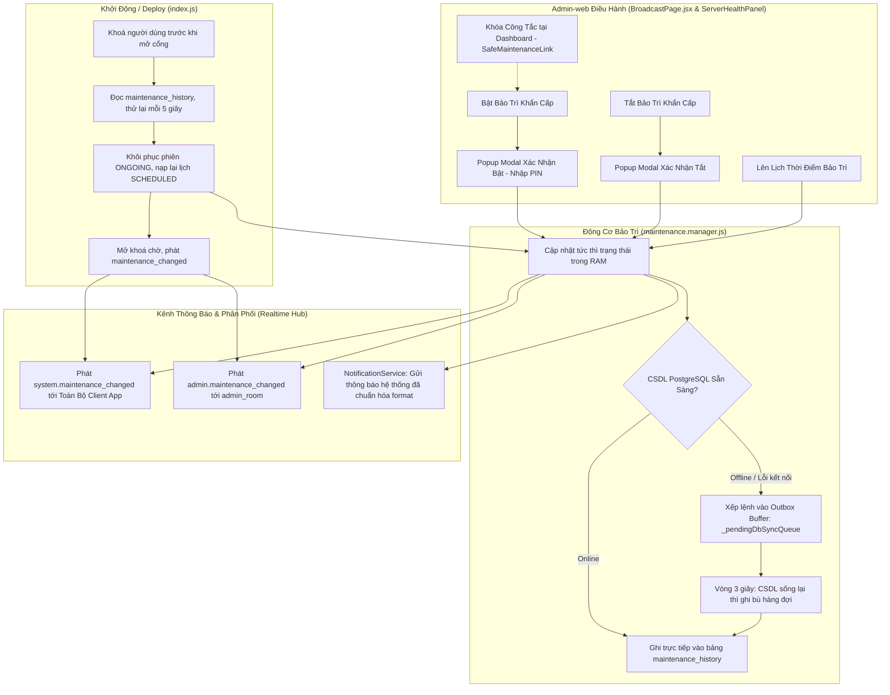

# ⚙️ Chức Năng 07: Quản Trị Chế Độ Bảo Trì & Cứu Hộ Khẩn Cấp (Maintenance & Resilience Management)

> **Mã chức năng:** `ADMIN-FEAT-07`  
> **Phiên bản tài liệu:** `v2.6` (Cập nhật ngày 23/10/2026)  
> **Module phụ trách:**  
> - Frontend: `src/Admin-web/src/pages/system/BroadcastPage.jsx` (Tab 1: `broadcast/MaintenanceTab.jsx`, `broadcast/MaintenanceHistory.jsx`), `src/Admin-web/src/components/common/ServerHealthPanel.jsx`  
> - Backend: `src/Backend/core/resilience/maintenance.manager.js`, `src/Backend/modules/admin/maintenance.repository.js`, `src/Backend/middleware/maintenance.middleware.js`, `src/Backend/index.js` (khôi phục khi khởi động), `src/Backend/api/admin.routes.js`  

---

## 📌 1. TỔNG QUAN & MỤC ĐÍCH NGHIỆP VỤ

Chức năng **Quản Trị Chế Độ Bảo Trì & Cứu Hộ Khẩn Cấp** là công tắc ngắt mạch trung tâm (Circuit Breaker) của toàn bộ nền tảng. Khi hệ thống cần nâng cấp phiên bản, thực hiện migrate cơ sở dữ liệu lớn hoặc đối mặt với sự cố an ninh nghiêm trọng, chức năng này cho phép quản trị viên cách ly an toàn máy chủ khỏi lưu lượng người dùng di động.

Cơ chế bảo trì gồm hai lớp: lớp **chặn yêu cầu** chạy trong bộ nhớ của máy chủ (nhanh, không phụ thuộc CSDL khi đang chạy) và lớp **lưu trạng thái** trong CSDL (nguồn sự thật, dùng để khôi phục sau mỗi lần khởi động):
1. **Chặn yêu cầu bằng trạng thái trong bộ nhớ:** cờ bảo trì nằm trong `MaintenanceManager` (RAM), middleware kiểm cờ này với mỗi yêu cầu, không truy vấn CSDL. Khi CSDL sập, admin vẫn bật / tắt bảo trì được.
2. **Bộ Đệm Ngoại Tuyến (Outbox Buffer `_pendingDbSyncQueue`):** thao tác ghi `maintenance_history` lỗi do CSDL offline được xếp vào hàng đợi trong RAM; vòng phát chỉ số 3 giây/lần kiểm hàng đợi và ghi bù khi CSDL hoạt động lại.
3. **CSDL là nguồn sự thật khi khởi động (mục 2.2):** sau mỗi lần khởi động / deploy, máy chủ khoá người dùng cho tới khi đọc được `maintenance_history`; phiên bảo trì còn hiệu lực được khoá lại đúng như trước, lịch hẹn được nạp lại. Máy chủ không tự tắt bảo trì khi khởi động.
4. **Phân Định Rõ Ràng Hai Loại Hình Bảo Trì (PO Mandatory):**
   - **Bảo trì khẩn cấp (`isEmergency: true`):** Tiêu đề chuẩn PO: **"HỆ THỐNG ĐANG BẢO TRÌ KHẨN CẤP"**, giao diện tông đỏ `rose`, badge `[KHẨN CẤP]`, tự động phát broadcast cấp độ `critical` tới toàn bộ người dùng.
   - **Bảo trì theo lịch (`isEmergency: false`):** Tiêu đề chuẩn PO: **"HỆ THỐNG ĐANG BẢO TRÌ"** (tuyệt đối không hiển thị từ "khẩn cấp"), giao diện tông cam `amber`, badge `[THEO LỊCH]`, broadcast cấp độ `warning`.
   - **Lưu trữ thời lượng thực tế (Migration 36 - `actual_duration_seconds`):** Bổ sung cột `actual_duration_seconds` trong bảng `maintenance_history` để ghi nhận chính xác từng giây thời gian gián đoạn thực tế khi kết thúc phiên. Đối với phiên đang diễn ra (`ONGOING`), giao diện tích hợp Live Timer đếm thời lượng thực tế theo thời gian thực ($T_{\text{hiện tại}} - T_{\text{bắt đầu}}$).
5. **Ràng Buộc Thời Gian Lập Lịch:**
   - Bắt buộc lập lịch trước thời điểm kích hoạt ít nhất **3 tiếng** (`scheduledAt >= now + 3h`, kiểm ở cả Admin-web và Backend).
   - Thời điểm bắt đầu không được xa quá **14 ngày** (`scheduledAt <= now + 14 ngày`, từ 2026-11-16, kiểm ở cả Admin-web và Backend: `MAX_LEAD_TIME_MS` trong `maintenance.manager.js`, `MAX_LEAD_DAYS` trong `maintenanceFormat.js`). Lý do: hẹn giờ `setTimeout` của Node tối đa khoảng 24,8 ngày; vượt mức đó hẹn giờ chạy ngay và hệ thống vào bảo trì lập tức (đã tái hiện ngày 2026-11-16 với lịch 30 ngày trên CSDL thử).
   - Một phiên bảo trì kéo dài tối đa **7 ngày** (từ 2026-11-16, `MAX_SESSION_MS` / `MAX_SESSION_DAYS`):
     + Lịch có giờ kết thúc: giờ kết thúc cách giờ bắt đầu quá 7 ngày thì bị chặn ở cả Admin-web và Backend ("Một phiên bảo trì kéo dài tối đa 7 ngày!").
     + Mọi phiên không có giờ kết thúc (khẩn cấp bật tay, theo lịch không nhập giờ kết thúc, bật từ AIOps / băng cảnh báo / `ServerHealthPanel`) tự kết thúc sau 7 ngày kể từ lúc bật, lý do ghi "Hết thời hạn tối đa 7 ngày của phiên bảo trì". Hộp xác nhận bảo trì khẩn cấp báo trước điều này.
     + Khẩn cấp đè lên phiên theo lịch: hạn của phiên khẩn cấp là 7 ngày kể từ lúc bật khẩn cấp, không theo giờ kết thúc của lịch cũ (trước đây giờ kết thúc của lịch có thể tắt luôn phiên khẩn cấp).
   - **Bảo trì khẩn cấp và các phiên theo lịch (chốt 2026-11-16):** mục đích là tránh xung đột khi kích hoạt bảo trì: trong một khung thời gian chỉ có **duy nhất một phiên bảo trì** đang diễn ra, và bảo trì khẩn cấp luôn được ưu tiên. Vì vậy phiên theo lịch bị ngắt dù chưa tới giờ kết thúc.
     + Bật khẩn cấp khi đang chạy một phiên theo lịch: phiên theo lịch bị **hủy** (bản ghi chuyển `CANCELLED`, ghi thời lượng đã chạy), phiên khẩn cấp là **bản ghi `EMERGENCY` riêng** bắt đầu từ lúc bật. Bản ghi cũ đóng xong mới tạo bản ghi mới. Trước đây bản ghi theo lịch bị đổi loại thành khẩn cấp.
     + Bật khẩn cấp **không** hủy ngay lịch nào đang chờ (trước đây hủy ngay các lịch rơi vào khung giả định 2 giờ). Khẩn cấp chạy tới đâu kiểm tra tới đó: tới giờ bắt đầu của một lịch mà khẩn cấp còn chạy thì lịch đó bị hủy lúc ấy (`activateScheduledItem`); lịch bắt đầu sau khi khẩn cấp đã tắt thì chạy bình thường.
     + Test: `tests/unit/maintenance.emergency.overlap.test.js` (4 ca, đồng hồ giả).
     + Khởi động lại máy chủ giữa phiên không có giờ kết thúc: hạn tính từ lúc phiên bắt đầu (`started_at` + 7 ngày); đã quá hạn thì đóng phiên với giờ kết thúc là mốc 7 ngày.
     + Lý do: hẹn giờ tự kết thúc cũng dùng `setTimeout`, phiên dài hơn ~24,8 ngày làm hẹn giờ chạy ngay. Test: `tests/unit/maintenance.max.duration.test.js` (8 ca, đồng hồ giả).
   - Thời điểm kết thúc (nếu có) phải sau thời điểm bắt đầu.
   - Lịch mới không được trùng khung giờ với lịch đã có, và khoảng cách giữa lúc kết thúc lịch này với lúc bắt đầu lịch kia ít nhất **12 tiếng** (lịch không có giờ kết thúc thì tính kết thúc = bắt đầu).
   - Hủy lịch bảo trì: Admin-web chỉ cho bấm hủy khi còn cách thời điểm bắt đầu tối thiểu **3 tiếng**; dưới 3 tiếng nút bị khóa, hiện `< 3h`.
6. **Cảnh Báo Lịch Bảo Trì Sắp Diễn Ra (Imminent Maintenance Warning):**
   - Card/Banner cảnh báo "LỊCH BẢO TRÌ SẮP DIỄN RA" **CHỈ HIỂN THỊ KHI CÒN $\le 1$ TIẾNG** trước thời điểm bắt đầu.
   - Nếu còn xa hơn 1 tiếng (> 1h), **ẨN HOÀN TOÀN** card này.
   - Khi kích hoạt Card cảnh báo: **TUYỆT ĐỐI KHÔNG ĐƯỢC LÀM MẤT FORM LẬP LỊCH BẢO TRÌ ĐỊNH KỲ**.
7. **Đa Lịch Bảo Trì (Multi-Schedule Management):**
   - Form lập lịch bảo trì định kỳ luôn luôn hiện diện và sẵn sàng tiếp nhận lịch mới.
   - Lịch đã hẹn hiện trong bảng **Lịch sử bảo trì** (trạng thái "Đã lên lịch") kèm nút hủy theo ID (`DELETE /api/admin/system/maintenance/schedule/:id`). Bảng riêng "Lịch đã đặt" đã bỏ ngày 2026-11-15 vì trùng thông tin; lịch còn dưới 1 giờ vẫn hiện băng cảnh báo phía trên.
8. **Đặc quyền Cứu hộ Khẩn cấp (Emergency Override):** Duy nhất **Bảo trì khẩn cấp** có quyền kích hoạt đè khi hệ thống đang trong phiên bảo trì thông thường (phiên đang mở trong CSDL chuyển sang loại `EMERGENCY`, gửi thông báo khẩn cấp). Đang bảo trì khẩn cấp thì không bật thêm được. Khi bật khẩn cấp, các lịch hẹn trùng khung giờ khẩn cấp (từ lúc bật tới giờ kết thúc hẹn, mặc định 2 tiếng nếu không hẹn) bị hủy tự động; lịch ngoài khung giữ nguyên. Lịch tới giờ mà hệ thống đang có bảo trì khác cũng bị hủy.

---

## ⚙️ 2. CƠ CHẾ HOẠT ĐỘNG CHI TIẾT (END-TO-END FLOW)

### 2.1. Khi CSDL mất kết nối trong lúc máy chủ đang chạy
1. **Giai đoạn CSDL ngoại tuyến:**
   - Quản trị viên vẫn bật hoặc tắt bảo trì trên Admin-web bình thường.
   - `MaintenanceManager` cập nhật trạng thái trong RAM ngay, phát `system.maintenance_changed` / `admin.maintenance_changed`; API trả kết quả ngay, không chờ CSDL.
   - Thao tác ghi `maintenance_history` bị lỗi được lưu vào bản sao trong bộ nhớ và xếp vào `_pendingDbSyncQueue` (các loại `CREATE_RECORD`, `COMPLETE_ONGOING`, `UPDATE_TO_EMERGENCY`).
2. **Giai đoạn CSDL hồi phục:**
   - Vòng phát chỉ số máy chủ (3 giây/lần) kiểm hàng đợi; còn việc tồn thì gọi `flushPendingQueue()` ghi bù lần lượt vào `maintenance_history`, ghi được thì xoá khỏi hàng đợi.

### 2.2. Khi máy chủ khởi động hoặc deploy
CSDL là nguồn sự thật của trạng thái bảo trì. Mã: `MaintenanceManager.beginRestore / startRestoreLoop / restoreFromDatabase`, `MaintenanceRepository.loadRestoreState / closeRecord`.

1. **Khoá trước khi mở cổng:** `index.js` gọi `beginRestore()` trước khi máy chủ nhận yêu cầu. Trong lúc chưa đọc được CSDL, người dùng thường nhận 503 `MAINTENANCE_MODE` với thông điệp "Hệ thống đang khởi động. Quý khách vui lòng thử lại sau ít phút!"; đăng nhập của người dùng thường cũng bị từ chối 503. `/health`, yêu cầu của admin và `POST /auth/login` (để admin đăng nhập) vẫn đi qua. Trạng thái chờ này chỉ ở RAM: không ghi `maintenance_history`, không gửi thông báo đẩy, không phát sự kiện socket, không tính vào độ khả dụng.
2. **Đọc CSDL:** lấy mọi phiên `ONGOING` và lịch `SCHEDULED`. Đọc lỗi thì giữ khoá và thử lại sau mỗi 5 giây cho tới khi đọc được.
3. **Phiên `ONGOING`:**
   - Có nhiều phiên (dữ liệu lỗi) ⇒ giữ phiên bắt đầu muộn nhất; các phiên còn lại đóng `COMPLETED` tại lúc phiên giữ lại bắt đầu.
   - Phiên đã quá giờ kết thúc hẹn (`scheduled_end_at`) ⇒ đóng `COMPLETED` tại đúng giờ hẹn, tính `actual_duration_seconds`; hệ thống không bị khoá.
   - Phiên còn hiệu lực ⇒ khoá lại với đúng loại (`EMERGENCY` / `UPGRADE` / còn lại là thông thường), lý do, người bật và **giờ bắt đầu gốc**; không tạo bản ghi mới, không gửi thông báo đẩy lặp lại; có giờ kết thúc hẹn thì đặt hẹn giờ tự mở cho phần còn lại.
4. **Lịch `SCHEDULED`:**
   - Đã qua giờ kết thúc hẹn ⇒ `CANCELLED`, lý do "Lỡ lịch do máy chủ không chạy trong khung giờ hẹn".
   - Đang trong khung giờ ⇒ kích hoạt ngay như khi tới giờ hẹn; nếu đang có bảo trì khác (vd. vừa khôi phục ở bước 3) thì lịch bị hủy.
   - Ở tương lai ⇒ nạp lại vào danh sách lịch (giữ `recordId`) kèm hẹn giờ kích hoạt.
5. **Mở khoá chờ:** thoát trạng thái chờ, phát `system.maintenance_changed` và `admin.maintenance_changed` một lần để client đang thấy 503 cập nhật lại.
6. **Rủi ro đã chấp nhận:** admin tắt bảo trì đúng lúc CSDL sập (lệnh đóng phiên còn trong `_pendingDbSyncQueue`), rồi máy chủ khởi động lại trước khi ghi bù ⇒ CSDL vẫn ghi phiên `ONGOING` nên bảo trì bật lại; admin thấy trên Admin-web và tắt lại.

---

## 📐 3. CÁC THÔNG SỐ KỸ THUẬT & HEADERS

| Thuộc tính / Header | Giá trị | Mục đích & Ý nghĩa |
|---|---|---|
| **HTTP Status Code** | `503 Service Unavailable` | Báo cho Client và Web Crawler biết server tạm thời bảo trì, không bị đánh tụt SEO. |
| **Header `Retry-After`** | `60` (giây) | Hướng dẫn client thời gian quay lại thử lại. |
| **Error Code Payload** | `MAINTENANCE_MODE` | Mã chuẩn hóa cho Client-app bắt exception. Thân phản hồi gồm `message` (lý do bảo trì, hoặc "Hệ thống đang khởi động…" khi đang chờ khôi phục), `isEmergency`, `activatedAt`. |
| **Outbox Buffer** | `_pendingDbSyncQueue` | Mảng In-Memory đệm các thao tác CSDL khi Postgres bị ngắt kết nối. |
| **Scheduled Timer** | `setTimeout().unref()` | Non-blocking timer, không gây treo tiến trình Node.js khi shutdown. Hẹn giờ mất khi tiến trình dừng và được đặt lại từ CSDL lúc khởi động (mục 2.2). |
| **Restore Retry** | 5 giây | Chu kỳ thử đọc lại CSDL khi khởi động. |
| **Database Table** | `maintenance_history` | Nguồn sự thật của phiên bảo trì và lịch hẹn: `status` = `SCHEDULED` / `ONGOING` / `COMPLETED` / `CANCELLED`; `type` = `EMERGENCY` / `SCHEDULED` / `ROUTINE` / `UPGRADE`. |
| **Trường trạng thái `restorePending`** | `true` / `false` | Có trong `getStatus()`; `true` khi máy chủ đang chờ đọc CSDL lúc khởi động. |

---

## ⛔ 4. CÁC GIỚI HẠN & NGUYÊN TẮC AN TOÀN

1. **Chặn thời gian trong quá khứ:** Form lên lịch bảo trì tự động kiểm tra thời điểm hẹn. Nếu thời gian chọn nhỏ hơn thời điểm hiện tại (`targetDate <= Date.now()`), hệ thống từ chối với lỗi HTTP 400.
2. **Miễn trừ Route kiểm tra sức khỏe:** Route `/health` và `/health/*` luôn mở, kể cả lúc đang bảo trì hay đang chờ khôi phục, để Render không hiểu nhầm máy chủ đã chết mà khởi động lại liên tục.
3. **Khôi phục sau khởi động lại:** trạng thái bảo trì và lịch hẹn nạp lại từ `maintenance_history` (mục 2.2); chưa đọc được CSDL thì khoá người dùng.
4. **Bảo vệ công tắc tại Dashboard:** Khóa công tắc tại `ServerHealthPanel` khi đang active để ngăn ngừa click tắt nhầm ngoài ý muốn, chỉ cho phép điều khiển tắt tại trang Broadcast có Modal xác nhận.

---

## 💼 5. CÔNG DỤNG & GIÁ TRỊ NGHIỆP VỤ

- **Bảo toàn dữ liệu tài chính tuyệt đối:** Ngắt toàn bộ lưu lượng ghi từ ứng dụng di động khi thực hiện migration database, bảo vệ số dư và giao dịch không bao giờ bị corrupt.
- **Khả năng tự phục hồi (Self-Healing Resiliency):** Đang chạy thì bật / tắt bảo trì không phụ thuộc CSDL, thao tác lỗi được ghi bù khi CSDL sống lại; khởi động lại hoặc deploy giữa phiên bảo trì không làm mất bảo trì hay lịch hẹn.
- **Minh bạch và chuẩn mực:** Toàn bộ lịch sử bảo trì lưu vết chi tiết người thực hiện, thời gian bắt đầu, thời gian kết thúc, thời lượng và lý do.

---

## 🧩 6. TÍNH NĂNG ĐI KÈM TRÊN GIAO DIỆN (`BroadcastPage.jsx`)

1. **Global Maintenance Banner & Modal Xác Nhận 2 Chiều:**
   - Khi kích hoạt bảo trì khẩn cấp: Modal xác nhận yêu cầu nhập mã PIN bảo mật cấp 2. Banner hiển thị tông đỏ `rose`, badge `[KHẨN CẤP]`, tiêu đề: **"HỆ THỐNG ĐANG BẢO TRÌ KHẨN CẤP"**.
   - Khi bảo trì theo lịch kích hoạt: Banner hiển thị tông cam `amber`, badge `[THEO LỊCH]`, tiêu đề chuẩn PO: **"HỆ THỐNG ĐANG BẢO TRÌ"**.
   - Khi tắt bảo trì: Modal xác nhận cảnh báo hệ thống sắp mở lại kết nối cho toàn bộ người dùng Client-app.
   - **PIN bắt buộc, máy chủ kiểm (từ 2026-11-16):** lên lịch, bật khẩn cấp, kết thúc bảo trì (`POST /api/admin/system/maintenance`) và hủy lịch (`DELETE /api/admin/system/maintenance/schedule[/:id]`) đều phải gửi `pin` kèm lệnh; thiếu / sai PIN trả 400, khóa sau 5 lần sai trả 429. Áp dụng cho mọi nơi bật bảo trì: trang Bảo trì & Thông báo, băng cảnh báo quá tải (`AppLayout`), hộp giảm thiểu của AIOps, `ServerHealthPanel`. Thêm / ngừng / kích hoạt chính sách cũng bắt buộc PIN (`PUBLISH_POLICY`, `CHANGE_POLICY_STATUS`).
   - **Tab Chính sách tạm ẩn (2026-11-16):** chính sách được viết cứng phía Client-app, Backend và Admin-web tạm không quản lý chính sách. Trang chỉ còn hai tab Bảo trì và Thông báo; `PolicyTab.jsx`, API `/api/admin/policies` và bảng CSDL giữ nguyên để bật lại bằng cờ `SHOW_POLICY_TAB` trong `BroadcastPage.jsx`.
2. **Cảnh Báo Lịch Bảo Trì Sắp Diễn Ra (Chỉ hiển thị khi $\le 1$ tiếng):**
   - Card/Banner cảnh báo tông cam viền amber nhấp nháy hiển thị số phút đếm ngược.
   - **Tuyệt đối không làm mất form lập lịch bảo trì định kỳ**.
3. **Khung Điều Hành & Lập Lịch Bảo Trì Kỹ Thuật Định Kỳ (Luôn Hiện Diện):**
   - Form lập lịch chỉ chia làm 2 loại hình duy nhất theo quy định của PO: **Bảo trì Khẩn cấp** (`EMERGENCY`) và **Bảo trì Định kỳ** (`SCHEDULED`) (tuyệt đối không có loại hình nâng cấp riêng biệt trên form).
   - Form luôn sẵn sàng tạo mới: input `datetime-local` bắt đầu (tối thiểu trước 3 tiếng) và kết thúc dự kiến, lý do. Lịch bảo trì phải cách các phiên khác tối thiểu 12 tiếng. (Đã loại bỏ box ghi chú giả thông báo icon campaign theo chỉ đạo PO).
   - Nút **"Lên lịch bảo trì"** và nút **"Làm mới"** biểu mẫu.
   - **Bảng Danh Sách Lịch Bảo Trì Đã Lên Lịch (Upcoming Schedules):** Hiển thị danh sách các phiên bảo trì định kỳ đã đặt, kèm nút **"Hủy"** riêng cho từng dòng theo ID.
4. **Bảng Lịch Sử Các Phiên Bảo Trì Hệ Thống (PostgreSQL Persistence):**
   - Lưu trữ vĩnh viễn trong bảng `maintenance_history`.
   - Các cột hiển thị (10 cột, từ 2026-11-16): `#`, `Loại bảo trì` (Khẩn cấp / Định kỳ), `Người kích hoạt`, `Lý do / Thông điệp`, `Bắt đầu`, `Kết thúc dự kiến`, `Kết thúc thực tế`, `Thời lượng`, `Trạng thái` (Đang diễn ra, Đã lên lịch, Đã hoàn thành, Đã hủy), `Thao tác`. Ô thời gian ghi ngày một dòng, giờ một dòng.
   - **Kết thúc dự kiến và Kết thúc thực tế là hai mốc khác nhau** (trước đây gộp chung một cột "Kết thúc", lịch hủy chỉ còn giờ hủy và mất giờ dự kiến):
     + `Kết thúc dự kiến` = `scheduled_end_at` (giờ đã hẹn khi lên lịch); không hẹn thì `—`.
     + `Kết thúc thực tế` = `ended_at` (giờ phiên thật sự dừng, kể cả bị bảo trì khẩn cấp ngắt giữa chừng); lịch bị hủy khi chưa chạy ghi "Hủy lúc" + giờ hủy; phiên đang chạy ghi "Đang diễn ra"; lịch chưa tới giờ ghi `—`.
   - **Cột Thao Tác (Action Column):** Hiển thị nút **"Hủy"** đối với các phiên bảo trì định kỳ đã lên lịch (`SCHEDULED`) còn trước giờ bắt đầu tối thiểu 3 tiếng. Nếu dưới 3 tiếng, nút bị khóa (`< 3h`) nhằm ngăn chặn việc hủy sát giờ gây bất ổn hệ thống.
   - Bộ phân trang chuẩn mực (`Pagination.jsx`) mặc định 5 bản ghi/trang (hỗ trợ chọn 5, 10, 20, 50 phiên/trang).

---

## 📱 7. ẢNH HƯỞNG ĐẾN HỆ THỐNG & MOBILE APP (CLIENT-APP)

- **Đến Backend:**
  - Middleware kiểm cờ bảo trì (đang bảo trì hoặc đang chờ khôi phục) bằng biến trong RAM, không truy vấn CSDL.
  - Mỗi lần khởi động đọc `maintenance_history` một lần (thường dưới 1 giây khi CSDL bình thường).
- **Đến Mobile App (Client-app):**
  - **Khi bật bảo trì:** Ứng dụng nhận sự kiện Socket, hiển thị ngay màn hình khóa bảo trì toàn phần, ngăn người dùng thực hiện giao dịch ghi. Người dùng vẫn xem được dữ liệu offline trong máy (Offline-first Drift SQLite).
  - **Khi tắt bảo trì:** Ứng dụng tự động kết nối lại, mở khóa các tính năng và đồng bộ hóa các giao dịch đang chờ trong SQLite lên máy chủ.
  - **Khi máy chủ khởi động lại:** ứng dụng có thể nhận 503 `MAINTENANCE_MODE` trong lúc máy chủ chờ đọc CSDL (thông điệp "Hệ thống đang khởi động"); xong thì nhận `system.maintenance_changed` với trạng thái thật. Nếu đang có phiên bảo trì, ứng dụng tiếp tục bị khoá như trước khi khởi động lại.

---

## 📡 8. DANH MỤC API & SOCKET.IO PHỤ TRÁCH

### REST API Endpoints
| Phương thức | Endpoint | Chức năng | Phân quyền |
|---|---|---|---|
| `GET` | `/api/admin/system/maintenance` | Lấy chi tiết trạng thái bảo trì & danh sách lịch hẹn (`scheduledList`) | Admin |
| `POST` | `/api/admin/system/maintenance` | Bật/Tắt bảo trì tức thì (`active`, `reason`, `isEmergency`), hoặc đặt lịch bảo trì mới khi gửi `scheduledAt` (kèm `scheduledEndAt`, `reason`) | Admin |
| `DELETE` | `/api/admin/system/maintenance/schedule` | Hủy bỏ lịch bảo trì gần nhất | Admin |
| `DELETE` | `/api/admin/system/maintenance/schedule/:id` | Hủy bỏ lịch bảo trì theo ID cụ thể | Admin |
| `GET` | `/api/admin/system/maintenance/history` | Lấy danh sách lịch sử các phiên bảo trì (có phân trang, bộ lọc) | Admin |

### Socket.io Events
- **Phát tán tới Toàn Hệ Thống (`broadcast`):**
  - `system.maintenance_changed`: Bắn tới toàn bộ người dùng di động khi trạng thái bảo trì bật/tắt.
- **Phát tán tới Phòng Quản Trị (`admin_room`):**
  - `admin.maintenance_changed`: Cập nhật trạng thái công tắc và card lịch hẹn trên mọi tab Admin-web đang mở.
