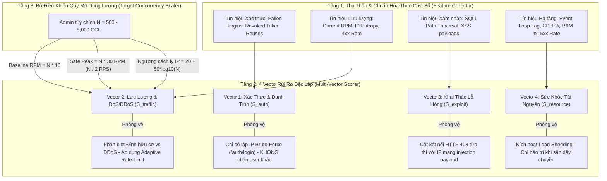

# 🛡️ Chức Năng 09: Hệ Thống AI Giám Sát Bất Thường & Tường Lửa Phong Tỏa (AIOps Sentinel & Active Quarantine Shield)

> **Mã chức năng:** `ADMIN-FEAT-09`  
> **Phiên bản:** `v2.6 (23/10/2026)`  
> **Trạng thái:** `Production Ready`  
> **Module phụ trách:**  
> - Frontend: `src/Admin-web/src/pages/system/AIOpsPage.jsx`, `src/Admin-web/src/components/layout/AppLayout.jsx`  
> - Backend: `src/Backend/modules/aiops/feature.collector.js`, `anomaly.detector.js`, `aiops.quarantine.js`, `aiops.service.js`, `src/Backend/api/admin.routes.js`, `src/Backend/database/27b_create_aiops_metric_snapshot_table.sql`  

---

## 📌 1. TỔNG QUAN & MỤC ĐÍCH NGHIỆP VỤ

**AIOps Sentinel & Active Quarantine Shield** là cỗ máy phòng vệ tự động thông minh (Autonomous Cyber Defense & Self-Healing Engine) chạy ngầm trực tiếp trong tiến trình Backend. Hệ thống áp dụng các mô hình học máy trực tuyến (In-process Online Learning) để liên tục học đường chuẩn vận hành (Baseline) của 24 khung giờ Việt Nam, từ đó:
1. Phát hiện sớm các sự cố sập server (DDoS, rò rỉ bộ nhớ RAM, nghẽn Event Loop).
2. Phát hiện các cuộc tấn công an ninh nguy hiểm (Dò quét mật khẩu Brute-Force, Tái sử dụng token đã thu hồi Token Hijacking, Rà quét lỗ hổng SQL Injection).
3. **Tự động kích hoạt Tường Lửa Chủ Động (Active Quarantine Shield):** Cắt đứt kết nối của nguồn IP vi phạm ngay tại đầu Express Pipeline với mã HTTP 403, giải phóng tài nguyên CPU/RAM/DB tức thì và thông báo Real-Time về Admin-web.
4. **Lưu trữ Snapshot định kỳ 5 phút (`aiops_metric_snapshot`):** Lưu trữ lịch sử 4 vectơ phục vụ soi chiếu xu hướng dài hạn (1h, 24h, 7d, 30d) mà không bị mất dữ liệu khi khởi động lại máy chủ.
5. **Cấu hình ngưỡng cảnh báo linh hoạt (Custom Vector Thresholds):** Cho phép Quản trị viên tùy chỉnh ngưỡng cảnh báo và khẩn cấp riêng biệt cho từng vectơ rủi ro theo đặc thù vận hành thực tế.

---

## ⚙️ 2. KIẾN TRÚC & CƠ CHẾ HOẠT ĐỘNG 4 VECTƠ ĐỘC LẬP (MULTI-VECTOR RISK ARCHITECTURE)

Hệ thống bãi bỏ hoàn toàn cơ chế tính điểm gộp đơn nhất (Monolithic Additive) và **loại bỏ hoàn toàn thông số tổng Threat Score** theo chỉ đạo tối cao từ Product Owner (PO). Biểu đồ và cơ chế giám sát tập trung 100% vào **4 vectơ rủi ro hoàn toàn độc lập**, mỗi vectơ có thang đo $[0, 100]$ điểm và biện pháp phòng vệ cá nhân hóa riêng biệt, triệt tiêu hoàn toàn rủi ro cộng dồn điểm gây báo động giả hoặc bảo trì khẩn cấp oan khi máy chủ vẫn vận hành bình thường:



---

## 📐 3. CÁC CÔNG THỨC TOÁN HỌC & MÔ HÌNH CHỊU TẢI DUNG LƯỢNG

### 3.1. Khảo Sát & Ước Tính Request Theo Chức Năng (Request Profiling)
Khảo sát chi tiết số lượng HTTP Request phát sinh khi Admin hoặc Client thực hiện từng chức năng cốt lõi:

| Nhóm chức năng | Hành động cụ thể | Số request phát sinh | Chi tiết endpoints |
|---|---|:---:|---|
| **Xác thực (Auth)** | Đăng nhập tài khoản | **3 reqs** | `POST /auth/login` $\to$ `GET /users/profile` $\to$ `GET /categories` |
| **Bảng điều khiển (Dashboard)** | Khởi động & tải trang chủ | **4 reqs** | `GET /wallets` $\to$ `GET /transactions/summary` $\to$ `GET /budgets` $\to$ `GET /audit_log/summary` |
| **Giao dịch (Transactions)** | Thêm 1 giao dịch mới | **2 reqs** | `POST /transactions` $\to$ `GET /wallets/balance` (cập nhật số dư) |
| **Báo cáo (Reports)** | Xuất báo cáo thu chi tháng | **3 reqs** | `GET /reports/cashflow` $\to$ `GET /reports/category-breakdown` $\to$ `GET /reports/trends` |
| **Đồng bộ ngầm (Background Sync)** | Mobile app duy trì kết nối | **~2 req/phút** | Heartbeat token check & thông báo đẩy |

Trung bình một người dùng hoạt động tích cực (Active User) tạo ra khoảng **10 requests/phút** ($\mu \approx 0.15\text{ req/s}$).

### 3.2. Mô Hình Chịu Tải & Cơ Sở Lý Thuyết Khoa Học (Theoretical Capacity Foundations)
Để bảo vệ hệ thống trước hội đồng giảng viên và các chuyên gia kiến trúc, các công thức được thiết lập dựa trên các định luật khoa học máy tính chuẩn mực:

1. **Định luật Little trong Lý thuyết Xếp hàng ($L = \lambda \times W$):**
   - Trong một hệ thống ổn định, số lượng người dùng đồng thời trong hệ thống $L$ ($N$ CCU) bằng tích của tần suất request $\lambda$ và thời gian dừng trung bình của người dùng $W$.
   - Khảo sát thực nghiệm hành vi người dùng ứng dụng tài chính cho thấy: 1 Active User thực hiện trung bình 1 hành động nghiệp vụ mỗi $6$ giây $\implies \lambda_{\text{user}} \approx 10\text{ req/phút} \approx 0.167\text{ RPS}$.
   - **Baseline RPM kỳ vọng:**
     $$\text{Baseline RPM}(N) = N \times 10\text{ req/phút}$$
     - $N = 500 \implies 5,000\text{ RPM} \approx 83\text{ RPS}$.
     - $N = 1,000 \implies 10,000\text{ RPM} \approx 167\text{ RPS}$.
     - $N = 2,000 \implies 20,000\text{ RPM} \approx 333\text{ RPS}$.
   - **Trần Đỉnh An Toàn (Safe Peak Ceiling $3\times$):**
     $$\text{Safe Peak RPM}(N) = 3 \times \text{Baseline RPM}(N) = N \times 30\text{ req/phút}$$
     $$\text{Safe Peak RPS}(N) = \frac{N \times 30}{60} = \frac{N}{2}\text{ req/giây (RPS)}$$
     - Quy đổi tương đương chuẩn xác: Đỉnh an toàn cho $N = 1,000$ CCU là $30,000\text{ RPM} \leftrightarrow 500\text{ RPS}$.
     - Lưu lượng hợp pháp có thể dao động tự nhiên lên tới $3\times$ baseline trong các đợt cao điểm mà **không bao giờ bị hệ thống coi là tấn công DoS**.

2. **Định luật Amdahl & Đặc Thù Đơn Luồng (Single-Threaded Event Loop của Node.js):**
   - Node.js xử lý non-blocking I/O trên một luồng chính duy nhất (Single Thread). Khi tải tăng cao, sự sụt giảm hiệu năng không bắt đầu từ CPU hay RAM chạm $100\%$, mà bắt đầu từ hiện tượng nghẽn luồng xử lý (Event Loop Contention).
   - Chỉ số **Event Loop Lag** ($> 100\text{ms}$) là chỉ báo sớm nhạy cảm nhất về tình trạng nghẽn pipeline (CPU-bound tasks hoặc cryptographic hashing quá tải), giúp kích hoạt cơ chế Load Shedding từ trước khi tiến trình rơi vào trạng thái sập hoàn toàn (Denial of Service).

3. **Ngưỡng An Ninh Co Giãn Logarit (Logarithmic Threat Threshold Scaling):**
   - Khi quy mô người dùng tăng từ $100$ lên $5,000$ CCU, số lần gõ nhầm mật khẩu tự nhiên cũng tăng theo xác suất thống kê. Nếu áp dụng ngưỡng cố định cứng, hệ thống sẽ tự khóa nhầm người dùng hợp pháp (False Positives).
   - Ngưỡng thất bại xác thực tối đa cho phép trên phút:
     $$\text{Auth Fail Threshold}(N) = \max\left(15, \text{round}\left(15 + 10 \cdot \log_{10}\left(\frac{N}{100}\right)\right)\right)\text{ lần/phút}$$
     - $N = 100 \implies 15\text{ lần/phút}$.
     - $N = 1,000 \implies 15 + 10 \times 1 = 25\text{ lần/phút}$.
     - $N = 5,000 \implies 15 + 10 \times 1.7 = 32\text{ lần/phút}$.
   - Ngưỡng cách ly IP động: $\text{Quarantine Burst Limit}(N) = \max\left(150, \text{round}\left(20 + 50 \cdot \log_{10}(N)\right)\right)\text{ req/10s}$.

4. **Cơ Chế Lưu Cứng Quy Mô CCU Bền Vững (Persistent Concurrency Scaling):**
   - **Lưu Cứng Trong CSDL PostgreSQL (`aiops_setting`):** Khi Admin thay đổi quy mô $N$ (qua nút chọn mẫu 500, 1000, 2000, 5000 hoặc nhập tay), giá trị được ghi tức thì vào CSDL Supabase với khóa `target_concurrency`.
   - **Tự động phục hồi khi máy chủ khởi động lại:** Backend nạp `target_concurrency` từ CSDL ngay khi khởi động (`loadPersistedSettings()`), tuyệt đối không tự ý rơi về 100 CCU.
   - **Lưu đệm LocalStorage (`aiops_target_concurrency`):** Admin-web lưu đệm trên trình duyệt, đảm bảo khi Admin tải lại trang (F5), chuyển trang, hoặc đăng nhập lại, quy mô chịu tải luôn ổn định vững chắc.

### 3.3. Công Thức Đo Lường Cá Nhân Hóa Từng Vectơ Rủi Ro
Mỗi vectơ đo lường mức độ nguy cơ độc lập trong thang điểm $[0, 100]$:

1. **Vectơ 1: Xác Thực & Danh Tính ($S_{\text{auth}}$)**:
   $$S_{\text{auth}} = \min(100, (\text{failedLogins} \times 8) + (\text{tokenReuseAttacks} \times 25))$$
   - 1 lần đăng nhập sai chỉ chiếm $8$ điểm (không thể gây báo động hay khóa admin).
   - Chỉ khi đăng nhập sai $\ge 5$ lần/10s hoặc có tái dùng token đã thu hồi, $S_{\text{auth}}$ mới chạm ngưỡng cảnh báo.

2. **Vectơ 2: Lưu Lượng & DoS ($S_{\text{traffic}}$)**:
   $$S_{\text{traffic}} = \min(100, \text{rpmThreat} \times (1 - \text{entropyFactor}))$$
   - Khi RPM tăng vọt nhưng độ phân tán IP cao ($\text{distinctIps} \ge 10$) $\implies$ $\text{entropyFactor} \to 0.8 \implies$ $S_{\text{traffic}}$ được dìm xuống dưới $25$ điểm (Lưu lượng tự nhiên).
   - Khi RPM tăng vọt mà chỉ có $1-2$ IP $\implies$ $\text{entropyFactor} \to 0 \implies$ $S_{\text{traffic}}$ vọt lên $80-100$ điểm (DDoS tập trung).

3. **Vectơ 3: Khai Thác Lỗ Hổng & Thăm Dò ($S_{\text{exploit}}$)**:
   $$S_{\text{exploit}} = \min(100, \text{malformedRequests} \times 30)$$
   - Phát hiện các mẫu SQL Injection (`' OR 1=1`), Path Traversal (`../etc/passwd`), XSS probe.

4. **Vectơ 4: Sức Khỏe Tài Nguyên Hệ Thống ($S_{\text{resource}}$)**:
   $$S_{\text{resource}} = \min(100, \text{lagFactor} + \text{ramFactor} + \text{cpuFactor} + \text{err5xxFactor})$$
   - **Đo lường từ máy chủ thật (`SystemHardwareMonitor`):** % CPU đo bằng Delta Ticks tức thời ($1,000\text{ms}$ interval) và % RAM đo từ `os.totalmem()` / `os.freemem()` thật của máy chủ đang chạy, loại bỏ hoàn toàn việc gán cứng số giả lập.
   - Phản ánh độ trễ Event Loop ($> 100\text{ms}$), RAM ($> 90\%$), CPU ($> 85\%$) và mã lỗi HTTP 5xx ($> 5\%$).

### 3.4. Bãi Bỏ Thông Số Tổng Threat Score (Theo Phê Duyệt Của PO)
- **Quyết định của PO:** Bỏ hoàn toàn thông số điểm Threat Score tổng gộp trên toàn bộ giao diện và luồng cảnh báo chính của AIOps Sentinel.
- **Cơ sở khoa học:** Biểu đồ 4 vector độc lập đã định lượng chi tiết và trực quan hóa từng khía cạnh rủi ro riêng biệt ($S_{\text{auth}}, S_{\text{traffic}}, S_{\text{exploit}}, S_{\text{resource}}$). Việc gộp hoặc cộng dồn các vector thành 1 con số đe dọa tổng quát duy nhất tiềm ẩn nguy cơ "báo động giả chùm":
  + Ví dụ: Nếu mỗi vector chỉ biến động nhẹ $20 - 30$ điểm (hoàn toàn bình thường trong vận hành thực tế), công thức tổng hợp có thể đẩy điểm số lên mức báo động đỏ, gây kích hoạt chế độ bảo trì khẩn cấp ngoài ý muốn.
  + Việc loại bỏ Threat Score tổng giúp đội ngũ Quản trị viên và hệ thống phòng vệ phản ứng chính xác đúng nơi có sự cố: chỉ cách ly IP vi phạm nếu rủi ro thuộc $S_{\text{auth}}$ / $S_{\text{exploit}}$, chỉ điều chỉnh phân luồng nếu thuộc $S_{\text{traffic}}$, và chỉ bảo trì khi có nguy cơ sập phần cứng từ $S_{\text{resource}}$.

### 3.5. Cơ Chế Chống Đầu Độc Mô Hình Máy Học (EWMA Anti-Poisoning Guard)
```javascript
// Chỉ cập nhật baseline khi không có vector nào vượt ngưỡng cảnh báo (Hệ thống an toàn)
const isSafe = Object.values(vectorScores).every(score => score < 70);
if (isSafe) {
  this._updateHourlyBaseline(sample);
} else {
  logger.warn('[AIOps] Anti-Poisoning kích hoạt: Tạm dừng cập nhật Baseline khi có vector vượt ngưỡng rủi ro');
}
```

---

## 🛑 4. CƠ CHẾ TƯỜNG LỬA CHỦ ĐỘNG & TỰ ĐỘNG PHONG TỎA (ACTIVE QUARANTINE SHIELD)

### 4.1. Bốn Kịch Bản Tự Động Phong Tỏa (Auto-Quarantine Triggers)
Khi phát hiện vi phạm, `AIOpsQuarantineManager` tự động đưa nguồn IP vào danh sách đen In-Memory với thời hạn cách ly cụ thể:

| Hình thái tấn công | Ngưỡng vi phạm tự động | Thời gian phong tỏa | Mã lý do |
|---|---|:---:|---|
| **DoS Request Burst** | Gửi $> 120$ request / 10 giây | **15 phút** | `Tấn công DoS quá ngưỡng request` |
| **Quét lỗ hổng SQLi / Path Traversal** | Gửi request chứa `' OR 1=1`, `../etc/passwd` $\ge 3$ lần | **30 phút** | `SQL Injection / Malicious Probe` |
| **Dò mật khẩu Brute-force** | Đăng nhập thất bại liên tiếp 5 lần trong 10 giây | **15 phút** | `Dò mật khẩu Brute-Force` |
| **Tái sử dụng Token đã hủy** | Gửi Refresh Token đã thu hồi (Bị hack hoặc đánh cắp) | **15 phút** | `Phát hiện hành vi chiếm đoạt Token` |

### 4.2. Mã Phản Hồi Ngắt Kết Nối Ngay Đầu Pipeline (HTTP 403)
Khi một IP đã bị phong tỏa gửi request lên server:
```json
HTTP/1.1 403 Forbidden
{
  "success": false,
  "code": "AIOPS_QUARANTINED",
  "error": "AIOPS_QUARANTINED",
  "message": "Kết nối từ thiết bị của bạn tạm thời bị phong tỏa do hệ thống phát hiện hành vi bất thường hoặc dấu hiệu tấn công an ninh.",
  "reason": "Tấn công DoS quá ngưỡng request",
  "quarantineExpiresAt": "2026-10-03T03:30:00.000Z"
}
```
Request bị ngắt lập tức trước khi chạm vào router nghiệp vụ hoặc database, giải phóng tài nguyên CPU và RAM tức thì.

### 4.3. Miễn Trừ Quản Trị Tuyệt Đối & Tự Động Giải Cứu (Admin Fast-Lane & Auto-Unquarantine)
Quản trị viên và giao diện Admin-web luôn được bảo vệ bởi 4 tầng thông suốt:
1. **Nhận diện Kênh Admin-web:** Toàn bộ request từ Admin-web được gắn header `x-client-platform: admin-web` cùng bộ lọc Origin/Referer, được middleware `adminPriority` cấp quyền `req.isAdmin = true` và `req.isAdminWebClient = true`.
2. **Mở Cửa Ngõ Đăng Nhập:** Request `POST /api/auth/login` với tài khoản `admin` hoặc từ Admin-web không bị chặn đứng bởi phong tỏa, cho phép đi tiếp vào controller để so khớp mật khẩu bcrypt an toàn.
3. **Cơ Chế Tự Động Giải Cứu (Auto-Unquarantine Upon Admin Login):** Khi đăng nhập thành công với vai trò Quản trị viên, hệ thống **tự động xóa IP đó khỏi danh sách phong tỏa ngay tức thì** (`defaultAIOpsQuarantine.unquarantine(clientIp)`).
4. **Miễn Trừ Môi Trường Phát Triển (Dev Loopback Exemption):** Khi `NODE_ENV === 'development'`, các địa chỉ loopback (`127.0.0.1`, `::1`, `localhost`) được miễn trừ hoàn toàn khỏi lệnh cô lập, đảm bảo các thiết bị thử nghiệm thật kết nối qua `adb reverse` hoặc máy ảo không bao giờ bị khóa chùm.
5. **Khai Thác IP Chuẩn Xác Tuân Thủ `trust proxy`:** Tuyệt đối không đọc thô phần tử đầu của `X-Forwarded-For` (vốn cho phép client giả mạo IP); hệ thống sử dụng chuẩn `req.ip || req.socket?.remoteAddress` đảm bảo tôn trọng `app.set('trust proxy', 1)`.
6. **Phân Định Token Expired vs Token Reuse:** Hết hạn phiên làm việc thông thường chỉ trả về `401 Unauthorized` để client đăng nhập lại, tuyệt đối KHÔNG phong tỏa IP. Chỉ khi kẻ gian cố tình tái sử dụng Refresh Token đã bị thu hồi (`req.tokenReuseDetected === true`) mới kích hoạt cảnh báo Token Hijacking.

### 4.4. Lá Chắn Bảo Vệ IP Admin Hybrid (Cấu Hình .env + Đăng Ký Động Theo Phiên Làm Việc)
Hệ thống thiết lập cơ chế bảo vệ tối thượng kết hợp cả 2 tầng tĩnh và động nhằm **ngăn ngừa triệt để thảm họa tự khóa cửa nhốt mình ngoài trời (Admin Lockout Disaster)** ngay cả khi Quản trị viên thay đổi vị trí, thiết bị hoặc mạng internet (nhà riêng, văn phòng, 4G, quán cafe):
1. **Lớp 1 — IP Tĩnh Cấu Hình Qua Biến Môi Trường (`ADMIN_TRUSTED_IPS`):**
   - Không set cứng trong code. Hệ thống đọc danh sách IP tin cậy từ `process.env.ADMIN_TRUSTED_IPS` (phân cách bởi dấu phẩy, ví dụ: `127.0.0.1,::1,localhost,192.168.1.100`).
   - Phù hợp cho IP tĩnh văn phòng, máy chủ nhảy cóc (Bastion Host) hoặc VPN nội bộ.
2. **Lớp 2 — Tự Động Nhận Diện & Đăng Ký Động Khi Admin Đăng Nhập (Dynamic Admin Session Protection):**
   - Khi Admin đăng nhập thành công (`authService.login`), Backend tự động đọc địa chỉ IP máy của Admin (`req.ip` / `req.socket.remoteAddress`) và gọi `defaultAIOpsQuarantine.registerAdminSession(clientIp, { userId, username, ttlMs })`.
   - IP này lập tức được thêm vào danh sách bảo vệ động In-Memory. Nếu IP đó từng bị phong tỏa trước đây, hệ thống tự động giải phóng phong tỏa tức thì.
   - Khi Admin bấm Đăng xuất (`authController.logout`): Hệ thống tự động gọi `unregisterAdminSession(clientIp)` để giải phóng bảo vệ.
3. **Phòng Vệ Trực Quan & Động Trên Giao Diện (`AIOpsPage.jsx`):**
   - Giao diện Admin-web nhận diện chính xác IP máy tính Admin đang ngồi (`currentClientIp` từ API status hoặc user session).
   - Trên bảng RCA, dòng sự cố thuộc IP máy tính hiện tại sẽ hiển thị huy hiệu xanh lá: **`🛡️ IP Máy bạn (Đang đăng nhập)`** và **hoàn toàn ẩn/vô hiệu hóa nút đỏ "Phong Tỏa IP"**.
   - Nếu đối tượng thuộc IP tĩnh hoặc nội bộ, hệ thống hiển thị huy hiệu **`🛡️ IP Được bảo vệ`** hoặc **`⚙️ Nội bộ hệ thống`**.

### 4.5. Định Danh Chuẩn Xác Tác Nhân & Phân Quyền 2 Tầng (Early Token Decoder & Role Resolution)
Hệ thống giải quyết triệt để tình trạng sai lệch dữ liệu ("Khách vãng lai / Ẩn danh" và gán nhầm IP máy chủ):
1. **Giải mã Token sớm (Early Token Decoder):** Tầng thu thập lưu lượng (`FeatureCollector`) chủ động bóc tách JWT Bearer Token ngay từ đầu Pipeline, trích xuất tức thì `userId`, `username`, và `role` (`Admin`, `User`, `Guest`) trước khi luồng request đi sâu vào các middleware nghiệp vụ.
2. **Chính danh cho sự cố hạ tầng máy chủ (System Actor Attribution):** Các sự cố thuộc Vectơ 4 (RAM 92%, CPU, Event Loop Lag, HTTP 5xx) là hiện tượng tài nguyên phần cứng, được định danh đích danh là `System Core Engine` (Tác nhân: `⚙️ Hệ thống`), IP hiển thị `Nội bộ hệ thống (Loopback)`, không bao giờ bị gán nhầm cho người dùng hay khách vãng lai.
3. **Hiển thị trực quan 4 nhóm phân quyền:** Bảng RCA phân tách rõ ràng với các huy hiệu sinh động:
   - 👑 **Quản trị viên (Admin):** Tài khoản quản trị cấp cao với đặc quyền Fast-Lane.
   - 👤 **Khách hàng (User):** Người dùng ứng dụng mobile đã đăng nhập hợp lệ.
   - ⚙️ **Hệ thống (System):** Tiến trình lõi máy chủ Node.js & CSDL.
   - 🌐 **Khách vãng lai (Guest):** Client chưa định danh hoặc các luồng quét tự động chưa đăng nhập.

### 4.6. Cơ Chế Tự Động Mở Khóa Khi Đếm Ngược Hoàn Thành (Auto-Expire & Real-Time Auto-Unblock)
Nhằm đảm bảo tính công bằng và loại bỏ hoàn toàn tình trạng IP hoặc Tài khoản bị giam giữ vô thời hạn sau khi đã hết thời gian phạt:
1. **Frontend (Admin-web Client Real-Time Countdown):**
   - Thiết lập ticker đếm ngược thời gian thực mỗi 5 giây (`setInterval(..., 5000)`).
   - Khi thời gian còn lại đếm ngược về 0 (`diffMs <= 0` hoặc `effectiveMin <= 0`):
     - Giao diện tự động chuyển trạng thái đối tượng sang ĐÃ MỞ KHÓA (`isIpUnlocked = true` / `isAccountUnlocked = true`).
     - Thời gian khóa hiển thị tự động triệt tiêu và chuyển sang nhãn `--` (`IP: --` hoặc `TK: --`).
     - Hàng thao tác tự động chuyển sang nút `Tạm khóa IP` / `Tạm khóa TK` (ẩn hoàn toàn các nút `Phong tỏa` và `Mở khóa`).
2. **Backend Engine (`aiops.quarantine.js`):**
   - Tích hợp bộ quét định kỳ ngầm `startAutoExpireTimer(15000)` chạy tự động mỗi 15 giây.
   - Phương thức `sweepExpiredQuarantines()` rà soát cả RAM Cache $O(1)$ và CSDL:
     - **Với IP hết hạn:** Chuyển `ipStatus = 'unlocked'`, `ipExpiresAt = null`, gỡ khỏi bộ nhớ chặn `_map` & `_byHash`, cập nhật trạng thái bảng CSDL `aiops_ip_quarantine` sang `UNLOCKED`.
     - **Với Tài khoản hết hạn:** Chuyển `accountStatus = 'unlocked'`, `accountExpiresAt = null`, cập nhật CSDL `aiops_account_quarantine` sang `UNLOCKED`, đồng bộ bảng `account` Prisma về `status: 'Active', reason_inactive: null`.
     - Tự động phát sự kiện Socket.io `admin.quarantine_updated` tới phòng `admin_room` để Admin-web đồng bộ tức thì mà không cần người dùng phải tải lại trang.
3. **Database Repository (`aiops.quarantine.repository.js`):**
   - Phương thức `autoExpireInDatabase()` chạy truy vấn tham số hóa giải phóng:
     `UPDATE "aiops_ip_quarantine" SET "status" = 'UNLOCKED', "expires_at" = NULL, "unblocked_at" = NOW(), "unblocked_by" = 'AIOps Auto-Expire' WHERE "status" = 'TEMPORARY' AND "expires_at" <= NOW()` (tương tự cho bảng `aiops_account_quarantine`).
   - Tích hợp vào `loadActiveQuarantines()` chạy giải phóng trước khi nạp dữ liệu.
   - Phương thức `hydrateFromDatabase()`: Chỉ gán trạng thái `temporary` nếu `expires_at > nowTs`; nếu hết hạn hoặc không có bản ghi thì tự động gán `unlocked` với `expiresAt = null`, triệt tiêu hoàn toàn lỗi hiển thị thời gian còn lại của các bản ghi từ quá khứ.

---

## 💼 5. CÔNG DỤNG & GIÁ TRỊ NGHIỆP VỤ

- **Tự chữa lành và tự vệ (Self-Healing System):** Máy chủ tự động đẩy lùi các đợt tấn công mà không cần lập trình viên phải thức đêm trực canh.
- **Tiết kiệm chi phí hạ tầng:** Giảm tải đến $95\%$ lưu lượng rác tấn công vào cơ sở dữ liệu PostgreSQL.
- **Bảo mật chuẩn ngân hàng:** Chống lại các cuộc tấn công chiếm đoạt tài khoản tiền gửi của khách hàng.

---

## 🧩 6. TÍNH NĂNG ĐI KÈM TRÊN GIAO DIỆN (`AIOpsPage.jsx`)

1. **Thanh Tiêu Đề & Nút "Ngưỡng Cảnh Báo Tùy Chỉnh" (Header & Custom Thresholds Modal):**
   - Tiêu đề trang được chuẩn hóa sạch sẽ: `AIOps Sentinel & Giám Sát An Ninh`, bỏ ngoặc đơn rườm rà.
   - Nút **"Ngưỡng cảnh báo tùy chỉnh"** (Custom Thresholds) cho phép Quản trị viên mở modal cấu hình riêng cho từng vectơ:
     - Thiết lập Ngưỡng cảnh báo (Warning Threshold: mặc định 70) và Ngưỡng khẩn cấp (Critical Threshold: mặc định 85) cho cả 4 vectơ: Xác thực (`auth`), Lưu lượng (`traffic`), Khai thác (`exploit`), và Tài nguyên (`resource`).
     - Tích hợp nút **"Mặc định"** khôi phục cấu hình tiêu chuẩn và nút **"Lưu thay đổi"** đẩy cấu hình xuống CSDL qua API `POST /api/admin/aiops/vector-thresholds`.
   - **Loại bỏ Box "Tình trạng hệ thống" rườm rà:** Bãi bỏ khối trạng thái tĩnh (Bình thường / Cảnh báo / Nguy cấp) khỏi hàng đầu trang, nhường không gian tối ưu cho Đồng hồ bán nguyệt và Ma trận 4 Vectơ Rủi Ro.

2. **Bộ Điều Khiển Quy Mô Người Dùng Mục Tiêu (Target Concurrency Scaler):**
   - Cho phép Admin thiết lập hoặc chọn nhanh quy mô tải người dùng đồng thời ($N = 500$, $1,000$, $2,000$, $5,000$ CCU hoặc nhập tùy biến).
   - Tối ưu giao diện thanh thoát: **Đã lược bỏ các chuỗi công thức toán thô** (`Baseline = N * 10`, `Safe Peak = 3 * Baseline`, `Quarantine = ...`) khỏi giao diện.
   - Khi thay đổi, giá trị được lưu tức thì vào CSDL PostgreSQL (`aiops_setting`) và bộ nhớ đệm `localStorage`, đồng thời phát lệnh cập nhật tới lõi máy chủ qua API `POST /api/admin/aiops/scale`.

3. **Bố Cục 2 Cột Cân Xứng Khối Tín Hiệu (Loại Bỏ Hoàn Toàn Widget Threat Score Gauge):**
   - **Chỉ thị của PO:** Bãi bỏ hoàn toàn widget đồng hồ đo Threat Score Gauge (0-100) nửa vòng tròn vì 4 vector độc lập đã định lượng từng nhóm rủi ro riêng biệt.
   - **Tái cấu trúc giao diện:** Khối 1 được dàn trải thành lưới 2 cột đối xứng (`grid-cols-1 lg:grid-cols-2`) thanh thoát và hiện đại:
     - **Cột 1 — Tín Hiệu Xâm Nhập & Tấn Công:** Giám sát song song Vectơ 1 (Xác thực & Danh tính) và Vectơ 3 (Khai thác lỗ hổng & Thăm dò).
     - **Cột 2 — Sức Chịu Tải & Phần Cứng:** Giám sát song song Vectơ 2 (Lưu lượng & DoS) và Vectơ 4 (Sức khỏe tài nguyên hệ thống).
   - Thiết kế này loại bỏ hoàn toàn sự rườm rà của chỉ số tổng, giúp người quản trị định vị tức thời bản chất của sự cố an ninh hoặc tài nguyên.

4. **Ma Trận 4 Vectơ Rủi Ro Độc Lập (Multi-Vector Risk Matrix):**
   - Tiêu đề phân mục được chuẩn hóa: **"4 Vectơ Rủi Ro"**.
   - 4 thẻ trực quan với thước đo Progress Bar $[0, 100]$ điểm và huy hiệu màu tương ứng (Xanh, Vàng, Cam, Đỏ).
   - Hiển thị chi tiết từng chỉ số đóng góp và **Hành vi phòng vệ cá nhân hóa độc lập** cho từng nhóm rủi ro (Auth, Traffic, Exploit, Resource).

5. **Biểu Đồ Xu Hướng 4 Vectơ Rủi Ro Đa Khung Thời Gian (Multi-Vector Multi-Range Trend Chart SVG):**
   - **Thanh 5 Preset Nhanh (Quick Presets):**
     - `10 Phút` (Mặc định): Trực quan hóa 60 mẫu trượt gần nhất từ Ring Buffer In-Memory ($10\text{s}$ interval).
     - `1 Giờ`: Mẫu snapshot trong 1 giờ qua.
     - `24 Giờ`: Mẫu snapshot 24 giờ qua từ CSDL PostgreSQL.
     - `7 Ngày`: Mẫu snapshot gộp theo mốc 7 ngày.
     - `1 Tháng`: Toàn cảnh xu hướng vận hành và an ninh trong 30 ngày qua.
   - **Loại Bỏ Hoàn Toàn Bộ Chọn Thời Gian Chi Tiết (Custom Date Range Picker):**
     - Bãi bỏ các trường input ngày giờ "Từ... Đến...", nút Lọc, Làm mới, Xóa bộ lọc và Banner ưu tiên rườm rà.
     - Giữ cho giao diện tập trung cao độ vào các dải quan sát chuẩn hóa của hệ thống AIOps.
   - **Tập Trung 100% Vào 4 Vectơ Độc Lập:**
     - Loại bỏ hoàn toàn đường trần nét đứt Max composite tím (`#8b5cf6`), nhãn `"Trần Max: threatScore"` trong Legend và dòng `"Threat Score"` trong Hover Tooltip.
     - Biểu đồ chỉ tập trung hiển thị 4 đường xu hướng độc lập:
       - 🟠 **Vectơ 1 (Xác thực):** Amber `#f59e0b` (`badge`) — Failed logins & token reuse.
       - 🔵 **Vectơ 2 (Lưu lượng):** Blue `#3b82f6` (`waves`) — Biến thiên RPM theo trần CCU.
       - 🔴 **Vectơ 3 (Khai thác):** Rose `#f43f5e` (`bug_report`) — Mẫu SQLi, traversal injection.
       - 🟢 **Vectơ 4 (Tài nguyên):** Teal `#0d9488` (`memory`) — Tải CPU/RAM và Event Loop lag.
   - **Tọa độ trục thời gian thực (Timestamp-based X Positioning):** Tọa độ hoành độ $X$ của mỗi mẫu đo được tính dựa trên tỷ lệ thời gian thực tế của mẫu trong dải $[startTime, endTime]$: $x = \text{padding} + \frac{t_{\text{sample}} - t_{\text{start}}}{t_{\text{end}} - t_{\text{start}}} \times \text{usableWidth}$. Dữ liệu mới trong 10 phút qua khi xem ở chế độ "1 Tháng" sẽ nằm tập trung ở mốc "Hiện tại", không bị kéo giãn giả tạo sang Tuần 1.
   - Dữ liệu lịch sử từ 1 Giờ trở lên được lấy từ API `GET /api/admin/aiops/trend?range=...` truy vấn bảng CSDL `aiops_metric_snapshot`.
   - **Tương tác trực quan (Interactive Hover Tooltip):** Khi rê chuột lên biểu đồ, hiển thị vạch gióng thời gian và bảng chỉ số chi tiết của cả 4 vectơ tại mốc thời gian đó (HH:mm:ss hoặc DD/MM HH:mm).
   - Hiển thị 2 vạch ngưỡng định lượng: Vạch vàng Cảnh báo ($70$) và Vạch đỏ Khẩn cấp ($85$).

6. **Bảng Bóc Tách Nguyên Nhân Gốc Rễ (Root Cause Analysis - RCA Table):**
   - **Icon Vectơ Chuẩn Hóa (Material Symbols thuần túy, loại bỏ hoàn toàn Emoji cũ):**
     - `badge` **Xác thực (`auth`):** Rủi ro dò mật khẩu, token giả mạo từ người dùng.
     - `waves` **Lưu lượng (`traffic`):** Rủi ro DoS, đột biến request từ người dùng/client.
     - `bug_report` **Khai thác (`exploit`):** Rủi ro SQL Injection, Path Traversal từ đối tượng bên ngoài.
     - `memory` **Tài nguyên (`resource`):** Rủi ro nghẽn CPU, RAM, Event Loop nội bộ máy chủ.
   - **Cột Đối tượng Chuẩn Hóa Theo Logic Gốc Của PO:**
     - **Chỉ duy nhất Vector Tài nguyên (`vector === 'resource'`) mới thuộc về Hệ thống:**
       - Dòng 1: `Hệ thống`
       - Dòng 2: `Nội bộ hệ thống`
     - **Tất cả các Vector khác (`traffic`, `auth`, `exploit`):** Đều là hành vi từ phía Client/User gửi vào máy chủ, do đó bắt buộc hiển thị:
       - Dòng 1: `TK: <username>` (nếu không xác định thì hiển thị `TK: Khách vãng lai / Ẩn danh`).
       - Dòng 2: `IP: <masked_ip>` (định dạng `192.168.xxx.xxx` hoặc `113.161.xxx.xxx` theo Nghị định 13/2023/NĐ-CP).
       - Tuyệt đối không hiển thị nhãn giả `Hệ thống - Lưu lượng mạng` cho vector Lưu lượng.
   - **Cột Tình trạng:** Hiển thị thời điểm phát hiện lần đầu (`first_detected_at`), nhãn trạng thái (`ĐANG DIỄN RA` / `ĐÃ GIẢM THIỂU`), và số lần lặp lại (`Lặp lại X lần` / `Phát hiện lần 1`). Đã loại bỏ hoàn toàn dòng hiển thị dư thừa `Gần nhất: ...`.
   - **Thao tác nhanh:**
     - Sự cố tài nguyên (`resource`): Chỉ hiển thị thông tin điều phối hạ tầng, không có nút chặn IP hay tài khoản.
     - Sự cố an ninh (`auth`, `traffic`, `exploit`): Cung cấp nút Phong tỏa IP / Tạm khóa TK tức thì.

7. **Bảng Nguồn Theo Dõi Đặc Biệt (Special Monitored Sources - Đặt Dưới Cùng Trang):**
   - Đặt ở vị trí dưới cùng trang theo luồng trải nghiệm: Thống kê tổng quan $\to$ Biểu đồ xu hướng $\to$ Nhật ký RCA $\to$ Danh sách phong tỏa/theo dõi đặc biệt.
   - **Loại bỏ Subtitle & Text đếm đối tượng:** Tiêu đề được thiết kế thanh thoát, bỏ dòng chữ mô tả phụ và text đếm rườm rà.
   - **Cấu trúc cột chuẩn hóa:**
     1. **Địa chỉ IP:** Dãy số IP đã che mờ chuẩn (`192.168.xxx.xxx`), bỏ icon tick hoặc badge thừa.
     2. **Tài khoản:** Tên người dùng sạch sẽ, bỏ icon người thừa.
     3. **Vector:** Phân loại nguy cơ (`Xác thực`, `Lưu lượng`, `Khai thác`).
     4. **Nguyên nhân phong tỏa:** Tóm tắt ngắn gọn; chi tiết nằm trong modal hồ sơ điều tra.
     5. **Thời điểm chặn & Thời gian còn lại:** Phân tách độc lập 2 dòng `IP: X giờ Y phút` và `TK: X giờ Y phút`. Khi đã mở khóa (`unlocked`) hoặc phong tỏa vĩnh viễn (`permanent`), hiển thị nhãn `--`.
     6. **Thao tác IP & Thao tác Tài khoản:** Nút thuần text màu dịu nhẹ (`rose-50`/`rose-700`, `amber-50`/`amber-700`, `emerald-50`/`emerald-700`). Phong tỏa vĩnh viễn hiển thị badge tĩnh, không hiển thị nút mở khóa.
     7. **Hồ sơ điều tra (Cột cuối):** Icon con mắt xanh mở modal Điều tra An Ninh liên kết N-N.
   - **Phân trang độc lập:** Hỗ trợ 5, 10, 20 dòng/trang qua component `Pagination.jsx`.

8. **Modal 1-Click Khóa Hệ Thống Bảo Trì Khẩn Cấp:**
   - **Nguyên tắc bảo vệ nghiêm ngặt:** Nút kích hoạt này **CHỈ hiển thị khi Vectơ 4 (Tài nguyên) vượt ngưỡng nguy cơ sập dây chuyền** (`resourceScore >= 85` hoặc `resourceScore >= 70 && Event Loop Lag > 250ms && 5xx > 15%`).
   - Tuyệt đối không bao giờ hiển thị nút bảo trì toàn hệ thống khi chỉ có tấn công an ninh từ các IP bên ngoài.

9. **Modal Tái Hiệu Chuẩn Baseline (Calibrate Baseline):**
   - **Đồng bộ chỉ số quy mô và khắc phục lệch đơn vị (RPM vs RPS):**
     - Đã giải quyết triệt để tình trạng lệch chỉ số giữa thanh "Quy Mô Người Dùng Mục Tiêu" và Modal Hiệu chuẩn. Modal đọc giá trị `targetConcurrency` thực tế từ server (mặc định $1,000$ CCU).
     - **Bảng quy đổi trực quan:** Hiển thị rõ ràng mối tương quan:
       + Baseline kỳ vọng: $N \times 10\text{ req/phút}$ (VD: $1,000 \text{ CCU} \implies 10,000\text{ RPM}$).
       + Trần đỉnh an toàn: $N \times 30\text{ req/phút} \leftrightarrow N / 2\text{ RPS}$ (VD: $1,000 \text{ CCU} \implies 30,000\text{ RPM} \leftrightarrow 500\text{ RPS}$).
     - **Input Ngưỡng đột biến lưu lượng (`trafficSpikeRps`):** Hiển thị đơn vị `req/s` kèm chú thích quy đổi rõ ràng sang req/phút để Quản trị viên dễ dàng hình dung.
     - **Backend Hỗ Trợ Toàn Diện:** Module `anomaly.detector.js` tiếp nhận trực tiếp tham số `trafficSpikeRps` (tự động tính toán `effectiveTrafficRatio = (trafficSpikeRps * 60) / expectedRpm`), đảm bảo ngưỡng hiệu chuẩn có hiệu lực tức thì trên luồng phát hiện bất thường Vector 2.
   - **Mô hình chịu tải dựa trên phần cứng máy chủ & quy mô $N$ CCU:**
     - Hệ thống kết hợp thông số phần cứng thực tế (CPU cores, RAM vật lý) với quy mô $N$ để tính toán các ngưỡng an toàn của 4 Vector rủi ro:
       - Xác thực: $\max(20, \text{round}(15 + 10 \cdot \log_{10}(N / 100)))$
       - Lưu lượng: $\max(50, \text{round}(N / 2))\text{ RPS}$
       - Khai thác: $8\text{ mẫu/phút}$
       - Tài nguyên: CPU $85\%$, RAM $85\%$, Event Loop Lag $100\text{ms}$
   - **Không lưu cứng giá trị admin nhập:** Mỗi lần mở modal hiệu chuẩn, tất cả ô input đều được reset rỗng (`value = ''`), tự động tính toán lại chỉ số phù hợp theo quy mô hiện tại và hiển thị dưới dạng `placeholder`.
   - **Ưu tiên chỉ số Admin nhập:** Khi submit, nếu admin tự gõ số thì lấy số admin nhập; nếu admin để trống thì lấy chỉ số hiển thị dưới `placeholder`.
   - Backend chỉ áp dụng hiệu chuẩn trong phiên runtime hiện tại, không ghi cứng `custom_vector_thresholds` vào CSDL `aiops_setting`.

10. **Banner Báo Động Đỏ Toàn Cục (`AppLayout.jsx`):**
    - Banner bảo trì khẩn cấp màu đỏ chỉ xuất hiện khi `recommendedAction === 'EMERGENCY_MAINTENANCE'` hoặc `vectorScores.resource >= 85`. Các cuộc tấn công IP bên ngoài chỉ kích hoạt Toast thông báo cô lập IP (`admin.security_blocked`), không làm gián đoạn trải nghiệm người dùng.

---

## 🗄️ 6.1. CẤU TRÚC BẢNG CSDL `aiops_incident` (POSTGRESQL)

| Tên Cột | Kiểu Dữ Liệu | Ràng buộc | Ý nghĩa Nghiệp vụ |
|---|---|---|---|
| `id` | `VARCHAR(64)` | `PRIMARY KEY` | Khóa chính sự cố (UUID v4) |
| `code` | `VARCHAR(64)` | `NOT NULL` | Mã loại bất thường (VD: `ANOMALY_AUTH_FAIL_SURGE`) |
| `vector` | `VARCHAR(32)` | `NOT NULL` | Nhóm rủi ro (`auth`, `traffic`, `exploit`, `resource`) |
| `severity` | `VARCHAR(16)` | `NOT NULL` | Mức độ cảnh báo (`HIGH`, `MEDIUM`, `LOW`) |
| `message` | `TEXT` | `NOT NULL` | Mô tả tóm tắt sự cố |
| `status` | `VARCHAR(20)` | `DEFAULT 'ACTIVE'` | Trạng thái (`ACTIVE` hoặc `MITIGATED`) |
| `actor_type` | `VARCHAR(32)` | `DEFAULT 'IP'` | Phân loại đối tượng (`IP`, `USER`, `BOT`) |
| `actor_identity` | `VARCHAR(64)` | `NOT NULL` | Địa chỉ IP đã che giấu (`113.161.xx.xx`) |
| `actor_hash` | `VARCHAR(64)` | `NOT NULL` | Hash SHA-256 đối tượng (16 ký tự an toàn) |
| `user_id` | `VARCHAR(64)` | `NULLABLE` | ID tài khoản vi phạm (nếu đã xác thực) |
| `username` | `VARCHAR(64)` | `NULLABLE` | Tên người dùng vi phạm (nếu có) |
| `actor_role` | `VARCHAR(50)` | `NULLABLE` | Vai trò quyền hạn (`Admin`, `User`, `System`, `Guest`) |
| `user_agent` | `TEXT` | `NULLABLE` | Thông tin User-Agent định danh trình duyệt/công cụ |
| `target_endpoint` | `VARCHAR(255)` | `NULLABLE` | Tuyến API bị nhắm mục tiêu tấn công/quá tải |
| `metric_current` | `NUMERIC(12,2)`| `NOT NULL` | Giá trị đo được tại thời điểm bất thường |
| `metric_baseline`| `NUMERIC(12,2)`| `NOT NULL` | Giá trị đường chuẩn đối chiếu |
| `metric_unit` | `VARCHAR(32)` | `NULLABLE` | Đơn vị đo (`req/min`, `ms`, `%`, `lần`) |
| `mitigation_taken`| `TEXT` | `NULLABLE` | Hành động bảo vệ đã thực hiện |
| `root_cause_diagnosis` | `TEXT` | `NULLABLE` | Phân tích chẩn đoán nguyên nhân gốc rễ của AI |
| `hits` | `INTEGER` | `DEFAULT 1` | Số lần sự cố liên tục lặp lại |
| `first_detected_at` | `TIMESTAMPTZ` | `DEFAULT NOW()` | Thời điểm phát hiện lần đầu tiên |
| `last_seen_at` | `TIMESTAMPTZ` | `DEFAULT NOW()` | Thời điểm gần nhất sự cố còn xuất hiện |
| `mitigated_at` | `TIMESTAMPTZ` | `NULLABLE` | Thời điểm sự cố được giảm thiểu thành công |

---

## ⚙️ 6.2. CẤU TRÚC BẢNG THIẾT LẬP BỀN VỮNG `aiops_setting` (POSTGRESQL)

Bảng cấu hình khóa-giá trị chuyên biệt dùng để **lưu cứng (hard-persist)** các tham số vận hành của hệ thống AIOps (tiêu biểu là quy mô tải `target_concurrency`), đảm bảo hệ thống không bao giờ tự ý reset về 100 CCU khi khởi động lại máy chủ hoặc khi Admin đăng nhập lại:

| Tên Cột | Kiểu Dữ Liệu | Ràng buộc | Ý nghĩa Nghiệp vụ |
|---|---|---|---|
| `key` | `VARCHAR(64)` | `PRIMARY KEY` | Tên tham số cấu hình (VD: `target_concurrency`) |
| `value` | `TEXT` | `NOT NULL` | Giá trị cấu hình được lưu cứng (VD: `'1000'`) |
| `updated_at` | `TIMESTAMP(6)` | `DEFAULT CURRENT_TIMESTAMP` | Thời điểm cập nhật giá trị gần nhất |

**Quy trình đồng bộ 2 lớp (Dual-Layer Persistence):**
1. **Lớp 1 (PostgreSQL `aiops_setting`):** Nguồn sự thật tin cậy duy nhất trên Server. Khi Backend khởi động, phương thức `loadPersistedSettings()` tự động khôi phục quy mô CCU đã lưu và tái áp dụng ngay cho mô hình chịu tải. Khi Admin thay đổi quy mô, controller gọi `setSetting('target_concurrency', value)` để UPSERT vào CSDL.
2. **Lớp 2 (Trình duyệt `localStorage.getItem('aiops_target_concurrency')`):** Bộ nhớ đệm cục bộ tức thì trên Admin-web. Giữ nguyên giá trị 1,000 CCU ngay khi tải lại trang hoặc đăng nhập lại, chống nhảy số 100 CCU trước khi API round-trip hoàn tất.

---

## 🗄️ 6.3. CẤU TRÚC 3 BẢNG CSDL LƯU TRỮ PHONG TỎA N-N & ĐIỀU TRA AN NINH (POSTGRESQL)

Nhằm tối ưu hóa năng lực điều tra an ninh, phục vụ yêu cầu kiểm soát bảo mật và tuân thủ Luật An ninh mạng & Nghị định 53/2022/NĐ-CP (lưu trữ dữ liệu nhật ký tối thiểu 12 tháng), hệ thống áp dụng **Mô hình 3 Bảng Quan Hệ N-N (Many-to-Many Relationship)** để quản lý Địa chỉ IP và Tài khoản vi phạm:

```
┌───────────────────────────┐         ┌──────────────────────────────────────┐         ┌─────────────────────────────────┐
│    aiops_ip_quarantine    │ 1     N │    aiops_quarantine_incident_link    │ N     1 │    aiops_account_quarantine     │
│───────────────────────────│─────────│──────────────────────────────────────│─────────│─────────────────────────────────│
│ id (PK)                   │         │ id (BIGSERIAL PK)                    │         │ id (PK)                         │
│ ip_hash (UNIQUE SHA-256)  │         │ ip_quarantine_id (FK)                │         │ username (UNIQUE lowercase)     │
│ masked_ip                 │         │ account_quarantine_id (FK)           │         │ idaccount (INT)                 │
│ raw_ip (optional)         │         │ ip_hash (INDEX)                      │         │ status (TEMPORARY/PERMANENT/...)│
│ status                    │         │ username (INDEX)                     │         │ hits (INTEGER)                  │
│ hits                      │         │ incident_code                        │         │ banned_by / unblocked_by        │
│ banned_at / expires_at    │         │ reason                               │         │ banned_at / expires_at          │
│ banned_by / unblocked_by  │         │ detected_at (TIMESTAMPTZ)            │         │ unblock_reason                  │
└───────────────────────────┘         └──────────────────────────────────────┘         └─────────────────────────────────┘
```

1. **Bảng Địa Chỉ IP (`aiops_ip_quarantine`):**
   - Quản lý trạng thái phong tỏa của nguồn mạng (`TEMPORARY`: Tạm khóa, `PERMANENT`: Khóa vĩnh viễn, `UNLOCKED`: Đã mở khóa).
   - Bảo mật theo Rule 9: Masked IP (`xxx.xxx.xx.xx`), SHA-256 IP Hash phục vụ tra cứu $O(1)$.
   - Ghi nhận thông tin người thực thi (`banned_by`, `unblocked_by`, `unblock_reason`).
   - **Đồng bộ thời hạn (`expires_at`):** Khi Admin Mở khóa (`UNLOCKED`) hoặc Phong tỏa vĩnh viễn (`PERMANENT`), CSDL tự động gán `"expires_at" = NULL`. Khi Tạm khóa (`TEMPORARY`), CSDL cập nhật chính xác timestamp hết hạn mới.
2. **Bảng Tài Khoản Người Dùng (`aiops_account_quarantine`):**
   - Quản lý trạng thái phong tỏa danh tính (`TEMPORARY`, `PERMANENT`, `UNLOCKED`).
   - **Đồng bộ thời hạn (`expires_at`):** Khi mở khóa hoặc phong tỏa vĩnh viễn, `"expires_at" = NULL`. Khi tạm khóa, lưu timestamp hết hạn tương ứng.
   - **Liên kết 2 chiều với bảng `account` trong CSDL:** Khi tài khoản bị cách ly, tạm khóa hoặc khóa vĩnh viễn, hệ thống tự động cập nhật bảng `account` với `status: 'Locked'`. Khi mở khóa hoặc hết hạn tạm khóa tự động (Auto-expire), hệ thống tự động cập nhật lại bảng `account` với `status: 'Active', reason_inactive: null`.
3. **Bảng Sự Cố Liên Kết N-N (`aiops_quarantine_incident_link`):**
   - Lưu trữ nhật ký bất biến (Append-Only) mọi sự cố tấn công liên kết giữa IP và Tài khoản.
   - Hỗ trợ cơ quan chức năng và Quản trị viên truy vết chéo: 1 IP đã tấn công những tài khoản nào, và 1 tài khoản đã bị tấn công/truy cập từ những IP nào.
4. **Cơ Chế Hydration & Auto-Expire Khi Boot Server (Zero-Loss On Restart):**
   - Khi Server khởi động, phương thức `hydrateFromDatabase()` tự động nạp tất cả IP và Tài khoản đang có hiệu lực (`PERMANENT` hoặc `TEMPORARY` chưa hết hạn) vào bộ nhớ RAM Cache.
   - Middleware chặn request tại đầu Express Pipeline với độ phức tạp $O(1) < 1\text{ms}$, không gây tải cho PostgreSQL.
   - Khi hết hạn tạm khóa trong RAM, hệ thống tự động bắn truy vấn cập nhật giải phóng trạng thái `UNLOCKED` và `Active` xuống CSDL.

---

## 🗄️ 6.4. CẤU TRÚC BẢNG CSDL LƯU TRỮ SNAPSHOT 5 PHÚT `aiops_metric_snapshot` (POSTGRESQL)

Nhằm phục vụ phân tích xu hướng dài hạn (1h, 24h, 7 ngày, 30 ngày) mà không phụ thuộc vào bộ đệm RAM Ring Buffer (vốn mất khi khởi động lại server), hệ thống thiết lập bảng `aiops_metric_snapshot`:

| Tên Cột | Kiểu Dữ Liệu | Ràng buộc | Ý nghĩa Nghiệp vụ |
|---|---|---|---|
| `id` | `VARCHAR(64)` | `PRIMARY KEY` | Khóa chính bản ghi snapshot (UUID v4) |
| `threat_score` | `INT` | `NOT NULL DEFAULT 0` | Điểm đe dọa tổng hợp tại thời điểm snapshot $[0, 100]$ |
| `auth_score` | `INT` | `NOT NULL DEFAULT 0` | Điểm rủi ro Vectơ 1 (Xác thực) $[0, 100]$ |
| `traffic_score` | `INT` | `NOT NULL DEFAULT 0` | Điểm rủi ro Vectơ 2 (Lưu lượng DoS) $[0, 100]$ |
| `exploit_score` | `INT` | `NOT NULL DEFAULT 0` | Điểm rủi ro Vectơ 3 (Khai thác lỗ hổng) $[0, 100]$ |
| `resource_score` | `INT` | `NOT NULL DEFAULT 0` | Điểm rủi ro Vectơ 4 (Tài nguyên phần cứng) $[0, 100]$ |
| `requests_per_min` | `INT` | `NOT NULL DEFAULT 0` | Số lượng HTTP request đo được trên phút (RPM) |
| `cpu_percent` | `INT` | `NOT NULL DEFAULT 0` | Tỷ lệ sử dụng CPU thực tế (%) |
| `ram_percent` | `INT` | `NOT NULL DEFAULT 0` | Tỷ lệ chiếm dụng bộ nhớ RAM thực tế (%) |
| `event_loop_lag_ms` | `INT` | `NOT NULL DEFAULT 0` | Độ trễ Event Loop máy chủ Node.js (ms) |
| `is_anomaly` | `BOOLEAN` | `NOT NULL DEFAULT FALSE` | Cờ đánh dấu thời điểm có phát hiện bất thường vượt ngưỡng |
| `recorded_at` | `TIMESTAMP(6)` | `DEFAULT NOW()` | Mốc thời gian ghi nhận (INDEX DESC tối ưu range query) |

- **Cơ chế chụp ngầm:** Cronjob định kỳ chạy mỗi 5 phút một lần trong tiến trình backend để chụp và lưu snapshot vào CSDL.
- **Tối ưu hóa truy vấn:** Chỉ mục `idx_aiops_metric_snapshot_recorded_at` trên cột `recorded_at DESC` cho phép API `/api/admin/aiops/trend` trả kết quả tức thì trong $< 10\text{ms}$.

---

## 📱 7. ẢNH HƯỞNG ĐẾN HỆ THỐNG & MOBILE APP (CLIENT-APP)

- **Đến Backend:**
  - Bộ nhớ In-Memory Ring Buffer chỉ lưu 60 mẫu gần nhất $\implies$ chiếm dụng $< 2\text{MB}$ RAM, thời gian tính toán Threat Score chỉ mất $< 0.2\text{ms}$.
  - Điều chỉnh trần dung lượng động, không cần khởi động lại máy chủ.
  - Lưu trữ sự cố trực tiếp vào CSDL PostgreSQL qua kiến trúc Repository hỗ trợ phân trang hiệu năng cao, kèm Fallback tự động khi offline.
  - Snapshot định kỳ 5 phút lưu trữ nhẹ nhàng vào CSDL, tự động dọn dẹp theo chính sách lưu trữ.
- **Đến Mobile App (Client-app):**
  - Người dùng bình thường không nhận thấy bất kỳ sự khác biệt nào ngay cả trong giờ cao điểm 1,000 - 2,000 người dùng.
  - Thiết bị nào cố tình gửi request spam hoặc can thiệp token sẽ nhận thông báo bị phong tỏa kèm thời gian đếm ngược còn lại để mở khóa.

---

## 📡 8. DANH MỤC API & SOCKET.IO PHỤ TRÁCH

### REST API Endpoints
| Phương thức | Endpoint | Chức năng | Phân quyền |
|---|---|---|---|
| `GET` | `/api/admin/aiops/status` | Lấy Threat Score, 4 điểm vectơ, trạng thái và phân tích | Admin |
| `GET` | `/api/admin/aiops/history` | Lấy 60 mẫu lịch sử In-Memory phục vụ vẽ biểu đồ 10 phút | Admin |
| `GET` | `/api/admin/aiops/trend` | Lấy chuỗi mẫu snapshot theo dải thời gian (`?range=10m\|1h\|24h\|7d\|30d`) | Admin |
| `GET` | `/api/admin/aiops/vector-thresholds` | Lấy cấu hình ngưỡng cảnh báo & khẩn cấp của 4 vectơ | Admin |
| `POST` | `/api/admin/aiops/vector-thresholds` | Cập nhật cấu hình ngưỡng cảnh báo & khẩn cấp của 4 vectơ | Admin |
| `GET` | `/api/admin/aiops/quarantine` | Lấy danh sách toàn bộ các IP/Tài khoản đang bị phong tỏa | Admin |
| `POST` | `/api/admin/aiops/quarantine` | Chủ động phong tỏa thủ công một nguồn IP/Tài khoản | Admin |
| `DELETE` | `/api/admin/aiops/quarantine/:hash` | Gỡ chặn và mở khóa kết nối thủ công cho IP (Legacy) | Admin |
| `POST` | `/api/admin/aiops/quarantine/unblock-ip` | Mở khóa địa chỉ IP và cập nhật CSDL `UNLOCKED` | Admin |
| `POST` | `/api/admin/aiops/quarantine/permanent-ip` | Khóa vĩnh viễn IP và cập nhật CSDL `PERMANENT` | Admin |
| `POST` | `/api/admin/aiops/quarantine/unblock-account` | Mở khóa tài khoản (đồng bộ CSDL account `Active`) | Admin |
| `POST` | `/api/admin/aiops/quarantine/permanent-account` | Khóa vĩnh viễn tài khoản (đồng bộ CSDL account `Locked`) | Admin |
| `GET` | `/api/admin/aiops/quarantine/forensics` | Truy vấn hồ sơ điều tra an ninh & liên kết N-N | Admin |
| `POST` | `/api/admin/aiops/scale` | Thiết lập số người dùng đồng thời kỳ vọng (CCU) | Admin |
| `POST` | `/api/admin/aiops/calibrate` | Tái hiệu chuẩn đường chuẩn máy học | Admin |
| `GET` | `/api/admin/aiops/incidents` | Lấy danh sách nhật ký sự cố CSDL có phân trang và bộ lọc | Admin |
| `POST` | `/api/admin/aiops/incidents/clear` | Làm sạch toàn bộ nhật ký sự cố trong CSDL (phục vụ nghiệm thu) | Admin |

### Socket.io Events
- **Phát tán tới Admin-web (`admin_room`):**
  - `admin.security_alert`: Báo động khi Threat Score $\ge 80$.
  - `admin.security_blocked`: Thông báo real-time ngay khi có 1 IP/Tài khoản bị tường lửa phong tỏa.
  - `admin.quarantine_updated`: Thông báo cập nhật khi trạng thái phong tỏa IP/Tài khoản thay đổi.
  - `admin.metrics_stream`: Stream thông số nhịp tim, Threat Score, 4 điểm vectơ và quy mô CCU mỗi 3 giây.
  - `admin.anomaly_detected`: Phát sự kiện thời gian thực khi có sự cố bất thường mới được ghi nhận vào CSDL.
  - `admin.vector_config_changed`: Phát thông báo khi cấu hình ngưỡng cảnh báo của các vectơ được cập nhật.

