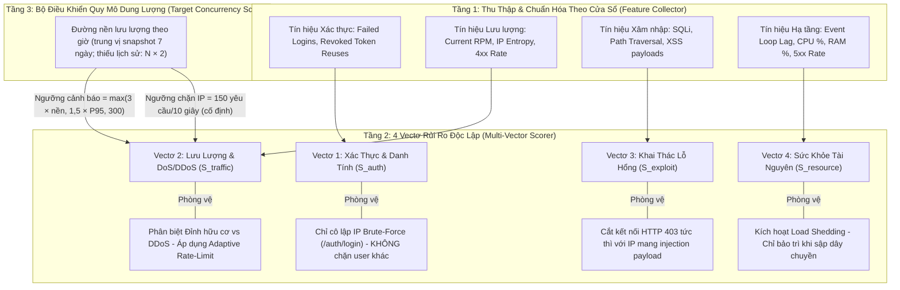

# 🛡️ Chức Năng 09: Hệ Thống AI Giám Sát Bất Thường & Tường Lửa Phong Tỏa (AIOps Sentinel & Active Quarantine Shield)

> **Mã chức năng:** `ADMIN-FEAT-09`  
> **Phiên bản:** `v2.6 (23/10/2026)`  
> **Trạng thái:** `Tạm dừng từ 2026-11-17 (xem mục Trạng thái)`  
> **Module phụ trách:**  
> - Frontend: `src/Admin-web/src/pages/system/AIOpsPage.jsx` (ghép khối), `src/Admin-web/src/pages/system/aiops/*` (`useAIOps.js`, `ScaleSection`, `SignalsSection`, `VectorSection`, `TrendSection`, `IncidentsSection`, `QuarantineSection`, `AIOpsModals`, `aiopsFormat.js`), `src/Admin-web/src/components/layout/AppLayout.jsx`  
> - Backend: `src/Backend/modules/aiops/feature.collector.js`, `anomaly.detector.js`, `aiops.quarantine.js`, `aiops.service.js`, `src/Backend/api/admin.routes.js`, `src/Backend/database/FlowMoney_Schema.sql` (bảng `aiops_metric_snapshot`)  

## Trạng thái: tạm dừng (2026-11-17)

Tính năng tạm dừng, thuộc phạm vi nâng cấp khi đưa hệ thống ra người dùng thật. Mã được giữ nguyên (bản công thức cuối: commit `a476d5ca`), bật lại bằng công tắc.

| Công tắc | Nơi đặt | Mặc định |
|---|---|---|
| `AIOPS_ENABLED` | Backend (`.env`, Render) | tắt; chỉ bật khi `= true` |
| `VITE_AIOPS_ENABLED` | Admin-web (lúc build, Vercel) | tắt; chỉ bật khi `= true` |

Bật thì bật cả hai. Chỉ bật Admin-web thì trang gọi API sẽ nhận 404.

**Khi tắt** (mã: `src/Backend/modules/aiops/aiops.toggle.js`, `src/Admin-web/src/config/features.js`; test: `tests/unit/aiops.toggle.test.js`, `src/tests/layout.test.jsx`, `src/tests/aiops.route.toggle.test.jsx`):
- Backend không thu thập chỉ số, không chạy vòng đo 10 giây, không tự khoá IP hay tài khoản, không chặn IP đang cách ly (không còn 403 `AIOPS_QUARANTINED`).
- `/admin/aiops/*` trả 404 `AIOPS_DISABLED`.
- Danh sách phong toả vẫn được nạp để bộ quét hết hạn mở các tài khoản đang bị khoá tạm đúng hạn. Khoá vĩnh viễn giữ nguyên; quản trị viên mở ở trang Người dùng.
- Đăng nhập vẫn được bảo vệ bởi bộ giới hạn tần suất (`authLimiter`, `generalLimiter`).
- Admin-web ẩn menu "Giám sát an ninh"; `/aiops` chuyển về Dashboard; không thăm dò trạng thái, không hiện banner đe doạ, bỏ qua sự kiện socket `admin.security_alert` / `admin.security_blocked`.
- Client-app không cần đổi: chỉ không còn nhận 403 `AIOPS_QUARANTINED`.
- Bảng CSDL, migration, ma trận quyền giữ nguyên.

---

---

## 📌 1. TỔNG QUAN & MỤC ĐÍCH NGHIỆP VỤ

**AIOps Sentinel & Active Quarantine Shield** là cỗ máy phòng vệ tự động thông minh (Autonomous Cyber Defense & Self-Healing Engine) chạy ngầm trực tiếp trong tiến trình Backend. Hệ thống áp dụng các mô hình học máy trực tuyến (In-process Online Learning) để liên tục học đường chuẩn vận hành (Baseline) của 24 khung giờ Việt Nam, từ đó:
1. Phát hiện sớm các sự cố sập server (DDoS, rò rỉ bộ nhớ RAM, nghẽn Event Loop).
2. Phát hiện các cuộc tấn công an ninh nguy hiểm (Dò quét mật khẩu Brute-Force, Tái sử dụng token đã thu hồi Token Hijacking, Rà quét lỗ hổng SQL Injection).
3. **Tự động kích hoạt Tường Lửa Chủ Động (Active Quarantine Shield):** Cắt đứt kết nối của nguồn IP vi phạm ngay tại đầu Express Pipeline với mã HTTP 403, giải phóng tài nguyên CPU/RAM/DB tức thì và thông báo Real-Time về Admin-web.
4. **Lưu trữ Snapshot định kỳ 5 phút (`aiops_metric_snapshot`):** Lưu trữ lịch sử 4 vectơ phục vụ soi chiếu xu hướng dài hạn (1h, 24h, 7d, 30d) mà không bị mất dữ liệu khi khởi động lại máy chủ.
5. **Cấu hình ngưỡng cảnh báo linh hoạt (Custom Vector Thresholds):** Cho phép Quản trị viên tùy chỉnh ngưỡng cảnh báo và khẩn cấp riêng biệt cho từng vectơ rủi ro theo đặc thù vận hành thực tế.

---

## ⚙️ 2. KIẾN TRÚC & CƠ CHẾ HOẠT ĐỘNG 4 VECTƠ ĐỘC LẬP (MULTI-VECTOR RISK ARCHITECTURE)

Hệ thống bãi bỏ hoàn toàn cơ chế tính điểm gộp đơn nhất (Monolithic Additive) và **loại bỏ hoàn toàn thông số tổng Threat Score** theo chỉ đạo tối cao từ Product Owner (PO). Biểu đồ và cơ chế giám sát tập trung 100% vào **4 vectơ rủi ro hoàn toàn độc lập**, mỗi vectơ có thang đo $[0, 100]$ điểm và biện pháp phòng vệ cá nhân hóa riêng biệt, triệt tiêu hoàn toàn rủi ro cộng dồn điểm gây báo động giả hoặc bảo trì khẩn cấp oan khi máy chủ vẫn vận hành bình thường:



---

## 📐 3. CÁC CÔNG THỨC TOÁN HỌC & MÔ HÌNH CHỊU TẢI DUNG LƯỢNG

### 3.1. Khảo Sát & Ước Tính Request Theo Chức Năng (Request Profiling)
Khảo sát chi tiết số lượng HTTP Request phát sinh khi Admin hoặc Client thực hiện từng chức năng cốt lõi:

| Nhóm chức năng | Hành động cụ thể | Số request phát sinh | Chi tiết endpoints |
|---|---|:---:|---|
| **Xác thực (Auth)** | Đăng nhập tài khoản | **3 reqs** | `POST /auth/login` $\to$ `GET /users/profile` $\to$ `GET /categories` |
| **Bảng điều khiển (Dashboard)** | Khởi động & tải trang chủ | **4 reqs** | `GET /wallets` $\to$ `GET /transactions/summary` $\to$ `GET /budgets` $\to$ `GET /audit_log/summary` |
| **Giao dịch (Transactions)** | Thêm 1 giao dịch mới | **2 reqs** | `POST /transactions` $\to$ `GET /wallets/balance` (cập nhật số dư) |
| **Báo cáo (Reports)** | Xuất báo cáo thu chi tháng | **3 reqs** | `GET /reports/cashflow` $\to$ `GET /reports/category-breakdown` $\to$ `GET /reports/trends` |
| **Đồng bộ ngầm (Background Sync)** | Mobile app duy trì kết nối | **~2 req/phút** | Heartbeat token check & thông báo đẩy |

Trung bình một người dùng hoạt động tích cực (Active User) tạo ra khoảng **10 requests/phút** ($\mu \approx 0.15\text{ req/s}$).

### 3.2. Mô Hình Chịu Tải & Cơ Sở Lý Thuyết Khoa Học (Theoretical Capacity Foundations)
Để bảo vệ hệ thống trước hội đồng giảng viên và các chuyên gia kiến trúc, các công thức được thiết lập dựa trên các định luật khoa học máy tính chuẩn mực:

1. **Định luật Little trong Lý thuyết Xếp hàng ($L = \lambda \times W$):**
   - Trong một hệ thống ổn định, số lượng người dùng đồng thời trong hệ thống $L$ ($N$ CCU) bằng tích của tần suất request $\lambda$ và thời gian dừng trung bình của người dùng $W$.
   - Khảo sát thực nghiệm hành vi người dùng ứng dụng tài chính cho thấy: 1 Active User thực hiện trung bình 1 hành động nghiệp vụ mỗi $6$ giây $\implies \lambda_{\text{user}} \approx 10\text{ req/phút} \approx 0.167\text{ RPS}$.
   - **Baseline RPM kỳ vọng:**
     $$\text{Baseline RPM}(N) = N \times 10\text{ req/phút}$$
     - $N = 500 \implies 5,000\text{ RPM} \approx 83\text{ RPS}$.
     - $N = 1,000 \implies 10,000\text{ RPM} \approx 167\text{ RPS}$.
     - $N = 2,000 \implies 20,000\text{ RPM} \approx 333\text{ RPS}$.
   - **Trần Đỉnh An Toàn (Safe Peak Ceiling $3\times$):**
     $$\text{Safe Peak RPM}(N) = 3 \times \text{Baseline RPM}(N) = N \times 30\text{ req/phút}$$
     $$\text{Safe Peak RPS}(N) = \frac{N \times 30}{60} = \frac{N}{2}\text{ req/giây (RPS)}$$
     - Quy đổi tương đương chuẩn xác: Đỉnh an toàn cho $N = 1,000$ CCU là $30,000\text{ RPM} \leftrightarrow 500\text{ RPS}$.
     - Lưu lượng hợp pháp có thể dao động tự nhiên lên tới $3\times$ baseline trong các đợt cao điểm mà **không bao giờ bị hệ thống coi là tấn công DoS**.

2. **Định luật Amdahl & Đặc Thù Đơn Luồng (Single-Threaded Event Loop của Node.js):**
   - Node.js xử lý non-blocking I/O trên một luồng chính duy nhất (Single Thread). Khi tải tăng cao, sự sụt giảm hiệu năng không bắt đầu từ CPU hay RAM chạm $100\%$, mà bắt đầu từ hiện tượng nghẽn luồng xử lý (Event Loop Contention).
   - Chỉ số **Event Loop Lag** ($> 100\text{ms}$) là chỉ báo sớm nhạy cảm nhất về tình trạng nghẽn pipeline (CPU-bound tasks hoặc cryptographic hashing quá tải), giúp kích hoạt cơ chế Load Shedding từ trước khi tiến trình rơi vào trạng thái sập hoàn toàn (Denial of Service).

3. **Ngưỡng An Ninh Co Giãn Logarit (Logarithmic Threat Threshold Scaling):**
   - Khi quy mô người dùng tăng từ $100$ lên $5,000$ CCU, số lần gõ nhầm mật khẩu tự nhiên cũng tăng theo xác suất thống kê. Nếu áp dụng ngưỡng cố định cứng, hệ thống sẽ tự khóa nhầm người dùng hợp pháp (False Positives).
   - Ngưỡng thất bại xác thực tối đa cho phép trên phút:
     $$\text{Auth Fail Threshold}(N) = \max\left(15, \text{round}\left(15 + 10 \cdot \log_{10}\left(\frac{N}{100}\right)\right)\right)\text{ lần/phút}$$
     - $N = 100 \implies 15\text{ lần/phút}$.
     - $N = 1,000 \implies 15 + 10 \times 1 = 25\text{ lần/phút}$.
     - $N = 5,000 \implies 15 + 10 \times 1.7 = 32\text{ lần/phút}$.
   - Ngưỡng cách ly IP động: $\text{Quarantine Burst Limit}(N) = \max\left(150, \text{round}\left(20 + 50 \cdot \log_{10}(N)\right)\right)\text{ req/10s}$.

4. **Cơ Chế Lưu Cứng Quy Mô CCU Bền Vững (Persistent Concurrency Scaling):**
   - **Lưu Cứng Trong CSDL PostgreSQL (`aiops_setting`):** Khi Admin thay đổi quy mô $N$ (qua nút chọn mẫu 500, 1000, 2000, 5000 hoặc nhập tay), giá trị được ghi tức thì vào CSDL Supabase với khóa `target_concurrency`.
   - **Tự động phục hồi khi máy chủ khởi động lại:** Backend nạp `target_concurrency` từ CSDL ngay khi khởi động (`loadPersistedSettings()`), tuyệt đối không tự ý rơi về 100 CCU.
   - **Lưu đệm LocalStorage (`aiops_target_concurrency`):** Admin-web lưu đệm trên trình duyệt, đảm bảo khi Admin tải lại trang (F5), chuyển trang, hoặc đăng nhập lại, quy mô chịu tải luôn ổn định vững chắc.

### 3.3. Công Thức Đo Lường Cá Nhân Hóa Từng Vectơ Rủi Ro
Mỗi vectơ đo lường mức độ nguy cơ độc lập trong thang điểm $[0, 100]$:

1. **Vectơ 1: Xác Thực & Danh Tính ($S_{\text{auth}}$)**:
   $$S_{\text{auth}} = \min(100, (\text{failedLogins} \times 8) + (\text{tokenReuseAttacks} \times 25))$$
   - 1 lần đăng nhập sai chỉ chiếm $8$ điểm (không thể gây báo động hay khóa admin).
   - Chỉ khi đăng nhập sai $\ge 5$ lần/10s hoặc có tái dùng token đã thu hồi, $S_{\text{auth}}$ mới chạm ngưỡng cảnh báo.

2. **Vectơ 2: Lưu Lượng & DoS ($S_{\text{traffic}}$)**:
   $$S_{\text{traffic}} = \min(100, \text{rpmThreat} \times (1 - \text{entropyFactor}))$$
   - Khi RPM tăng vọt nhưng độ phân tán IP cao ($\text{distinctIps} \ge 10$) $\implies$ $\text{entropyFactor} \to 0.8 \implies$ $S_{\text{traffic}}$ được dìm xuống dưới $25$ điểm (Lưu lượng tự nhiên).
   - Khi RPM tăng vọt mà chỉ có $1-2$ IP $\implies$ $\text{entropyFactor} \to 0 \implies$ $S_{\text{traffic}}$ vọt lên $80-100$ điểm (DDoS tập trung).

3. **Vectơ 3: Khai Thác Lỗ Hổng & Thăm Dò ($S_{\text{exploit}}$)**:
   $$S_{\text{exploit}} = \min(100, \text{malformedRequests} \times 30)$$
   - Phát hiện các mẫu SQL Injection (`' OR 1=1`), Path Traversal (`../etc/passwd`), XSS probe.

4. **Vectơ 4: Sức Khỏe Tài Nguyên Hệ Thống ($S_{\text{resource}}$)**:
   $$S_{\text{resource}} = \min(100, \text{lagFactor} + \text{ramFactor} + \text{cpuFactor} + \text{err5xxFactor})$$
   - **Đo lường từ máy chủ thật (`SystemHardwareMonitor`):** % CPU đo bằng Delta Ticks tức thời ($1,000\text{ms}$ interval) và % RAM đo từ `os.totalmem()` / `os.freemem()` thật của máy chủ đang chạy, loại bỏ hoàn toàn việc gán cứng số giả lập.
   - Phản ánh độ trễ Event Loop ($> 100\text{ms}$), RAM ($> 90\%$), CPU ($> 85\%$) và mã lỗi HTTP 5xx ($> 5\%$).

### 3.4. Bãi Bỏ Thông Số Tổng Threat Score (Theo Phê Duyệt Của PO)
- **Quyết định của PO:** Bỏ hoàn toàn thông số điểm Threat Score tổng gộp trên toàn bộ giao diện và luồng cảnh báo chính của AIOps Sentinel.
- **Cơ sở khoa học:** Biểu đồ 4 vector độc lập đã định lượng chi tiết và trực quan hóa từng khía cạnh rủi ro riêng biệt ($S_{\text{auth}}, S_{\text{traffic}}, S_{\text{exploit}}, S_{\text{resource}}$). Việc gộp hoặc cộng dồn các vector thành 1 con số đe dọa tổng quát duy nhất tiềm ẩn nguy cơ "báo động giả chùm":
  + Ví dụ: Nếu mỗi vector chỉ biến động nhẹ $20 - 30$ điểm (hoàn toàn bình thường trong vận hành thực tế), công thức tổng hợp có thể đẩy điểm số lên mức báo động đỏ, gây kích hoạt chế độ bảo trì khẩn cấp ngoài ý muốn.
  + Việc loại bỏ Threat Score tổng giúp đội ngũ Quản trị viên và hệ thống phòng vệ phản ứng chính xác đúng nơi có sự cố: chỉ cách ly IP vi phạm nếu rủi ro thuộc $S_{\text{auth}}$ / $S_{\text{exploit}}$, chỉ điều chỉnh phân luồng nếu thuộc $S_{\text{traffic}}$, và chỉ bảo trì khi có nguy cơ sập phần cứng từ $S_{\text{resource}}$.

### 3.5. Chống đầu độc đường nền (cập nhật 2026-11-17)
Bỏ EWMA cập nhật mỗi 10 giây. Đường nền lưu lượng là **trung vị** snapshot có `is_anomaly = false` trong 7 ngày, tính lại mỗi giờ. Trung vị không bị một đợt tấn công kéo lệch, và mẫu bất thường bị loại khỏi tập học. Công thức đầy đủ (điểm liên tục, ngưỡng, năng lực theo Luật sử dụng): [AIOPS_CONG_THUC.md](../AIOps/AIOPS_CONG_THUC.md).

---

## 🛑 4. CƠ CHẾ TƯỜNG LỬA CHỦ ĐỘNG & TỰ ĐỘNG PHONG TỎA (ACTIVE QUARANTINE SHIELD)

### 4.1. Bốn Kịch Bản Tự Động Phong Tỏa (Auto-Quarantine Triggers)
Khi phát hiện vi phạm, `AIOpsQuarantineManager` tự động đưa nguồn IP vào danh sách đen In-Memory với thời hạn cách ly cụ thể:

| Hình thái tấn công | Ngưỡng vi phạm tự động | Thời gian phong tỏa | Mã lý do |
|---|---|:---:|---|
| **DoS Request Burst** | Gửi $> 120$ request / 10 giây | **15 phút** | `Tấn công DoS quá ngưỡng request` |
| **Quét lỗ hổng SQLi / Path Traversal** | Gửi request chứa `' OR 1=1`, `../etc/passwd` $\ge 3$ lần | **30 phút** | `SQL Injection / Malicious Probe` |
| **Dò mật khẩu Brute-force** | Đăng nhập thất bại liên tiếp 5 lần trong 10 giây | **15 phút** | `Dò mật khẩu Brute-Force` |
| **Tái sử dụng Token đã hủy** | Gửi Refresh Token đã thu hồi (Bị hack hoặc đánh cắp) | **15 phút** | `Phát hiện hành vi chiếm đoạt Token` |

### 4.2. Mã Phản Hồi Ngắt Kết Nối Ngay Đầu Pipeline (HTTP 403)
Khi một IP đã bị phong tỏa gửi request lên server:
```json
HTTP/1.1 403 Forbidden
{
  "success": false,
  "code": "AIOPS_QUARANTINED",
  "error": "AIOPS_QUARANTINED",
  "message": "Kết nối từ thiết bị của bạn tạm thời bị phong tỏa do hệ thống phát hiện hành vi bất thường hoặc dấu hiệu tấn công an ninh.",
  "reason": "Tấn công DoS quá ngưỡng request",
  "quarantineExpiresAt": "2026-10-03T03:30:00.000Z"
}
```
Request bị ngắt lập tức trước khi chạm vào router nghiệp vụ hoặc database, giải phóng tài nguyên CPU và RAM tức thì.

### 4.3. Khoá IP chặn cả quản trị viên (đổi nghiệp vụ 2026-11-16)
Trước 2026-11-16, request đã xác thực là admin (`req.isAdmin`) đi qua mọi IP bị khoá, và admin đăng nhập thì IP của mình được gỡ khoá và miễn khoá 24 giờ. Cơ chế đó đã **bỏ**, vì kẻ chiếm được một tài khoản admin có thể dùng nó để tự gỡ khoá IP của mình. Nay:
1. IP đang bị khoá thì chặn mọi request (403 `AIOPS_QUARANTINED`), kể cả admin có token hợp lệ. Admin đăng nhập không gỡ và không miễn khoá IP.
2. Ngoại lệ duy nhất: **tài khoản quản trị gốc** (mục 4.8): request mang token hợp lệ của tài khoản gốc, hoặc `POST /api/auth/login` với tên đăng nhập trùng `ROOT_ADMIN_USERNAME` (vẫn phải qua mật khẩu và khoá thứ hai).
3. IP không bao giờ bị khoá: loopback và các IP trong `ADMIN_TRUSTED_IPS` (biến môi trường, phân cách dấu phẩy). Trên Render chưa đặt biến này, nên chỉ còn loopback.
4. Admin được khoá IP mình đang dùng (trừ IP máy chủ); không được khoá tài khoản của chính mình (403 `CANNOT_LOCK_SELF`); được khoá tài khoản admin khác.
5. Admin-web nhận 403 `AIOPS_QUARANTINED` thì hiện "IP bạn đang dùng bị khóa tạm thời đến …" theo ngôn ngữ đang chọn, ở mọi trang kể cả Đăng nhập (`api/axios-client.js`).
6. **Miễn trừ môi trường phát triển:** khi `NODE_ENV === 'development'`, loopback không bị chặn. IP lấy bằng `req.ip` theo `trust proxy`, không đọc thô `X-Forwarded-For`.
7. Hết hạn phiên chỉ trả 401; chỉ khi dùng lại refresh token đã thu hồi (`req.tokenReuseDetected`) mới tính là dấu hiệu chiếm phiên.

### 4.5. Định Danh Chuẩn Xác Tác Nhân & Phân Quyền 2 Tầng (Early Token Decoder & Role Resolution)
Hệ thống giải quyết triệt để tình trạng sai lệch dữ liệu ("Khách vãng lai / Ẩn danh" và gán nhầm IP máy chủ):
1. **Giải mã Token sớm (Early Token Decoder):** Tầng thu thập lưu lượng (`FeatureCollector`) chủ động bóc tách JWT Bearer Token ngay từ đầu Pipeline, trích xuất tức thì `userId`, `username`, và `role` (`Admin`, `User`, `Guest`) trước khi luồng request đi sâu vào các middleware nghiệp vụ.
2. **Chính danh cho sự cố hạ tầng máy chủ (System Actor Attribution):** Các sự cố thuộc Vectơ 4 (RAM 92%, CPU, Event Loop Lag, HTTP 5xx) là hiện tượng tài nguyên phần cứng, được định danh đích danh là `System Core Engine` (Tác nhân: `⚙️ Hệ thống`), IP hiển thị `Nội bộ hệ thống (Loopback)`, không bao giờ bị gán nhầm cho người dùng hay khách vãng lai.
3. **Hiển thị trực quan 4 nhóm phân quyền:** Bảng RCA phân tách rõ ràng với các huy hiệu sinh động:
   - 👑 **Quản trị viên (Admin):** Tài khoản quản trị cấp cao với đặc quyền Fast-Lane.
   - 👤 **Khách hàng (User):** Người dùng ứng dụng mobile đã đăng nhập hợp lệ.
   - ⚙️ **Hệ thống (System):** Tiến trình lõi máy chủ Node.js & CSDL.
   - 🌐 **Khách vãng lai (Guest):** Client chưa định danh hoặc các luồng quét tự động chưa đăng nhập.

### 4.6. Tự mở khoá khi hết hạn
- Bộ quét `sweepExpiredQuarantines()` chạy định kỳ (60 giây) và lúc khởi động (`_reconcileAutoLocks`): dòng `TEMPORARY` hết hạn trong `aiops_ip_quarantine` / `aiops_account_quarantine` chuyển `UNLOCKED` (dòng vẫn giữ), và tài khoản được trả về `Active`.
- Chỉ mở `account` khi `Reason_Inactive` còn mang dấu khoá có thời hạn của AIOps: `[AIOPS_AUTO_QUARANTINE]` (AIOps tự khoá) hoặc `[AIOPS_ADMIN_TEMP]` (admin tạm khoá). Khoá vĩnh viễn `[AIOPS_ADMIN_BAN]` và khoá ở trang Người dùng (không có dấu) không bao giờ tự mở. Các dấu này bị bỏ khỏi lý do trả cho app (`lyDoChoNguoiDung`).
- Sau mỗi thay đổi phát `admin.quarantine_updated` để Admin-web tải lại danh sách.

### 4.7. Vòng đời khoá và danh sách khoá (2026-11-16)
- **Tài khoản:** tạm khoá (mặc định 4 giờ, khoá tay chọn 1 / 4 / 12 / 24 giờ) → hết hạn tự mở; đang tạm khoá có thể nâng lên khoá vĩnh viễn; khoá vĩnh viễn chỉ admin mở. Khoá ghi `account.Status = 'Inactive'` (người dùng nhận `ACCOUNT_INACTIVE` khi đăng nhập / gọi API, phiên đang mở bị đẩy ra qua `account.force_logout`) và một dòng trong `aiops_account_quarantine`.
- **IP:** chỉ tạm khoá; "Khóa thêm 4 giờ" gọi `POST /api/admin/aiops/quarantine/extend-ip` (route cũ `permanent-ip` trỏ cùng hàm, giữ cho tương thích).
- **Danh sách** (`GET /api/admin/aiops/quarantine` → `listQuarantines()`) đọc từ CSDL, không phụ thuộc bộ nhớ: mọi IP và tài khoản từng bị khoá, kể cả đã mở (ghi người mở và thời điểm). Mỗi dòng là cặp (IP, tài khoản) theo lần vi phạm gần nhất; khoá tay một tài khoản không gắn IP thì là dòng chỉ có tài khoản.
- Khoá lần đầu một tài khoản chưa từng có dòng thì tạo dòng mới (`upsertAccountLock`); mỗi tài khoản một dòng, khoá lại thì dòng đó trở lại trạng thái khoá. Mã dòng lấy theo đúng tên đăng nhập (dòng có sẵn) hoặc băm SHA-256 của cả tên; mã cũ chỉ phân biệt 16 ký tự đầu nên từng gộp nhầm hai tên trùng tiền tố.
- Mở tài khoản ở trang Người dùng cũng chuyển dòng AIOps đang khoá của tài khoản đó sang `UNLOCKED` ("Mở từ trang Người dùng").
- Danh sách chỉ gồm khoá do AIOps tạo (tự động và thủ công trên trang AIOps); vô hiệu hoá ở trang Người dùng vẫn chỉ hiện ở trang Người dùng.

### 4.8. Tài khoản quản trị gốc (2026-11-16)
- Một tài khoản duy nhất, email cố định `admin@wealthcommand.com` (`modules/auth/root-admin.js`, trùng trigger `fn_protect_root_admin` trong `database/FlowMoney_Schema.sql`). Không thêm cột vào `account`.
- **Không ai khoá được:** trigger `trg_protect_root_admin` chặn xoá vật lý, đổi Email / Username / Idrole, đưa khỏi `Active`, đặt `Delete_at`, và chặn tài khoản không phải admin dùng email này. Tầng dịch vụ báo 403 `ROOT_ACCOUNT_PROTECTED` trước khi chạm trigger (AIOps khoá tay); AIOps tự khoá bỏ qua tài khoản này. IP của nó vẫn có thể nằm trong danh sách khoá, nhưng request của tài khoản gốc đi qua lớp chặn IP (mục 4.3).
- **Đăng nhập hai bước:** mật khẩu (bcrypt trong CSDL) + `rootKey` khớp `ROOT_ADMIN_SECOND_KEY` (biến môi trường, so bằng `timingSafeEqual`). Thiếu khoá → 401 `ROOT_KEY_REQUIRED`; sai → 401 `ROOT_KEY_INVALID`; máy chủ chưa đặt biến → 403 `ROOT_KEY_NOT_CONFIGURED`. Admin-web hiện thêm ô "Khoá quản trị gốc" khi nhận `ROOT_KEY_REQUIRED`.
- **Cắt phiên khi bị lộ:** token mang `root: true` và `rkf` (HMAC của khoá thứ hai bằng bí mật JWT). Đổi `ROOT_ADMIN_SECOND_KEY` rồi khởi động lại → middleware, socket và `/auth/refresh` từ chối phiên cũ (401 `ROOT_SESSION_REVOKED`).
- Mỗi lần đăng nhập thành công gửi email cảnh báo tới `ADMIN_ALERT_EMAIL`.
- Tạo tài khoản: `node scripts/seed_root_admin.js --url=…` (đọc `ROOT_ADMIN_USERNAME / EMAIL / PASSWORD`; luỹ đẳng; `--reset-password` đặt lại mật khẩu). Lần đăng nhập đầu phải đổi mật khẩu và đặt PIN.
- Giữ an toàn tài khoản này là trách nhiệm của admin đứng đầu nắm giữ nó.

---

## 💼 5. CÔNG DỤNG & GIÁ TRỊ NGHIỆP VỤ

- **Tự chữa lành và tự vệ (Self-Healing System):** Máy chủ tự động đẩy lùi các đợt tấn công mà không cần lập trình viên phải thức đêm trực canh.
- **Tiết kiệm chi phí hạ tầng:** Giảm tải đến $95\%$ lưu lượng rác tấn công vào cơ sở dữ liệu PostgreSQL.
- **Bảo mật chuẩn ngân hàng:** Chống lại các cuộc tấn công chiếm đoạt tài khoản tiền gửi của khách hàng.

---

## 🧩 6. TÍNH NĂNG ĐI KÈM TRÊN GIAO DIỆN (trang "Giám sát an ninh", cập nhật 2026-11-14 theo mã)

Trang `AIOpsPage.jsx` chỉ ghép các khối; dữ liệu, socket và thao tác nằm ở `pages/system/aiops/useAIOps.js` (tham số tải đọc qua ref nên vòng làm mới định kỳ luôn dùng bộ lọc đang chọn). Thứ tự khối trên trang:

**Mọi thao tác ghi trên trang đều qua hộp PIN chung** (máy chủ kiểm, `pin` gửi trong body; thiếu / sai PIN thì không thay đổi gì): đổi quy mô, hiệu chuẩn, bật / tắt phòng vệ, chặn từ sự cố, khoá / mở / khoá thêm IP, tạm khoá / khoá vĩnh viễn / mở tài khoản, khoá thủ công, bảo trì khẩn cấp, xem IP đầy đủ. Thao tác chỉ đọc (xem, lọc, phân trang, đổi khung biểu đồ, Làm mới) không cần PIN.

1. **Tiêu đề và nút hành động:** Làm mới (tải lại đúng trang và bộ lọc đang xem; lỗi thì báo lỗi); Hiệu chuẩn (6 ô ngưỡng; số mờ trong ô là ngưỡng đang hiệu lực do Backend trả; chỉ gửi ô đã nhập, ô trống giữ nguyên; nút "Về mặc định" qua PIN gửi `resetThresholds: true` để bỏ mọi ngưỡng tuỳ chỉnh; ngưỡng được lưu vào `aiops_setting`; kết quả là báo cáo năng lực theo Luật sử dụng, `POST /api/admin/aiops/calibrate`); Bảo trì khẩn cấp (chỉ hiện khi Backend đề xuất `EMERGENCY_MAINTENANCE` hoặc vectơ tài nguyên ở mức CRITICAL).
2. **Quy mô người dùng (`ScaleSection`):** 4 mức có sẵn và ô nhập 100–50.000 (`POST /api/admin/aiops/scale`); ba thẻ Lưu lượng nền (kèm nguồn: từ lịch sử / 24 giờ gần nhất / ước tính), Ngưỡng cảnh báo lưu lượng, Ngưỡng chặn IP đều lấy nguyên từ `indicators` của Backend; Admin-web không tự tính (công thức: [AIOPS_CONG_THUC.md](../AIOps/AIOPS_CONG_THUC.md)).
3. **Chỉ số (`SignalsSection`):** dấu hiệu tấn công và tải máy chủ; thẻ ghi "Gần ngưỡng" khi vượt mức chú ý A và "Vượt ngưỡng" khi chạm ngưỡng cảnh báo T (mốc do Backend trả); độ trễ là p99 vòng lặp sự kiện trong cửa sổ kèm giá trị cao nhất; RAM là RAM tiến trình (RSS / hạn mức); số hiện theo định dạng của ngôn ngữ đang chọn (vd. "0,15 nhân" / "0.15 cores").
4. **Nhóm rủi ro (`VectorSection`):** 4 thẻ với điểm /100 và trạng thái phòng vệ; công tắc bật / tắt qua PIN (`POST /api/admin/aiops/vectors/toggle`).
5. **Xu hướng rủi ro (`TrendSection`):** khoảng 10 phút / 1 giờ / 24 giờ / 7 ngày / 30 ngày hoặc Từ – Đến. Nhãn trục ngang đặt theo thời gian thật (7 ngày: −7…0); khoảng tự chọn ghi giờ (≤ 24 giờ), ngày + giờ (≤ 3 ngày) hoặc ngày, không trùng nhãn; đường ngắt ở quãng mất số liệu (cách nhau > 3 lần khoảng trung vị); bỏ điểm ngoài khung; trục dọc 0 / 50 / 100 và vạch ngưỡng 70, 85; số cạnh chú thích là điểm hiện tại, hoặc điểm của mẫu cuối khi xem khoảng tự chọn.
6. **Sự cố (`IncidentsSection`):** lọc nhóm / trạng thái / từ khoá, phân trang. Sự kiện `admin.anomaly_detected`: sự cố đang hiện thì cập nhật tại chỗ; sự cố mới (lần đầu, đang diễn ra) chỉ tăng tổng khi khớp bộ lọc, chỉ chèn khi đang ở trang 1 và giữ đúng cỡ trang. Nút "Chặn" qua PIN (gửi `ipHash`, không gửi IP đầy đủ); sự cố của hệ thống hoặc loopback không có nút chặn.
7. **Nguồn bị chặn (`QuarantineSection`):** lọc trạng thái (Tất cả / Đang khóa / Đã mở), IP, tài khoản; dòng đã mở ghi "Đã mở bởi … lúc …"; dòng chỉ có tài khoản không có cột / nút IP; tài khoản khoá vĩnh viễn có nút Mở khóa; "Xem IP đầy đủ" và "Hồ sơ điều tra" như trước; "Tạm khóa thủ công" IP hoặc tài khoản trong 1 / 4 / 12 / 24 giờ.
8. **Realtime:** `admin.metrics_stream`, `admin.security_alert`, `admin.security_blocked`, `admin.quarantine_updated`, `admin.anomaly_detected`, `admin.maintenance_changed`, `admin.vector_config_changed`. Các sự kiện và phản hồi `/api/admin/aiops/*` không mang IP đầy đủ.
9. **Kiểm thử:** Admin-web `tests/aiops.test.jsx`, `aiops.trend.test.jsx`, `aiops.quarantined.message.test.js`, `auth.test.jsx`; Backend `tests/unit/aiops.lock_lifecycle.test.js`, `aiops.controller.pin_selflock.test.js`, `root_admin.test.js`, và hai test chạy trên CSDL thử khi có `TEST_DATABASE_URL`: `aiops.quarantine.repo.db.test.js`, `root_admin.trigger.db.test.js`.

---

## 🗄️ 6.1. CẤU TRÚC BẢNG CSDL `aiops_incident` (POSTGRESQL)

| Tên Cột | Kiểu Dữ Liệu | Ràng buộc | Ý nghĩa Nghiệp vụ |
|---|---|---|---|
| `id` | `VARCHAR(64)` | `PRIMARY KEY` | Khóa chính sự cố (UUID v4) |
| `code` | `VARCHAR(64)` | `NOT NULL` | Mã loại bất thường (VD: `ANOMALY_AUTH_FAIL_SURGE`) |
| `vector` | `VARCHAR(32)` | `NOT NULL` | Nhóm rủi ro (`auth`, `traffic`, `exploit`, `resource`) |
| `severity` | `VARCHAR(16)` | `NOT NULL` | Mức độ cảnh báo (`HIGH`, `MEDIUM`, `LOW`) |
| `message` | `TEXT` | `NOT NULL` | Mô tả tóm tắt sự cố |
| `status` | `VARCHAR(20)` | `DEFAULT 'ACTIVE'` | Trạng thái (`ACTIVE` hoặc `MITIGATED`) |
| `actor_type` | `VARCHAR(32)` | `DEFAULT 'IP'` | Phân loại đối tượng (`IP`, `USER`, `BOT`) |
| `actor_identity` | `VARCHAR(64)` | `NOT NULL` | Địa chỉ IP đã che giấu (`113.161.xx.xx`) |
| `actor_hash` | `VARCHAR(64)` | `NOT NULL` | Băm đối tượng: IP băm HMAC-SHA256 64 ký tự bằng khóa `BLIND_INDEX_SECRET` (từ G4.1a, 2026-11-13) |
| `user_id` | `VARCHAR(64)` | `NULLABLE` | ID tài khoản vi phạm (nếu đã xác thực) |
| `username` | `VARCHAR(64)` | `NULLABLE` | Tên người dùng vi phạm (nếu có) |
| `actor_role` | `VARCHAR(50)` | `NULLABLE` | Vai trò quyền hạn (`Admin`, `User`, `System`, `Guest`) |
| `user_agent` | `TEXT` | `NULLABLE` | Thông tin User-Agent định danh trình duyệt/công cụ |
| `target_endpoint` | `VARCHAR(255)` | `NULLABLE` | Tuyến API bị nhắm mục tiêu tấn công/quá tải |
| `metric_current` | `NUMERIC(12,2)`| `NOT NULL` | Giá trị đo được tại thời điểm bất thường |
| `metric_baseline`| `NUMERIC(12,2)`| `NOT NULL` | Giá trị đường chuẩn đối chiếu |
| `metric_unit` | `VARCHAR(32)` | `NULLABLE` | Đơn vị đo (`req/min`, `ms`, `%`, `lần`) |
| `mitigation_taken`| `TEXT` | `NULLABLE` | Hành động bảo vệ đã thực hiện |
| `root_cause_diagnosis` | `TEXT` | `NULLABLE` | Phân tích chẩn đoán nguyên nhân gốc rễ của AI |
| `hits` | `INTEGER` | `DEFAULT 1` | Số lần sự cố liên tục lặp lại |
| `first_detected_at` | `TIMESTAMPTZ` | `DEFAULT NOW()` | Thời điểm phát hiện lần đầu tiên |
| `last_seen_at` | `TIMESTAMPTZ` | `DEFAULT NOW()` | Thời điểm gần nhất sự cố còn xuất hiện |
| `mitigated_at` | `TIMESTAMPTZ` | `NULLABLE` | Thời điểm sự cố được giảm thiểu thành công |

---

## ⚙️ 6.2. CẤU TRÚC BẢNG THIẾT LẬP BỀN VỮNG `aiops_setting` (POSTGRESQL)

Bảng cấu hình khóa-giá trị chuyên biệt dùng để **lưu cứng (hard-persist)** các tham số vận hành của hệ thống AIOps (tiêu biểu là quy mô tải `target_concurrency`), đảm bảo hệ thống không bao giờ tự ý reset về 100 CCU khi khởi động lại máy chủ hoặc khi Admin đăng nhập lại:

| Tên Cột | Kiểu Dữ Liệu | Ràng buộc | Ý nghĩa Nghiệp vụ |
|---|---|---|---|
| `key` | `VARCHAR(64)` | `PRIMARY KEY` | Tên tham số cấu hình (VD: `target_concurrency`) |
| `value` | `TEXT` | `NOT NULL` | Giá trị cấu hình được lưu cứng (VD: `'1000'`) |
| `updated_at` | `TIMESTAMP(6)` | `DEFAULT CURRENT_TIMESTAMP` | Thời điểm cập nhật giá trị gần nhất |

**Quy trình đồng bộ 2 lớp (Dual-Layer Persistence):**
1. **Lớp 1 (PostgreSQL `aiops_setting`):** Nguồn sự thật tin cậy duy nhất trên Server. Khi Backend khởi động, phương thức `loadPersistedSettings()` tự động khôi phục quy mô CCU đã lưu và tái áp dụng ngay cho mô hình chịu tải. Khi Admin thay đổi quy mô, controller gọi `setSetting('target_concurrency', value)` để UPSERT vào CSDL.
2. **Lớp 2 (Trình duyệt `localStorage.getItem('aiops_target_concurrency')`):** Bộ nhớ đệm cục bộ tức thì trên Admin-web. Giữ nguyên giá trị 1,000 CCU ngay khi tải lại trang hoặc đăng nhập lại, chống nhảy số 100 CCU trước khi API round-trip hoàn tất.

---

## 🗄️ 6.3. CẤU TRÚC 3 BẢNG CSDL LƯU TRỮ PHONG TỎA N-N & ĐIỀU TRA AN NINH (POSTGRESQL)

Nhằm tối ưu hóa năng lực điều tra an ninh, phục vụ yêu cầu kiểm soát bảo mật và tuân thủ Luật An ninh mạng & Nghị định 53/2022/NĐ-CP (lưu trữ dữ liệu nhật ký tối thiểu 12 tháng), hệ thống áp dụng **Mô hình 3 Bảng Quan Hệ N-N (Many-to-Many Relationship)** để quản lý Địa chỉ IP và Tài khoản vi phạm:

```
┌───────────────────────────┐         ┌──────────────────────────────────────┐         ┌─────────────────────────────────┐
│    aiops_ip_quarantine    │ 1     N │    aiops_quarantine_incident_link    │ N     1 │    aiops_account_quarantine     │
│───────────────────────────│─────────│──────────────────────────────────────│─────────│─────────────────────────────────│
│ id (PK)                   │         │ id (BIGSERIAL PK)                    │         │ id (PK)                         │
│ ip_hash (UNIQUE SHA-256)  │         │ ip_quarantine_id (FK)                │         │ username (UNIQUE lowercase)     │
│ masked_ip                 │         │ account_quarantine_id (FK)           │         │ idaccount (INT)                 │
│ raw_ip (optional)         │         │ ip_hash (INDEX)                      │         │ status (TEMPORARY/PERMANENT/...)│
│ status                    │         │ username (INDEX)                     │         │ hits (INTEGER)                  │
│ hits                      │         │ incident_code                        │         │ banned_by / unblocked_by        │
│ banned_at / expires_at    │         │ reason                               │         │ banned_at / expires_at          │
│ banned_by / unblocked_by  │         │ detected_at (TIMESTAMPTZ)            │         │ unblock_reason                  │
└───────────────────────────┘         └──────────────────────────────────────┘         └─────────────────────────────────┘
```

1. **Bảng Địa Chỉ IP (`aiops_ip_quarantine`):**
   - Quản lý trạng thái phong tỏa của nguồn mạng (`TEMPORARY`: Tạm khóa, `PERMANENT`: Khóa vĩnh viễn, `UNLOCKED`: Đã mở khóa).
   - Bảo mật theo Rule 9: Masked IP (`xxx.xxx.xx.xx`), SHA-256 IP Hash phục vụ tra cứu $O(1)$.
   - Ghi nhận thông tin người thực thi (`banned_by`, `unblocked_by`, `unblock_reason`).
   - **Đồng bộ thời hạn (`expires_at`):** Khi Admin Mở khóa (`UNLOCKED`) hoặc Phong tỏa vĩnh viễn (`PERMANENT`), CSDL tự động gán `"expires_at" = NULL`. Khi Tạm khóa (`TEMPORARY`), CSDL cập nhật chính xác timestamp hết hạn mới.
2. **Bảng Tài Khoản Người Dùng (`aiops_account_quarantine`):**
   - Quản lý trạng thái phong tỏa danh tính (`TEMPORARY`, `PERMANENT`, `UNLOCKED`).
   - **Đồng bộ thời hạn (`expires_at`):** Khi mở khóa hoặc phong tỏa vĩnh viễn, `"expires_at" = NULL`. Khi tạm khóa, lưu timestamp hết hạn tương ứng.
   - **Liên kết 2 chiều với bảng `account` trong CSDL:** Khi tài khoản bị cách ly, tạm khóa hoặc khóa vĩnh viễn, hệ thống tự động cập nhật bảng `account` với `status: 'Locked'`. Khi mở khóa hoặc hết hạn tạm khóa tự động (Auto-expire), hệ thống tự động cập nhật lại bảng `account` với `status: 'Active', reason_inactive: null`.
3. **Bảng Sự Cố Liên Kết N-N (`aiops_quarantine_incident_link`):**
   - Lưu trữ nhật ký bất biến (Append-Only) mọi sự cố tấn công liên kết giữa IP và Tài khoản.
   - Hỗ trợ cơ quan chức năng và Quản trị viên truy vết chéo: 1 IP đã tấn công những tài khoản nào, và 1 tài khoản đã bị tấn công/truy cập từ những IP nào.
4. **Cơ Chế Hydration & Auto-Expire Khi Boot Server (Zero-Loss On Restart):**
   - Khi Server khởi động, phương thức `hydrateFromDatabase()` tự động nạp tất cả IP và Tài khoản đang có hiệu lực (`PERMANENT` hoặc `TEMPORARY` chưa hết hạn) vào bộ nhớ RAM Cache.
   - Middleware chặn request tại đầu Express Pipeline với độ phức tạp $O(1) < 1\text{ms}$, không gây tải cho PostgreSQL.
   - Khi hết hạn tạm khóa trong RAM, hệ thống tự động bắn truy vấn cập nhật giải phóng trạng thái `UNLOCKED` và `Active` xuống CSDL.

---

## 🗄️ 6.4. CẤU TRÚC BẢNG CSDL LƯU TRỮ SNAPSHOT 5 PHÚT `aiops_metric_snapshot` (POSTGRESQL)

Nhằm phục vụ phân tích xu hướng dài hạn (1h, 24h, 7 ngày, 30 ngày) mà không phụ thuộc vào bộ đệm RAM Ring Buffer (vốn mất khi khởi động lại server), hệ thống thiết lập bảng `aiops_metric_snapshot`:

| Tên Cột | Kiểu Dữ Liệu | Ràng buộc | Ý nghĩa Nghiệp vụ |
|---|---|---|---|
| `id` | `VARCHAR(64)` | `PRIMARY KEY` | Khóa chính bản ghi snapshot (UUID v4) |
| `threat_score` | `INT` | `NOT NULL DEFAULT 0` | Điểm đe dọa tổng hợp tại thời điểm snapshot $[0, 100]$ |
| `auth_score` | `INT` | `NOT NULL DEFAULT 0` | Điểm rủi ro Vectơ 1 (Xác thực) $[0, 100]$ |
| `traffic_score` | `INT` | `NOT NULL DEFAULT 0` | Điểm rủi ro Vectơ 2 (Lưu lượng DoS) $[0, 100]$ |
| `exploit_score` | `INT` | `NOT NULL DEFAULT 0` | Điểm rủi ro Vectơ 3 (Khai thác lỗ hổng) $[0, 100]$ |
| `resource_score` | `INT` | `NOT NULL DEFAULT 0` | Điểm rủi ro Vectơ 4 (Tài nguyên phần cứng) $[0, 100]$ |
| `requests_per_min` | `INT` | `NOT NULL DEFAULT 0` | Số lượng HTTP request đo được trên phút (RPM) |
| `cpu_percent` | `INT` | `NOT NULL DEFAULT 0` | Tỷ lệ sử dụng CPU thực tế (%) |
| `ram_percent` | `INT` | `NOT NULL DEFAULT 0` | Tỷ lệ chiếm dụng bộ nhớ RAM thực tế (%) |
| `event_loop_lag_ms` | `INT` | `NOT NULL DEFAULT 0` | Độ trễ Event Loop máy chủ Node.js (ms) |
| `is_anomaly` | `BOOLEAN` | `NOT NULL DEFAULT FALSE` | Cờ đánh dấu thời điểm có phát hiện bất thường vượt ngưỡng |
| `recorded_at` | `TIMESTAMP(6)` | `DEFAULT NOW()` | Mốc thời gian ghi nhận (INDEX DESC tối ưu range query) |

- **Cơ chế chụp ngầm:** Cronjob định kỳ chạy mỗi 5 phút một lần trong tiến trình backend để chụp và lưu snapshot vào CSDL.
- **Tối ưu hóa truy vấn:** Chỉ mục `idx_aiops_metric_snapshot_recorded_at` trên cột `recorded_at DESC` cho phép API `/api/admin/aiops/history` trả kết quả tức thì trong $< 10\text{ms}$.

---

## 📱 7. ẢNH HƯỞNG ĐẾN HỆ THỐNG & MOBILE APP (CLIENT-APP)

- **Đến Backend:**
  - Bộ nhớ In-Memory Ring Buffer chỉ lưu 60 mẫu gần nhất $\implies$ chiếm dụng $< 2\text{MB}$ RAM, thời gian tính toán Threat Score chỉ mất $< 0.2\text{ms}$.
  - Điều chỉnh trần dung lượng động, không cần khởi động lại máy chủ.
  - Lưu trữ sự cố trực tiếp vào CSDL PostgreSQL qua kiến trúc Repository hỗ trợ phân trang hiệu năng cao, kèm Fallback tự động khi offline.
  - Snapshot định kỳ 5 phút lưu trữ nhẹ nhàng vào CSDL, tự động dọn dẹp theo chính sách lưu trữ.
- **Đến Mobile App (Client-app):**
  - Người dùng bình thường không nhận thấy bất kỳ sự khác biệt nào ngay cả trong giờ cao điểm 1,000 - 2,000 người dùng.
  - Thiết bị nào cố tình gửi request spam hoặc can thiệp token sẽ nhận thông báo bị phong tỏa kèm thời gian đếm ngược còn lại để mở khóa.

---

## 📡 8. DANH MỤC API & SOCKET.IO PHỤ TRÁCH

### REST API Endpoints
| Phương thức | Endpoint | Chức năng | Phân quyền |
|---|---|---|---|
| `GET` | `/api/admin/aiops/status` | Lấy Threat Score, 4 điểm vectơ, trạng thái và phân tích | Admin |
| `GET` | `/api/admin/aiops/history` | Lấy 60 mẫu lịch sử In-Memory phục vụ vẽ biểu đồ 10 phút | Admin |
| `GET` | `/api/admin/aiops/vectors` | Cấu hình bật / tắt phòng vệ của 4 nhóm rủi ro | Admin |
| `POST` | `/api/admin/aiops/vectors/toggle` | Bật / tắt phòng vệ một nhóm rủi ro | Admin + PIN |
| `GET` | `/api/admin/aiops/quarantine` | Danh sách khoá đọc từ CSDL: mọi IP / tài khoản từng bị khoá, kể cả đã mở (mục 4.7) | Admin |
| `POST` | `/api/admin/aiops/quarantine` | Khoá thủ công một IP (kèm `username` thì kiểm không tự khoá / không khoá tài khoản gốc) | Admin + PIN |
| ~~`DELETE`~~ | ~~`/api/admin/aiops/quarantine/:hash`~~ | Đã bỏ 2026-11-14 (gỡ chặn không qua xác nhận, không nơi gọi); dùng `unblock-ip` / `unblock-account` | — |
| `POST` | `/api/admin/aiops/quarantine/unblock-ip` | Mở khóa IP, dòng chuyển `UNLOCKED` (vẫn giữ) | Admin + PIN |
| `POST` | `/api/admin/aiops/quarantine/extend-ip` | Khóa thêm 4 giờ (IP chỉ có tạm khoá) | Admin + PIN |
| `POST` | `/api/admin/aiops/quarantine/permanent-ip` | Tên cũ của `extend-ip`, giữ cho tương thích; không còn khoá vĩnh viễn IP | Admin + PIN |
| `POST` | `/api/admin/aiops/quarantine/temporary-ip` | Tạm khóa IP (mặc định 4 giờ) | Admin + PIN |
| `POST` | `/api/admin/aiops/quarantine/temporary-account` | Tạm khóa tài khoản, hết hạn tự mở (`[AIOPS_ADMIN_TEMP]`); 403 `CANNOT_LOCK_SELF` / `ROOT_ACCOUNT_PROTECTED` | Admin + PIN |
| `POST` | `/api/admin/aiops/quarantine/unblock-account` | Mở khóa tài khoản (account `Active`, dòng `UNLOCKED`) | Admin + PIN |
| `POST` | `/api/admin/aiops/quarantine/permanent-account` | Khóa vĩnh viễn tài khoản (`[AIOPS_ADMIN_BAN]`, không tự mở); 403 `CANNOT_LOCK_SELF` / `ROOT_ACCOUNT_PROTECTED` | Admin + PIN |
| `GET` | `/api/admin/aiops/quarantine/forensics` | Truy vấn hồ sơ điều tra an ninh & liên kết N-N | Admin |
| `POST` | `/api/admin/aiops/scale` | Thiết lập số người dùng đồng thời kỳ vọng (CCU) | Admin + PIN |
| `POST` | `/api/admin/aiops/calibrate` | Tái hiệu chuẩn đường chuẩn máy học | Admin + PIN |
| `GET` | `/api/admin/aiops/incidents` | Lấy danh sách nhật ký sự cố CSDL có phân trang và bộ lọc | Admin |
| `POST` | `/api/admin/aiops/quarantine/:hash/reveal-ip` | Xem IP đầy đủ của nguồn bị cô lập; bắt buộc PIN (`REVEAL_IP`), ghi nhật ký không chứa IP (G4.1a, 2026-11-13) | Admin |

Đã bỏ (2026-11-13, Chủ dự án quyết): `POST /api/admin/aiops/incidents/clear` (xóa toàn bộ nhật ký sự cố). Nhật ký sự cố là dữ liệu điều tra an ninh, giữ tối thiểu 12 tháng; không có đường xóa hàng loạt từ Admin-web hay API.

**Bảo vệ IP trong AIOps (G4.1a, 2026-11-13):** bộ thu thập, lớp chặn và sự cố băm IP bằng một hàm chung `ipLookupHash` (HMAC-SHA256, khóa `BLIND_INDEX_SECRET`), trùng chỉ mục mù của lịch sử thiết bị. Phản hồi `/api/admin/aiops/*` và các sự kiện `admin.*` không mang IP đầy đủ (`rawIp` / `raw_ip` bị lọc); Admin-web chỉ thấy bản che. Nhật ký thao tác ghi mọi lệnh không phải `GET` của AIOps. Chi tiết: `docs/Rule_Project/Data_Security.md` mục 10.8.

### Socket.io Events
- **Phát tán tới Admin-web (`admin_room`):**
  - `admin.security_alert`: Báo động khi Threat Score $\ge 80$.
  - `admin.security_blocked`: Thông báo real-time ngay khi có 1 IP/Tài khoản bị tường lửa phong tỏa.
  - `admin.quarantine_updated`: Thông báo cập nhật khi trạng thái phong tỏa IP/Tài khoản thay đổi.
  - `admin.metrics_stream`: Stream thông số nhịp tim, Threat Score, 4 điểm vectơ và quy mô CCU mỗi 3 giây.
  - `admin.anomaly_detected`: Phát sự kiện thời gian thực khi có sự cố bất thường mới được ghi nhận vào CSDL.
  - `admin.vector_config_changed`: Phát thông báo khi cấu hình ngưỡng cảnh báo của các vectơ được cập nhật.

