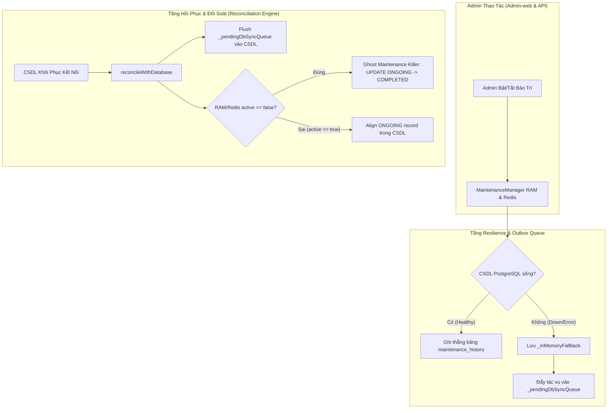

# KẾ HOẠCH TRIỂN KHAI: CƠ CHẾ ĐỐI SOÁT & BÙ DỮ LIỆU BẢO TRÌ KHI CSDL GẶP SỰ CỐ (MAINTENANCE FAILOVER & RECONCILIATION ENGINE)

> **Mục tiêu:** Đảm bảo khi CSDL gặp sự cố (down/timeout), hệ thống vẫn cho phép Admin Bật/Tắt bảo trì 100% trơn tru trên RAM/Redis. Khi CSDL phục hồi, hệ thống tự động bù dữ liệu (flush outbox) và kích hoạt cơ chế **Triệt tiêu Bảo trì ma (Ghost Maintenance Killer)** để ngăn chặn tuyệt đối tình huống phiên bảo trì cũ "đội mồ sống dậy" làm gián đoạn người dùng.

---

## 1. KIẾN TRÚC TỔNG THỂ (ARCHITECTURE DIAGRAM)



---

## 2. NGUYÊN TẮC CỐT LÕI (CORE PRINCIPLES)

1. **Nguồn Chân Lý Vận Hành (Operational Source of Truth):**
   - Trạng thái sống trên RAM và Redis luôn phản ánh ý chí tức thời của Admin. CSDL cũ không được phép đè ngược lại làm đảo lộn trạng thái.
2. **Outbox Pattern:**
   - Mọi thao tác ghi CSDL khi gặp lỗi mạng/timeout được lưu vào hàng đợi `_pendingDbSyncQueue` trên RAM/Redis kèm timestamp và retry counter.
3. **Ghost Maintenance Killer:**
   - Khi CSDL kết nối lại, nếu RAM/Redis đang là `active = false`, tự động cập nhật mọi bản ghi `ONGOING` mồ côi trong CSDL thành `COMPLETED` để triệt tiêu hoàn toàn lỗi "bảo trì ma".
4. **Zero Regressions & 2-Tier Testing (Rule 11):**
   - Đảm bảo 100% test suites hiện tại của Backend (405 tests) và Admin-web (313 tests) tiếp tục PASS.
   - Bổ sung bộ test 2 tầng mới kiểm chứng đầy đủ các kịch bản sự cố.

---

## 3. CÁC TÁC VỤ THỰC HIỆN (TASK BREAKDOWN)

### Tác Vụ 1: Nâng Cấp `MaintenanceRepository` Với Outbox Buffer & Reconciliation
- **Files:**
  - `src/Backend/modules/admin/maintenance.repository.js`
- **Chi tiết:**
  - Bổ sung `this._pendingDbSyncQueue = []`.
  - Khi `createRecord`, `completeOngoingRecord`, `updateOngoingToEmergency`, `cancelScheduledRecord` gặp lỗi DB `catch(err)`:
    - Lưu vào `_inMemoryFallback`.
    - Đẩy payload thao tác vào `_pendingDbSyncQueue` với `{ action, payload, queuedAt: new Date() }`.
  - Viết method `flushPendingQueue()`: Duyệt queue, thực thi lại vào DB khi kết nối đã sẵn sàng.
  - Viết method `reconcileWithDatabase({ currentActiveState })`:
    - Nếu `currentActiveState.active === false`:
      Chạy câu lệnh:
      ```sql
      UPDATE "maintenance_history"
      SET "status" = 'COMPLETED', "ended_at" = COALESCE("ended_at", NOW())
      WHERE "status" = 'ONGOING'
      ```
    - Nếu `currentActiveState.active === true`:
      Kiểm tra CSDL xem đã có bản ghi `status = 'ONGOING'` chưa; nếu chưa có, tự động tạo mới dựa trên `currentActiveState`.
    - Sau đó gọi `flushPendingQueue()`.

### Tác Vụ 2: Tích Hợp Vào `MaintenanceManager` & Cơ Chế Khởi Động / DB Reconnect Hook
- **Files:**
  - `src/Backend/core/resilience/maintenance.manager.js`
  - `src/Backend/index.js`
  - `src/Backend/config/db.js`
- **Chi tiết:**
  - `MaintenanceManager` bổ sung method `reconcileStateWithDatabase()` gọi xuống repository.
  - Khi Backend khởi động (`index.js`):
    - Kiểm tra Redis / RAM trạng thái `system:maintenance_mode`.
    - Sau khi `initTable()`, tự động gọi `reconcileWithDatabase` để dọn dẹp các bản ghi mồ côi nếu trước đó server bị tắt đột ngột lúc đang bảo trì.
  - Khi Pool DB phát hiện kết nối lại hoặc định kỳ qua `System Metrics Streamer`:
    - Nếu queue có bản ghi tồn đọng (`hasPendingSync()`), tự động kích hoạt `flushPendingQueue()`.

### Tác Vụ 3: Viết Bộ Kiểm Thử 2 Tầng Chuyên Biệt (2-Tier Testing)
- **Files:**
  - Tạo mới: `src/Backend/tests/unit/maintenance.reconciliation.2tier.test.js`
- **Nội dung kiểm thử:**
  - **Tầng 1 (Operation & Degradation):**
    - Khi CSDL ném lỗi kết nối (DB down), `MaintenanceManager.setMaintenance(true)` và `setMaintenance(false)` không crash, trả về status chuẩn xác.
    - Dữ liệu được lưu trong `_inMemoryFallback` và đẩy vào `_pendingDbSyncQueue`.
  - **Tầng 2 (Real System Impact & Ghost Killer Verification):**
    - Kịch bản Ghost Maintenance: CSDL có sẵn bản ghi `ONGOING`. Admin tắt bảo trì trong lúc DB lỗi. Khi DB khôi phục và chạy `reconcileWithDatabase({ active: false })`:
      * Bản ghi `ONGOING` trong CSDL lập tức được đổi thành `COMPLETED`.
      * Hệ thống KHÔNG tự động bật lại bảo trì.
    - Kịch bản Flush Outbox: Các bản ghi tạo mới trong lúc DB chết được tự động INSERT vào CSDL sau khi DB phục hồi.

### Tác Vụ 4: Thẩm Tra & Hoàn Tất (Verification & Rule 8)
- Chạy toàn bộ test Backend (`rtk npm test` - 405+ tests).
- Chạy toàn bộ test Admin-web (`rtk npm test` - 313+ tests).
- Cập nhật `Project.md` và CodeGraph (`rtk npx codegraph build`).
