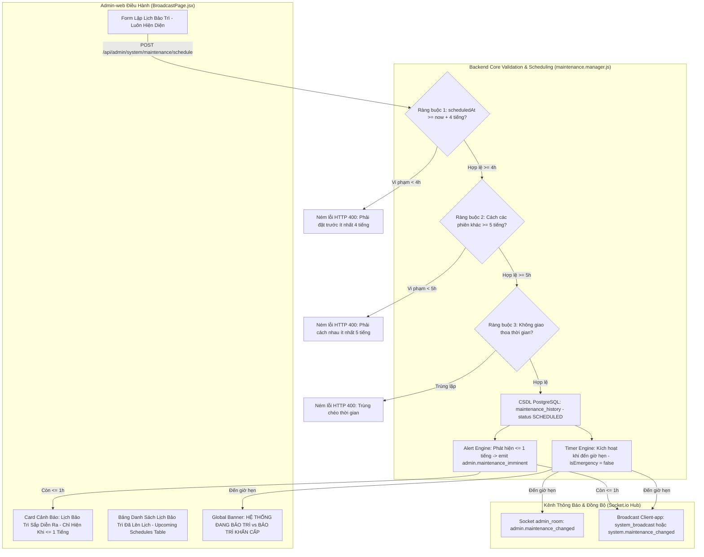

# 🛠️ Kế Hoạch Triển Khai: Tinh Chỉnh Toàn Diện Logic & Giao Diện Bảo Trì Theo Lịch (Maintenance Schedule Refinement Plan)

> **Mã công việc:** `PLAN-MAINTENANCE-SCHEDULE-REFINEMENT-2026-10-21`  
> **Người phê duyệt:** Product Owner (PO)  
> **Mục tiêu:** 
> 1. Phân định tuyệt đối giữa **Bảo trì khẩn cấp** (`isEmergency: true`, đỏ `rose`, tiêu đề `HỆ THỐNG ĐANG BẢO TRÌ KHẨN CẤP`) và **Bảo trì theo lịch** (`isEmergency: false`, cam `amber`, tiêu đề chuẩn PO `HỆ THỐNG ĐANG BẢO TRÌ`).
> 2. Giữ lại form lập lịch bảo trì định kỳ luôn luôn hiển thị và sẵn sàng (kể cả khi đang bảo trì, khi đã có lịch hoặc khi có cảnh báo sắp diễn ra).
> 3. Hỗ trợ đa lịch bảo trì (Multi-schedule) trong CSDL PostgreSQL `maintenance_history`, cho phép tạo nhiều lịch bảo trì tương lai không chồng chéo.
> 4. Ràng buộc thời gian khắt khe: Bắt buộc đặt trước thời điểm kích hoạt ít nhất **4 tiếng**; mỗi phiên bảo trì phải cách nhau ít nhất **5 tiếng**.
> 5. Card / Banner cảnh báo **"LỊCH BẢO TRÌ SẮP DIỄN RA"** CHỈ ĐƯỢC PHÉP HIỂN THỊ khi thời gian còn lại $\le 1$ tiếng trước giờ bắt đầu, và tuyệt đối không làm mất form lập lịch.

---

## 🏛️ 1. SƠ ĐỒ KIẾN TRÚC & LUỒNG XỬ LÝ (ARCHITECTURE)

---

## 📋 2. CHI TIẾT CÁC TÁC VỤ THỰC THI (DETAILED TASKS)

### 🔹 TÁC VỤ 1: Backend - Tinh Chỉnh Ràng Buộc Thời Gian & Hỗ Trợ Đa Lịch Hẹn (`maintenance.manager.js`)
**Files:**
- Sửa đổi: `src/Backend/core/resilience/maintenance.manager.js`
- Sửa đổi: `src/Backend/modules/admin/admin.controller.js`
- Sửa đổi: `src/Backend/modules/admin/maintenance.repository.js`
- Unit Test: `src/Backend/tests/unit/maintenance.schedule.rules.test.js`

**Nội dung thực thi:**
1. **Kiểm tra ràng buộc thời gian (4 tiếng & 5 tiếng):**
   - Ràng buộc 1: `new Date(scheduledAt).getTime() >= Date.now() + 4 * 3600 * 1000`. Nếu không thỏa mãn ném lỗi: *"Thời gian bảo trì theo lịch phải được thiết lập trước ít nhất 4 tiếng!"*.
   - Ràng buộc 2: Lấy toàn bộ các lịch `SCHEDULED` và các phiên `ONGOING` (nếu có). Duyệt so sánh:
     `new Date(scheduledAt).getTime() >= new Date(prev_end).getTime() + 5 * 3600 * 1000`
     hoặc nếu đặt lịch vào khoảng giữa: thời gian kết thúc của lịch mới phải cách thời gian bắt đầu của lịch tiếp theo $\ge 5$ tiếng.
     Nếu vi phạm ném lỗi: *"Mỗi phiên bảo trì theo lịch phải cách nhau ít nhất 5 tiếng!"*.
   - Ràng buộc 3: Không giao thoa thời gian (No overlap).
2. **Hỗ trợ Quản lý Đa Lịch Hẹn (Multi-Schedule):**
   - Chuyển `this.scheduled` thành quản lý danh sách `this.scheduledList = []` hoặc hỗ trợ tra cứu danh sách lịch hẹn tương lai từ CSDL `maintenance_history` (`WHERE status = 'SCHEDULED' ORDER BY started_at ASC`).
   - Cung cấp method `getUpcomingSchedules()` trả về danh sách toàn bộ các lịch đang chờ.
   - Hỗ trợ hủy lịch theo ID cụ thể: `cancelScheduledMaintenance(id)`.
3. **Phân định rõ ràng `isEmergency = false` khi kích hoạt lịch hẹn:**
   - Khi timer đến giờ hẹn, gọi `setMaintenance(true, sched.reason, 'Lịch hẹn bởi ' + sched.createdBy, { isEmergency: false, type: 'SCHEDULED' })`.
   - Tiêu đề thông báo phát tán khi lịch kích hoạt là: `HỆ THỐNG ĐANG BẢO TRÌ` (Level: `WARNING`, tuyệt đối không dùng tiêu đề `KHẨN CẤP`).
4. **Cơ chế kiểm tra Cửa sổ 1 tiếng (`<= 1h`):**
   - Phương thức kiểm tra: Với lịch gần nhất `nearestSchedule`, nếu `now >= new Date(nearestSchedule.scheduledAt).getTime() - 3600 * 1000 && now < new Date(nearestSchedule.scheduledAt).getTime()`, đánh dấu cờ `isImminent: true` và tính `minutesLeft`.

---

### 🔹 TÁC VỤ 2: Frontend - Phân Định Banner & Tinh Chỉnh Form Lập Lịch (`BroadcastPage.jsx`)
**Files:**
- Sửa đổi: `src/Admin-web/src/pages/system/BroadcastPage.jsx`
- Sửa đổi: `src/Admin-web/src/components/common/ServerHealthPanel.jsx`
- Sửa đổi: `src/Admin-web/src/locales/vi.js` & `src/Admin-web/src/locales/en.js`
- Test: `src/Admin-web/src/tests/broadcast.schedule.multi.2tier.test.jsx`

**Nội dung thực thi:**
1. **Sửa đổi Banner Đang Bảo Trì (`maintenance.active === true`):**
   - Nếu `maintenance.isEmergency === true`:
     - Tiêu đề: **`HỆ THỐNG ĐANG BẢO TRÌ KHẨN CẤP`**
     - Huy hiệu: **`[KHẨN CẤP]`** màu đỏ `rose-200 text-rose-800`
     - Mô tả: *"Toàn bộ kết nối Client-app bị chặn (HTTP 503). Đã tự động phát cảnh báo đỏ tới người dùng."*
     - Giao diện: Viền `border-rose-300`, nền `bg-rose-50/90`, icon `crisis_alert` nhấp nháy.
   - Nếu `maintenance.isEmergency === false` (Bảo trì theo lịch / định kỳ):
     - Tiêu đề: **`HỆ THỐNG ĐANG BẢO TRÌ`** *(Tuyệt đối không có từ "khẩn cấp")*
     - Huy hiệu: **`[THEO LỊCH]`** màu cam `bg-amber-200 text-amber-800`
     - Mô tả: *"Hệ thống đang tiến hành bảo trì kỹ thuật định kỳ theo lịch trình. Toàn bộ tính năng sẽ sớm khôi phục."*
     - Giao diện: Viền `border-amber-300`, nền `bg-amber-50/90`, icon `construction`.
2. **Khung Lập Lịch Bảo Trì — LUÔN LUÔN HIỂN THỊ FORM:**
   - Loại bỏ hoàn toàn khối khóa vàng ("CHẾ ĐỘ BẢO TRÌ ĐANG KÍCH HOẠT Không thể thiết lập thêm lịch...").
   - Form nhập ngày giờ bắt đầu, kết thúc dự kiến, lý do **LUÔN LUÔN HIỆN DIỆN VÀ SẴN SÀNG**.
   - Thêm dòng chú thích hướng dẫn trực quan:
     * *"Lịch bảo trì phải được đặt trước ít nhất 4 tiếng và cách các phiên khác tối thiểu 5 tiếng."*
   - Xử lý validate trước khi gửi và thông báo lỗi mượt mà.
3. **Card Cảnh Báo "LỊCH BẢO TRÌ SẮP DIỄN RA" — CHỈ HIỂN THỊ KHI $\le 1$ TIẾNG:**
   - Tính toán khoảng cách thời gian tới lịch bắt đầu gần nhất: `const diffMs = new Date(nearestSchedule.scheduledAt).getTime() - Date.now()`.
   - **ĐIỀU KIỆN HIỂN THỊ:** `diffMs > 0 && diffMs <= 3600 * 1000` ($\le 60$ phút).
   - Nếu `diffMs > 3600 * 1000` (còn hơn 1 tiếng, 4 tiếng, 2 ngày...): **HOÀN TOÀN KHÔNG HIỂN THỊ CARD NÀY!**
   - Khi hiển thị: Nằm gọn gàng, hiển thị đếm ngược thời gian (VD: *"Sẽ bắt đầu sau 42 phút"*), và **TUYỆT ĐỐI KHÔNG ẨN FORM LẬP LỊCH**.
4. **Bảng Danh Sách Lịch Bảo Trì Đã Đặt (Upcoming Schedules Table):**
   - Đặt ngay bên dưới form lập lịch.
   - Hiển thị danh sách tất cả các lịch bảo trì tương lai đang ở trạng thái `SCHEDULED`.
   - Các cột: `#`, `Bắt đầu`, `Kết thúc dự kiến`, `Thời lượng`, `Lý do / Mô tả`, `Người tạo`, `Thao tác` (Nút đỏ *"Hủy lịch"* riêng cho từng dòng).

---

### 🔹 TÁC VỤ 3: Kiểm Thử 2 Tầng (2-Tier Testing Architecture) & Kiểm Tra Toàn Bộ Test Suite
1. **Tầng 1 (Giao diện & Tương tác UI):**
   - Kiểm tra render form lập lịch luôn luôn hiện diện, kiểm tra các input datetime-local, lý do.
   - Kiểm tra Card "Lịch bảo trì sắp diễn ra" chỉ render khi $\le 1$ tiếng và biến mất khi $> 1$ tiếng.
   - Kiểm tra Banner đang bảo trì đổi đúng tiêu đề `HỆ THỐNG ĐANG BẢO TRÌ` khi `isEmergency = false`.
2. **Tầng 2 (Tác động Hệ thống & Ràng buộc Nghiệp vụ):**
   - Gửi yêu cầu đặt lịch trước 2 tiếng $\to$ Bị Backend từ chối lỗi HTTP 400 (Ràng buộc 4 tiếng).
   - Gửi yêu cầu đặt 2 lịch cách nhau 3 tiếng $\to$ Bị Backend từ chối lỗi HTTP 400 (Ràng buộc 5 tiếng).
   - Gửi yêu cầu đặt lịch hợp lệ (trước 6 tiếng, cách 8 tiếng) $\to$ Thành công, CSDL lưu bản ghi `SCHEDULED`.
   - Khi kích hoạt lịch $\to$ `isEmergency: false`, Socket phát `HỆ THỐNG ĐANG BẢO TRÌ`.
3. **Chạy toàn bộ Test Suite:**
   - Backend: 74 suites / >415 tests PASS 100%.
   - Admin-web: 43 suites / >315 tests PASS 100%.

---

### 🔹 TÁC VỤ 4: Cập Nhật Nguồn Sự Thật & CodeGraph (Rule 8)
1. Cập nhật `docs/Admin-web/07-maintenance-and-resilience.md` (đồng bộ tiêu đề, form luôn hiện, multi-schedule, 4h & 5h, cảnh báo 1h).
2. Cập nhật `Project.md` (mục 4.14 - Quy tắc bảo trì).
3. Chạy `rtk npx codegraph build` đồng bộ CodeGraph.
