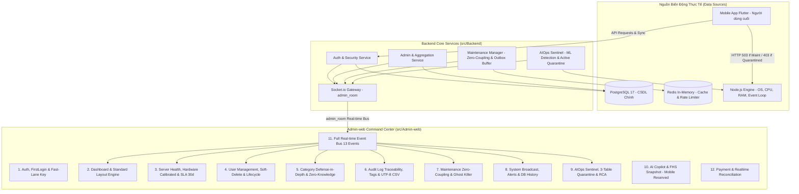

# 📘 Hệ Thống Tài Liệu Kỹ Thuật Admin-Web (WealthCommand)

> **Dự án:** Personal Finance Management  
> **Module:** `src/Admin-web` (Frontend Quản trị) & `src/Backend/modules/admin` (Backend Core API)  
> **Phiên bản:** v2.6 (Cập nhật ngày 23/10/2026)  
> **Đối tượng sử dụng:** Product Owner (PO), Technical Architect, Senior Engineers, QA & DevOps Team  

---

## 🏛️ 1. TỔNG QUAN KIẾN TRÚC ADMIN-WEB

Hệ thống quản trị **Admin-web** là trung tâm chỉ huy tối cao (Command Center) của nền tảng Quản lý Tài chính Cá nhân. Admin-web được thiết kế theo kiến trúc **Single Page Application (SPA)** kết hợp **Centralized Event-Driven Real-time Bus**, cho phép quản trị viên theo dõi nhịp tim hệ thống, phân tích dữ liệu vĩ mô, điều phối an ninh an toàn thông tin và tương tác trực tiếp với người dùng di động (Client-app).



---

## 📑 2. MỤC LỤC CHI TIẾT CÁC TÀI LIỆU CHỨC NĂNG

Mỗi chức năng của Admin-web được ghi nhận độc lập tại một tập tin tài liệu chuyên sâu, phản ánh đầy đủ: **Cơ chế hoạt động, Công thức toán học, Giới hạn kỹ thuật, Công dụng, Tính năng đi kèm, và Mức độ ảnh hưởng tới Hệ thống & Ứng dụng Mobile Client-app**.

| STT | Tập tin tài liệu | Tên chức năng chính | Mô tả vắn tắt |
|:---:|---|---|---|
| STT | Tập tin tài liệu | Tên chức năng chính | Mô tả vắn tắt |
|:---:|---|---|---|
| **01** | [`01-authentication-and-authorization.md`](./01-authentication-and-authorization.md) | **Xác thực, Phân quyền & Quản Trị Viên (Auth & Fast-Lane)** | Migration 34 (`is_first_login`, `created_by_admin_id`), `FirstLoginModal`, Cấp tài khoản quản trị viên mới với form 6 trường (`Username`, `Email`, `FullName`*, `Phone`* mã hóa AES-256-GCM, `Address`, `Country Code`), đổi mật khẩu/PIN admin (`SettingsModal`), mã PIN bảo mật cấp 2 trước thao tác chí mạng (`SecurityConfirmModal`, `/api/admin/verify-security-action`), `LockScreen` session recovery với dữ liệu CSDL thực (loại bỏ thông tin tĩnh, nút Mở khóa và Đăng xuất ngang hàng), JWT Token kép và Cửa thoát hiểm khẩn cấp `X-Emergency-Admin-Key`. |
| **02** | [`02-dashboard-and-analytics.md`](./02-dashboard-and-analytics.md) | **Bảng Điều Khiển & Động Cơ Thống Kê Tổng Hợp** | Bố cục chuẩn Dashboard, đồng bộ ngang hàng `ServerHealthPanel` và Bảng hoạt động, 2 biểu đồ full-width, bộ lọc thời gian đa dạng (Hôm nay, Tháng này, Năm nay, Tùy chọn dải ngày), phân biệt bảo trì khẩn cấp vs thường, khóa toggle Dashboard và điều hướng an toàn `SafeMaintenanceLink`. |
| **03** | [`03-server-health-and-sla-monitoring.md`](./03-server-health-and-sla-monitoring.md) | **Giám Sát Sức Khỏe Máy Chủ & Uptime SLA 30 Ngày** | Đo lường tỷ lệ hoạt động liên tục chuẩn hóa theo cửa sổ SLA 30 ngày (2,592,000s), nhận diện môi trường Cloud (cgroup_v2 quota) vs Host Server, CPU delta ticks đa nhân tức thời, RAM RSS thực tế, độ trễ Event Loop lag ms, DB Connection Pool Bulkhead và cơ chế khóa toggle bảo trì an toàn. |
| **04** | [`04-user-management-and-lifecycle.md`](./04-user-management-and-lifecycle.md) | **Quản Lý Người Dùng & Vòng Đời Tài Khoản** | Giao diện Bento KPI, chuẩn hóa chỉ có 2 gói `Basic` và `Premium`, xác thực mã PIN bảo mật cấp 2 khi khóa hoặc xóa tài khoản, bảo toàn hiển thị trạng thái xóa mềm badge đỏ `Đã xóa`, mặt nạ PII (Email, Phone, Địa chỉ, IP), cưỡng chế đăng xuất Socket `force_logout` và giao dịch xóa mềm 5 bước Prisma ACID. |
| **05** | [`05-category-management.md`](./05-category-management.md) | **Quản Lý Danh Mục Hệ Thống & Bảo Vệ Riêng Tư** | Nguyên tắc Zero-Knowledge Privacy (Admin chỉ quản lý `is_default = true`, cấm can thiệp danh mục cá nhân), chuẩn hóa phân loại canonical, bảo toàn liên kết `idgroup` khi xóa cha, bảo toàn từ khóa AI (`keyword`), nút Khôi Phục trực tiếp kèm Staged Changes và mã PIN Admin qua `PATCH /api/admin/restorecategory/:id`, chuyển đổi cơ chế đồng bộ sang nút Làm mới thủ công. |
| **06** | [`06-audit-logging-and-traceability.md`](./06-audit-logging-and-traceability.md) | **Nhật Ký Truy Vết Toàn Hệ Thống (Audit Logging)** | Ghi nhận bất đồng bộ toàn bộ request (`setImmediate`, 0ms latency overhead), cấu trúc Dual-Column (Cột 1 Hành động tiếng Việt thân thiện, Cột 2 Yêu cầu API gồm Method badge + URL route), giữ Tag chuẩn quốc tế (`[PAYMENT]`, `[AUTH]`, `[USER]`, `[SYSTEM]`, `[AIOPS]`, `[CATEGORY]`), lược bỏ nút Làm mới (Realtime Socket), xuất báo cáo CSV chuẩn UTF-8 BOM, đảm bảo tính pháp lý theo Luật ATTTM 2015 và Nghị định 13/2023/NĐ-CP. |
| **07** | [`07-maintenance-and-resilience.md`](./07-maintenance-and-resilience.md) | **Quản Trị Bảo Trì Hệ Thống & Cứu Hộ Khẩn Cấp** | Kiến trúc Zero-Coupling hoạt động độc lập CSDL (RAM In-Memory & Redis), Outbox Buffer `_pendingDbSyncQueue`, Ghost Maintenance Killer `reconcileWithDatabase`, phân định rõ ràng Bảo trì Khẩn cấp (`isEmergency: true`, tông đỏ) vs Bảo trì Theo Lịch (`isEmergency: false`, tông cam), quy tắc lập lịch tối thiểu trước 4 tiếng và cách nhau 5 tiếng, banner đếm ngược $\le 1$ tiếng mà không che form, bảng lịch sử bảo trì PostgreSQL phân trang. |
| **08** | [`08-broadcast-and-notification.md`](./08-broadcast-and-notification.md) | **Phát Sóng Thông Báo Hệ Thống & Hộp Thư Cảnh Báo** | Phát sóng thông báo toàn mạng (Info, Warning, Critical) kèm Live Preview Box, bảng lịch sử phát sóng lưu CSDL PostgreSQL `broadcast_notification`, phân trang 5 dòng/trang, xóa bỏ khối rules notes rườm rà, hộp thư chuông cảnh báo an ninh thời gian thực tại Header. |
| **09** | [`09-aiops-sentinel-and-quarantine.md`](./09-aiops-sentinel-and-quarantine.md) | **AIOps Sentinel & Tường Lửa Tự Động Phong Tỏa** | Máy học Online phân tách 4 vectơ rủi ro độc lập (Auth, Traffic, Exploit, Resource), Modal Custom Thresholds riêng từng vectơ, loại bỏ box trạng thái rườm rà, lưu trữ snapshot CSDL PostgreSQL 5 phút `aiops_metric_snapshot`, biểu đồ SVG 5 dải thời gian (10m, 1h, 24h, 7d, 30d) với tab lọc vectơ, lưu cứng quy mô CCU `aiops_setting` và `localStorage`, kiến trúc 3 bảng phong tỏa N-N (`aiops_ip_quarantine`, `aiops_account_quarantine`, `aiops_quarantine_incident_link`), cơ chế Auto-Expire 15s tự động giải phóng, chuẩn hóa icon và Cột Đối tượng RCA (`TK:`, `IP: 192.168.xxx.xxx`). |
| **10** | [`10-ai-copilot-and-financial-health.md`](./10-ai-copilot-and-financial-health.md) | **Trợ Lý AI Tài Chính & Điểm Sức Khỏe FHS** | ⚠️ Đã loại bỏ khỏi Admin-web theo quyết định của PO (Bảo lưu toàn bộ mã nguồn Backend cho ứng dụng di động Client-app phục vụ On-Device Edge AI SLM Google Gemma 4 E2B qua LiteRT, chuẩn hóa công thức FHS & cơ cấu chi tiêu 50/30/20). |
| **11** | [`11-full-realtime-architecture.md`](./11-full-realtime-architecture.md) | **Kiến Trúc Real-Time Toàn Diện Qua Socket.io** | Trục điều phối 13 sự kiện thời gian thực tập trung qua `admin_room` (`admin.metrics_stream`, `admin.user_registered`, `admin.user_status_changed`, `audit_activity`, `admin.maintenance_changed`, `admin.security_alert`, `admin.security_blocked`, `admin.quarantine_updated`, `admin.anomaly_detected`, `admin.vector_config_changed`, v.v.), cơ chế triệt tiêu Toast lặp lại 3 tầng (`isActionInitiatorRef`, Debounce 1500ms), cơ chế Heartbeat Ping Latency đo độ trễ thực tế. |
| **12** | [`../Payment/PAYMENT_WORKFLOW_SPEC.md`](../Payment/PAYMENT_WORKFLOW_SPEC.md) | **Quản Trị Thanh Toán & Đối Soát Realtime** | Đối soát giao dịch PayOS VietQR, Sandbox Mode thử nghiệm sinh đơn thật, Just-in-Time Sync, và xử lý hoàn tiền Refund đính kèm minh chứng. |

---

## 🛡️ 3. MA TRẬN ẢNH HƯỞNG TỚI MOBILE APP (CLIENT-APP)

Hệ thống quản trị Admin-web có quyền lực điều phối trực tiếp tới trải nghiệm và hoạt động của người dùng di động:

```
┌────────────────────────────────────────┬────────────────────────────────────────────────────────┐
│ Hành động từ Admin-web                 │ Tác động trực tiếp lên Mobile App (Client-app)         │
├────────────────────────────────────────┼────────────────────────────────────────────────────────┤
│ 1. Bật Bảo trì Khẩn cấp                │ Chặn kết nối tức thì (HTTP 503), đẩy Modal đỏ toàn màn │
│                                        │ hình, ngắt kết nối đồng bộ dữ liệu.                    │
├────────────────────────────────────────┼────────────────────────────────────────────────────────┤
│ 2. Bật Bảo trì Thông thường            │ Chặn âm thầm (HTTP 503) khi gửi request, không hiện    │
│                                        │ banner cảnh báo hoảng loạn, giữ dữ liệu cục bộ SQLite. │
├────────────────────────────────────────┼────────────────────────────────────────────────────────┤
│ 3. Vô hiệu hóa tài khoản (Khóa)        │ Socket.io đẩy `force_logout`, thu hồi refresh token,   │
│                                        │ xóa sạch phiên trên máy, đẩy người dùng ra màn Login.  │
├────────────────────────────────────────┼────────────────────────────────────────────────────────┤
│ 4. Tường lửa AIOps phong tỏa IP        │ Thiết bị người dùng tại IP đó bị chặn với HTTP 403     │
│                                        │ `AIOPS_QUARANTINED`, hiển thị lý do và thời gian hết hạn.│
├────────────────────────────────────────┼────────────────────────────────────────────────────────┤
│ 5. Phát sóng thông báo (Broadcast)     │ Đẩy SnackBar/Dialog thông báo tức thời tới màn hình    │
│                                        │ ứng dụng mà không cần cập nhật bản build mới.          │
├────────────────────────────────────────┼────────────────────────────────────────────────────────┤
│ 6. Thêm/Sửa danh mục hệ thống          │ Tự động đồng bộ vào danh mục mặc định của ứng dụng khi  │
│                                        │ Client thực hiện Pull Sync.                            │
├────────────────────────────────────────┼────────────────────────────────────────────────────────┤
│ 7. Xử lý Hoàn tiền (Refund)            │ Phát Socket.io `payment.refunded` thông báo hoàn tiền   │
│                                        │ thành công kèm biên lai minh chứng đến Client-app.     │
└────────────────────────────────────────┴────────────────────────────────────────────────────────┘
```

---

## 🔒 4. NGUYÊN TẮC BẢO MẬT & PHÁP LÝ (DATA SECURITY)

Toàn bộ các chức năng trong thư mục tài liệu này tuân thủ 100% quy định tại [`docs/Rule_Project/Data_Security.md`](../Rule_Project/Data_Security.md), Nghị định 13/2023/NĐ-CP và tiêu chuẩn bảo mật quốc tế OWASP:
1. **Zero PII Exposure:** 100% thông tin nhạy cảm của người dùng (Email, SĐT, Địa chỉ, Số tài khoản ngân hàng, IP) đều được mặt nạ hóa (Masking) trước khi hiển thị trên Admin-web.
2. **User-scoped Privacy Protection:** Admin tuyệt đối không có quyền xem, sửa hoặc xóa danh mục riêng tư của người dùng Client-app (`is_default = false`).
3. **Audit Immutability:** Mọi thao tác quản trị viên đều được ghi nhật ký Append-only vĩnh viễn, bảo vệ bằng trigger CSDL `trg_protect_auditlog`, không thể chỉnh sửa hay tẩy xóa.
4. **Mã Hóa Dữ Liệu Nhạy Cảm Tại Điểm Thu Thập:** Các trường nhạy cảm khi cấp tài khoản Quản trị viên mới (như Số điện thoại `Phone`, Địa chỉ `Address`) bắt buộc được mã hóa chuẩn `AES-256-GCM` trước khi ghi nhận vào CSDL, tuân thủ tuyệt đối trigger kiểm tra `trg_check_phone_encrypted`.

---

## ⚙️ 5. TRUNG TÂM CÀI ĐẶT HỆ THỐNG & QUẢN TRỊ VIÊN (SETTINGS CENTER)

Tích hợp trực tiếp trên Header thanh điều hướng (`Header.jsx`), nằm ngay bên phải icon Thông báo hệ thống (🔔):
- **Biểu tượng (Icon):** ⚙️ Material Symbol `settings` (title: *"Cài đặt hệ thống"*).
- **Hộp thoại Cài Đặt (`SettingsModal.jsx`):** Thiết kế Tabbed Modal bo góc chuẩn Enterprise với 5 tab nghiệp vụ hoàn chỉnh:
  1. **Giao diện (Appearance):** Lựa chọn Chủ đề Giao diện (Sáng / Tối / Tự động theo OS), Mật độ hiển thị bảng (Rộng rãi / Tiêu chuẩn / Tối ưu thu gọn Compact).
  2. **Cảnh báo & Âm thanh (Alerts & Sound):** Bật/tắt âm thanh cảnh báo khi có sự cố khẩn cấp (`soundAlarm`), Thời lượng hiển thị Toast thông báo (3s / 5s / 8s / 10s), Bật/tắt huy hiệu đếm chưa đọc trên icon chuông.
  3. **Realtime & Socket.io:** Trạng thái kết nối Socket `admin_room` trực tiếp, cấu hình chu kỳ lấy mẫu nhịp tim AIOps Sentinel (1s / 3s / 5s), nút Kiểm tra độ trễ (Ping Test đo ms thực tế).
  4. **Bảo mật & Phiên làm việc (Security & Session):** Tự động khóa màn hình Admin sau thời gian rảnh rỗi (5 / 15 / 30 phút), nút Xóa bộ nhớ đệm trình duyệt cục bộ (Local Storage Cache Reset) an toàn, hiển thị Thông tin phiên bản & Môi trường runtime.
  5. **Quản trị viên (Admin Management):**
     - **Cấp tài khoản quản trị viên mới:** Thiết kế Grid 2 cột cân đối (`max-w-lg`) gồm 6 trường thông tin chuẩn hóa:
       - `Username` (*): Tên đăng nhập (chữ thường, số, dấu gạch dưới).
       - `Email` (*): Địa chỉ email liên hệ quản trị.
       - `FullName` (*): Họ và tên đầy đủ của quản trị viên.
       - `Phone` (*): Số điện thoại liên hệ (được mã hóa AES-256-GCM bảo mật).
       - `Address`: Địa chỉ cư trú (tùy chọn, được mã hóa an toàn).
       - `Country Code`: Mã vùng quốc gia (tùy chọn, mặc định `+84`, tối đa 4 ký tự).
       - Tự động gán mật khẩu tạm thời và mã PIN bảo mật cấp 2 tạm thời cho quản trị viên mới.
     - **Thay đổi mật khẩu đăng nhập cá nhân:** Yêu cầu mật khẩu cũ + kiểm tra độ mạnh mật khẩu mới.
     - **Thay đổi mã PIN bảo mật cấp 2:** Yêu cầu mã PIN cũ 6 chữ số, tự động mã hóa SHA-256 trước khi gửi API.
- **Lưu trữ Cục bộ & CSDL:** Cấu hình cá nhân lưu `localStorage` với tiền tố `admin_settings_*`; thông tin bảo mật và tài khoản lưu trữ đồng bộ vào CSDL PostgreSQL qua API `admin.api.js`.

---

## 🧪 6. QUY TẮC KIỂM THỬ 2 TẦNG (2-TIER TESTING ARCHITECTURE — RULE 11)

Mọi module và chức năng của Admin-web bắt buộc phải có bài kiểm thử thỏa mãn cả 2 tầng:
1. **Tầng 1: Kiểm thử Hiển thị & Thao tác tại Giao diện (UI Rendering & Interaction):**
   - Đảm bảo render đầy đủ các controls (form inputs, badges, modals, charts, buttons).
   - Kiểm tra tương tác người dùng mượt mà, không throw runtime error.
2. **Tầng 2: Kiểm thử Hoạt động Thực tế & Tác động Hệ thống (Real System Impact):**
   - *"Nếu thao tác được trên giao diện nhưng không tạo ra tác động thực sự đến hệ thống như mong muốn thì bài test BẮT BUỘC ĐÁNH RỚT."*
   - Kiểm tra tính bền vững của dữ liệu trong CSDL hoặc LocalStorage.
   - Kiểm tra thay đổi trạng thái Root DOM (`document.documentElement`).
   - Kiểm tra API call gửi đúng payload mã hóa (`AES-256-GCM`) và nhận response thật.
   - Kiểm tra các side-effects (Socket broadcast, Web Audio alarm, Toast timeout).

---

## 🖥️ 7. THIẾT KẾ FLUID RESPONSIVE & ĐA TỶ LỆ MÀN HÌNH

Hệ thống giao diện Admin-web được xây dựng theo chuẩn **Fluid Responsive Architecture** đảm bảo trải nghiệm hiển thị hoàn hảo trên mọi kích thước màn hình và tỷ lệ zoom:
- **Tương thích Zoom 50% - 200%:** Thiết kế sử dụng các đơn vị co giãn linh hoạt và CSS Grid/Flexbox tự co giãn, không bị tràn layout hay gãy cột khi quản trị viên phóng to hoặc thu nhỏ trình duyệt.
- **Sidebar Mini-Mode Thu Gọn (76px vs 260px):**
  - Chế độ mở rộng: Độ rộng 260px hiển thị đầy đủ icon, nhãn tiếng Việt và huy hiệu số lượng.
  - Chế độ thu gọn: Độ rộng 76px với icon trung tâm tinh gọn, tự động bung tooltip giải thích khi rê chuột qua, tối đa hóa không gian quan sát dữ liệu trên các màn hình nhỏ (Laptop 13-14 inch).
- **Khung chứa Dữ liệu Siêu Rộng (Max Container Fluid `max-w-[1720px]`):**
  - Đảm bảo tận dụng tối đa bề ngang trên màn hình Full HD (1920x1080), 2K và 4K mà không bị ép hẹp vào giữa, mang lại tầm nhìn bao quát cho các biểu đồ hạ tầng và bảng dữ liệu chuyên sâu.

