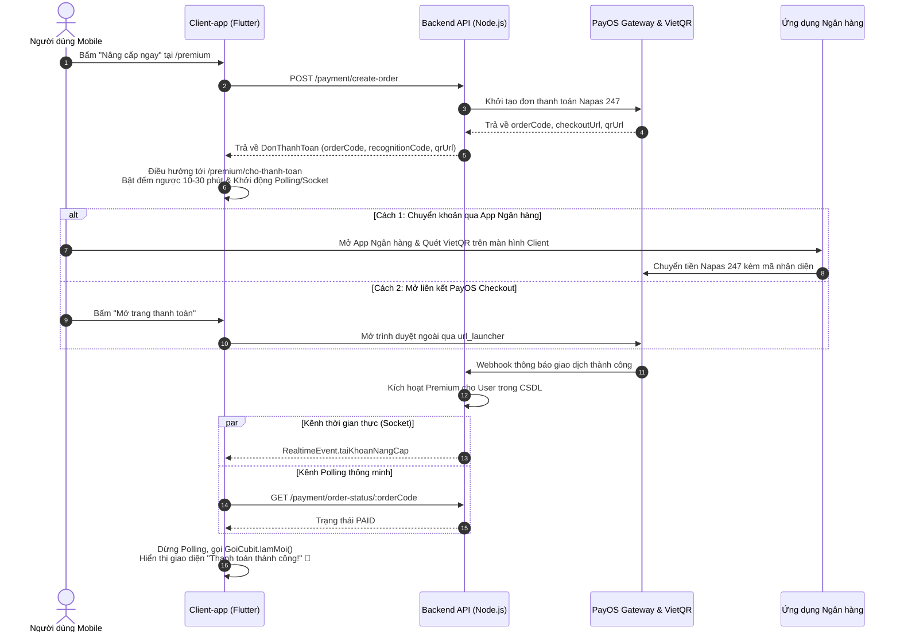

# 💎 PHÂN HỆ 12: GÓI CƯỚC TÀI KHOẢN, THANH TOÁN VIETQR & PAYOS (PREMIUM & SUBSCRIPTION)

> **Mã phân hệ:** `PREMIUM`  
> **Thư mục mã nguồn:** [`src/Client-app/lib/features/premium`](file:///d:/Tai_Lieu_IUH/Tailieu_Nam5_HK1/DoAnTotNghiep/Personal_Finance_Management/src/Client-app/lib/features/premium)  
> **Quản lý trạng thái:** `GoiCubit` ([`goi_cubit.dart`](file:///d:/Tai_Lieu_IUH/Tailieu_Nam5_HK1/DoAnTotNghiep/Personal_Finance_Management/src/Client-app/lib/features/premium/presentation/bloc/goi_cubit.dart)) & `BoHoiTrangThaiDon` ([`bo_hoi_trang_thai_don.dart`](file:///d:/Tai_Lieu_IUH/Tailieu_Nam5_HK1/DoAnTotNghiep/Personal_Finance_Management/src/Client-app/lib/features/premium/data/bo_hoi_trang_thai_don.dart))  
> **Cổng thanh toán tích hợp:** Cổng thanh toán quốc gia VietQR (Napas 247) & PayOS Open API Gateway  
> **Kênh sự kiện thời gian thực:** `RealtimeChannel` (`RealtimeEvent.taiKhoanNangCap`) & HTTP Polling đa tầng

---

## 1. DANH SÁCH MÀN HÌNH & GIAO DIỆN (UI SCREENS)

| Route | Tên file Dart | Chức năng nghiệp vụ | Thành phần giao diện chính |
|:---|:---|:---|:---|
| `/premium` | [`nang_cap_page.dart`](file:///d:/Tai_Lieu_IUH/Tailieu_Nam5_HK1/DoAnTotNghiep/Personal_Finance_Management/src/Client-app/lib/features/premium/presentation/pages/nang_cap_page.dart) | Giới thiệu & Đăng ký gói Premium | Thẻ thông điệp theo ngữ cảnh (`?tran=` hoặc `?quyen=`); Thẻ so sánh quyền lợi Basic vs Premium; Bảng giá niêm yết (49.000đ/tháng hoặc gói trọn đời); Nút "Nâng cấp ngay" tích hợp chống bấm trùng đơn |
| `/premium/cho-thanh-toan` | [`cho_thanh_toan_page.dart`](file:///d:/Tai_Lieu_IUH/Tailieu_Nam5_HK1/DoAnTotNghiep/Personal_Finance_Management/src/Client-app/lib/features/premium/presentation/pages/cho_thanh_toan_page.dart) | Đang chờ thanh toán & Quét VietQR | Mã VietQR động sinh theo chuẩn Napas 247; Mã nhận diện thanh toán 6 ký tự độc nhất; Đồng hồ đếm ngược 10-30 phút; Nút chép nhanh thông tin; Nút mở trang PayOS checkout ngoài; Xử lý trạng thái chuyển thừa/chuyển thiếu/hoàn tiền |
| `/premium/lich-su` | [`lich_su_mua_page.dart`](file:///d:/Tai_Lieu_IUH/Tailieu_Nam5_HK1/DoAnTotNghiep/Personal_Finance_Management/src/Client-app/lib/features/premium/presentation/pages/lich_su_mua_page.dart) | Lịch sử đơn mua gói Premium | Danh sách các đơn giao dịch; Thời gian thanh toán; Số tiền thanh toán; Badge trạng thái (Thành công, Chờ xác nhận, Hoàn tiền); Đã lọc sạch 100% đơn hàng mẫu (`is_template: false`) |

---

## 2. KIẾN TRÚC PHÂN QUYỀN GÓI CƯỚC (FEATURE GATING & LIMITS)

Hệ thống phân quyền được thiết kế tập trung tại tầng domain ([`quyen_tinh_nang.dart`](file:///d:/Tai_Lieu_IUH/Tailieu_Nam5_HK1/DoAnTotNghiep/Personal_Finance_Management/src/Client-app/lib/features/premium/domain/quyen_tinh_nang.dart) và [`tran_goi.dart`](file:///d:/Tai_Lieu_IUH/Tailieu_Nam5_HK1/DoAnTotNghiep/Personal_Finance_Management/src/Client-app/lib/features/premium/domain/tran_goi.dart)), đồng bộ động từ server qua endpoint `/payment/subscription-info`.

> [!NOTE]
> `premium_expires_at` NULL với `Type = 'Premium'` là dữ liệu hỏng, coi là Basic: `accountType: 'Premium'`, `isPremium: false`, `isExpired: true`; job hạ cấp đưa về `Basic` ở lượt quét kế.

### 2.1. Trần hạn mức gói Basic (`TranGoi` & `LoaiTran`)

| Loại tài nguyên (`LoaiTran`) | Giới hạn Basic mặc định | Giới hạn gói Premium | Hành vi khi chạm trần |
|:---|:---:|:---:|:---|
| **Ví tiền** (`LoaiTran.vi`) | **3 ví** | **Không giới hạn** | Chặn tạo mới, chuyển hướng `/premium?tran=vi` |
| **Ngân sách** (`LoaiTran.nganSach`) | **3 ngân sách** | **Không giới hạn** | Chặn tạo mới, chuyển hướng `/premium?tran=nganSach` |
| **Mục tiêu tích lũy** (`LoaiTran.mucTieu`) | **3 mục tiêu** | **Không giới hạn** | Chặn tạo mới, chuyển hướng `/premium?tran=mucTieu` |
| **Hóa đơn định kỳ** (`LoaiTran.hoaDon`) | **5 hóa đơn** | **Không giới hạn** | Chặn tạo mới, chuyển hướng `/premium?tran=hoaDon` |
| **Danh mục tùy chỉnh** (`LoaiTran.danhMucRieng`) | Giới hạn theo Admin | **Không giới hạn** | Chặn thêm danh mục riêng |

> **Quy tắc an toàn dữ liệu:** Người dùng đang sở hữu nhiều hơn hạn mức (ví dụ tài khoản bị hạ cấp từ Premium về Basic khi hết hạn) **chỉ bị chặn tạo thêm**, toàn bộ dữ liệu cũ vẫn được bảo toàn nguyên vẹn và hiển thị đầy đủ, tuyệt đối không bị xóa hoặc ẩn đi.

### 2.2. Danh mục 11 quyền tính năng (`MaQuyen`)

| Mã quyền (`MaQuyen`) | Tên hiển thị | Trạng thái gói Basic | Mô tả nghiệp vụ |
|:---|:---|:---:|:---|
| `aiAssistant` | Trợ lý AI tài chính | 🔒 **Khóa** | Trò chuyện với AI Gemini phân tích tài chính sâu |
| `aiQuickInput` | Nhập nhanh bằng giọng nói / câu | 🔒 **Khóa** | Bóc tách giao dịch tự nhiên qua AI |
| `aiEdgeModel` | AI trên máy (Offline On-Device) | 🔒 **Khóa** | Whisper & OCR offline không cần mạng |
| `exportReports` | Xuất báo cáo PDF / Excel | 🔒 **Khóa (Độc quyền)** | Xuất file sao kê thu chi chuyên nghiệp |
| `ocrReceipt` | Quét hóa đơn, biên lai | 🔓 Mở (Cấu hình) | Nhận diện biên lai ảnh qua ML Kit |
| `smartBudgetRebalancing` | Đề xuất cân đối ngân sách | 🔓 Mở (Cấu hình) | Gợi ý tối ưu hạn mức chi tiêu |
| `cashflowForecast` | Dự báo dòng tiền 30 ngày | 🔓 Mở (Cấu hình) | Dự báo số dư tương lai |
| `anomalySpendingInsights` | Cảnh báo chi bất thường | 🔓 Mở (Cấu hình) | Cảnh báo khi chi vượt đột biến |
| `billAutoPay` | Tự động trả hóa đơn | 🔓 Mở (Cấu hình) | Tự động sinh giao dịch trừ tiền ví |
| `goalAutoDeposit` | Trích tiền tiết kiệm tự động | 🔓 Mở (Cấu hình) | Tự động trích tiền vào mục tiêu |
| `bankNotificationParser` | Đọc biến động số dư ngân hàng | 🔓 Mở (Cấu hình) | Bắt notification app ngân hàng ngầm |

---

## 3. LUỒNG THANH TOÁN TỰ ĐỘNG QUA VIETQR & PAYOS (PAYMENT FLOW)

---

## 4. CƠ CHẾ ĐỐI SOÁT & XỬ LÝ NGOẠI LỆ THANH TOÁN

Client-app tích hợp đầy đủ máy trạng thái xử lý đối soát giao dịch ([`_ChoThanhToanPageState`](file:///d:/Tai_Lieu_IUH/Tailieu_Nam5_HK1/DoAnTotNghiep/Personal_Finance_Management/src/Client-app/lib/features/premium/presentation/pages/cho_thanh_toan_page.dart)):

1. **Trạng thái Chờ thanh toán (`_Man.cho` - `PENDING`):**
   - Đếm ngược liên tục mỗi giây (`_conLai`).
   - Nếu hết giờ đếm ngược mà chưa nhận được tiền: chuyển sang `_Man.hetHan` (`EXPIRED`), hủy bộ polling để tránh gửi request rác lên server.
   - Khi người dùng chuyển app sang ứng dụng ngân hàng rồi quay lại (Lifecycle `resumed`), hệ thống thực hiện **hỏi ngay lập tức (`hoiNgay()`)** mà không cần đợi hết chu kỳ polling.

2. **Trạng thái Chuyển thừa tiền (`_Man.choXacNhanThua` - `WAITING_CONFIRMATION`):**
   - Xảy ra khi người dùng chuyển số tiền lớn hơn giá niêm yết gói cước.
   - Giao diện hiển thị số tiền thừa và cung cấp 2 lựa chọn:
     - **"Chấp nhận kích hoạt":** Gọi `POST /payment/confirm-upgrade` với `accept: true` $\rightarrow$ Kích hoạt Premium ngay lập tức.
     - **"Yêu cầu hoàn tiền":** Gọi với `accept: false` $\rightarrow$ Chuyển sang trạng thái chờ hoàn tiền `_Man.canHoanTien`.

3. **Trạng thái Chuyển thiếu tiền & Chờ hoàn tiền (`_Man.canHoanTien` - `REFUND_PENDING`):**
   - Xảy ra khi người dùng chuyển thiếu tiền so với quy định.
   - Hiển thị thông báo minh bạch số tiền đã nhận và hướng dẫn người dùng chờ hệ thống hoàn tiền về tài khoản ngân hàng hoặc liên hệ CSKH.

4. **Trạng thái Đã hoàn tiền (`_Man.daHoanTien` - `REFUNDED`):**
   - Xác nhận tiền đã được hoàn trả thành công về tài khoản nguồn.

5. **Loại trừ giao dịch mẫu (Sample Order Isolation):**
   - Mọi đơn hàng phục vụ kiểm thử hệ thống được gắn cờ `is_template: true`.
   - Client-app và Backend đồng thuận loại trừ 100% các đơn này khỏi màn hình `/premium/lich-su`, đảm bảo lịch sử thanh toán người dùng luôn trong sạch và chính xác tuyệt đối.
