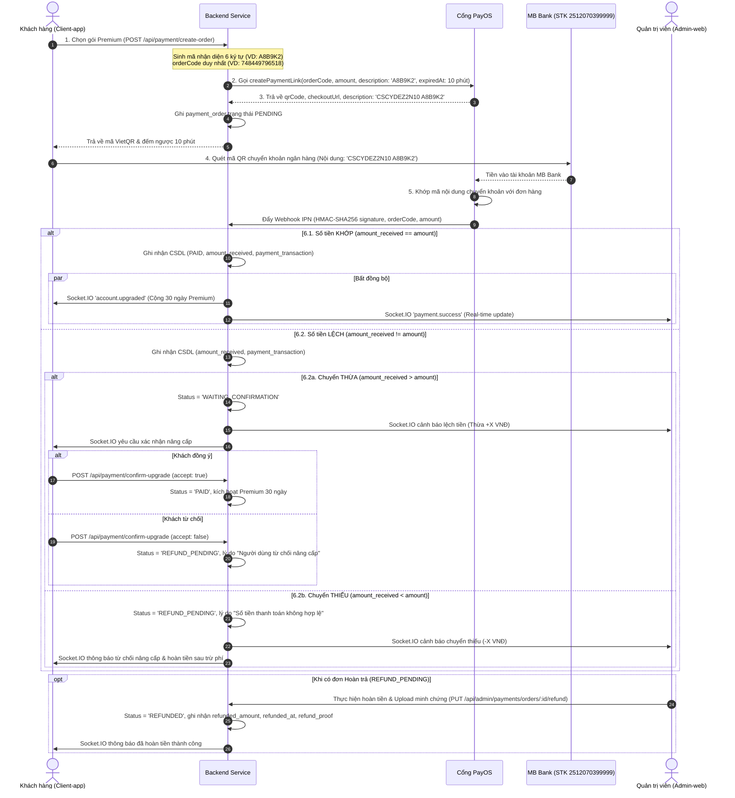
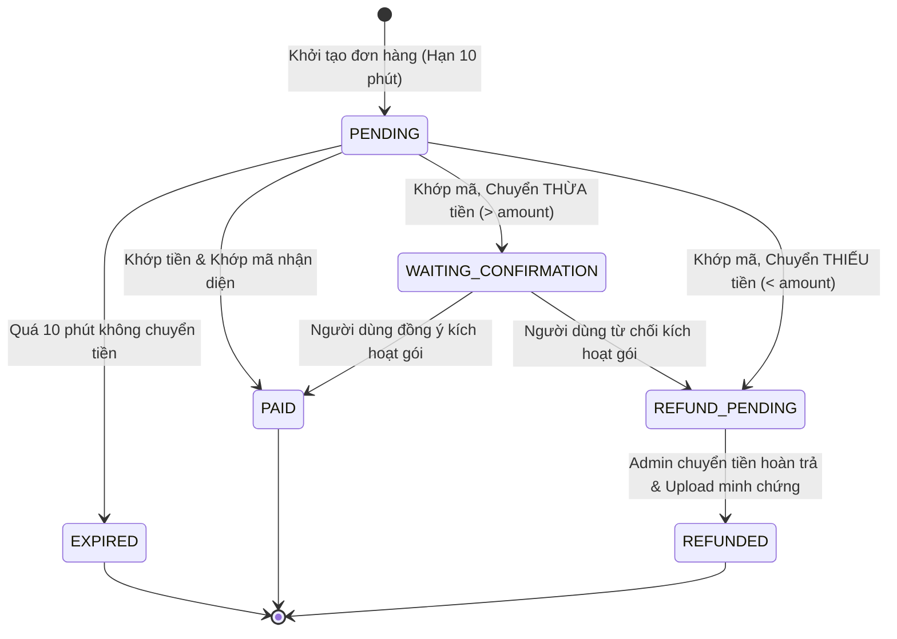

# QUY TRÌNH THANH TOÁN TỰ ĐỘNG, ĐỐI SOÁT & XỬ LÝ LỆCH TIỀN (PAYOS PAYMENT RECONCILIATION SPEC)

> **Phiên bản:** 2.0.0 · **Ngày ban hành:** 2026-10-15  
> **Thẩm quyền:** Product Owner & Core Engineering Team  
> **Phạm vi:** `src/Backend`, `src/Client-app` (Flutter), `src/Admin-web` (React/Vite), CSDL PostgreSQL Supabase.

---

## 1. TỔNG QUAN & NGUYÊN TẮC CỐT LÕI

Quy trình thanh toán gói cước Premium qua cổng **PayOS** và ngân hàng **MB Bank** được thiết kế nhằm đảm bảo:
1. **Tự động hóa 100%:** Người dùng quét mã VietQR trên App ngân hàng bất kỳ, PayOS phát hiện biến động số dư và đẩy Webhook về Backend để kích hoạt tài khoản trong vòng 1 - 3 giây.
2. **Khớp mã nhận diện ngẫu nhiên (6 ký tự):** Mỗi đơn hàng gắn liền với một mã nhận diện độc nhất gồm 6 ký tự chữ và số `[A-Z0-9]` do Backend sinh ra, kết hợp với tiền tố động của PayOS (`[TIỀN TỐ ĐỘNG PAYOS] [MÃ NHẬN DIỆN]`) trong nội dung chuyển khoản để loại trừ hoàn toàn rủi ro nhầm lẫn giao dịch.
3. **Minh bạch & Xử lý sai lệch số tiền (Overpayment / Underpayment):** Phân định rạch ròi giữa số tiền cần thanh toán (`amount`) và số tiền thực nhận (`amount_received`). Có kịch bản tự động xử lý khi khách chuyển thừa hoặc chuyển thiếu.
4. **Vết kiểm toán & Bảo vệ pháp lý (Audit Trail):** Lưu giữ đầy đủ thông tin giao dịch, minh chứng hoàn trả (Ủy nhiệm chi / Biên lai), phục vụ công tác thanh tra tài chính và điều tra pháp lý theo Nghị định 13/2023/NĐ-CP và `Data_Security.md`.

---

## 2. QUY TRÌNH THANH TOÁN 6 BƯỚC CHI TIẾT

---

## 3. CƠ CẤU DỮ LIỆU & RÀNG BUỘC CSDL (DATABASE SCHEMA)

Toàn bộ dữ liệu đơn hàng được lưu tại bảng `payment_order` và bảng đối soát `payment_transaction` trên PostgreSQL Supabase:

### 3.1. Bảng `payment_order` (Đơn hàng thanh toán)

| Cột (Column) | Kiểu dữ liệu | Ràng buộc | Ý nghĩa nghiệp vụ |
| :--- | :--- | :--- | :--- |
| `id` | `VARCHAR(36)` | `PRIMARY KEY` | Định danh UUID v4 duy nhất của đơn hàng. |
| `order_code` | `BIGINT` | `UNIQUE, NOT NULL` | Mã đơn số nguyên dương duy nhất do Backend sinh ngẫu nhiên gửi sang PayOS. |
| `idaccount` | `INT` | `FK -> account` | ID tài khoản người mua. |
| `package_type` | `VARCHAR(30)` | `DEFAULT 'PREMIUM_1_MONTH'` | Gói dịch vụ đăng ký mua. |
| `amount` | `DECIMAL(15,2)` | `NOT NULL` | Số tiền **cần thanh toán** theo niêm yết của gói (VD: `49000.00`). |
| `amount_received` | `DECIMAL(15,2)` | `DEFAULT 0.00` | Số tiền **thực nhận** từ Webhook PayOS gửi về. |
| `fee` | `DECIMAL(15,2)` | `DEFAULT 0.00` | Phí giao dịch / phí xử lý hoàn tiền khấu trừ (VD: `n` VNĐ). |
| `recognition_code` | `VARCHAR(10)` | `NOT NULL, INDEX` | **Mã nhận diện 6 ký tự chữ + số** (VD: `A8B9K2`). |
| `transfer_content` | `VARCHAR(100)`| `NULLABLE` | Toàn bộ chuỗi ghi chú (VD: `CSCYDEZ2N10 A8B9K2`). |
| `currency` | `VARCHAR(3)` | `DEFAULT 'VND'` | Đơn vị tiền tệ. |
| `status` | `VARCHAR(25)` | `DEFAULT 'PENDING', INDEX` | Trạng thái vòng đời đơn hàng (Xem mục 4). |
| `checkout_url` | `TEXT` | `NULLABLE` | URL trang checkout thanh toán trực tiếp của PayOS. |
| `payment_link_id` | `VARCHAR(100)`| `NULLABLE` | ID liên kết thanh toán của PayOS. |
| `created_at` | `TIMESTAMP(6)`| `DEFAULT now()` | Thời điểm tạo đơn hàng. |
| `paid_at` | `TIMESTAMP(6)`| `NULLABLE` | Thời điểm thanh toán thành công. |
| `expired_at` | `TIMESTAMP(6)`| `NULLABLE` | Thời điểm hết hạn đơn (Mặc định: `created_at + 10 phút`). |
| `refunded_at` | `TIMESTAMP(6)`| `NULLABLE` | Thời điểm Admin thực hiện hoàn tiền cho khách. |
| `refunded_amount`| `DECIMAL(15,2)`| `NULLABLE` | Số tiền thực tế Admin đã hoàn trả. |
| `refund_reason` | `TEXT` | `NULLABLE` | Lý do hoàn trả: *"Do người dùng từ chối nâng cấp gói"* hoặc *"Số tiền thanh toán không hợp lệ"*. |
| `refund_proof` | `TEXT` | `NULLABLE` | Minh chứng hoàn tiền (URL ảnh chụp ủy nhiệm chi / biên lai chuyển khoản ngân hàng). |

### 3.2. Bảng `payment_transaction` (Nhật ký đối soát Webhook ngân hàng)

| Cột (Column) | Kiểu dữ liệu | Ràng buộc | Ý nghĩa nghiệp vụ |
| :--- | :--- | :--- | :--- |
| `id` | `VARCHAR(36)` | `PRIMARY KEY` | UUID v4 của bản ghi giao dịch. |
| `order_id` | `VARCHAR(36)` | `FK -> payment_order` | Khóa ngoại liên kết đơn hàng. |
| `idaccount` | `INT` | `FK -> account` | Khóa ngoại người dùng. |
| `payos_transaction_id` | `VARCHAR(100)` | `NULLABLE` | Mã giao dịch tham chiếu của PayOS/Ngân hàng. |
| `amount` | `DECIMAL(15,2)` | `NOT NULL` | Số tiền thực tế ghi nhận của giao dịch này. |
| `bank_code` | `VARCHAR(50)` | `NULLABLE` | Ngân hàng chuyển tiền (VD: `MBBANK`, `VCB`...). |
| `transaction_time` | `TIMESTAMP(6)` | `DEFAULT now()` | Thời gian giao dịch ngân hàng xảy ra. |
| `signature_verified` | `BOOLEAN` | `DEFAULT true` | Đã xác thực chữ ký HMAC-SHA256 thành công. |
| `raw_webhook_hash` | `VARCHAR(256)` | `NULLABLE` | Mã băm SHA-256 toàn bộ payload webhook để chống chối bỏ. |

---

## 4. VÒNG ĐỜI TRẠNG THÁI ĐƠN HÀNG (ORDER STATUS ENUM)

1. **`PENDING` (Chờ xử lý):** Đơn vừa khởi tạo, đang chờ quét mã VietQR và trong thời gian đếm ngược 10 phút.
2. **`EXPIRED` (Đã hết hạn):** Đơn quá 10 phút không phát sinh giao dịch, liên kết PayOS tự động vô hiệu hóa.
3. **`PAID` (Đã thanh toán):** Tiền vào đúng hoặc khách đồng ý kích hoạt $\rightarrow$ Tài khoản nâng cấp Premium 30 ngày.
4. **`WAITING_CONFIRMATION` (Chờ xác nhận):** Khách chuyển thừa tiền, hệ thống dừng lại hỏi ý kiến khách hàng qua Client-app.
5. **`REFUND_PENDING` (Hoàn trả):** Đơn chuyển thiếu tiền hoặc khách từ chối kích hoạt, đưa vào hàng đợi chờ Admin hoàn tiền.
6. **`REFUNDED` (Đã hoàn trả):** Admin đã chuyển khoản hoàn lại tiền cho khách, cập nhật đầy đủ số tiền, thời gian và đính kèm biên lai chuyển khoản.

---

## 5. ĐẶC TẢ GIAO DIỆN & TRẢI NGHIỆM NGƯỜI DÙNG

### 5.1. Dành cho Client-App (Flutter - Trọng tâm chính)
1. **Màn hình "Chờ thanh toán" (`ChoThanhToanPage`):**
   - Hiển thị ảnh VietQR động chuẩn Napas sinh trực tiếp từ PayOS.
   - Hiển thị đồng hồ đếm ngược 10 phút (`09:59` $\rightarrow$ `00:00`).
   - Hiển thị rõ **Mã nhận diện 6 ký tự** và lưu ý: *"Vui lòng giữ nguyên nội dung chuyển khoản để hệ thống tự động kích hoạt tức thì"*.
   - Nút "Mở App Ngân Hàng" (Deep link VietQR).
2. **Lắng nghe Real-time Socket.IO:**
   - Khi nhận `account.upgraded`: Chuyển ngay sang màn hình **Chúc mừng nâng cấp Premium thành công**.
   - Khi nhận sự kiện `payment.overpaid_confirmation`: Mở BottomSheet/Dialog xác nhận:
     > *"Bạn đã chuyển [amount_received] VNĐ (thừa [lệch] VNĐ). Bạn có đồng ý dùng khoản thanh toán này để kích hoạt gói Premium 30 ngày không?"*
     - Nút "Đồng ý kích hoạt": Gọi API xác nhận.
     - Nút "Yêu cầu hoàn tiền": Chuyển trạng thái sang Chờ hoàn trả.
   - Khi nhận sự kiện `payment.underpaid_warning`: Mở Dialog thông báo:
     > *"Bạn đã chuyển thiếu tiền ([amount_received] / [amount] VNĐ). Gói cước không đủ điều kiện kích hoạt. Khoản tiền sẽ được hoàn trả lại cho bạn sau khi trừ phí giao dịch [fee] VNĐ."*

### 5.2. Dành cho Admin-Web (Mô phỏng Sandbox & Đối soát Realtime)
1. **Mô phỏng Giao dịch Client-app (Admin Roleplay / Sandbox Mode):**
   - Tại nút "Mã QR mẫu thử nghiệm" trên trang Quản lý thanh toán: Admin đóng vai người dùng cuối.
   - Popup hiển thị giao diện y hệt Client-app (Mã QR thật, mã nhận diện 6 ký tự, đếm ngược 10 phút).
   - Có thêm bộ công cụ giả lập kiểm thử tức thì (Dev Sandbox Actions):
     - Nút *"Giả lập chuyển đúng tiền (49k)"* $\rightarrow$ Kích hoạt luồng 6.1.
     - Nút *"Giả lập chuyển thừa tiền (70k)"* $\rightarrow$ Kích hoạt luồng 6.2a (hiện prompt xác nhận ngay trên modal).
     - Nút *"Giả lập chuyển thiếu tiền (20k)"* $\rightarrow$ Kích hoạt luồng 6.2b (chuyển sang hàng đợi hoàn tiền).
2. **Trang Quản lý & Thực hiện Hoàn tiền (Refund Processing):**
   - Danh sách đơn hàng có thêm tab lọc: `Tất cả` | `Đã thanh toán` | `Chờ xác nhận` | `Cần hoàn trả` | `Đã hoàn trả`.
   - Với đơn `REFUND_PENDING` (Cần hoàn trả):
     - Hiển thị nút "Hoàn tiền cho khách".
     - Modal Hoàn tiền cho phép Admin: Nhập số tiền hoàn trả thực tế, chọn thời gian hoàn trả, và Upload ảnh biên lai chuyển tiền (Ủy nhiệm chi).
     - Sau khi lưu: Đơn chuyển sang `REFUNDED` và bắn Socket.IO thông báo cho khách hàng.
