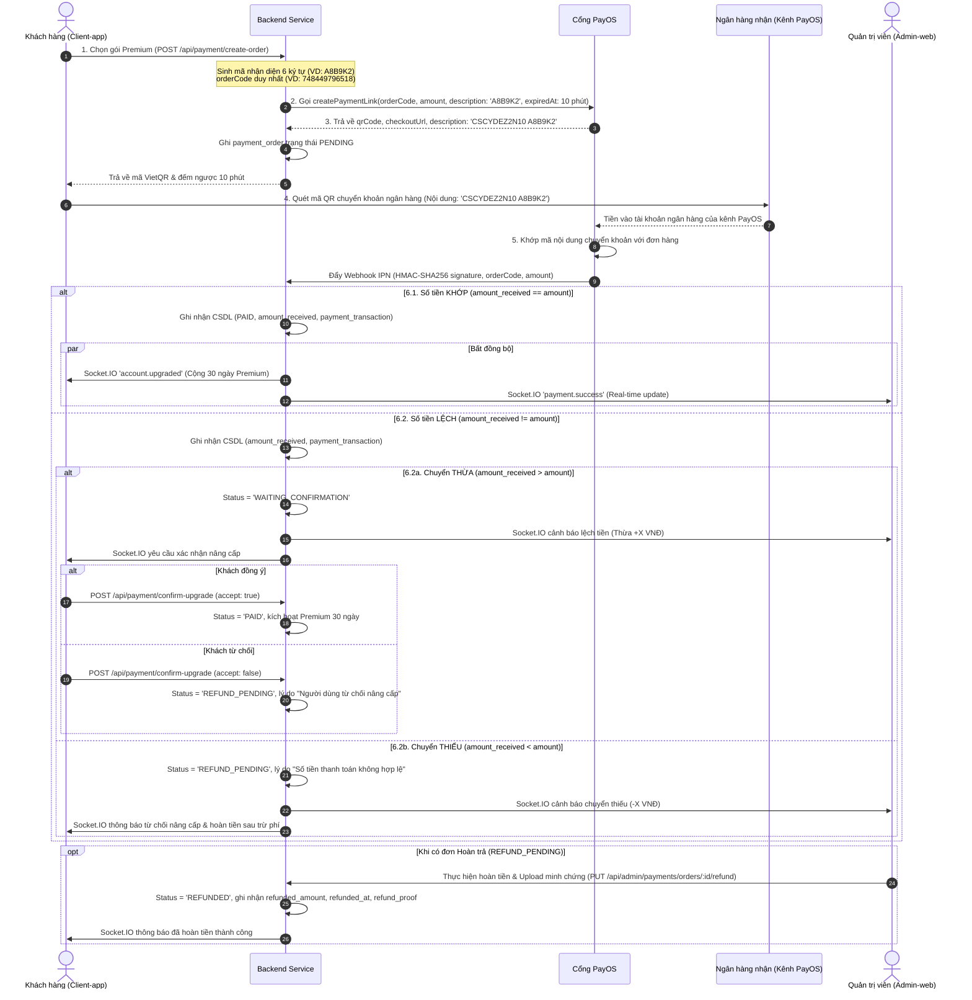
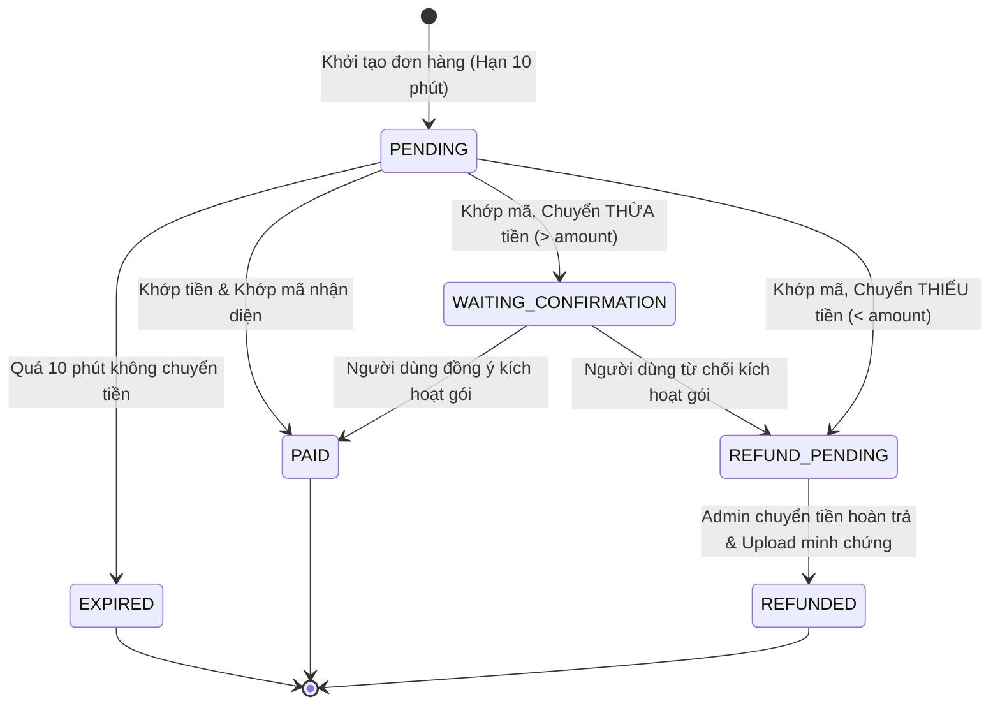

# QUY TRÌNH THANH TOÁN TỰ ĐỘNG, ĐỐI SOÁT & XỬ LÝ LỆCH TIỀN (PAYOS PAYMENT RECONCILIATION SPEC)

> **Phiên bản:** 2.0.0 · **Ngày ban hành:** 2026-10-15  
> **Thẩm quyền:** Product Owner & Core Engineering Team  
> **Phạm vi:** `src/Backend`, `src/Client-app` (Flutter), `src/Admin-web` (React/Vite), CSDL PostgreSQL Supabase.

---

## 1. TỔNG QUAN & NGUYÊN TẮC CỐT LÕI

Quy trình thanh toán gói cước Premium qua cổng **PayOS** và ngân hàng **MB Bank** được thiết kế nhằm đảm bảo:
1. **Tự động hóa 100%:** Người dùng quét mã VietQR trên App ngân hàng bất kỳ, PayOS phát hiện biến động số dư và đẩy Webhook về Backend để kích hoạt tài khoản trong vòng 1 - 3 giây.
2. **Khớp mã nhận diện ngẫu nhiên linh hoạt (6 ký tự):** Mỗi đơn hàng gắn liền với một mã nhận diện độc nhất gồm 6 ký tự chữ và số `[A-Z0-9]` do Backend sinh ra. Backend sử dụng regex linh hoạt nhận diện chính xác mã này kể cả khi token động của PayOS nằm ở đầu chuỗi (`[TOKEN] [MÃ NHẬN DIỆN]`) hoặc ở cuối chuỗi (`[MÃ NHẬN DIỆN] [TOKEN]`).
3. **Minh bạch & Xử lý sai lệch số tiền (Overpayment / Underpayment):** Phân định rạch ròi giữa số tiền cần thanh toán (`amount`) và số tiền thực nhận (`amount_received`). Có kịch bản tự động xử lý khi khách chuyển thừa hoặc chuyển thiếu.
4. **Cơ chế Đối soát Tức thời (Just-in-Time Sync - JIT Sync):** Khi mạng lag hoặc Webhook bị trễ, Client-app hoặc Admin-web chỉ cần gọi `GET /api/payment/order-status/:orderCode`, Backend sẽ chủ động truy vấn cổng PayOS và tự động kích hoạt gói ngay lập tức nếu tiền đã vào, loại bỏ hoàn toàn việc người dùng bị treo ở màn hình chờ.
5. **Vết kiểm toán & Bảo vệ pháp lý (Audit Trail):** Lưu giữ đầy đủ thông tin giao dịch, minh chứng hoàn trả (Ủy nhiệm chi / Biên lai), phục vụ công tác thanh tra tài chính và điều tra pháp lý theo Nghị định 13/2023/NĐ-CP và `Data_Security.md`.
6. **Trang kết quả sau khi thanh toán trên trình duyệt (2026-11-14):** `PAYOS_RETURN_URL` / `PAYOS_CANCEL_URL` trỏ `https://management-finance-gamma.vercel.app/payment/success` và `/payment/cancel`. Đây là trang công khai của Admin-web (không cần đăng nhập, không gọi API): đọc `status`, `cancel`, `orderCode` PayOS gắn vào đường dẫn và báo thành công / đang xác nhận / đã hủy, hướng dẫn người dùng quay lại ứng dụng. Trang chỉ để thông báo; gói vẫn kích hoạt theo webhook và JIT Sync ở mục 4.
6. **Bảo vệ Idempotency Tuyệt Đối:** Chặn xử lý lặp lại và dừng ngay nếu đơn hàng đã ở các trạng thái kết thúc `['PAID', 'REFUNDED', 'CANCELLED']`.

---

## 2. QUY TRÌNH THANH TOÁN 6 BƯỚC CHI TIẾT

---

### Ghi sổ tiền vào: mã giao dịch ngân hàng là bắt buộc
- Webhook có chữ ký hợp lệ luôn được lưu vào `payment_webhook_log` (payload mã hoá).
- Webhook có `reference` ⇒ ghi dòng sổ tiền vào (`source = WEBHOOK`) đủ chứng cứ: mã giao dịch ngân hàng, tài khoản nhận, người chuyển (mã hoá), mã liên kết PayOS, payload gốc có chữ ký (mã hoá).
- Webhook **thiếu** `reference` ⇒ hỏi lại PayOS (`getPaymentLinkInfo(orderCode).transactions[]`), lấy giao dịch khớp số tiền (`source = PAYOS_API`). Vẫn không có mã ⇒ **không ghi sổ, không kích hoạt gói, giữ nguyên đơn**, nhật ký webhook ghi `MISSING_REFERENCE` và phát `payment.reconciliation_needed` tới admin để đối soát. Tuyệt đối không dùng mã đơn hay mã tự sinh thay mã ngân hàng.
- Đối soát tức thì (`syncOrderWithPayOS`, khi xem đơn `PENDING`) cũng chỉ ghi sổ khi PayOS trả mã giao dịch ngân hàng.

## 3. CƠ CẤU DỮ LIỆU & RÀNG BUỘC CSDL (DATABASE SCHEMA)

Toàn bộ dữ liệu đơn hàng được lưu tại bảng `payment_order` và bảng đối soát `payment_transaction` trên PostgreSQL Supabase:

### 3.1. Bảng `payment_order` (Đơn hàng thanh toán)

| Cột (Column) | Kiểu dữ liệu | Ràng buộc | Ý nghĩa nghiệp vụ |
| :--- | :--- | :--- | :--- |
| `id` | `VARCHAR(36)` | `PRIMARY KEY` | Định danh UUID v4 duy nhất của đơn hàng. |
| `order_code` | `BIGINT` | `UNIQUE, NOT NULL` | Mã đơn số nguyên dương duy nhất do Backend sinh ngẫu nhiên gửi sang PayOS. |
| `idaccount` | `INT` | `FK -> account` | ID tài khoản người mua. |
| `package_type` | `VARCHAR(30)` | `DEFAULT 'PREMIUM_1_MONTH'` | Gói dịch vụ đăng ký mua. |
| `amount` | `DECIMAL(15,2)` | `NOT NULL` | Số tiền **cần thanh toán** theo niêm yết của gói (VD: `49000.00`). |
| `amount_received` | `DECIMAL(15,2)` | `DEFAULT 0.00` | Số tiền **thực nhận** từ Webhook PayOS gửi về. |
| `fee` | `DECIMAL(15,2)` | `DEFAULT 0.00` | Phí giao dịch / phí xử lý hoàn tiền khấu trừ (VD: `n` VNĐ). |
| `recognition_code` | `VARCHAR(10)` | `NOT NULL, INDEX` | **Mã nhận diện 6 ký tự chữ + số** (VD: `A8B9K2`). |
| `transfer_content` | `VARCHAR(100)`| `NULLABLE` | Toàn bộ chuỗi ghi chú (VD: `CSCYDEZ2N10 A8B9K2`). |
| `currency` | `VARCHAR(3)` | `DEFAULT 'VND'` | Đơn vị tiền tệ. |
| `status` | `VARCHAR(25)` | `DEFAULT 'PENDING', INDEX` | Trạng thái vòng đời đơn hàng (Xem mục 4). |
| `checkout_url` | `TEXT` | `NULLABLE` | URL trang checkout thanh toán trực tiếp của PayOS. |
| `payment_link_id` | `VARCHAR(100)`| `NULLABLE` | ID liên kết thanh toán của PayOS. |
| `created_at` | `TIMESTAMP(6)`| `DEFAULT now()` | Thời điểm tạo đơn hàng. |
| `paid_at` | `TIMESTAMP(6)`| `NULLABLE` | Thời điểm thanh toán thành công. |
| `expired_at` | `TIMESTAMP(6)`| `NULLABLE` | Thời điểm hết hạn đơn (Mặc định: `created_at + 10 phút`). |
| `is_template` | `BOOLEAN` | `DEFAULT false, INDEX` | Đánh dấu đơn hàng là đơn mẫu thử nghiệm của Admin (`true`) hay đơn hàng thật của người dùng (`false`). |
| `refunded_at` | `TIMESTAMP(6)`| `NULLABLE` | Thời điểm Admin thực hiện hoàn tiền cho khách. |
| `refunded_amount`| `DECIMAL(15,2)`| `NULLABLE` | Số tiền thực tế Admin đã hoàn trả. |
| `refund_reason` | `TEXT` | `NULLABLE` | Lý do hoàn trả: *"Do người dùng từ chối nâng cấp gói"* hoặc *"Số tiền thanh toán không hợp lệ"*. |
| `refund_proof` | `TEXT` | `NULLABLE` | Minh chứng hoàn tiền (khóa kho lưu trữ `sb://refund-proofs/{orderId}/{uuid}.{ext}`; API admin trả đường dẫn tạm 10 phút) hoặc URL ảnh chụp ủy nhiệm chi / biên lai chuyển khoản ngân hàng). |
| `hidden_at`, `hidden_by` | `TIMESTAMP(6)`, `INT` | `NULLABLE` | Đơn mẫu đã ẩn khỏi danh sách admin (đơn không bao giờ bị xoá). |

### 3.2. Bảng `payment_transaction` (Sổ giao dịch — chứng từ bất biến)

Mỗi dòng là **một lần tiền thật vào hoặc ra**, luôn mang **mã giao dịch ngân hàng** để đối chiếu với PayOS và sao kê. Sổ **không sửa, không xoá được** (trigger `trg_protect_payment_transaction` chặn `UPDATE` / `DELETE`); mã chỉ thêm dòng mới.

| Cột (Column) | Kiểu dữ liệu | Ràng buộc | Ý nghĩa nghiệp vụ |
| :--- | :--- | :--- | :--- |
| `id` | `VARCHAR(36)` | `PRIMARY KEY` | UUID v4 của bản ghi giao dịch. |
| `order_id` | `VARCHAR(36)` | `FK -> payment_order` | Đơn hàng của giao dịch. |
| `idaccount` | `INT` | `FK -> account` | Chủ đơn. |
| `payos_transaction_id` | `VARCHAR(100)` | `NOT NULL`, duy nhất (`uq_payment_transaction_payos_id`) | **Mã giao dịch ngân hàng**: `reference` PayOS gửi (vd. `FT26313015169909`) với tiền vào; mã chuyển khoản hoàn do admin nhập với tiền ra. **Không bao giờ** thay bằng mã đơn hay mã tự sinh. |
| `direction` | `VARCHAR(3)` | `IN` \| `OUT`, mặc định `IN` | Chiều tiền: vào (khách trả qua PayOS) / ra (admin hoàn tiền). |
| `source` | `VARCHAR(12)` | `WEBHOOK` \| `PAYOS_API` \| `ADMIN_REFUND` | Nguồn ghi nhận: webhook có chữ ký / hỏi lại API PayOS / admin ghi hoàn tiền. |
| `amount` | `DECIMAL(15,2)` | `NOT NULL` | Số tiền của giao dịch. |
| `transaction_time` | `TIMESTAMP(6)` | `DEFAULT now()` | Thời điểm giao dịch ngân hàng (tiền vào: PayOS báo; tiền ra: admin nhập). |
| `created_at` | `TIMESTAMP(6)` | `DEFAULT now()` | Thời điểm hệ thống ghi dòng sổ (đối chiếu với `transaction_time`). |
| `receiving_account_number` | `VARCHAR(50)` | `NULLABLE` | Tài khoản nhận tiền (PayOS `accountNumber`). |
| `payment_link_id` | `VARCHAR(64)` | `NULLABLE` | Mã liên kết thanh toán PayOS (tra lại giao dịch qua API PayOS). |
| `transfer_description` | `VARCHAR(255)` | `NULLABLE` | Nội dung chuyển khoản / nội dung hoàn tiền. |
| `currency` | `VARCHAR(10)` | `NULLABLE` | Đơn vị tiền. |
| `bank_code`, `counter_account_bank_id`, `counter_account_bank_name` | `VARCHAR` | `NULLABLE` | Ngân hàng người chuyển. |
| `counter_account_name`, `counter_account_number` | `VARCHAR(512)` | mã hoá AES-256-GCM | Tên và số tài khoản người chuyển (dữ liệu cá nhân). Admin-web chỉ thấy số tài khoản che còn 4 số cuối. |
| `raw_payload` | `TEXT` | mã hoá AES-256-GCM | Webhook gốc có chữ ký PayOS (kiểm lại được chữ ký khi điều tra) hoặc phản hồi API PayOS. Không trả ra API. |
| `signature_verified` | `BOOLEAN` | | `true` với dòng ghi từ webhook đã xác thực chữ ký HMAC-SHA256. |
| `raw_webhook_hash` | `VARCHAR(256)` | `NULLABLE` | SHA-256 của payload webhook. |
| `created_by`, `proof` | `INT`, `TEXT` | `NULLABLE` | Với tiền ra: admin ghi nhận và minh chứng chuyển khoản. |

### 3.3. Bảng `payment_webhook_log` (Nhật ký webhook PayOS)

Ghi **mọi** webhook PayOS có chữ ký hợp lệ (kể cả không tìm thấy đơn hoặc thiếu mã giao dịch): `received_at`, `order_code`, `reference`, `amount`, `handled_as` (`PROCESSED`, `TEMPLATE`, `NO_ORDER`, `MISSING_REFERENCE`), `payload` (mã hoá). Append-only: trigger chặn sửa / xoá.

### 3.4. Bất biến của đơn hàng (`payment_order`)

Trigger `trg_protect_payment_order`: **cấm xoá** đơn (mọi trạng thái, kể cả đơn mẫu); **cấm sửa** trường gốc (`id`, `idaccount`, `order_code`, `package_type`, `amount`, `currency`, `is_template`, `created_at`, `recognition_code`); `paid_at`, `amount_received`, `refunded_at`, `refunded_amount`, `refund_proof`, `hidden_at` **chỉ ghi một lần**; đơn `REFUNDED` **khoá hẳn**. Trạng thái đơn vẫn đổi theo dòng đời (PENDING → PAID / EXPIRED / …), còn tiền nằm ở sổ giao dịch bất biến.

---

## 4. VÒNG ĐỜI TRẠNG THÁI ĐƠN HÀNG (ORDER STATUS ENUM)

1. **`PENDING` (Chờ xử lý):** Đơn vừa khởi tạo, đang chờ quét mã VietQR và trong thời gian đếm ngược 10 phút.
2. **`EXPIRED` (Đã hết hạn):** Đơn quá 10 phút không phát sinh giao dịch, liên kết PayOS tự động vô hiệu hóa.
3. **`PAID` (Đã thanh toán):** Tiền vào đúng hoặc khách đồng ý kích hoạt $\rightarrow$ Tài khoản nâng cấp Premium 30 ngày.
4. **`WAITING_CONFIRMATION` (Chờ xác nhận):** Khách chuyển thừa tiền, hệ thống dừng lại hỏi ý kiến khách hàng qua Client-app.
5. **`REFUND_PENDING` (Hoàn trả):** Đơn chuyển thiếu tiền hoặc khách từ chối kích hoạt, đưa vào hàng đợi chờ Admin hoàn tiền.
6. **`REFUNDED` (Đã hoàn trả):** Admin đã chuyển khoản hoàn lại tiền cho khách, cập nhật đầy đủ số tiền, thời gian và đính kèm biên lai chuyển khoản.

---

## 5. ĐẶC TẢ GIAO DIỆN & TRẢI NGHIỆM NGƯỜI DÙNG

### 5.1. Dành cho Client-App (Flutter - Trọng tâm chính)
1. **Màn hình "Chờ thanh toán" (`ChoThanhToanPage`):**
   - Hiển thị ảnh VietQR động chuẩn Napas sinh trực tiếp từ PayOS.
   - Hiển thị đồng hồ đếm ngược 10 phút (`09:59` $\rightarrow$ `00:00`).
   - Hiển thị rõ **Mã nhận diện 6 ký tự** và lưu ý: *"Vui lòng giữ nguyên nội dung chuyển khoản để hệ thống tự động kích hoạt tức thì"*.
   - Nút "Mở App Ngân Hàng" (Deep link VietQR).
2. **Lắng nghe Real-time Socket.IO:**
   - Khi nhận `account.upgraded`: Chuyển ngay sang màn hình **Chúc mừng nâng cấp Premium thành công**.
   - Khi nhận sự kiện `payment.overpaid_confirmation`: Mở BottomSheet/Dialog xác nhận:
     > *"Bạn đã chuyển [amount_received] VNĐ (thừa [lệch] VNĐ). Bạn có đồng ý dùng khoản thanh toán này để kích hoạt gói Premium 30 ngày không?"*
     - Nút "Đồng ý kích hoạt": Gọi API xác nhận.
     - Nút "Yêu cầu hoàn tiền": Chuyển trạng thái sang Chờ hoàn trả.
   - Khi nhận sự kiện `payment.underpaid_warning`: Mở Dialog thông báo:
     > *"Bạn đã chuyển thiếu tiền ([amount_received] / [amount] VNĐ). Gói cước không đủ điều kiện kích hoạt. Khoản tiền sẽ được hoàn trả lại cho bạn sau khi trừ phí giao dịch [fee] VNĐ."*

### 5.2. Dành cho Admin-Web (Đơn thử nghiệm & Đối soát Realtime)
1. **Đơn thử nghiệm (thử luồng thanh toán thật, chống lạm dụng):**
   - **Một mức tiền cố định 2.000 ₫**, do Backend quyết định; mọi số tiền / trạng thái / tài khoản gửi lên đều bị bỏ qua (`POST /api/admin/payments/sample` chỉ nhận `{ pin }`). Lý do: đơn thử là đơn PayOS thật, tiền thật vào tài khoản doanh nghiệp; giới hạn nhỏ và cố định để chức năng không thể dùng làm kênh thu tiền ngoài sổ.
   - **Tối đa 10 đơn thử / ngày (giờ Việt Nam) cho toàn hệ thống**, không phân biệt admin, tính cả đơn đã ẩn. Đếm và tạo nằm trong một giao tác có khoá (`pg_advisory_xact_lock`) nên nhiều yêu cầu đồng thời cũng không vượt; vượt ⇒ 429 `SAMPLE_DAILY_LIMIT`. `GET /api/admin/payments/sample/quota` trả `{ used, limit, amount }`; hộp tạo đơn hiện "Còn x/10 đơn thử hôm nay", hết lượt thì khoá nút.
   - **Bắt buộc PIN** (gửi cùng lời gọi tạo đơn); đơn gắn với **chính admin tạo** (lấy từ JWT); nhật ký ghi `[PAYMENT] Tạo đơn thử nghiệm 2.000 đ, mã đơn <mã>` kèm người tạo.
   - Đơn thử được trả tiền: webhook ghi dòng sổ tiền vào đầy đủ chứng cứ như đơn thật, đơn chuyển `PAID`, **không** kích hoạt gói.
   - **Không có API giả lập webhook** và không thể tạo đơn "đã thanh toán" giả: đơn chỉ thành `PAID` khi PayOS gửi webhook thật có chữ ký (hoặc API PayOS xác nhận có tiền kèm mã giao dịch ngân hàng). Admin quét mã QR bằng ứng dụng ngân hàng / MoMo để thử.
   - **Cơ chế Tự động Render Realtime (Auto-render):** Ngay khi tạo đơn mới hoặc khi PayOS gửi dữ liệu về, sự kiện Socket.IO (`payment.order_created`, `payment.success`) được phát tán; trang Admin-web tự động làm mới danh sách đơn hàng và 4 thẻ KPI doanh thu mà không cần tải lại trang.
   - **Đồng hồ đếm ngược 10 phút:** Trên khung mã QR hiển thị đồng hồ đếm lùi trực quan `10:00` $\rightarrow$ `00:00`.
2. **Bộ lọc, Phân loại đơn mẫu & Tra cứu đa chiều:**
   - **Dropdown gói cước (LOV):** Truy vấn động từ CSDL qua endpoint `GET /admin/payments/packages` (Basic mặc định, Premium).
   - **Cột Đơn hàng & Badge `[Mẫu]`:** Các đơn hàng thử nghiệm mang cờ `is_template: true` được gắn badge nhận diện `[Mẫu]` màu hổ phách bên cạnh mã đơn.
   - **Checkbox "Ẩn đơn mẫu":** Nằm trên thanh công cụ lọc; khi tích chọn, bảng không hiện đơn mẫu (`is_template: false`). Không ảnh hưởng thẻ thống kê.
   - **Bộ lọc ngày (Từ ngày - Đến ngày):** Lọc chính xác theo ngày tạo đơn (`created_at`).
   - **Ẩn đơn mẫu chỉ qua checkbox ở trên.** 2026-11-15: bỏ nút "Ẩn các đơn mẫu" ở đầu trang (trùng việc với checkbox) và **gỡ endpoint `DELETE /api/admin/payments/sample`** cùng `hideSampleOrders`. Cột `hidden_at` / `hidden_by` (migration 53) giữ nguyên: đơn mẫu đã ẩn từ trước vẫn không hiện trong danh sách mặc định, **thống kê và xuất CSV vẫn tính** (`includeHidden=true` khi xuất). Client-app không thấy đơn mẫu (`findOrdersByAccount` lọc `is_template = false`).
   - **Thẻ thống kê (`GET /api/admin/payments/stats`):** **Doanh thu**, **Tổng đơn hàng**, **Đã thanh toán** hiện số tổng ở trên, dưới có hai cột "Từ user · Thử nghiệm" (`revenue | orders | paid = { total, user, template }`). Thẻ thứ tư **Đơn chờ hoàn** (thay "Tỷ lệ thành công" từ 2026-11-15): trên là hai cột số đơn `REFUND_PENDING` từ user / thử nghiệm (`refundPending`), dưới là hai cột số đơn `REFUNDED` "Đã hoàn · Từ user / Thử nghiệm" (`refunded`). Doanh thu = tổng `amount` của đơn `PAID`. API vẫn trả `successRate` (chỉ đơn người dùng) và khoá cũ (`totalRevenue`, `totalOrders`, `paidOrders`…, nghĩa "đơn người dùng") để tương thích.
   - **Xuất CSV** có cột "Loại đơn" (Người dùng / Thử nghiệm).
3. **Trang Quản lý & Thực hiện Hoàn tiền (Refund Processing):**
   - Nút "Hoàn tiền" trên từng dòng: Luôn hiển thị ở cột Thao tác, sáng rõ và tương tác được đối với các đơn `REFUND_PENDING`; tự động làm mờ và vô hiệu hóa (disabled) với các trạng thái khác.
   - **Modal Hoàn tiền (hoàn tiền thủ công):** hệ thống chưa hoàn tiền tự động; admin tự chuyển khoản trả khách rồi **tự nhập và chịu trách nhiệm** về: số tiền hoàn, **mã giao dịch chuyển khoản hoàn** (bắt buộc), **ngày giờ hoàn** (bắt buộc), lý do / nội dung, minh chứng (tệp hoặc đường dẫn, bắt buộc). Bấm Tiếp tục ⇒ hộp PIN; **PIN gửi cùng lời gọi** `PUT /api/admin/payments/orders/:id/refund` và Backend tự xác thực (không tin bước xác thực riêng ở giao diện).
     - Backend từ chối khi: thiếu / sai PIN; đơn không ở `REFUND_PENDING` hoặc `PAID`; đơn đã `REFUNDED` (409, không hoàn lần hai); số tiền ≤ 0 hoặc vượt `amount_received`; thiếu mã giao dịch hoặc mã đã được ghi; ngày hoàn ở tương lai hoặc trước ngày tạo đơn; thiếu minh chứng.
     - Hợp lệ ⇒ trong một giao tác: ghi dòng sổ **tiền ra** (`direction = OUT`, `source = ADMIN_REFUND`, mã giao dịch hoàn, `transaction_time` = ngày admin nhập, `created_by` = admin, `proof`) và chốt đơn `REFUNDED` cùng `refunded_at` (ngày admin nhập), `refunded_amount`, `refund_proof`; sau đó trigger khoá đơn. Nhật ký `[PAYMENT] Hoàn tiền <số tiền> đ đơn <mã> — mã GD <mã>`; phát `payment.refunded` tới người dùng như trước.
     - Tệp minh chứng (JPG / PNG / WEBP / PDF, tối đa 5 MB, kiểm loại theo nội dung) đẩy lên Supabase Storage, bucket riêng tư `refund-proofs`; admin xem qua đường dẫn tạm 10 phút (`core/storage`). Dev / test không có khóa Supabase thì lưu ở `src/Backend/Assets/Storage`.
   - **Modal Chi tiết Đơn hàng & Đối soát:**
     - Tích hợp khung hiển thị mã **VietQR (MB Bank)** sắc nét kèm thông tin tài khoản và nút mở cổng PayOS Checkout.
     - **Đồng hồ đếm ngược thời gian còn lại (10 phút)** đếm lùi theo từng giây cho các đơn hàng `PENDING`.
     - Hiển thị đầy đủ thông tin đơn, **sổ giao dịch** (chiều tiền vào / ra, mã giao dịch ngân hàng, thời điểm, nguồn ghi nhận, tài khoản nhận, ngân hàng và số tài khoản người chuyển che còn 4 số cuối, trạng thái chữ ký) và ảnh minh chứng hoàn tiền. API chi tiết không trả payload gốc hay bản mã thông tin người chuyển.
