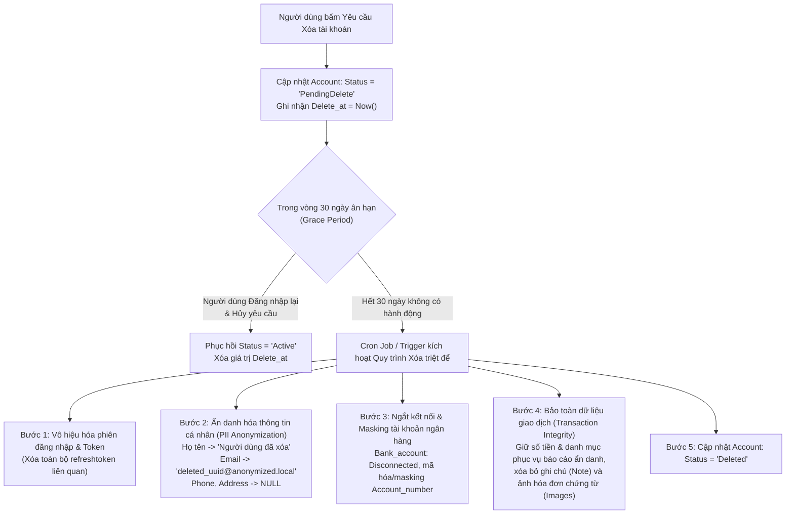

# 🛡️ NGUYÊN TẮC BẢO MẬT DỮ LIỆU & PHÂN LOẠI DỮ LIỆU NHẠY CẢM — MANAGEMENTFINANCE

> **Source of Truth** về danh mục dữ liệu nhạy cảm, cấp độ bảo mật, phạm vi thu thập, chia sẻ và các nguyên tắc kỹ thuật an toàn thông tin áp dụng cho toàn bộ hệ thống **ManagementFinance**.
>
> *Ngày cập nhật:* 2026-09-10  
> *Phạm vi áp dụng:* Toàn bộ dự án (`src/Backend`, `src/Admin-web`, `src/Client-app`).  
> *Căn cứ pháp lý & tiêu chuẩn:* Luật Bảo vệ dữ liệu cá nhân 2025 (91/2025/QH15) và Nghị định 356/2025/NĐ-CP (thay Nghị định 13/2023/NĐ-CP), Luật An ninh mạng 2025 (116/2025/QH15) và Nghị định 333/2026/NĐ-CP, Nghị định 330/2026/NĐ-CP (xử phạt), chuẩn bảo mật dữ liệu thẻ PCI-DSS, khuyến nghị bảo mật OWASP.

---
# Phân loại dữ liệu trong hệ thống tài chính
### (Theo Luật Bảo vệ dữ liệu cá nhân 2025 – Luật số 91/2025/QH15 – và các chuẩn quốc tế)

> **Cập nhật pháp lý quan trọng:** Việt Nam đã ban hành **Luật Bảo vệ dữ liệu cá nhân 2025 (Luật số 91/2025/QH15)**, Quốc hội thông qua ngày 26/6/2025, **có hiệu lực từ 01/01/2026**, thay thế cơ chế cũ chỉ dựa trên Nghị định 13/2023/NĐ-CP. Kèm theo là **Nghị định 356/2025/NĐ-CP** (31/12/2025) quy định chi tiết thi hành. Luật chia dữ liệu cá nhân thành 2 nhóm: **dữ liệu cá nhân cơ bản** và **dữ liệu cá nhân nhạy cảm**, đồng thời có **Điều 27** quy định riêng trách nhiệm của tổ chức hoạt động trong lĩnh vực tài chính, ngân hàng, thông tin tín dụng — trong đó nêu rõ **phần lớn dữ liệu khách hàng ngân hàng thuộc nhóm dữ liệu nhạy cảm**.
>
> Nếu hệ thống của bạn đang xây dựng chính sách dữ liệu, nên đối chiếu lại với văn bản luật gốc và Nghị định 356/2025/NĐ-CP vì đây là văn bản mới, các hướng dẫn chi tiết (thông tư chuyên ngành ngân hàng) có thể tiếp tục được ban hành thêm trong 2026.

---

## 1. Các chức năng & nhóm dữ liệu nhạy cảm phổ biến trong hệ thống tài chính

| Chức năng nghiệp vụ | Dữ liệu nhạy cảm liên quan |
|---|---|
| Định danh khách hàng (KYC/eKYC) | CCCD/CMND/hộ chiếu, ảnh chân dung, video xác thực sống (liveness), vân tay, khuôn mặt |
| Mở & quản lý tài khoản | Số tài khoản, số dư, lịch sử giao dịch, hạn mức |
| Thanh toán / ví điện tử | Số thẻ (PAN), CVV, mã OTP, token thanh toán, lịch sử giao dịch |
| Tín dụng / cho vay | Thu nhập, lịch sử tín dụng (CIC), tài sản đảm bảo, điểm tín dụng (credit score), hồ sơ vay |
| Đầu tư / chứng khoán | Danh mục đầu tư, giá trị tài sản ròng, lệnh giao dịch |
| Bảo hiểm | Tình trạng sức khỏe, bệnh sử, thông tin người thụ hưởng |
| Chống gian lận / AML-CFT | Thiết bị (device ID), IP, vị trí địa lý, hành vi giao dịch bất thường, danh sách đen |
| Chấm điểm tín dụng bằng AI | Dữ liệu hành vi, dữ liệu thay thế (alternative data), mô hình scoring |

---

## 2. Dữ liệu nhạy cảm theo quy định Việt Nam + chuẩn quốc tế

### Theo Luật Bảo vệ dữ liệu cá nhân 2025 (VN)
Dữ liệu cá nhân nhạy cảm là dữ liệu gắn liền với quyền riêng tư, khi bị xâm phạm sẽ ảnh hưởng trực tiếp tới quyền và lợi ích hợp pháp của chủ thể, bao gồm (nhóm chính thường được nêu):
- Dữ liệu về **sức khỏe, đời sống riêng tư, tôn giáo, tín ngưỡng, chủng tộc/dân tộc, quan điểm chính trị**
- **Dữ liệu sinh trắc học** (vân tay, khuôn mặt, giọng nói, mống mắt...)
- **Dữ liệu tài chính** — tài khoản ngân hàng, số dư, lịch sử giao dịch, **thông tin tín dụng** (đây là nhóm áp dụng trực tiếp cho ngành tài chính – ngân hàng, quy định riêng tại Điều 27)
- **Vị trí địa lý** của cá nhân
- **Lịch sử hoạt động trên không gian mạng**: theo dõi hành vi, sử dụng dịch vụ trực tuyến, lịch sử truy cập (thiết bị, IP) — Nghị định 356/2025/NĐ-CP chuyển nhóm này từ dữ liệu cơ bản sang nhạy cảm
- Dữ liệu về **tội phạm, vi phạm pháp luật**
- Dữ liệu cá nhân **là bí mật nhà nước** — phải mã hóa/giải mã theo pháp luật về bảo vệ bí mật nhà nước và cơ yếu

Riêng với lĩnh vực tài chính – ngân hàng – thông tin tín dụng, Điều 27 quy định thêm:
- Không được dùng thông tin tín dụng để **chấm điểm/xếp hạng tín dụng** khi chưa có sự đồng ý của chủ thể dữ liệu
- Chỉ thu thập dữ liệu **cần thiết** cho hoạt động thông tin tín dụng, từ nguồn hợp pháp
- Phải **thông báo cho khách hàng** khi xảy ra sự cố lộ/mất dữ liệu tài khoản ngân hàng, tài chính, tín dụng
- Xử lý dữ liệu bằng AI phải **phân loại theo mức độ rủi ro**

*(Lưu ý: đây là tổng hợp từ các nguồn báo chí/pháp lý công bố về luật mới — nên đối chiếu với văn bản luật gốc Điều 2 và Nghị định 356/2025/NĐ-CP để có định nghĩa chính xác từng khoản khi áp dụng vào hệ thống thực tế.)*

### Theo chuẩn quốc tế (tham chiếu song song)

| Chuẩn / Quy định | Phạm vi | Dữ liệu coi là nhạy cảm |
|---|---|---|
| **GDPR (EU)** – Điều 9 | Bảo vệ dữ liệu cá nhân chung | Chủng tộc, dân tộc, tôn giáo, sức khỏe, xu hướng/đời sống tình dục, sinh trắc học, công đoàn, quan điểm chính trị |
| **PCI-DSS** | Dữ liệu thẻ thanh toán | Số thẻ đầy đủ (PAN), CVV/CVC, dữ liệu dải từ/chip, PIN |
| **GLBA (Mỹ)** | Tổ chức tài chính | "Nonpublic Personal Information" – thu nhập, số dư, lịch sử giao dịch, điểm tín dụng |
| **ISO/IEC 27701** | Hệ thống quản lý bảo mật thông tin cá nhân | PII nhạy cảm, gắn với ISO 27001 |
| **Basel / quy định NHNN** | Quản trị rủi ro ngân hàng | Dữ liệu định danh khách hàng, dữ liệu giao dịch, dữ liệu rủi ro tín dụng |

**Điểm chung VN + quốc tế:** dữ liệu tài chính – tín dụng – sinh trắc học – sức khỏe đều được xếp vào nhóm cần **bảo vệ đặc biệt**, đòi hỏi sự đồng ý rõ ràng, tách biệt, và biện pháp bảo mật cao hơn dữ liệu cơ bản.

---

## 3. Dữ liệu công khai và được phép quản lý tự do

Đây là dữ liệu không thuộc phạm vi bảo vệ nghiêm ngặt, có thể công bố/quản lý bình thường:

- Tên, mã số thuế, thông tin đăng ký kinh doanh của **pháp nhân/doanh nghiệp**
- Báo cáo tài chính đã công bố của công ty đại chúng/niêm yết
- Tỷ giá hối đoái, lãi suất huy động/cho vay đã công bố công khai
- Biểu phí dịch vụ, danh mục sản phẩm
- Địa chỉ chi nhánh, phòng giao dịch, ATM, giờ làm việc
- Mã ngân hàng (BIN), mã SWIFT/BIC
- Số tổng đài, kênh liên hệ chăm sóc khách hàng

---

## 4. Dữ liệu được phép thu thập từ khách hàng & gửi lên server

Điều kiện tiên quyết theo luật mới: phải có **sự đồng ý** rõ ràng, tách biệt (đặc biệt với dữ liệu nhạy cảm), thông báo mục đích – phạm vi – thời hạn lưu trữ, và **chỉ thu thập trong phạm vi cần thiết**.

Nhóm dữ liệu thường được phép thu thập khi có đồng ý hợp lệ:
- **Định danh cơ bản:** họ tên, ngày sinh, giới tính, quốc tịch, số CCCD/hộ chiếu (cần mã hóa khi lưu trữ/truyền tải)
- **Liên hệ:** số điện thoại, email, địa chỉ
- **Dữ liệu eKYC:** ảnh giấy tờ, ảnh chân dung, dữ liệu sinh trắc học phục vụ xác thực (cần đồng ý riêng, mục đích rõ ràng)
- **Dữ liệu giao dịch nghiệp vụ:** số tài khoản, lịch sử giao dịch phục vụ đúng mục đích đã thông báo
- **Dữ liệu thiết bị/phiên:** device ID, IP, user-agent — phục vụ bảo mật, chống gian lận
- **Dữ liệu tín dụng:** chỉ thu thập từ nguồn hợp pháp, phục vụ đúng mục đích thông tin tín dụng

---

## 5. Dữ liệu server cung cấp công khai & mặc định

Đây là dữ liệu hệ thống có thể trả về qua API công khai, không cần xác thực định danh cá nhân:

- Tỷ giá hối đoái tham khảo theo thời gian thực
- Lãi suất tiết kiệm/vay đã niêm yết
- Biểu phí dịch vụ
- Danh sách chi nhánh/ATM và trạng thái hoạt động
- Mã QR thanh toán công khai của điểm bán (merchant)
- Trạng thái vận hành hệ thống (uptime/maintenance)
- Danh mục sản phẩm/dịch vụ

---

## 6. Dữ liệu đặc thù riêng, cần bảo mật đặc biệt cho hệ thống

Nhóm này không chỉ nhạy cảm với khách hàng mà còn **quyết định an toàn của toàn hệ thống** — cần kiểm soát truy cập chặt nhất (mã hóa, HSM, phân quyền tối thiểu, audit log):

- **Khóa mã hóa / bí mật hệ thống:** encryption keys, HSM keys, API secrets, private key ví điện tử/blockchain
- **Dữ liệu xác thực:** mật khẩu (hash), mã OTP seed, PIN, CVV — theo PCI-DSS **tuyệt đối không lưu CVV** sau khi xác thực xong
- **Dữ liệu sinh trắc học gốc** (biometric templates) — không lưu dạng thô, chỉ lưu vector đã mã hóa/hash
- **Core banking data & nhật ký giao dịch nội bộ**
- **Mô hình/thuật toán chấm điểm tín dụng, mô hình AI** — thuộc bí mật kinh doanh
- **Danh sách đen AML/CFT, dữ liệu phòng chống rửa tiền** — thường có yêu cầu bảo mật ở mức cao, hạn chế truy cập
- **Dữ liệu cá nhân là bí mật nhà nước** (nếu có) — bắt buộc mã hóa/giải mã theo quy định về bảo vệ bí mật nhà nước và cơ yếu
- **Kiến trúc bảo mật hệ thống, source code, cấu hình hạ tầng**

---

## Ghi chú áp dụng thực tế

1. Với **dữ liệu nhạy cảm**, luật mới yêu cầu **sự đồng ý riêng biệt** (không gộp chung với đồng ý dữ liệu cơ bản) và phải chứng minh được căn cứ pháp lý khi bị kiểm tra.
2. Sự cố lộ/mất dữ liệu tài khoản ngân hàng/tài chính/tín dụng phải được **thông báo cho khách hàng** — nên có quy trình phản ứng sự cố (incident response) rõ ràng, kèm mốc thời gian báo cáo cơ quan quản lý (một số nguồn nhắc tới mốc 72 giờ theo tinh thần tương tự GDPR).
3. Nên rà soát lại toàn bộ chính sách bảo mật/quy trình nội bộ đang dựa trên Nghị định 13/2023/NĐ-CP cũ để cập nhật theo Luật 91/2025/QH15 và Nghị định 356/2025/NĐ-CP, có hiệu lực từ 01/01/2026.
4. Nên đối chiếu song song với PCI-DSS (nếu xử lý dữ liệu thẻ) và tiêu chuẩn quốc tế phù hợp (ISO 27001/27701) nếu hệ thống phục vụ khách hàng nước ngoài hoặc có đối tác quốc tế.

---

### Nguồn tham khảo
- [Luật Bảo vệ dữ liệu cá nhân 2025, số 91/2025/QH15 – LuatVietnam](https://luatvietnam.vn/dan-su/luat-bao-ve-du-lieu-ca-nhan-2025-so-91-2025-qh15-405135-d1.html)
- [Luật Bảo vệ dữ liệu cá nhân chính thức có hiệu lực – Cổng TTĐT Chính phủ](https://baochinhphu.vn/luat-bao-ve-du-lieu-ca-nhan-chinh-thuc-co-hieu-luc-tu-ngay-mai-1-1-2026-102251231155609721.htm)
- [Quy định bảo vệ dữ liệu cá nhân trong hoạt động tài chính, ngân hàng – Chinhphu.vn](https://xaydungchinhsach.chinhphu.vn/quy-dinh-bao-ve-du-lieu-ca-nhan-trong-hoat-dong-tai-chinh-ngan-hang-119250725172823942.htm)
- [Bảo vệ dữ liệu cá nhân trong lĩnh vực ngân hàng – Tạp chí Ngân hàng](https://tapchinganhang.gov.vn/bao-ve-du-lieu-ca-nhan-trong-linh-vuc-ngan-hang-tu-yeu-cau-phap-ly-den-thuc-tien-quan-tri-17223.html)
- [Luật số 91/2025/QH15 – An toàn thông tin](https://antoanthongtin.vn/tin/luat-so-91-2025-qh15-luat-bao-ve-du-lieu-ca-nhan-2025)

---

## 7. Khung Pháp Lý Bắt Buộc Áp Dụng Cho Dự Án

Cập nhật 2026-11-13 theo `Khao_sat_phap_ly_2026-11.md` (nguồn thứ cấp, mức xác minh ghi từng dòng; sẽ đối chiếu văn bản gốc khi có bản PDF). Nghị định 13/2023/NĐ-CP, Luật An ninh mạng 2018, Luật An toàn thông tin mạng 2015 và Nghị định 53/2022/NĐ-CP **đã bị thay**, không dùng làm căn cứ mới.

### 7.1. Luật Bảo vệ dữ liệu cá nhân 2025 (Luật 91/2025/QH15) & Nghị định 356/2025/NĐ-CP (hiệu lực 01/01/2026)
* **Phân loại:** lịch sử hoạt động trên không gian mạng (lượt truy cập, thiết bị, IP), thông tin tài khoản và lịch sử giao dịch là **dữ liệu nhạy cảm**. Với FlowMoney: `account_device_history`, `refreshtoken`, `audit_log` (hành vi người dùng), `transaction`, `wallet`, `budget`, `bill`, `goal`, `bank_account`, `payment_order` xếp nhóm nhạy cảm (mục 2).
* **Thông báo & đồng ý (đã làm 2026-11-13, mục 10.10):** người dùng đọc chính sách bảo mật (loại dữ liệu, mục đích, thời hạn lưu, việc dữ liệu nhạy cảm đang được xử lý, nơi lưu, quyền) và **đồng ý một lần cho cả chính sách** trước khi dùng app (Chủ dự án chốt: không tách theo dịch vụ, không có rút đồng ý); phiên bản mới thì đồng ý lại. Hệ thống **lưu bằng chứng đồng ý** (ai, phiên bản, thời điểm, chỉ mục mù IP, thiết bị) để chứng minh khi có tranh chấp.
* **Thời hạn xóa tài khoản (Chủ dự án chốt 2026-11-13):** giữ 30 ngày chờ xóa (`PendingDelete`, người dùng hủy được), nêu rõ trong chính sách bảo mật mà người dùng đồng ý.
* **Quyền của chủ thể và thời hạn trả lời:** rút đồng ý / hạn chế / phản đối 2 ngày làm việc; xem, sửa, nhận bản sao dữ liệu 10 ngày; ngừng xử lý 15 ngày; xóa 20 ngày (30 ngày nếu có bên xử lý); được gia hạn một lần có giải thích.
* **Biện pháp bảo vệ dữ liệu nhạy cảm:** giới hạn quyền truy cập, quy trình xử lý, mã hóa khi lưu và khi truyền, ghi nhật ký truy cập (mục 10).
* **Sự cố:** thông báo cơ quan chuyên trách **chậm nhất 72 giờ** kể từ khi phát hiện vi phạm có thể gây tổn hại (Điều 23). Quy trình: `Quy_trinh_su_co_du_lieu.md`.
* **Đánh giá tác động:** lập hồ sơ đánh giá tác động xử lý dữ liệu cá nhân, gửi cơ quan chuyên trách trong **60 ngày** kể từ ngày bắt đầu xử lý, cập nhật khi thay đổi (Điều 21, 22). Bản nháp: `Ho_so_danh_gia_tac_dong.md`.
* **Chế tài (Nghị định 330/2026/NĐ-CP, hiệu lực 19/8/2026):** tổ chức tối đa 3 tỷ đồng (cá nhân một nửa); mua bán dữ liệu 2–10 lần khoản thu; chuyển dữ liệu xuyên biên giới tới 5% doanh thu năm trước; không thông báo cơ quan chuyên trách 20–40 triệu đồng.

### 7.2. Luật An ninh mạng 2025 (Luật 116/2025/QH15, hiệu lực 01/7/2026) & Nghị định 333/2026/NĐ-CP (hiệu lực 19/8/2026)
* **Nhật ký hệ thống:** đủ thông tin xác định phiên kết nối, lưu **tối thiểu 12 tháng**. Áp cho `audit_log` (12 tháng) và IP đầy đủ ở lịch sử thiết bị (`IP_RETENTION_DAYS` = 365, mục 10.8).
* **Lưu trữ dữ liệu tại Việt Nam (Điều 19):** theo bài phân tích, nghĩa vụ lưu tối thiểu 24 tháng chỉ phát sinh có điều kiện với doanh nghiệp nước ngoài khi có quyết định của Bộ trưởng Bộ Công an. Nghĩa vụ với doanh nghiệp trong nước **chưa xác minh**. Hiện CSDL đặt tại Supabase (AWS Tokyo): ghi là hạn chế, chờ đối chiếu văn bản gốc.
* **Xác thực người dùng (Điều 16):** đăng ký tài khoản số xác thực bằng số điện thoại di động Việt Nam hoặc số định danh cá nhân. Đối tượng áp dụng **chưa xác minh**; FlowMoney hiện xác thực bằng email OTP.

### 7.3. Lưu giữ dữ liệu tài chính người dùng (chính sách hệ thống)
* Chủ dự án quyết định (2026-11-13) giữ `transaction`, `bank_account`, `wallet`, `bill`, `budget` tối thiểu **5 năm** trước khi ẩn danh hóa hoặc thanh lọc, kể cả sau khi tài khoản bị xóa.
* Lưu ý căn cứ: Luật Kế toán 2015 (Luật 88/2015/QH13) điều chỉnh sổ sách của đơn vị kế toán; sổ thu chi cá nhân người dùng tự ghi không trực tiếp thuộc phạm vi này. Vì vậy đây là chính sách lưu giữ của hệ thống, phải được **nêu rõ trong thông báo xử lý dữ liệu** (mục đích, thời hạn) để người dùng biết khi đồng ý và khi yêu cầu xóa. Dữ liệu thanh toán gói dịch vụ (`payment_order`, `payment_transaction`) lưu theo nghĩa vụ chứng từ của bên bán.

### 7.4. Tiêu Chuẩn Quốc Tế PCI-DSS v4.0 & Khuyến Nghị OWASP Top 10
* **PCI-DSS (Payment Card Industry Data Security Standard):**
  * Yêu cầu 3: Bảo vệ dữ liệu chủ thẻ lưu trữ. Cấm tuyệt đối lưu trữ mã bảo mật CVV/CVC, mã PIN sau khi ủy quyền giao dịch.
  * Số tài khoản ngân hàng / số thẻ (PAN) phải được che bớt (masking) khi hiển thị (chỉ hiển thị 4 số cuối: `**** **** **** 1234`) và mã hóa AES-256 khi lưu trong CSDL.
  * Yêu cầu 10: nhật ký ghi nguồn gốc sự kiện; IP lấy từ nguồn tin cậy (`req.ip` sau `trust proxy`), không lấy header client tự gửi.
* **OWASP Top 10:**
  * Phòng chống Cryptographic Failures: Mật khẩu băm bằng Argon2id hoặc bcrypt (cost $\ge$ 12); OTP và Refresh Token băm 1 chiều bằng SHA-256; dữ liệu nhạy cảm mã hóa AES-256-GCM với khóa mã hóa quản lý độc lập.
  * Chống dò mã PIN quản trị: sai 5 lần trong 15 phút thì khóa xác thực 15 phút theo tài khoản admin (`verifySecurityAction`).
  * PIN hệ thống dự phòng (quản trị viên chưa có `pin_hash` riêng) lấy từ `ADMIN_SECURITY_PIN`. Production thiếu biến thì không PIN dự phòng nào khớp (từ 2026-11-14, `systemPinMatches` trong `admin.service.js`); chỉ dev mới dùng mặc định `123456`.
* **Tham chiếu quốc tế về IP:** IP là dữ liệu cá nhân (phán quyết Breyer C-582/14); xử lý vì an ninh mạng là lợi ích chính đáng nếu cần thiết, tương xứng (GDPR Recital 49).

## 8. Quy Định Chi Tiết Về Thời Hạn Lưu Trữ Dữ Liệu (Data Retention Policy)

Bảng quy định thời hạn lưu trữ chi tiết cho từng nhóm dữ liệu và từng bảng CSDL trong hệ thống **ManagementFinance**:

| Nhóm dữ liệu | Bảng CSDL liên quan | Thời hạn lưu trữ tối thiểu | Thời hạn lưu trữ tối đa | Căn cứ pháp lý & Tiêu chuẩn | Xử lý khi hết hạn |
|---|---|---|---|---|---|
| **Xác thực tạm thời (OTP)** | `otp_code` | 10 phút (hiệu lực mã) | **24 giờ** kể từ khi tạo | OWASP Session & Storage Limitation (Luật 91/2025: lưu theo mục đích) | **Purge tự động** (xóa vật lý khỏi CSDL) hàng ngày |
| **Phiên đăng nhập & Token** | `refreshtoken` | Theo thời hạn hiệu lực Token (7 - 30 ngày) | **30 ngày** sau khi hết hạn hoặc bị thu hồi (`Status = TRUE`) | OWASP Session Management, Luật BV DLCN 2025 | Lưu IP đã che mờ (IP đầy đủ chỉ ở lịch sử thiết bị, mục 10.8) (`a.b.xx.xx`). **Purge tự động** bản ghi token hết hạn > 30 ngày |
| **Nhật ký kiểm toán (Audit)** | `auditlog` | **12 tháng** | **24 - 36 tháng** | Luật An ninh mạng 2025, Nghị định 333/2026/NĐ-CP (nhật ký ≥ 12 tháng) | Sau 12 tháng: Nén xuất kho lạnh (Cold Storage/Archive) hoặc xóa dữ liệu hết hạn điều tra |
| **Lịch sử thiết bị & IP (nhạy cảm)** | `account_device_history`, `aiops_ip_quarantine.raw_ip` | IP đầy đủ (bản mã + chỉ mục mù): **12 tháng** | **365 ngày** (`IP_RETENTION_DAYS`) kể từ hoạt động cuối; bản che giữ theo vòng đời tài khoản | Luật 91/2025, Nghị định 356/2025, Nghị định 333/2026 | **Purge tự động** 0h00 (`runDailyIpRetentionPurgeTask`): xóa `ip_encrypted`, `ip_hash`, `raw_ip` |
| **Định danh & Tài khoản** | `account`, `User` | Trong suốt thời gian tài khoản hoạt động (`Active`) | Khi người dùng yêu cầu xóa: **30 ngày ân hạn (`PendingDelete`)** $\rightarrow$ Chuyển `Deleted` | Luật 91/2025 (quyền xóa); Nghị định 356/2025 Điều 5: trả lời yêu cầu xóa trong 20 ngày; Chủ dự án giữ 30 ngày ân hạn (2026-11-13), ghi trong chính sách người dùng đồng ý | Sau 30 ngày: Ẩn danh hóa thông tin cá nhân (Email, Phone, Address, Họ tên); xóa IP đầy đủ (`ip_encrypted`, `ip_hash`) trong `account_device_history`, giữ dòng nhật ký với IP đã che; giữ nguyên `policy_acceptance` làm bằng chứng đồng ý (`processFullSoftDelete`, 2026-11-13) |
| **Giao dịch tài chính cốt lõi** | `transaction` | **5 năm** kể từ ngày phát sinh giao dịch | Vô thời hạn (hoặc theo yêu cầu người dùng) | Luật Kế toán 2015 (Điều 41) & Nghị định 174/2016/NĐ-CP | Sau 5 năm: Được phép nén lưu trữ ngoại tuyến (Cold Archive) hoặc ẩn danh hóa nếu tài khoản đã xóa |
| **Tài sản & Số dư** | `bank_account`, `wallet` | Trong suốt vòng đời tài khoản | Tối thiểu **5 năm** sau khi ví/liên kết bị xóa mềm | Luật Kế toán 2015 | Giữ bản ghi tham chiếu lịch sử giao dịch (không xóa vật lý làm hỏng toàn vẹn sổ cái) |
| **Kế hoạch & Định mức** | `budget`, `bill`, `goal` | Đến khi kết thúc chu kỳ ngân sách / hóa đơn / mục tiêu | Tối thiểu **3 - 5 năm** phục vụ báo cáo phân tích | Best Practice Quản lý Tài chính | Cho phép xóa mềm hoặc lưu trữ lịch sử báo cáo tổng hợp |
| **Cấu hình & Phân quyền** | `role`, `category` | Vĩnh viễn (danh mục mặc định hệ thống) | Theo vòng đời tài khoản (với danh mục custom) | Nguyên tắc vận hành hệ thống | Không xóa vật lý danh mục đã có giao dịch liên kết |

---

## 9. Quy Trình Kỹ Thuật Thanh Lọc & Hủy Dữ Liệu (Data Sanitization & Deletion Workflow)

Nhằm đảm bảo tính toàn vẹn tham chiếu (Referential Integrity) của cơ sở dữ liệu mà vẫn tuyệt đối tuân thủ quyền xóa dữ liệu của người dùng theo Luật Bảo vệ dữ liệu cá nhân 2025 và Nghị định 356/2025/NĐ-CP:

### 9.1. Quy tắc Ẩn danh hóa (Data Anonymization):
* **Không thể tái định danh:** Sau khi ẩn danh, mọi mối liên kết giữa dữ liệu tài chính lịch sử và danh tính đời thực của cá nhân phải bị cắt đứt hoàn toàn.
* **Xóa chứng từ nhạy cảm:** Mọi tệp ảnh biên lai, hóa đơn chứa hình ảnh (`transaction.images`) phải bị xóa vật lý khỏi Storage (S3/Cloudinary/Local disk).

### 9.2. Cơ chế Thanh lọc Định kỳ Tự động (Automated Scheduled Purge):
* Hệ thống phải có **Job định kỳ tự động chạy mỗi ngày (ví dụ 00:00 GMT+7)** để:
  1. Quét và xóa các bản ghi `otp_code` đã tạo quá 24 giờ.
  2. Quét và xóa các bản ghi `refreshtoken` đã hết hạn hoặc bị thu hồi quá 30 ngày.
  3. Quét các tài khoản `PendingDelete` đã quá 30 ngày để tiến hành quy trình ẩn danh hóa tự động.

---

## 10. Các Giải Pháp Kỹ Thuật Bảo Mật Đã Triển Khai Thực Tế

Các biện pháp dưới đây đã có trong mã; bốn trigger ở 10.1 có trên CSDL dev từ 2026-09-10 (áp database/10, 11). Chưa có bộ test tự động riêng trong repo cho các biện pháp này:

### 10.1. Cơ chế Bảo vệ 2 Đầu (Client/Backend + CSDL Trigger)
* **Xác thực và mã hóa cấp ứng dụng (Backend Application Layer):** Mọi trường PII (`User.phone`, `User.address`, `bank_account.account_number`) được mã hóa AES-256-GCM trước khi lưu vào CSDL.
* **Hàng rào thép cấp CSDL (PostgreSQL Trigger Layer):** 
  * Trigger `trg_check_phone_encrypted`: Chặn đứng lệnh INSERT/UPDATE nếu SĐT có dạng chuỗi số rõ.
  * Trigger `trg_check_bank_account_encrypted`: Chặn đứng lệnh INSERT/UPDATE nếu STK có dạng chuỗi số rõ.
  * Trigger `trg_protect_transaction` & `trg_protect_auditlog`: Chặn đứng lệnh `DELETE` vật lý dưới 5 năm đối với giao dịch và dưới 12 tháng đối với audit log.

### 10.2. Blind Indexing cho Tra Soát Ngân Hàng O(1)
* Bảng `bank_account` bổ sung cột `Account_number_hash` `VARCHAR(64)` có Index B-Tree.
* Sử dụng `HMAC-SHA256` với khóa bí mật `BLIND_INDEX_SECRET` để tạo hash xác định. Worker SePay/Casso tra cứu tài khoản nhận tiền trong thời gian thực $O(1)$ mà không cần giải mã toàn bộ bảng hay quét tuyến tính.

### 10.3. Che Mờ Dữ Liệu Tự Động (Data Masking)
* Bộ tiện ích `masking.util.js`:
  * Email: `ph***@gmail.com`
  * Phone: `098****321`
  * STK: `**** **** **** 1234`
  * Họ tên công cộng: `Nguyễn P. B.`
  * IP Address: `113.161.xx.xx` (IPv4) hoặc `2001:0db8:xxxx:xxxx:xxxx:xxxx:xxxx:xxxx` (IPv6)
* Tích hợp tự động vào các API danh sách quản trị viên (`AdminService.getUsers`, `AdminService.getUserDetail`).

### 10.4. Kiểm Soát Nội Dung Không Được Chứa PII hay Xúc Phạm
* `Reason_Inactive` (Lý do khóa tài khoản): Tiện ích `content-filter.util.js` quét phát hiện SĐT, Email, CCCD, Thẻ ngân hàng, từ ngữ thô tục/xúc phạm. Nếu vi phạm, trả về lỗi `400 Bad Request`.
* `Note` (Ghi chú giao dịch/ngân sách/hóa đơn/mục tiêu): Áp dụng chuẩn kiểm tra kết hợp **Hình dạng số thẻ (CARD_SHAPE)** và **Thuật toán Luhn (Luhn checksum)** để chỉ lọc số thẻ tín dụng thật sự mà không bắt nhầm số điện thoại, mã đơn hàng hay chuỗi do ứng dụng sinh. Nhận diện mật khẩu tường minh theo dấu phân tách `[:=]`, không nuốt từ "pin" trong ngữ cảnh thường ngày (như "thay pin"). Tự động khử số thẻ tín dụng, mã CVV, mật khẩu trước khi mã hóa At-Rest AES-256-GCM.

### 10.5. Bảo Mật Biên Lai Chứng Từ (Pre-signed URL)
* Ảnh chứng từ (`transaction.images`) được lưu trong Private Bucket, không cấp quyền public truy cập trực tiếp.
* Khi cần xem ảnh, Backend sinh Pre-Signed URL có chữ ký HMAC-SHA256 với thời hạn ngắn (15 - 30 phút).

### 10.6. Làm Sạch Nhật Ký Hệ Thống (Logger Redaction)
* Winston Logger tích hợp format tự động phát hiện và che giấu các trường nhạy cảm (`balance`, `password`, `token`, `otp`, `code_hash`, `cvv`, `refreshtoken`).

### 10.7. Bảo Vệ Tuyệt Đối Quyền Riêng Tư Danh Mục Chi Tiêu Của Người Dùng (User Category Privacy & Isolation)
* **Cơ sở pháp lý:** Luật Bảo vệ dữ liệu cá nhân 2025 và Nghị định 356/2025/NĐ-CP (thay Nghị định 13/2023/NĐ-CP) (Luật số 91/2025/QH15 - Điều 27). Danh mục chi tiêu tùy chỉnh của cá nhân chứa đựng trực tiếp thói quen sinh hoạt, đời sống riêng tư, mức chi trả và lối sống của người dùng, thuộc nhóm dữ liệu cá nhân nhạy cảm cần được bảo vệ đặc biệt.
* **Nguyên tắc phân quyền cách ly (User-scoped Isolation):**
  * Quản trị viên (Admin) chỉ quản lý các danh mục mẫu mặc định của hệ thống (`is_default = true`).
  * Danh mục người dùng (`is_default = false`) thuộc quyền sở hữu riêng tư tuyệt đối của tài khoản tạo lập (`create_by = idaccount`).
  * Backend API (`/api/admin/getcategory`, `addcategory`, `updatecategory/:id`, `deletecategory/:id`, `restorecategory/:id`) và giao diện Admin-web (`/categories`) bị ép cứng lọc theo `is_default = true, delete_at = null`, gỡ bỏ hoàn toàn logic truy vấn danh mục cá nhân của người dùng.
* **Cơ chế Phòng vệ Chiều sâu (Defense-in-Depth):**
  * **Ẩn danh hóa bắt buộc (Data Masking):** Nếu bất kỳ danh mục người dùng nào vô tình lọt vào API hoặc giao diện Admin, toàn bộ trường thông tin cá nhân (`name`, `keyword`, `created_by`, `created_by_name`) bắt buộc bị thay thế 100% bằng `***` và cắm cờ `is_user_category: true`. Giao diện hiển thị nhãn cảnh báo `[Dữ liệu riêng tư - Đã ẩn danh]` và khóa toàn bộ nút Sửa / Xóa.
  * **Chặn đứng can thiệp (403 Forbidden):** Mọi hành vi sửa (`updateCategory`) hoặc xóa (`deleteCategory`) danh mục của người dùng từ phía Admin đều bị Backend từ chối ngay lập tức với mã lỗi `403 Forbidden` ("Vi phạm quyền riêng tư: Tuyệt đối cấm chỉnh sửa/xóa danh mục của người dùng.").
* **Xử lý danh mục khi người dùng yêu cầu xóa tài khoản:**
  * Khi tài khoản người dùng ở trạng thái `PendingDelete` (thời hạn ân hạn 30 ngày), danh mục cá nhân vẫn được bảo lưu cục bộ để người dùng có thể khôi phục nếu hủy yêu cầu.
  * Khi hết 30 ngày và chuyển sang trạng thái `Deleted` (quy trình thanh lọc triệt để): Các danh mục cá nhân liên kết với tài khoản sẽ được xóa mềm (`Delete_at = NOW()`) hoặc ẩn danh hóa hoàn toàn, đảm bảo cắt đứt mọi liên kết định danh cá nhân mà vẫn bảo toàn tính toàn vẹn tham chiếu của các giao dịch lịch sử theo Luật Kế toán.

### 10.8. Bảo Vệ Địa Chỉ IP: Che Để Hiển Thị, Mã Hóa Để Điều Tra (Phương án B, 2026-11-13)
* **Cơ sở pháp lý:**
  * IP gắn với tài khoản là dữ liệu cá nhân; lịch sử truy cập, thiết bị, IP thuộc nhóm dữ liệu phản ánh hoạt động trên không gian mạng, được Nghị định 356/2025/NĐ-CP xếp là **dữ liệu nhạy cảm** (Luật Bảo vệ dữ liệu cá nhân 2025 – Luật 91/2025/QH15). Thu thập được phép khi có mục đích rõ ràng (bảo mật, chống chiếm đoạt tài khoản, điều tra sự cố), có thông báo cho người dùng, có thời hạn lưu và biện pháp bảo vệ.
  * Luật An ninh mạng 2025 (Luật 116/2025/QH15, hiệu lực 01/7/2026, thay Luật An ninh mạng 2018 và Luật An toàn thông tin mạng 2015) và Nghị định 333/2026/NĐ-CP yêu cầu nhật ký đủ thông tin xác định phiên kết nối, lưu tối thiểu 12 tháng. Khảo sát và mức xác minh: `Khao_sat_phap_ly_2026-11.md`.
  * Vì vậy hệ thống không xóa bỏ IP đầy đủ (phương án "Zero Raw IP" cũ không đáp ứng được yêu cầu điều tra) mà lưu ở dạng không đọc được nếu không có khóa và quyền.
* **Cách lưu (migration `48_protect_ip_addresses.sql`):**
  * IP lấy từ `req.ip` (Express `trust proxy = 1`), không lấy giá trị đầu của header `x-forwarded-for` vì client tự gửi được.
  * Bảng `account_device_history` lưu ba dạng: `ip_address` bản che (`113.161.xx.xx`, chỉ để hiển thị); `ip_encrypted` IP đầy đủ mã hóa AES-256-GCM bằng `DATA_ENCRYPTION_KEY`; `ip_hash` HMAC-SHA256 bằng `BLIND_INDEX_SECRET` để so khớp và tra cứu mà không giải mã. Đổi IP đầy đủ (kể cả cùng dải `/16`) ghi dòng lịch sử mới.
  * Bảng `aiops_ip_quarantine.raw_ip`: lưu bản mã AES-256-GCM (`enc:...`), giải mã khi nạp vào bộ lọc chặn. Việc chặn so theo `ip_hash`.
  * Từ G4.1 (2026-11-13): toàn bộ AIOps (bộ thu thập, lớp chặn, sự cố) băm IP bằng một hàm chung `ipLookupHash` = HMAC-SHA256 khóa `BLIND_INDEX_SECRET`, trùng chỉ mục mù của lịch sử thiết bị (tra chéo được). Lượt chặn cũ (băm kiểu cũ) được tính lại từ `raw_ip` khi nạp danh sách chặn. Sửa kèm lỗi chặn từ sự cố không có tác dụng (bộ thu thập từng dùng muối ngẫu nhiên riêng).
  * Phản hồi `/api/admin/aiops/*` và các sự kiện `admin.security_alert`, `admin.anomaly_detected`, `admin.metrics_stream` bỏ mọi khóa `rawIp` / `raw_ip`; Admin-web chỉ nhận bản che. Xem IP đầy đủ của nguồn bị cô lập: `POST /api/admin/aiops/quarantine/:hash/reveal-ip`, bắt buộc PIN (`REVEAL_IP`), ghi nhật ký không chứa IP. Nhật ký thao tác trước đây bỏ qua mọi đường `/admin/aiops`; từ G4.1 chỉ bỏ các lệnh `GET` (hỏi trạng thái định kỳ), còn chặn / cấm / gỡ chặn / xem IP của admin đều được ghi.
  * Bảng `refreshtoken`, `aiops_incident`: chỉ lưu bản che như trước. `audit_log` không có cột IP.
* **Xem IP đầy đủ:** chỉ admin, tại hộp chi tiết người dùng (Admin-web) → mục "Thiết bị đăng nhập" → "Xem IP đầy đủ". API `POST /api/admin/getuser/:id/devices/:deviceId/reveal-ip` nhận PIN (hoặc mật khẩu) trong cùng request và tự kiểm bằng `verifySecurityAction`; mỗi lượt (cả nhập sai) ghi vào `audit_log` tên hành động "Xem IP đầy đủ (người dùng #…, thiết bị #…)", không ghi IP. Phản hồi đặt `Cache-Control: no-store`; giao diện chỉ hiện IP trong phiên xem, không lưu lại.
* **Thời hạn lưu:** job hằng ngày `runDailyIpRetentionPurgeTask` xóa `ip_encrypted`, `ip_hash` và `raw_ip` có hoạt động cuối quá `IP_RETENTION_DAYS` (mặc định **365 ngày**, Chủ dự án chốt 2026-11-13: đủ mức tối thiểu 12 tháng của nhật ký theo Nghị định 333/2026, giữ ít nhất có thể). Bản che và dòng lịch sử được giữ.
* **Khóa:** mất `DATA_ENCRYPTION_KEY` thì không giải được IP đã lưu; đổi `BLIND_INDEX_SECRET` thì `ip_hash` cũ không còn khớp (chỉ làm phát sinh thêm dòng lịch sử, không hỏng dữ liệu).
* **Nguồn IP:** toàn Backend lấy IP qua `getClientIp(req)` (`req.ip`); test rào chắn `ip.protection.2tier.test.js` đỏ nếu có mã đọc lại header `x-forwarded-for` (sửa 2026-11-13: `audit-log.middleware`, `auth.controller`, `auth.service` — kể cả IP admin được AIOps bảo vệ khi đăng nhập —, `aiops.controller`).
* **Đã đóng (G4.1, 2026-11-13):** muối viết cứng của `hashIp` được thay bằng khóa bí mật `BLIND_INDEX_SECRET`.

### 10.9. Chuẩn Hóa Dung Lượng Lưu Trữ Các Cột Hash & IP (Overflow Guard - 256/512 Ký Tự)
* **Bối cảnh & Nguy cơ tràn dữ liệu (Length Overflow):**
  * Trong các hệ thống CSDL truyền thống, các cột lưu mã băm thường bị giới hạn ở 40 ký tự (chuẩn SHA-1 cũ) hoặc 45 ký tự (chuẩn IPv6 max) hoặc 64 ký tự (chuẩn hex SHA-256).
  * Khi áp dụng các thuật toán băm hiện đại (SHA-256 256-bit, SHA-512 128 hex chars, bcrypt, Argon2id, chuỗi hash có tiền tố thuật toán `sha256:...`, hoặc token băm dài tới 256 ký tự), các cột khai báo 40, 45, hoặc 64 ký tự sẽ ném ngoại lệ nghiêm trọng `value too long for type character varying(...)` làm sập luồng xác thực hoặc giám sát an ninh.
  * Đồng thời, cột `VARCHAR(255)` truyền thống gặp lỗi biên (off-by-one error) nếu chuỗi hash/token có độ dài đúng 256 ký tự.
* **Giải Pháp Kỹ Thuật (Migration 18 Đã Áp Dụng Trên Supabase Cloud):**
  * Thực thi Migration SQL `18_expand_hash_and_ip_columns_capacity.sql` đồng bộ lên PostgreSQL Cloud Supabase:
    * `refreshtoken.IP_address`: Mở rộng từ `VARCHAR(45)` lên `VARCHAR(256)`. Đảm bảo an toàn tuyệt đối cho cả Masked IP IPv4/IPv6, chuỗi băm IP, lẫn các định danh thiết bị dài tới 256 ký tự.
    * `refreshtoken.Token_hash`: Mở rộng từ `VARCHAR(255)` lên `VARCHAR(512)`. Loại bỏ 100% nguy cơ tràn bộ đệm khi lưu token băm.
    * `aiops_incident.actor_hash`: Mở rộng từ `VARCHAR(64)` lên `VARCHAR(256)`. Hỗ trợ lưu trữ mọi định dạng hash thuật toán.
    * `aiops_incident.actor_identity`: Mở rộng từ `VARCHAR(100)` lên `VARCHAR(256)`.
    * `aiops_incident.id`: Mở rộng từ `VARCHAR(64)` lên `VARCHAR(256)`.
    * `bank_account.Account_number_hash`: Mở rộng từ `VARCHAR(64)` lên `VARCHAR(256)`.
    * `otp_code.code_hash`: Mở rộng từ `VARCHAR(255)` lên `VARCHAR(512)`.
  * **Đặc tính PostgreSQL:** Việc mở rộng độ dài `VARCHAR(n)` lên độ dài lớn hơn trong PostgreSQL là thao tác metadata tức thì ($< 1\text{ms}$), không khóa bảng, không ghi đè dữ liệu và không làm tăng chi phí lưu trữ trên đĩa.

### 10.9b. Lưu Trữ Tệp Người Dùng Tải Lên (Supabase Storage, 2026-11-13)

* Minh chứng hoàn tiền (và bản sao dữ liệu cá nhân, mục 10.11 khi hoàn thành) lưu ở Supabase Storage, bucket **riêng tư** `refund-proofs`, `data-exports`; không ghi ổ đĩa máy chủ ứng dụng.
* Không có đường dẫn công khai: Backend ký đường dẫn tạm (minh chứng: 10 phút cho admin). Khóa `SUPABASE_SERVICE_ROLE_KEY` chỉ ở Backend.
* Tệp tải lên được kiểm loại theo nội dung (JPG / PNG / WEBP / PDF), tối đa 5 MB.
* Dữ liệu nằm cùng nhà cung cấp và khu vực với CSDL (Supabase, châu Á), nên không mở thêm bên xử lý mới so với chính sách v1.

### 10.10. Chính Sách Bảo Mật Theo Phiên Bản & Bằng Chứng Đồng Ý (Migration 49, 2026-11-13)
* **Căn cứ:** Luật Bảo vệ dữ liệu cá nhân 2025; Nghị định 356/2025/NĐ-CP Điều 6 (bên kiểm soát lưu bằng chứng đồng ý, chứng minh khi tranh chấp).
* **CSDL:** `privacy_policy` (mỗi phiên bản một dòng: `version`, `title`, `content`, `published_at`, `published_by`) và `policy_acceptance` (`idaccount`, `policy_version`, `accepted_at`, `ip_hash` HMAC, `device_name`, `user_agent`; duy nhất theo `idaccount` + `policy_version`). Trigger `trg_protect_privacy_policy`, `trg_protect_policy_acceptance` chặn `UPDATE`: nội dung đã đăng và bằng chứng đã ghi không sửa được. Không lưu IP.
* **Admin:** Admin-web → Bảo trì & Thông báo → Chính sách: xem phiên bản hiện hành, tỉ lệ người dùng đã đồng ý, lịch sử phiên bản; đăng phiên bản mới phải nhập PIN trong cùng request (`POST /api/admin/policies`), ghi nhật ký "Đăng chính sách bảo mật vN", phát `system.policy_updated` tới mọi client. Hộp chi tiết người dùng hiện "Đã đồng ý vN" / "Chưa đồng ý vN".
* **Người dùng:** `GET /api/policy/current` (chính sách hiện hành, phiên bản đã đồng ý, `mustAccept`), `POST /api/policy/accept` (409 `POLICY_VERSION_OUTDATED` khi đã có phiên bản mới). Backend **chưa chặn** người dùng chưa đồng ý; Client-app làm màn đồng ý theo `docs/superpowers/client-app/CAN-LAM/CHINH_SACH_BAO_MAT.md`.
* **Văn bản:** nguồn phiên bản 1 ở `Chinh_sach_bao_mat_v1.md` (không ghi tên nhà cung cấp AI; email hỗ trợ tạm thời phubao12as@gmail.com). Đổi nội dung thì tạo tệp phiên bản mới rồi đăng.
* **Lưu giữ:** bằng chứng giữ theo bản ghi tài khoản (tài khoản chỉ xóa mềm nên bằng chứng còn nguyên để đối chứng).

### 10.11. Quyền Nhận Bản Sao Dữ Liệu Cá Nhân (Migration 50, 2026-11-14)

* Người dùng yêu cầu trong app (`POST /api/account/data-export`); Backend tạo tệp nền, lưu Supabase Storage bucket riêng tư `data-exports`, gửi email báo sẵn sàng **không kèm đường dẫn**; tải trong app khi đã đăng nhập (`GET /api/account/data-export/:id/download?format=json|csv`), chỉ chủ tài khoản.
* Nội dung: tài khoản, hồ sơ (giải mã), ví, giao dịch, ngân sách, hóa đơn, mục tiêu, danh mục tự tạo, gia đình đang tham gia, đơn thanh toán, thiết bị (IP bản che), các lần đồng ý chính sách, nhật ký lượt gọi máy chủ 12 tháng. Không có: mật khẩu, PIN, token, OTP, IP đầy đủ, dữ liệu điều tra an ninh AIOps. Dữ liệu của thành viên khác trong nhóm gia đình không đưa vào.
* Tệp hết hạn sau 24 giờ và bị xóa; 1 yêu cầu / 24 giờ; mỗi lượt yêu cầu và tải ghi nhật ký thao tác. Bảng `data_export_request` là bằng chứng đáp ứng trong thời hạn 10 ngày.
* Phạm vi thu thập: máy chủ chỉ ghi các lượt ứng dụng gọi tới Backend (bảo đảm vận hành, khả năng chịu tải); không thu thập hoạt động cá nhân trong ứng dụng.

### 10.12. Sổ Sự Cố Dữ Liệu Và Hạn Báo 72 Giờ (Migration 51, 2026-11-14)

* Bảng `data_incident`; Admin-web: Nhật ký kiểm toán → "Sự cố dữ liệu". Hạn báo cơ quan chuyên trách = thời điểm phát hiện + 72 giờ, có đồng hồ đếm ngược.
* Quy tắc ở Backend: báo sau 72 giờ bắt buộc `late_reason`; đóng bắt buộc `root_cause` và (đã báo cơ quan hoặc `report_not_required` + `no_report_reason`), xác thực PIN (`CLOSE_DATA_INCIDENT`); sự cố đã đóng không sửa (409).
* Trigger `trg_protect_data_incident` chặn DELETE: sổ là hồ sơ pháp lý. Mọi thao tác ghi nhật ký kiểm toán; sự kiện `admin.data_incident_changed` cập nhật màn hình theo thời gian thực.
* Quy trình: `Quy_trinh_su_co_du_lieu.md`.
