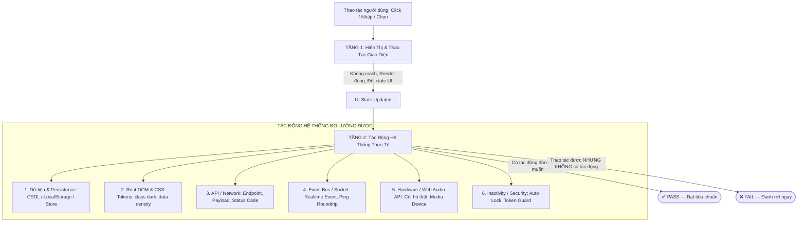

# 🧪 Quy Chuẩn Kiểm Thử Bắt Buộc: Spec-Driven Test-First & Kiến Trúc Kiểm Thử 2 Tầng — FinanceManagement

> **Dự án:** Personal Finance Management  
> **Tài liệu nguồn sự thật:** `docs/Rule_Project/testing-guidelines.md`  
> **Phạm vi áp dụng:** Toàn bộ 3 module (`src/Backend`, `src/Admin-web`, `src/Client-app`)  
> **4 Nguyên tắc cốt lõi bắt buộc:**
> 1. *"Test phải dựa vào đặc tả nghiệp vụ 100% (Specification-Driven Testing)."*
> 2. *"Test phải được viết TRƯỚC KHI hiện thực code (Test-First / TDD Red Phase)."*
> 3. *"Sau khi hiện thực code mới chạy test để kiểm chứng code (Verification / TDD Green Phase)."*
> 4. *"Khi 1 nghiệp vụ có sự thay đổi, BẮT BUỘC cập nhật bản test trước khi cập nhật code (Update Test-First on Requirement Changes)."*
> 5. *"Nếu thao tác được trên giao diện nhưng không tạo ra tác động thực sự đến hệ thống như mong muốn thì bài test BẮT BUỘC ĐÁNH RỚT (FAIL)."*

---

## 🎯 1. NGUYÊN TẮC TEST THEO ĐẶC TẢ NGHIỆP VỤ & QUY TRÌNH TEST-FIRST

Trong mọi hoạt động phát triển phần mềm tại FinanceManagement, toàn bộ kỹ sư và AI bắt buộc phải tuân thủ nghiêm ngặt quy trình **Spec-Driven Test-First (Phát triển hướng kiểm thử dựa trên đặc tả nghiệp vụ)**:

```mermaid
flowchart TD
    subgraph "A. PHÁT TRIỂN TÍNH NĂNG MỚI"
        Spec1["1. Lead PO & PO Cấp cao chốt Đặc tả nghiệp vụ & AC"] --> Test1["2. Viết Test trước dựa trên Đặc tả (Chạy FAIL / RED)"]
        Test1 --> Code1["3. Hiện thực Code vừa đủ để thỏa mãn Test"]
        Code1 --> Run1["4. Chạy Test để kiểm chứng (Chạy PASS / GREEN)"]
        Run1 --> Refactor1["5. Tái cấu trúc & Hoàn thiện (Refactor)"]
    end

    subgraph "B. KHI NGHIỆP VỤ THAY ĐỔI (REQUIREMENT CHANGE)"
        ChangeSpec["1. Cập nhật Đặc tả nghiệp vụ trong docs/ & Plan"] --> UpdateTest["2. BẮT BUỘC: Cập nhật Bản Test trước (Chạy FAIL / RED trên code cũ)"]
        UpdateTest --> UpdateCode["3. Cập nhật Code để thích ứng nghiệp vụ mới"]
        UpdateCode --> RunTest2["4. Chạy Test để kiểm chứng (Chạy PASS / GREEN)"]
        RunTest2 --> VerifyRegression["5. Chạy toàn bộ Test suite chống hồi quy (Zero Regressions)"]
    end
```



### 1.1. Test phải dựa vào đặc tả nghiệp vụ 100% (Specification-Driven Testing)
- Mọi test case (Unit, Integration, E2E, 2-Tier Test) bắt buộc phải phản ánh đúng tiêu chí chấp thuận (Acceptance Criteria - AC) và kịch bản nghiệp vụ do PO Cấp cao / Lead PO đặc tả trong `docs/`, `Project.md`.
- **Cấm đoán tuyệt đối:** Không viết test hình thức, test giả lập vô nghĩa, test cho có hoặc test bịa đặt không có căn cứ nghiệp vụ chỉ để "chạy cho xanh mã".

### 1.2. Viết Test TRƯỚC KHI hiện thực Code (Test-First / TDD Red Phase)
- Tuyệt đối **KHÔNG viết code trước rồi mới viết test sau** để hợp thức hóa.
- Luôn viết bài test trước: bài test mô tả chính xác kết quả mong đợi theo đặc tả nghiệp vụ. Khi chạy trên hệ thống chưa có code mới, test **BẮT BUỘC PHẢI THẤT BẠI (RED)**. Test đóng vai trò là "khung định hướng" (guardrails / specification executable) cho việc hiện thực code.

### 1.3. Sau khi hiện thực Code thì mới chạy Test để kiểm chứng Code (Verification / TDD Green Phase)
- Sau khi đã có bản test, kỹ sư mới tiến hành hiện thực mã nguồn (chỉ viết lượng code tối thiểu vừa đủ để thỏa mãn tiêu chí kiểm thử, bám sát SOLID, DRY, KISS, không viết code thừa ngoài phạm vi).
- Sau khi hoàn thành code, chạy toàn bộ bộ test để kiểm chứng:
  + Mã nguồn chỉ được công nhận đạt yêu cầu khi test chuyển từ **RED $\rightarrow$ GREEN** (100% PASS cả Tầng 1 và Tầng 2).
  + Xác nhận không phát sinh lỗi phụ (Zero Regressions) trên toàn bộ hệ thống.

### 1.4. Khi 1 nghiệp vụ có sự thay đổi thì BẮT BUỘC cập nhật bản Test TRƯỚC KHI cập nhật Code (Update Test-First on Requirement Changes)
- Khi có bất kỳ thay đổi, điều chỉnh, bổ sung nào về logic nghiệp vụ (Change Request từ PO, cập nhật luồng tài chính, thay đổi hạn ngạch quota, sửa đổi validation, đổi hành vi trạng thái):
  + **Bước 1 — Nguồn sự thật:** Cập nhật tài liệu đặc tả nghiệp vụ (`docs/`, `Project.md`).
  + **Bước 2 — Cập nhật Test trước (BẮT BUỘC):** Cập nhật hoặc viết mới bản test TRƯỚC KHI đụng vào code. Lúc này chạy test phải **FAIL (RED)** do code hiện tại chưa đáp ứng nghiệp vụ mới.
  + **Bước 3 — Cập nhật Code:** Sau khi test đã được cập nhật và kiểm chứng thất bại chính xác, mới tiến hành cập nhật mã nguồn (code) cho đến khi test mới chuyển sang **PASS (GREEN)**.
  + **CẤM TUYỆT ĐỐI:** Sửa code trước rồi sửa test sau theo mã code, hoặc sửa code mà không cập nhật bản test tương ứng!

---

## 🏛️ 2. TỔNG QUAN KIẾN TRÚC KIỂM THỬ 2 TẦNG (2-TIER TESTING ARCHITECTURE)

Trong dự án FinanceManagement, mọi tính năng kỹ thuật và màn hình nghiệp vụ khi viết bài kiểm thử (Unit / Integration / System Test) **bắt buộc phải được cấu trúc theo 2 tầng độc lập nhưng liên kết chặt chẽ**:



---

## 🧱 3. ĐẶC TẢ CHI TIẾT TỪNG TẦNG

---

### 3.1. TẦNG 1: KIỂM THỬ HIỂN THỊ & THAO TÁC GIAO DIỆN (UI Rendering & Interaction)

* **Mục tiêu:** Đảm bảo component/màn hình hiển thị đầy đủ các phần tử trực quan, bố cục không bị vỡ và phản hồi tương tác mượt mà với người dùng mà không quăng lỗi (crash).
* **Nhiệm vụ kiểm tra:**
  1. **Hiển thị đầy đủ phần tử:** Kiểm tra render của tất cả các controls (input, select, checkbox, toggle, button, table, badge, modal, alert).
  2. **Tương tác trực tiếp:** Người dùng có thể `click()`, `change()`, `submit()`, `hover()` bình thường.
  3. **Xử lý trạng thái nội bộ:** Component tự cập nhật các visual feedback như loading indicator, active tab highlight, disabled buttons khi đang gửi request.
* **Ví dụ Assertion Tầng 1:**
  ```javascript
  // Kiểm tra hiển thị
  expect(screen.getByText('Cài Đặt Hệ Thống Admin')).toBeInTheDocument();
  expect(screen.getByText('Giao diện Tối')).toBeInTheDocument();
  
  // Kiểm tra thao tác click
  const darkBtn = screen.getByText('Giao diện Tối');
  fireEvent.click(darkBtn);
  // UI phản hồi active class
  expect(darkBtn).toHaveClass('border-primary');
  ```

---

### 3.2. TẦNG 2: KIỂM THỬ HOẠT ĐỘNG THỰC TẾ & TÁC ĐỘNG HỆ THỐNG (Real System Impact)

* **Mục tiêu:** Đảm bảo tính năng **thực sự hoạt động và tạo ra tác động đo lường được đến toàn bộ hệ thống**, không phải là bản mockup trá hình hay chỉ đổi state giả lập cục bộ.
* **NGUYÊN TẮC BẤT DI BẤT DỊCH (CRITICAL RULE):**
  > **Nếu thao tác được trên giao diện nhưng không tạo ra tác động thực sự đến hệ thống như mong muốn thì bài test BẮT BUỘC ĐÁNH RỚT (FAIL).**
* **Các chiều tác động hệ thống bắt buộc phải assert (Tùy theo loại tính năng):**

| Chiều Tác Động | Yêu Cầu Kiểm Chứng Tầng 2 | Ví Dụ Assertion Mẫu |
|---|---|---|
| **1. Persistence & Dữ liệu** | Dữ liệu phải được ghi nhận bền vững vào CSDL / LocalStorage / SecureStorage / Global Store. Khi đọc lại phải bảo toàn. | `expect(localStorage.getItem('admin_system_settings')).toContain('"theme":"dark"');` |
| **2. Root DOM & CSS Tokens** | Thiết lập giao diện phải tác động lên Root Document (`<html>`, `<body>`) để toàn bộ trang thay đổi màu sắc/mật độ. | `expect(document.documentElement.classList.contains('dark')).toBe(true);`<br>`expect(document.body.getAttribute('data-density')).toBe('compact');` |
| **3. API Call & Network** | Request gửi lên server phải đúng endpoint, đúng HTTP method, đúng authorization token và body chuẩn. | `expect(authApi.login).toHaveBeenCalledWith({ username: 'admin', password: 'secret' });` |
| **4. Event Bus & Realtime** | Gửi/nhận sự kiện socket thật, đo độ trễ roundtrip thời gian thực. | `expect(mockSocket.timeout).toHaveBeenCalledWith(5000);`<br>`expect(mockSocket.emit).toHaveBeenCalledWith('admin_ping', expect.any(Function));` |
| **5. Web Audio API / Hardware** | Còi báo động phải kích hoạt dao động sóng âm Oscillator thật của Web Audio API. | `expect(soundService.playCriticalAlarm).toHaveBeenCalledTimes(1);` |
| **6. Timer & Inactivity** | Thay đổi thời gian Toast (`3000ms`) thì thông báo phải tự đóng đúng sau `3000ms`. Rời website quá thời gian thì màn hình khóa phải kích hoạt. | `act(() => vi.advanceTimersByTime(3000));`<br>`expect(screen.queryByTestId('alert-toast-success')).toBeNull();` |

---

## 🚫 4. CÁC ANTI-PATTERNS (LỖI CẤM KỴ KHI VIẾT TEST)

1. ❌ **Chỉ assert state nội bộ của component:**
   ```javascript
   // SAI: Chỉ kiểm tra state biến đổi nội bộ, không biết hệ thống có ăn không!
   expect(button.classList.contains('active')).toBe(true);
   ```
   👉 **ĐÚNG (Có Tầng 2):**
   ```javascript
   // ĐÚNG: Kiểm tra cả UI active lẫn tác động lên Root DOM hoặc LocalStorage
   expect(button.classList.contains('active')).toBe(true);
   expect(document.documentElement.classList.contains('dark')).toBe(true);
   expect(localStorage.getItem('admin_system_settings')).toContain('"theme":"dark"');
   ```

2. ❌ **Mock quá mức làm mất tác động thực tế (Over-mocking):**
   Mock luôn cả hàm thực thi chính khiến việc test trở thành vô nghĩa. Nếu mock một service, phải assert service đó được gọi với đúng tham số và trigger đúng side-effects.

3. ❌ **Bỏ qua kiểm tra thời gian thực (Timers):**
   Đặt Toast Duration là 3 giây nhưng trong test không chạy timer kiểm tra xem sau 3 giây Toast có thực sự biến mất hay không.

4. ❌ **Viết code trước rồi mới viết test để hợp thức hóa:**
   Viết code xong mới viết test dẫn đến việc test bị thiên vị theo cách code chạy, bỏ sót các ca biên hoặc sai lệch so với đặc tả nghiệp vụ ban đầu.

5. ❌ **Sửa code trước khi cập nhật test khi nghiệp vụ thay đổi:**
   Khi nghiệp vụ đổi, sửa thẳng vào code khiến test cũ bị gãy hoặc sửa test theo cách code mới chạy mà không kiểm chứng được hành vi chuyển đổi nghiệp vụ.

---

## 📋 5. MA TRẬN ĐỐI CHIẾU 2 TẦNG TRONG TOÀN BỘ 3 MODULE

### 5.1. Module `src/Admin-web`
- **Tính năng Theme Tối:**
  - *Tầng 1:* Click nút "Giao diện Tối" -> Nút chuyển viền xanh active.
  - *Tầng 2:* `document.documentElement` có class `.dark` + LocalStorage lưu `theme: 'dark'`.
- **Tính năng Mật độ bảng (Compact):**
  - *Tầng 1:* Click nút "Thu gọn" -> Nút chuyển màu active.
  - *Tầng 2:* `document.body` có thuộc tính `data-density="compact"`.
- **Tính năng Đổi thời gian Toast (3s):**
  - *Tầng 1:* Chọn select `3000` -> Dropdown hiển thị giá trị 3000.
  - *Tầng 2:* Bắn thông báo Toast -> Sau 2500ms vẫn còn -> Sau 3000ms biến mất hoàn toàn.
- **Tính năng Dọn dẹp cache an toàn:**
  - *Tầng 1:* Click nút "Xóa Cache" -> Hiện hộp thoại confirm.
  - *Tầng 2:* `sessionStorage` bị xóa sạch, cache rác bị xóa, nhưng `wealthcommand_access_token` và `settings` còn nguyên vẹn 100%.

### 5.2. Module `src/Backend`
- **Tính năng Phân quyền tính năng (`requireFeature`):**
  - *Tầng 1:* Controller nhận request hợp lệ không bị sập ứng dụng.
  - *Tầng 2:* Nếu tài khoản Basic gọi tính năng Premium -> Chặn cứng HTTP 403 Forbidden (`code: FEATURE_DISABLED`); nếu đã nâng cấp Premium -> Cho phép đi tiếp HTTP 200 OK.

### 5.3. Module `src/Client-app`
- **Tính năng Nâng cấp gói cước Realtime:**
  - *Tầng 1:* Nhận sự kiện Socket hoặc kết quả thanh toán -> Thẻ Gói tại trang Cá nhân (`profile_page.dart`) chuyển sang trạng thái "Premium", badge hiển thị số ngày còn lại; màn Chờ thanh toán chuyển sang màn "Chúc mừng nâng cấp".
  - *Tầng 2:* `GoiCubit` cập nhật state `TrangThaiGoi(laPremium: true)`, các cổng OCR, Chatbot AI và trần giới hạn 3/3/3 (Ví, Ngân sách, Mục tiêu) mở khóa hoàn toàn; dữ liệu hạn gói được lưu bền vững vào `FlutterSecureStorage` (`goi_tai_khoan_<id>`).

---

## 🏁 6. CHECKLIST NGHIỆM THU TEST TRƯỚC KHI SHIP
Mỗi khi viết hoặc review test, kỹ sư/AI bắt buộc tự kiểm:
- [ ] Test đã bám sát 100% đặc tả nghiệp vụ và tiêu chí chấp thuận (Acceptance Criteria)?
- [ ] Test được viết TRƯỚC KHI hiện thực code (Test-First / Red Phase)?
- [ ] Nếu nghiệp vụ có thay đổi, bản test đã được cập nhật TRƯỚC KHI cập nhật code chưa?
- [ ] Sau khi code xong, đã chạy lại toàn bộ test để kiểm chứng code và đạt 100% PASS (Green Phase)?
- [ ] Test đã có assert Tầng 1 (Render đầy đủ, thao tác click/change/submit không lỗi)?
- [ ] Test đã có assert Tầng 2 (Tác động đo lường được lên CSDL / DOM / Event Bus / Timer / Persistence)?
- [ ] Nếu component đổi state nhưng không tạo ra tác động đến hệ thống, bài test có bắt được và đánh fail không?
