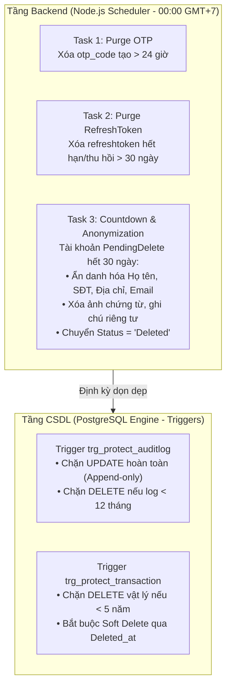

# Kế Hoạch Triển Khai Cơ Chế Lưu Trữ Dữ Liệu & Bảo Vệ An Ninh (Data Retention & Security Plan)

> **Mục tiêu:** Xây dựng cơ chế quản lý thời hạn lưu trữ dữ liệu tự động và chốt chặn an toàn theo mô hình lai (PostgreSQL Security Triggers + Backend Retention Schedulers) tuân thủ 100% Nghị định 13/2023/NĐ-CP, Nghị định 53/2022/NĐ-CP và Luật Kế toán 2015.

---

## 🏗️ Kiến Trúc Giải Pháp (Mô Hình Lai - Hybrid Architecture)

---

## 📋 Chi Tiết Các Hạng Mục Thực Hiện

### 1. Tầng CSDL (PostgreSQL Security Triggers)
* **File tạo mới:** `src/Backend/database/10_Data_Security_And_Retention_Triggers.sql`
* **Nội dung kỹ thuật:**
  1. `protect_auditlog_immutability()`:
     - Ném ngoại lệ `RAISE EXCEPTION` khi có thao tác `UPDATE` trên bảng `auditlog`.
     - Ném ngoại lệ khi có thao tác `DELETE` nếu `TimeReq > NOW() - INTERVAL '365 days'`.
  2. `protect_transaction_hard_delete()`:
     - Ném ngoại lệ khi có thao tác `DELETE` vật lý trên bảng `transaction` nếu `DateTransaction > NOW() - INTERVAL '5 years'`.
* **Áp dụng:** Sử dụng script runner chạy trực tiếp lên database PostgreSQL của hệ thống.

---

### 2. Tầng Backend (Scheduler & Retention Service)
* **File cập nhật:** `src/Backend/core/scheduler.service.js`
* **Nội dung kỹ thuật:**
  1. **`runDailyOtpPurgeTask()`**:
     - Query: `prisma.otp_code.deleteMany({ where: { created_at: { lt: new Date(Date.now() - 24 * 60 * 60 * 1000) } } })`.
     - Ghi nhận số lượng bản ghi OTP đã thanh lọc vào `logger`.
  2. **`runDailyRefreshTokenPurgeTask()`**:
     - Query: `prisma.refreshtoken.deleteMany({ where: { AND: [ { OR: [{ expired: { lt: new Date() } }, { status: true }] }, { update_at: { lt: new Date(Date.now() - 30 * 24 * 60 * 60 * 1000) } } ] } })`.
     - Ghi nhận số lượng token hết hạn đã dọn dẹp.
  3. **Nâng cấp `processFullSoftDelete(idaccount)`**:
     - Khi tài khoản countdown về `0`:
       * Ẩn danh hóa thông tin `User`: `fullname = 'Người dùng đã xóa'`, `phone = null`, `address = null`.
       * Ẩn danh hóa email tài khoản: `email = 'deleted_' + idaccount + '_' + randomBytes(4).toString('hex') + '@anonymized.local'`.
       * Vô hiệu hóa mật khẩu: gán hash mật khẩu vô hiệu không thể đảo ngược.
       * Dọn dẹp dữ liệu giao dịch riêng tư: `transaction.images = null`, `transaction.note = null` đối với các giao dịch của tài khoản bị xóa (bảo toàn số tiền, ví, ngày giao dịch để không làm vỡ sổ cái kế toán).
       * Chuyển `account.status = 'Deleted'`, `countdown = 0`, `delete_at = now()`.
  4. **Tích hợp vào vòng lặp 00:00 GMT+7**:
     - Chạy đồng bộ: Countdown $\rightarrow$ Anonymize $\rightarrow$ Purge OTP $\rightarrow$ Purge Refresh Token.

---

### 3. Kiểm Thử Tự Động (TDD & Regression Tests)
* **File tạo mới:** `Test/test_data_retention_and_security_rules.js`
* **Kịch bản kiểm thử:**
  - ✅ **Test 1:** Thử `UPDATE` bảng `auditlog` $\rightarrow$ Kết quả mong đợi: Bị Trigger CSDL chặn và ném lỗi (PASS).
  - ✅ **Test 2:** Thử `DELETE` bảng `auditlog` (< 1 năm) $\rightarrow$ Kết quả mong đợi: Bị Trigger CSDL chặn và ném lỗi (PASS).
  - ✅ **Test 3:** Thử `DELETE` vật lý bảng `transaction` (< 5 năm) $\rightarrow$ Kết quả mong đợi: Bị Trigger CSDL chặn (PASS).
  - ✅ **Test 4:** Tạo OTP giả lập cũ > 24h và mới $\rightarrow$ Chạy `runDailyOtpPurgeTask()` $\rightarrow$ OTP cũ bị xóa, OTP mới vẫn còn (PASS).
  - ✅ **Test 5:** Tạo RefreshToken giả lập hết hạn > 30 ngày và token đang dùng $\rightarrow$ Chạy `runDailyRefreshTokenPurgeTask()` $\rightarrow$ Token hết hạn bị xóa, token đang dùng được bảo toàn (PASS).
  - ✅ **Test 6:** Tài khoản countdown về 0 $\rightarrow$ Chạy `processFullSoftDelete()` $\rightarrow$ Thông tin cá nhân PII được ẩn danh hóa triệt để, giao dịch được xóa bỏ ảnh/note nhưng giữ nguyên số tiền toàn vẹn (PASS).

---

## 🚀 Các Bước Thực Hiện Tiếp Theo (Sau Khi Được PO Duyệt)
1. Tạo và thực thi script SQL Trigger `10_Data_Security_And_Retention_Triggers.sql`.
2. Viết bài kiểm thử thất bại (Red phase) trong `Test/test_data_retention_and_security_rules.js`.
3. Triển khai code tại `src/Backend/core/scheduler.service.js`.
4. Chạy test chuyển sang Green (100% Pass).
5. Cập nhật `Project.md` và chạy `rtk npx codegraph build .`.
