# KẾ HOẠCH TRIỂN KHAI CHI TIẾT HỆ THỐNG CHATBOT AI (AI FINANCIAL COPILOT) — TOÀN DỰ ÁN

> **Tài liệu Kế hoạch Thi công (Master Implementation Plan)**  
> **Ngày lập:** 2026-09-26 · **Phiên bản:** 1.0.0  
> **Căn cứ nguồn sự thật:** [`docs/AI/ChatbotAI.md`](../../AI/ChatbotAI.md), [`docs/AI/Standard_RAG.md`](../../AI/Standard_RAG.md), [`docs/AI/LogicBusinessAI.md`](../../AI/LogicBusinessAI.md), [`docs/Rule_Project/Data_Security.md`](../../../Rule_Project/Data_Security.md).  
> **Phân chia phạm vi:**  
> • **Trọng tâm thực thi (AI + Kỹ sư):** `src/Backend` + `src/Admin-web`.  
> • **Bàn giao cho Client-app:** Lưu vết tại [`docs/AI/ChatbotAI_Moblie.md`](../../AI/ChatbotAI_Moblie.md).

---

## 1. MỤC TIÊU & PHẠM VI DỰ ÁN (PROJECT SCOPE)

1. **Xây dựng Chức năng 4 (AI Financial Copilot / Chatbot):**  
   Triển khai kiến trúc **Dual-Phase Reasoning with Privacy Shield** (Giải pháp 3 đã được PO duyệt):
   - **Tầng 1 (Snapshot Engine):** Tự động tính toán *Anonymized Financial Health Snapshot* (Chức năng 7 Lối A: cơ cấu 50/30/20, điểm FHS, top chi tiêu, chỉ số quỹ dự phòng).
   - **Tầng 2 (Dual-Phase Reasoning):** Tích hợp Google Gemini 2.0 Flash qua SSE Streaming, kết hợp System Prompt chuyên gia CFP, RAG tri thức tĩnh và On-Demand Function Calling đào sâu số liệu.
   - **Tầng 3 (Security & Rate Limit):** Tuân thủ tuyệt đối cam kết F1 và Nghị định 13/2023/NĐ-CP (không đưa PII sang LLM, không index dữ liệu người dùng vào Vector DB; Redis Token-Bucket Limiter 15 req/phút).
2. **Xây dựng giao diện AI Copilot Testing & Dashboard trên `src/Admin-web`:**  
   Màn hình điều khiển và kiểm thử thời gian thực cho Admin/PO với khả năng streaming SSE mượt mà, hiển thị thẻ sức khỏe tài chính và kiểm tra chi tiết các tool được gọi.
3. **Bàn giao đặc tả kỹ thuật cho `src/Client-app`:**  
   Đã hoàn thiện tài liệu hướng dẫn tiêu thụ SSE stream và lưu trữ SQLite cục bộ tại [`docs/AI/ChatbotAI_Moblie.md`](../../AI/ChatbotAI_Moblie.md).

---

## 2. KIẾN TRÚC KỸ THUẬT & DANH MỤC THÀNH PHẦN MÃ NGUỒN

### 2.1. Cấu Trúc Mã Nguồn Backend (`src/Backend/modules/ai/features/chatbot/`)

```
src/Backend/modules/ai/features/chatbot/
├── chatbot.controller.js          # Xử lý HTTP request, điều phối SSE stream text/event-stream
├── chatbot.routes.js              # Định tuyến: POST /chat/stream, GET /snapshot, POST /chat
├── chatbot.service.js             # Nhạc trưởng điều phối: Snapshot -> Context -> Gemini -> Tools
├── chatbot.validation.js          # Joi/Validation schema kiểm tra message, history
├── snapshot/
│   └── financial.snapshot.service.js # Tính toán Snapshot 50/30/20, điểm FHS, quỹ khẩn cấp từ PostgreSQL
├── privacy/
│   └── pii.masker.js              # Che giấu số tài khoản, số điện thoại, làm tròn số tiền
├── tools/
│   ├── financial.tools.js         # Khai báo JSON Schema Tools cho Gemini Function-Calling
│   └── tools.executor.js          # Thực thi query Prisma an toàn có scoped idaccount
├── rag/
│   ├── data/
│   │   ├── thue_tncn_2026.json    # Biểu thuế TNCN, giảm trừ gia cảnh hiện hành
│   │   ├── quy_tac_50_30_20.json  # Chuẩn phân bổ tài chính quốc tế & 6 chiếc lọ
│   │   └── quan_ly_no_an_toan.json# Phương pháp Tuyết Lở (Avalanche) và Hòn Tuyết Lăn (Snowball)
│   └── hybrid.search.js           # BM25 + Vector Cosine + RRF k=60
└── prompts/
    └── advisor.system.prompt.js   # System Prompt CFP, In-Context CoT, Strict Grounding
```

### 2.2. Cấu Trúc Mã Nguồn Admin-Web (`src/Admin-web/src/pages/ai/`)

```
src/Admin-web/src/
├── api/
│   └── chatbot.api.js             # Client gọi API /api/ai/chatbot/chat/stream bằng Fetch/SSE
└── pages/
    └── ai/
        ├── AICopilotPage.jsx      # Giao diện Chatbot Copilot thời gian thực
        ├── components/
        │   ├── FinancialHealthCard.jsx # Thẻ hiển thị điểm FHS và thanh 50/30/20
        │   ├── ChatMessageBubble.jsx   # Bubble tin nhắn hỗ trợ Markdown & typing cursor
        │   └── PromptSuggestionChips.jsx # Danh sách câu hỏi gợi ý nhanh
        └── index.js
```

---

## 3. LỘ TRÌNH THỰC THI CHI TIẾT THEO 4-PHASE DELIVERY WORKFLOW (TDD)

```dot
digraph execution_plan {
  rankdir=LR;
  node [shape=box, style=rounded];
  G1 [label="GĐ 1: Snapshot & Privacy\n(TDD Red-Green)"];
  G2 [label="GĐ 2: On-demand Tools\n(Prisma Scoped)"];
  G3 [label="GĐ 3: Static RAG\n(Tax & Rules)"];
  G4 [label="GĐ 4: Gemini Core & SSE\n(Service & Controller)"];
  G5 [label="GĐ 5: Admin-web UI\n(SSE Stream & FHS Card)"];
  G6 [label="GĐ 6: Test & Verify\n(Load Test & CodeGraph)"];

  G1 -> G2 -> G3 -> G4 -> G5 -> G6;
}
```



---

### GIAI ĐOẠN 1: BACKEND SNAPSHOT ENGINE & PRIVACY SHIELD (TDD)
> **Mục tiêu:** Tạo bản tóm tắt sức khỏe tài chính vĩ mô ẩn danh từ CSDL PostgreSQL (giải quyết triệt để Chức năng 7 Lối A).

- [x] **Task 1.1 — Cài đặt thư viện Google Gen AI SDK vào Backend:**  
  Chạy `rtk npm install @google/genai` (hoặc `@google/generative-ai`) tại `src/Backend/`.
- [x] **Task 1.2 — Viết Test Case trước (TDD Red):**  
  Tạo `src/Backend/tests/unit/financial.snapshot.test.js`:
  - Test tính tổng thu nhập loại trừ khoản vay/thu nợ/chuyển ví (theo chuẩn `thuNhapCua`).
  - Test phân bổ tỷ lệ 50/30/20 từ danh mục chi tiêu.
  - Test tính số tháng quỹ khẩn cấp (tổng số dư ví lỏng / chi tiêu trung bình tháng).
  - Test tính Điểm sức khỏe tài chính FHS (0 - 100).
- [x] **Task 1.3 — Xây dựng `financial.snapshot.service.js` (TDD Green):**  
  Thực hiện các câu truy vấn Prisma scoped `idaccount`:
  - Tính toán theo cửa sổ cuộn linh hoạt `[max(now - 90d, firstTx), now)`.
  - Gom nhóm chi tiêu theo danh mục, tính trend so với chu kỳ trước.
  - Lấy thông tin các hóa đơn sắp đến hạn trong 7 ngày tới.
- [x] **Task 1.4 — Xây dựng `pii.masker.js`:**  
  Bộ lọc làm mờ dữ liệu: che số tài khoản `[STK]`, số điện thoại `[SĐT]`, làm tròn số tiền và chuyển sang tỷ lệ %.
- [x] **Task 1.5 — Chạy kiểm thử Giai đoạn 1:**  
  `rtk npm test -- financial.snapshot.test.js` $\rightarrow$ Pass 100%.

---

### GIAI ĐOẠN 2: BỘ CÔNG CỤ TRUY VẤN ĐÀO SÂU (ON-DEMAND DRILLDOWN TOOLS)
> **Mục tiêu:** Cung cấp 4 công cụ có cấu trúc cho Gemini tự động kích hoạt khi người dùng hỏi sâu về giao dịch cụ thể.

- [x] **Task 2.1 — Viết Test Case cho Tools (TDD Red):**  
  Tạo `src/Backend/tests/unit/chatbot.tools.test.js`:
  - Test tool `get_category_transactions` chỉ trả về giao dịch của đúng `idaccount`.
  - Test tool `compare_spending_periods` tính đúng chênh lệch 2 kỳ.
  - Test tool `get_bill_details` chỉ lấy hóa đơn chưa thanh toán.
  - Test tool `get_goal_simulation` tính đúng số tháng hoàn thành mục tiêu.
- [x] **Task 2.2 — Định nghĩa JSON Schema Tools trong `financial.tools.js`:**  
  Khai báo định dạng chuẩn tương thích với Gemini Function Calling SDK.
- [x] **Task 2.3 — Cài đặt `tools.executor.js` (TDD Green):**  
  Xây dựng logic truy vấn Prisma tương ứng, lọc PII của trường `note` qua `maskTransactionDescription`.
- [x] **Task 2.4 — Chạy kiểm thử Giai đoạn 2:**  
  `rtk npm test -- chatbot.tools.test.js` $\rightarrow$ Pass 100%.

---

### GIAI ĐOẠN 3: KHO TRI THỨC TĨNH CHUẨN RAG (KNOWLEDGE BASE)
> **Mục tiêu:** Cung cấp kiến thức luật thuế TNCN và các quy tắc tài chính chuẩn xác, chống ảo giác 100%.

- [x] **Task 3.1 — Soạn thảo các gói dữ liệu tri thức tĩnh trong `rag/data/`:**
  - `thue_tncn_2026.json`: Biểu thuế lũy tiến từng phần 7 bậc, mức giảm trừ gia cảnh (11 triệu bản thân, 4.4 triệu người phụ thuộc), các khoản thu nhập được miễn thuế.
  - `quy_tac_50_30_20.json`: Định nghĩa và cách phân bổ 50% Thiết yếu, 30% Phong cách sống, 20% Tích lũy & Trả nợ; Phương pháp 6 chiếc lọ (Jars).
  - `quan_ly_no_an_toan.json`: Chiến lược Tuyết Lở (Avalanche - ưu tiên lãi suất cao) và Hòn Tuyết Lăn (Snowball - ưu tiên khoản nợ nhỏ).
- [x] **Task 3.2 — Xây dựng `hybrid.search.js`:**  
  Thuật toán tìm kiếm kết hợp BM25 (từ khóa tiếng Việt) + Vector Cosine + RRF ($k=60$) để trích xuất 1-2 cẩm nang liên quan nhất nạp vào prompt.
- [x] **Task 3.3 — Viết test kiểm tra truy vấn tri thức tĩnh:**  
  Đảm bảo các câu hỏi về thuế và 50/30/20 đều truy xuất trúng tài liệu tương ứng.

---

### GIAI ĐOẠN 4: GEMINI REASONING CORE & STREAMING CONTROLLER (SSE)
> **Mục tiêu:** Tích hợp bộ não Gemini 2.0 Flash, đẩy stream token thời gian thực về Client và xử lý ngắt kết nối an toàn.

- [x] **Task 4.1 — Xây dựng System Prompt `prompts/advisor.system.prompt.js`:**  
  Định hình phong cách Cố vấn Tài chính CFP (thấu cảm, sắc sảo, đưa ra lời khuyên 3 bước hành động cụ thể), kèm quy tắc Strict Grounding và định dạng trích dẫn nguồn `[Nguồn: ...]`.
- [x] **Task 4.2 — Xây dựng `chatbot.service.js`:**
  - Khởi tạo session Gemini 2.0 Flash.
  - Nạp: System Prompt + Financial Health Snapshot + Context RAG + History + User Message.
  - Xử lý luồng stream `generateContentStream` và vòng lặp tự động xử lý Tool Call (`functionCalls()`) nếu Gemini yêu cầu.
  - Cơ chế Circuit Breaker: fallback thông báo thân thiện khi Gemini API quá tải.
- [x] **Task 4.3 — Xây dựng `chatbot.controller.js` & `chatbot.routes.js`:**
  - Endpoint `POST /api/ai/chatbot/chat/stream`: Thiết lập header SSE (`Content-Type: text/event-stream`), đẩy sự kiện `meta`, `delta`, `done`.
  - Lắng nghe `req.on('close')`: Hủy stream của Gemini ngay khi client ngắt kết nối.
  - Endpoint `GET /api/ai/chatbot/snapshot`: Trả về JSON bản chụp sức khỏe tài chính cho Dashboard.
- [x] **Task 4.4 — Tích hợp Rate Limiter & Đăng ký Router:**
  - Áp dụng Redis Token-Bucket Limiter (15 req/phút / user).
  - Đăng ký route vào hệ thống routing của Backend.
- [x] **Task 4.5 — Viết Integration Test cho Chatbot API:**  
  Tạo `src/Backend/tests/integration/chatbot.api.test.js` kiểm tra gọi endpoint và nhận stream dữ liệu.

---

### GIAI ĐOẠN 5: ADMIN-WEB — GIAO DIỆN AI COPILOT & KIỂM THỬ THỜI GIAN THỰC
> **Mục tiêu:** Cung cấp giao diện trực quan cho Admin/PO kiểm thử tốc độ streaming, chất lượng tư vấn và theo dõi Snapshot.

- [x] **Task 5.1 — Xây dựng API Client trong `src/Admin-web/src/api/chatbot.api.js`:**  
  Sử dụng Fetch API với `ReadableStream` để tiêu thụ luồng SSE từ Backend.
- [x] **Task 5.2 — Xây dựng các Component giao diện (`src/Admin-web/src/pages/ai/`):**
  - `FinancialHealthCard.jsx`: Hiển thị điểm FHS dạng đồng hồ tròn và thanh phân bổ 50/30/20.
  - `ChatMessageBubble.jsx`: Hiển thị tin nhắn định dạng Markdown, con trỏ nhấp nháy khi đang stream.
  - `PromptSuggestionChips.jsx`: 4 chip câu hỏi gợi ý nhanh.
- [x] **Task 5.3 — Xây dựng màn hình `AICopilotPage.jsx`:**
  - Tích hợp khung chat, thanh nhập tin nhắn, nút "Dừng tạo" khi đang stream.
  - Khung Debug Drawer (tùy chọn bật/tắt): Cho phép Admin xem cấu trúc Snapshot JSON và thời gian phản hồi (TTFT).
- [x] **Task 5.4 — Cập nhật Menu Điều Hướng & Router Admin-web:**  
  Thêm mục "Trợ Lý AI (Copilot)" vào Sidebar của Admin-web.

---

### GIAI ĐOẠN 6: KIỂM THỬ TẢI, NGHIỆM THU TOÀN DIỆN & CẬP NHẬT CODEGRAPH
> **Mục tiêu:** Kiểm tra độ ổn định dưới tải cao, hoàn tất tài liệu và đồng bộ toàn bộ codebase.

- [x] **Task 6.1 — Chạy toàn bộ Test Suite:**  
  `rtk npm test` tại Backend đảm bảo tất cả bài test (cũ và mới) đều Pass 100%.
- [x] **Task 6.2 — Kiểm thử ngắt kết nối (Client Disconnect Test):**  
  Gửi request stream rồi ngắt kết nối giữa chừng, kiểm tra log đảm bảo Backend hủy stream sạch sẽ, không rò rỉ RAM hay connection pool.
- [x] **Task 6.3 — Đồng bộ tài liệu và CodeGraph (Rule 8):**  
  - Cập nhật [`Project.md`](../../../Project.md) (§8.5.1 và §11.42 chuyển Chức năng 4 sang trạng thái 🟢 Đã hoàn thành).
  - Cập nhật [`docs/superpowers/backend/CAN-LAM/README.md`](../backend/CAN-LAM/README.md).
  - Chạy `rtk npx codegraph build` đồng bộ toàn bộ dự án.

---

## 4. TIÊU CHÍ NGHIỆM THU TỔNG THỂ (ACCEPTANCE CRITERIA)

| Mã AC | Tiêu chí nghiệm thu | Phương pháp kiểm tra |
|---|---|---|
| **AC-01** | Snapshot Engine tính toán chính xác 50/30/20 và điểm FHS từ CSDL PostgreSQL, không lọt PII. | Unit Test `financial.snapshot.test.js` pass 100%. |
| **AC-02** | Endpoint `POST /api/ai/chatbot/chat/stream` phản hồi dạng SSE (`text/event-stream`). | Kiểm tra curl / Postman và Admin-web thấy từng token chạy về. |
| **AC-03** | Tốc độ xuất hiện ký tự đầu tiên (TTFT) $< 800\text{ms}$ qua SSE stream. | Đo lường thời gian từ lúc gửi req đến khi nhận event `delta` đầu tiên. |
| **AC-04** | Gemini tự động gọi công cụ đào sâu (`tools.executor.js`) khi được hỏi về chi tiết giao dịch cụ thể. | Test câu hỏi: *"Cho tôi xem các khoản chi ăn uống lớn nhất tháng này"*. |
| **AC-05** | Câu hỏi về luật thuế TNCN hoặc quy tắc 50/30/20 trích dẫn chính xác nguồn `[Nguồn: ...]`. | Test câu hỏi: *"Biểu thuế TNCN 2026 hiện nay tính thế nào?"*. |
| **AC-06** | Khi người dùng đóng tab / ngắt kết nối, stream phía Backend được hủy ngay lập tức. | Kiểm tra log `[Stream Aborted: Client disconnected]`. |
| **AC-07** | Admin-web hiển thị giao diện chat streaming mượt mà, có thẻ Sức khỏe tài chính và chip câu hỏi nhanh. | Kiểm thử trực tiếp trên trình duyệt Admin-web. |
| **AC-08** | Tài liệu bàn giao Client-app [`ChatbotAI_Moblie.md`](../../AI/ChatbotAI_Moblie.md) đầy đủ và sẵn sàng cho đội ngũ mobile thi công. | Kiểm tra đối soát tệp đã lưu trong thư mục `docs/AI/`. |
