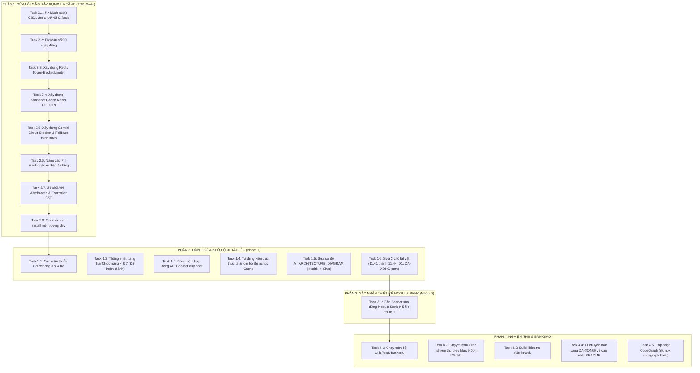

# Kế Hoạch Hợp Nhất Triển Khai Toàn Diện: Sửa Lỗi Mã Nguồn, Xây Dựng Hạ Tầng Chatbot AI, Nâng Cấp Bảo Mật PII & Đồng Bộ Tài Liệu

> **Quy chuẩn thực thi:** TUÂN THỦ NGHIÊM NGẶT NGUYÊN TẮC DỰ ÁN (`AGENTS.md` & `karpathy-guidelines.md`):
> 1. Mọi lệnh terminal đều dùng prefix `rtk`.
> 2. Áp dụng TDD (Red $\rightarrow$ Green $\rightarrow$ Refactor) cho toàn bộ code sửa lỗi và tính năng mới.
> 3. Tuyệt đối không xóa bỏ mã nguồn đã có của Backend; giữ nguyên làm baseline đối chiếu.
> 4. Mỗi nhiệm vụ đều có checkbox (`- [ ]`) rõ ràng để theo dõi tiến độ từng bước.

**Mục tiêu toàn diện:**
Hợp nhất đầy đủ 100% các nội dung đã thống nhất từ trước và các nội dung mới bổ sung:
- **Nhóm 1:** Khử toàn bộ 9 điểm mâu thuẫn tài liệu (Chức năng 3 gộp trùng biến động số dư trên máy; thống nhất trạng thái Chức năng 4 & 7 là `🟢 Đã hoàn thành (Backend + Admin-web)`; đồng bộ 1 hợp đồng API Chatbot; tả đúng kiến trúc thực tế; sửa sơ đồ `Health --> Chat`; sửa 3 lỗi lặt vặt).
- **Nhóm 2:** Sửa lỗi mã nguồn (Math.abs số âm trong CSDL cho FHS & Tools; mẫu số 90 ngày động; chuẩn hóa fallback không bịa số; sửa API Admin-web; ghi chú `npm install`) VÀ xây dựng 3 tính năng hạ tầng mới (Redis Token-Bucket Limiter, Snapshot Cache Redis TTL 120s, Gemini Circuit Breaker; PII Masking toàn diện; KHÔNG làm Semantic Cache).
- **Nhóm 3:** Bổ sung banner tạm dừng chính sách cho Module Bank tại 5 file tài liệu.



---

## Danh Mục Tệp Tác Động Chi Tiết

### 1. Mã Nguồn Backend & Admin-web (Nhóm 2)
| Tệp | Hành động | Mục đích |
|---|---|---|
| `src/Backend/modules/ai/features/chatbot/snapshot/financial.snapshot.service.js` | Sửa code | Lấy `Math.abs()` chi tiêu âm CSDL, tính mẫu số ngày động, tích hợp Snapshot Cache Redis |
| `src/Backend/modules/ai/features/chatbot/tools/tools.executor.js` | Sửa code | Lấy `Math.abs()` cho chi tiêu trong tool, sửa `calculatePeriodDifference` |
| `src/Backend/modules/ai/features/chatbot/rate-limiter/redis-token-bucket.js` | **Tạo mới** | Middleware giới hạn tần suất Token-Bucket phân tán trên Redis (15 tokens/m, atomic) |
| `src/Backend/modules/ai/features/chatbot/resilience/circuit-breaker.js` | **Tạo mới** | Bộ ngắt mạch Circuit Breaker cho Gemini API (ngưỡng 5 lỗi, cooldown 30s) |
| `src/Backend/modules/ai/features/chatbot/chatbot.service.js` | Sửa code | Tích hợp Circuit Breaker, bỏ bịa số giả trong Fallback, báo lỗi hệ thống minh bạch |
| `src/Backend/modules/ai/features/chatbot/chatbot.controller.js` | Sửa code | Phát SSE delta trả về cả `{ text, content }` |
| `src/Backend/modules/ai/features/chatbot/chatbot.routes.js` | Sửa code | Gắn `redisTokenBucketLimiter`, thêm alias route `GET /financial-health` |
| `src/Backend/utils/masking.util.js` | Sửa code | Nâng cấp PII Masking toàn diện (SĐT, STK, Email, CCCD, Họ tên, OTP/CVV, giải mã AES) |
| `src/Backend/modules/ai/features/chatbot/privacy/pii.masker.js` | Sửa code | Áp dụng PII Masking toàn diện cho Tool parameters và Snapshot |
| `src/Admin-web/src/api/chatbot.api.js` | Sửa code | Đọc `deltaData.text \|\| deltaData.content`, gọi endpoint `/ai/chatbot/snapshot` |
| `src/Backend/tests/unit/financial.snapshot.test.js` | Sửa test | Thêm test case cho chi phí âm CSDL và tài khoản mới |
| `src/Backend/tests/unit/chatbot.resilience.test.js` | **Tạo mới** | Unit tests cho Redis Token-Bucket, Snapshot Cache, Circuit Breaker và PII Masking |

### 2. Tài Liệu Nghiệp Vụ & Thiết Kế (Nhóm 1 & Nhóm 3)
| Tệp | Vị trí | Nội dung sửa |
|---|---|---|
| `docs/AI/LogicBusinessAI.md` | Dòng 32, 76–77 | Sửa Chức năng 3: Client gộp trùng biến động số dư trên máy (SMS & thông báo app ngân hàng); Backend giữ `dedup.service.js` cho OCR |
| `docs/AI/LogicBusinessAI.md` | Dòng 33, 36 | Thống nhất trạng thái Chức năng 4 & 7: `🟢 Đã hoàn thành (Backend + Admin-web)` |
| `Project.md` | Dòng 1610, 2722 | Sửa Chức năng 3 đồng bộ với `LogicBusinessAI.md` |
| `Project.md` | Dòng 1611, 1614 | Thống nhất trạng thái Chức năng 4 & 7: `🟢 Đã hoàn thành (Backend + Admin-web)` |
| `Project.md` | Dòng 2684 (§11.39) | Cập nhật công thức D1 theo cửa sổ cuộn ngày `[max(now - 90d, firstTx), now)` |
| `Project.md` | Dòng 2697, 2770 | Đánh lại số mục trùng `### 11.41` (Múi giờ) thành `### 11.44` |
| `Project.md` | Dòng 2734–2770 (§11.43) | Mô tả đúng kiến trúc: Redis Token-Bucket, Snapshot Cache, Circuit Breaker, PII toàn diện, gemini-2.5-flash, không có Semantic Cache |
| `docs/AI/ORC.md` | Dòng 73 | Sửa Chức năng 3 đồng bộ |
| `docs/AI/ChatbotAI.md` | Dòng 4 | Thống nhất trạng thái: `🟢 Đã triển khai xong Backend & Admin-web` |
| `docs/AI/ChatbotAI.md` | Toàn bộ file | Cập nhật hợp đồng API (`/snapshot`, alias `/financial-health`, delta `{text, content}`, history: 6), mô tả đúng Redis Token-Bucket, Snapshot Cache, Circuit Breaker, PII toàn diện, bỏ Semantic Cache |
| `docs/AI/ChatbotAI_Moblie.md` | Dòng 40, 45–64, 194 | Đồng bộ hợp đồng API (`/snapshot`, delta, history: 6), bỏ số phiên bản SQLite v24 cố định |
| `docs/AI/AI_ARCHITECTURE_DIAGRAM.md` | Dòng 87, 98 | Đổi `Health --> Gemini` thành `Health --> Chat` (FHS tính tất định tại Backend) |
| `docs/superpowers/backend/DA-XONG/README.md` | Dòng 84 | Sửa đường dẫn trỏ tệp từ `CAN-LAM/` sang `DA-XONG/` |
| `docs/Deploy/CloudDeploy.md` | Phần cài đặt | Bổ sung ghi chú chạy `npm install` cài `@google/generative-ai` |
| `Project.md` | Dòng 992 (bảng A3), dòng 1074-1075 (bảng B12) | Thêm ghi chú/banner tạm dừng Module Bank do chính sách |
| `docs/progress/Client-app.md` | Mục 3 (Bank Inbox UI) | Thêm banner tạm dừng Module Bank do chính sách |
| `docs/Rule_Project/Rule_project.md` | Dòng 342–344, 483–492, 666 | Thêm banner tạm dừng Module Bank do chính sách |
| `docs/progress/Backend.md` | Dòng 60, 75 | Thêm banner tạm dừng Module Bank do chính sách |
| `docs/Bank/Client-app.md` | Đầu file | Thêm banner toàn diện tạm dừng Module Bank do chính sách |

---

## KẾ HOẠCH TRIỂN KHAI TỪNG NHIỆM VỤ

---

### PHẦN 1: NHÓM 2 — SỬA LỖI MÃ NGUỒN & XÂY DỰNG HẠ TẦNG (TDD CODE)

#### Nhiệm Vụ 2.1: Sửa Lỗi Tính Dấu Âm & Sắp Xếp FHS / Tools (TDD)
- [ ] **Bước 2.1.1: Viết test case mô phỏng khoản Chi mang số âm trong CSDL PostgreSQL**
  * Tệp: `src/Backend/tests/unit/financial.snapshot.test.js`
  * Dựng fixture giao dịch `Chi` có `amount = -150000`, `amount = -250000`.
  * Khẳng định: `totalExpense` phải là số dương `400000`, `emergencyFundMonths > 0`, phân bổ 50/30/20 có tỷ lệ dương (`needs_percent > 0`), Top 3 danh mục chi sắp xếp đúng theo số tiền chi từ lớn đến bé.
- [ ] **Bước 2.1.2: Chạy test để xác nhận test FAIL (Red)**
  * Lệnh: `rtk npm --prefix src/Backend test tests/unit/financial.snapshot.test.js`
- [ ] **Bước 2.1.3: Cập nhật `financial.snapshot.service.js`**
  * Trong `calculate50_30_20`: lấy `const amount = Math.abs(Number(item.amount || 0));`.
  * Trong `generateSnapshot`: tính `totalExpense = expenses.reduce((sum, t) => sum + Math.abs(Number(t.amount || 0)), 0);`.
  * Trong bảng gom `categoryMap`: cộng `Math.abs(Number(exp.amount || 0))` và sắp xếp giảm dần `(a, b) => b[1] - a[1]`.
- [ ] **Bước 2.1.4: Cập nhật `tools.executor.js`**
  * Trong `compareSpendingPeriods`: tính tổng chi kỳ 1 và kỳ 2 bằng `Math.abs(Number(t.amount || 0))`.
  * Trong `calculatePeriodDifference`: tính đúng chênh lệch `diff = p1 - p2`, phần trăm `%` và trend `increased / decreased` theo số dương.
- [ ] **Bước 2.1.5: Chạy lại test xác nhận PASS (Green)**
  * Lệnh: `rtk npm --prefix src/Backend test tests/unit/financial.snapshot.test.js`

#### Nhiệm Vụ 2.2: Sửa Mẫu Số 90 Ngày Cố Định Thành Mẫu Số Động (TDD)
- [ ] **Bước 2.2.1: Viết test case cho tài khoản mới có giao dịch đầu tiên cách 20 ngày**
  * Tệp: `src/Backend/tests/unit/financial.snapshot.test.js`
  * Khẳng định: Mẫu số tính ngày chia phải là 20 ngày (thay vì 90 ngày cố định), không làm loãng chi tiêu trung bình tháng.
- [ ] **Bước 2.2.2: Cập nhật `financial.snapshot.service.js`**
  * Truy vấn giao dịch sớm nhất:
    ```js
    const oldestTx = await prisma.transaction.findFirst({
      where: { idaccount, deleted_at: null },
      orderBy: { date_transaction: 'asc' },
      select: { date_transaction: true },
    });
    const firstTxDate = oldestTx?.date_transaction ? new Date(oldestTx.date_transaction) : ninetyDaysAgo;
    const effectiveStart = new Date(Math.max(ninetyDaysAgo.getTime(), firstTxDate.getTime()));
    const daysSpan = Math.max(14, Math.round((now - effectiveStart) / (1000 * 60 * 60 * 24)));
    ```
- [ ] **Bước 2.2.3: Chạy test xác nhận PASS**
  * Lệnh: `rtk npm --prefix src/Backend test tests/unit/financial.snapshot.test.js`

#### Nhiệm Vụ 2.3: Xây Dựng Redis Token-Bucket Limiter (Backend)
- [ ] **Bước 2.3.1: Tạo middleware `redis-token-bucket.js`**
  * Tệp: `src/Backend/modules/ai/features/chatbot/rate-limiter/redis-token-bucket.js`
  * Thuật toán Token Bucket: Capacity = 15 tokens, Refill rate = 15 tokens / 60s (0.25 token/s).
  * Khóa Redis: `ratelimit:chatbot:{idaccount || ip}`.
  * Atomic pipeline tính toán số token tích lũy theo thời gian `tokens = Math.min(capacity, lastTokens + (now - lastTime) * refillRate)`.
  * Trả về HTTP 429 nếu `tokens < 1` kèm `Retry-After`.
  * Fallback: Tự động dùng `express-rate-limit` in-memory nếu Redis không khả dụng (`redis.status !== 'ready'`).
- [ ] **Bước 2.3.2: Tích hợp vào `chatbot.routes.js`**
  * Thay thế middleware rate limit cũ tại route `/chat/stream` và `/chat`.
- [ ] **Bước 2.3.3: Viết unit test cho Redis Token-Bucket**
  * Tệp: `src/Backend/tests/unit/chatbot.resilience.test.js`

#### Nhiệm Vụ 2.4: Xây Dựng Snapshot Cache Trên Redis (TTL 120s) (Backend)
- [ ] **Bước 2.4.1: Tích hợp Cache vào `financial.snapshot.service.js`**
  * Khóa cache: `cache:snapshot:${idaccount}`.
  * Trong `generateSnapshot(idaccount)`: Kiểm tra Redis trước. Nếu có cache hit, parse JSON trả về ngay trong $< 5\text{ms}$. Nếu cache miss, query CSDL, tính toán, và lưu `redis.setex(cacheKey, 120, JSON.stringify(snapshot))`.
  * Thêm hàm `invalidateSnapshotCache(idaccount)` để xóa cache khi có giao dịch mới/sync.
  * Bọc khối `try...catch` để tự động query DB bình thường nếu Redis mất kết nối.
- [ ] **Bước 2.4.2: Viết unit test kiểm tra Cache Hit / Cache Miss**
  * Tệp: `src/Backend/tests/unit/chatbot.resilience.test.js`

#### Nhiệm Vụ 2.5: Xây Dựng Gemini Circuit Breaker & Chuẩn Hóa Fallback (Backend)
- [ ] **Bước 2.5.1: Tạo class `GeminiCircuitBreaker`**
  * Tệp: `src/Backend/modules/ai/features/chatbot/resilience/circuit-breaker.js`
  * Quản lý 3 trạng thái: `CLOSED`, `OPEN`, `HALF_OPEN`.
  * Ngưỡng lỗi: 5 lần lỗi liên tiếp trong 60s $\rightarrow$ chuyển `OPEN` trong 30s. Sau 30s chuyển `HALF_OPEN` thử lại 1 request.
- [ ] **Bước 2.5.2: Tích hợp Circuit Breaker vào `chatbot.service.js`**
  * Bọc lời gọi `model.generateContentStream` qua Circuit Breaker.
  * **Chuẩn hóa hàm `_streamFallbackResponse`:** Xóa sạch toàn bộ việc bịa số giả (`score = 70`, `emergency = 1.5`). Khi Circuit Breaker mở hoặc thiếu API key, phát thông điệp minh bạch: *"Dịch vụ Trợ lý AI đang tạm thời gián đoạn do quá tải hoặc sự cố kết nối nhà cung cấp. Vui lòng thử lại sau giây lát."* kèm error metadata kỹ thuật.
- [ ] **Bước 2.5.3: Viết unit test cho Circuit Breaker**
  * Tệp: `src/Backend/tests/unit/chatbot.resilience.test.js`

#### Nhiệm Vụ 2.6: Nâng Cấp Bộ Lọc PII Masking Toàn Diện Đa Tầng (Backend)
- [ ] **Bước 2.6.1: Mở rộng `masking.util.js`**
  * Tệp: `src/Backend/utils/masking.util.js`
  * Tự động giải mã AES-256 an toàn nếu chuỗi là ciphertext trước khi lọc.
  * Regex lọc Số CCCD / CMND (9 hoặc 12 số) $\rightarrow$ `[CCCD]`.
  * Regex lọc SĐT Việt Nam toàn diện mọi đầu số $\rightarrow$ `[SĐT]`.
  * Regex lọc STK / Số thẻ ngân hàng (9–19 số, kèm Luhn check) $\rightarrow$ `[STK]`.
  * Regex lọc Email $\rightarrow$ `[EMAIL]`.
  * Lọc mã OTP / CVV / Mật khẩu nhạy cảm qua `filterSensitiveNote`.
  * Che họ tên người dùng qua `maskFullname`.
- [ ] **Bước 2.6.2: Cập nhật `pii.masker.js`**
  * Áp dụng bộ lọc toàn diện trên cho cả ghi chú giao dịch và tên danh mục tùy chỉnh của người dùng trước khi gửi sang Google Gemini qua Tool Calls.
- [ ] **Bước 2.6.3: Viết unit test cho PII Masking toàn diện**
  * Tệp: `src/Backend/tests/unit/chatbot.resilience.test.js`

#### Nhiệm Vụ 2.7: Sửa Lỗi Lệch API Tại Admin-web & Controller SSE
- [ ] **Bước 2.7.1: Cập nhật `chatbot.controller.js` & `chatbot.routes.js` (Backend)**
  * Trong `chatbot.controller.js`: Sự kiện `delta` phát cả hai trường:
    `res.write('event: delta\ndata: ' + JSON.stringify({ text: textChunk, content: textChunk }) + '\n\n');`
  * Trong `chatbot.routes.js`: Bổ sung route alias:
    `router.get('/financial-health', authenticate, chatbotController.handleGetSnapshot);`
- [ ] **Bước 2.7.2: Cập nhật `src/Admin-web/src/api/chatbot.api.js` (Frontend)**
  * Dòng 89: Đọc cả `deltaData.text || deltaData.content`.
  * Dòng 128: Chuyển endpoint gọi sang `/ai/chatbot/snapshot` (hỗ trợ fallback `/financial-health`).

#### Nhiệm Vụ 2.8: Bổ Sung Ghi Chú Môi Trường Dev Cho Backend
- [ ] **Bước 2.8.1: Cập nhật `docs/Deploy/CloudDeploy.md` và `Project.md`**
  * Ghi chú hướng dẫn rõ ràng: Sau khi pull mã nguồn mới, bắt buộc chạy `npm install` (hoặc `npm ci`) trong thư mục `src/Backend` để cài đặt gói `@google/generative-ai` tránh lỗi `MODULE_NOT_FOUND`.

---

### PHẦN 2: NHÓM 1 — ĐỒNG BỘ & KHỬ LỆCH TÀI LIỆU

#### Nhiệm Vụ 1.1: Khử Mâu Thuẫn Chức Năng 3 (Deduplication) Ở 4 Vị Trí
- [ ] **Bước 1.1.1: Sửa `docs/AI/LogicBusinessAI.md` dòng 32 và dòng 76–77**
  * Thay câu cũ *"Khử trùng lặp trên client chỉ cần khi và nếu client làm OCR..."* bằng nội dung đã duyệt:
    > **Client-app:** gộp trùng tin biến động số dư đọc **trên máy** — SMS và thông báo app ngân hàng qua `NotificationListenerService` (đã duyệt, `DA-XONG/CLIENT_DOC_BIEN_DONG_SO_DU_TREN_MAY.md` §5) — và nhắc khi sổ đã có khoản cùng số tiền trong ngày. Chống quét trùng **biên lai** sẽ đặc tả cùng spec OCR phía client. Kênh liên kết ngân hàng (SePay) và SMS **phía server** vẫn dừng. **Backend** giữ `dedup.service.js` cho `POST /api/ai/ocr/parse`.
    > Trạng thái: ⬜ **Chưa làm tại Client** — đang thiết kế tính năng đọc biến động số dư trên máy.
- [ ] **Bước 1.1.2: Sửa `Project.md` dòng 1610 và dòng 2722**
  * Cập nhật mô tả Chức năng 3 đồng bộ với `LogicBusinessAI.md`.
- [ ] **Bước 1.1.3: Sửa `docs/AI/ORC.md` dòng 73**
  * Cập nhật mô tả Chức năng 3 đồng bộ với `LogicBusinessAI.md`.

#### Nhiệm Vụ 1.2: Thống Nhất Trạng Thái Chức Năng 4 & 7 Thành "Đã Triển Khai Xong"
- [ ] **Bước 1.2.1: Sửa `docs/AI/LogicBusinessAI.md` dòng 33, 36**
  * Đổi từ `🟡 Đang xây dựng tại Backend` thành `🟢 Đã hoàn thành (Backend + Admin-web)`.
- [ ] **Bước 1.2.2: Sửa `Project.md` §8.5 dòng 1611, 1614**
  * Đổi từ `🔴 Chưa hoàn thành` thành `🟢 Đã hoàn thành (Backend + Admin-web)`.
- [ ] **Bước 1.2.3: Chuẩn hóa `Project.md` §11.42 dòng 2723, 2726 & `docs/AI/ChatbotAI.md` dòng 4**
  * Khẳng định đồng nhất trạng thái `🟢 Đã hoàn thành (Backend + Admin-web)`.

#### Nhiệm Vụ 1.3: Đồng Bộ 1 Hợp Đồng API Chatbot Duy Nhất
- [ ] **Bước 1.3.1: Cập nhật `docs/AI/ChatbotAI.md`**
  * Thống nhất endpoint FHS: `GET /api/ai/chatbot/snapshot` (alias `GET /api/ai/chatbot/financial-health`).
  * Khóa delta SSE: `{ "text": "...", "content": "..." }`.
  * Khóa meta: `{ "snapshotLoaded": true, "financialHealthScore": ..., "snapshot": ... }`.
  * Lịch sử hội thoại: 6 lượt gần nhất (`history.slice(-6)`).
  * Giới hạn đầu vào: `message` tối đa 2000 ký tự.
- [ ] **Bước 1.3.2: Cập nhật `docs/AI/ChatbotAI_Moblie.md`**
  * Sửa dòng 40: Lịch sử hội thoại là 6 tin gần nhất.
  * Sửa dòng 45–64: Thống nhất endpoint `GET /api/ai/chatbot/snapshot`.
  * Sửa dòng 194: Bỏ số phiên bản SQLite v24 cố định.

#### Nhiệm Vụ 1.4: Mô Tả Đúng Kiến Trúc Thực Tế & Loại Bỏ Semantic Cache
- [ ] **Bước 1.4.1: Cập nhật `docs/AI/ChatbotAI.md` và `Project.md` §11.43**
  * Tả đúng: **Redis Token-Bucket Limiter** (15 req/m, dung lượng 15).
  * Tả đúng: **Snapshot Cache** trên Redis (TTL 120s).
  * Tả đúng: **Gemini Circuit Breaker** (5 lần lỗi trong 60s $\rightarrow$ OPEN 30s).
  * Ghi rõ: **Semantic Cache KHÔNG áp dụng** cho dữ liệu tài chính thời gian thực.
  * Tả đúng: **Pipeline PII Masking toàn diện** (SĐT, STK, Email, CCCD, Họ tên, OTP/CVV, giải mã AES).
  * Model chính xác: `gemini-2.5-flash`.

#### Nhiệm Vụ 1.5: Sửa Sơ Đồ Kiến Trúc AI (`AI_ARCHITECTURE_DIAGRAM.md`)
- [ ] **Bước 1.5.1: Sửa dòng 87 và 98 của `docs/AI/AI_ARCHITECTURE_DIAGRAM.md`**
  * Đổi liên kết `Health --> Gemini` thành `Health --> Chat` (FHS tính tất định tại backend, nạp vào ngữ cảnh của Chatbot).

#### Nhiệm Vụ 1.6: Sửa 3 Lỗi Lặt Vặt
- [ ] **Bước 1.6.1: Sửa số mục trùng trong `Project.md`**
  * Đổi `### 11.41. Chuẩn Hóa Toàn Diện Múi Giờ Việt Nam...` (dòng 2770) thành `### 11.44. Chuẩn Hóa Toàn Diện Múi Giờ Việt Nam...`.
- [ ] **Bước 1.6.2: Sửa công thức D1 trong `Project.md` dòng 2684 (§11.39)**
  * Cập nhật theo cửa sổ cuộn ngày `[max(now - 90d, firstTx), now)`.
- [ ] **Bước 1.6.3: Sửa đường dẫn trong `docs/superpowers/backend/DA-XONG/README.md` dòng 84**
  * Sửa đường dẫn từ `CAN-LAM/AI_EDGE_SLM_SOAT_SAU_B147FEE.md` thành `DA-XONG/AI_EDGE_SLM_SOAT_SAU_B147FEE.md`.

---

### PHẦN 3: NHÓM 3 — XÁC NHẬN THIẾT KẾ: BANNER TẠM DỪNG MODULE BANK

#### Nhiệm Vụ 3.1: Gắn Banner Tạm Dừng Module Bank Tại 5 Tệp Tài Liệu
- [ ] **Bước 3.1.1: Gắn banner tại `Project.md`**
  * Dòng 992 (bảng A3): Thêm ghi chú `⏸️ [Tạm dừng do chính sách]` cho mục Liên kết ngân hàng.
  * Dòng 1002 (bảng A4): Thêm ghi chú `⏸️ [Tạm dừng do chính sách]` cho Webhook ngân hàng.
  * Dòng 1074–1075 (bảng B12): Giữ vững biểu tượng ⏸️ và ghi chú tạm dừng.
- [ ] **Bước 3.1.2: Gắn banner tại `docs/progress/Client-app.md`**
  * Thêm banner tại Mục 3 (Bank Inbox UI):
    > ⏸️ **TẠM DỪNG HOẠT ĐỘNG VÌ LÝ DO CHÍNH SÁCH:** Module liên kết ngân hàng (Bank Inbox UI) đã được PO phê duyệt tạm dừng hoàn toàn theo chính sách bảo mật dữ liệu và phạm vi đồ án, giữ nguyên làm baseline chuẩn hóa đối chiếu.
- [ ] **Bước 3.1.3: Gắn banner tại `docs/Rule_Project/Rule_project.md`**
  * Thêm banner tại Mục 8 (Quy tắc tích hợp ngân hàng SePay) và ghi chú tại dòng 342-344, 666.
- [ ] **Bước 3.1.4: Gắn banner tại `docs/progress/Backend.md`**
  * Thêm banner tại Mục 3 và ghi chú tại dòng 60, 75.
- [ ] **Bước 3.1.5: Gắn banner tại `docs/Bank/Client-app.md`**
  * Đặt banner nổi bật ngay dòng đầu tiên của tài liệu:
    > ⏸️ **TẠM DỪNG HOẠT ĐỘNG VÌ LÝ DO CHÍNH SÁCH:** Module liên kết ngân hàng (SePay / Casso) đã được PO phê duyệt tạm dừng hoàn toàn vì lý do chính sách bảo mật dữ liệu theo Nghị định 13/2023/NĐ-CP và phạm vi đồ án. Toàn bộ tài liệu này được giữ nguyên trạng làm baseline chuẩn hóa đối chiếu lịch sử, không nằm trong phạm vi thi công, kiểm thử hay nghiệm thu của Client-app & Backend.

---

### PHẦN 4: NGHIỆM THU TỰ ĐỘNG & BÀN GIAO

- [ ] **Nhiệm Vụ 4.1: Chạy toàn bộ Unit Tests Backend**
  * Lệnh: `rtk npm --prefix src/Backend test`
  * Tiêu chí nghiệm thu: Toàn bộ các test suites (gồm `financial.snapshot.test.js`, `chatbot.resilience.test.js`, `chatbot.tools.test.js`, `chatbot.rag.test.js`, `chatbot.api.test.js`...) phải **PASS 100%**.

- [ ] **Nhiệm Vụ 4.2: Chạy bộ 5 lệnh Grep nghiệm thu tự động theo Mục 9 đơn 422debf**
  ```bash
  # 1. Chức năng 3 không còn ghi "chỉ khi có OCR" (Kỳ vọng: 0 dòng)
  rtk grep -n "chỉ cần khi và nếu client làm OCR\|chỉ cần khi triển khai tính năng OCR\|chỉ cần triển khai khi làm OCR\|khi có OCR; Kênh" docs/AI/LogicBusinessAI.md Project.md docs/AI/ORC.md

  # 2. Không còn tài liệu tả sai thành phần Semantic Cache (Kỳ vọng: 0 dòng)
  rtk grep -n "Semantic Cache" docs/AI/ChatbotAI.md

  # 3. FHS không nối trực tiếp vào Gemini (Kỳ vọng: 0 dòng)
  rtk grep -n "Health --> Gemini" docs/AI/AI_ARCHITECTURE_DIAGRAM.md

  # 4. Kiểm tra mục 11.41 là duy nhất (Kỳ vọng: 1)
  rtk grep -c "^### 11.41" Project.md

  # 5. Bốn chỗ ghi cùng một trạng thái cho Chức năng 4 và 7 (Kỳ vọng: Đều là 'Đã hoàn thành')
  rtk grep -n "Trợ Lý Tài Chính Thông Minh.*Đã hoàn thành\|Đánh Giá Sức Khỏe Tài Chính.*Đã hoàn thành" docs/AI/LogicBusinessAI.md Project.md
  ```

- [ ] **Nhiệm Vụ 4.3: Kiểm tra Build Admin-web**
  * Lệnh: `rtk npm --prefix src/Admin-web run build`
  * Tiêu chí nghiệm thu: Exit code 0, không có lỗi type/lint/syntax.

- [ ] **Nhiệm Vụ 4.4: Di chuyển đơn `CHATBOT_AI_SOAT_SAU_422DEBF.md` sang `DA-XONG/` & Cập nhật README**
  * Chuyển tệp sang `docs/superpowers/backend/DA-XONG/CHATBOT_AI_SOAT_SAU_422DEBF.md`.
  * Cập nhật `docs/superpowers/backend/CAN-LAM/README.md` (ghi nhận hoàn tất 26/26 mục).
  * Cập nhật `docs/superpowers/backend/DA-XONG/README.md`.

- [ ] **Nhiệm Vụ 4.5: Cập nhật CodeGraph**
  * Lệnh: `rtk npx codegraph build` (theo quy định bắt buộc của RULE 8).
