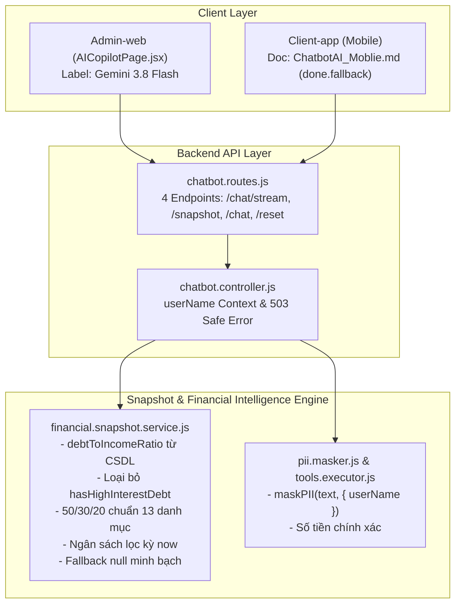

# Kế Hoạch Xử Lý 7 Điểm Còn Lệch Chatbot AI (Theo Đơn CHATBOT_AI_CON_LECH_SAU_8BBDD97.md)

> **Dành cho Agentic Workers:** REQUIRED SUB-SKILL: Sử dụng `superpowers:subagent-driven-development` để thực thi kế hoạch này theo từng task. Các bước kiểm tra sử dụng cú pháp checkbox (`- [ ]`).

**Mục tiêu:** Xử lý dứt điểm 7 điểm lệch (4 điểm tài liệu, 3 điểm mã nguồn) được đối soát thực tế bởi phía Client-app tại [`docs/superpowers/backend/CAN-LAM/CHATBOT_AI_CON_LECH_SAU_8BBDD97.md`](file:///d:/Tai_Lieu_IUH/Tailieu_Nam5_HK1/DoAnTotNghiep/Personal_Finance_Management/docs/superpowers/backend/CAN-LAM/CHATBOT_AI_CON_LECH_SAU_8BBDD97.md), đảm bảo tính nhất quán tuyệt đối giữa mã nguồn Backend, giao diện Admin-web và hợp đồng tích hợp Client-app.

**Kiến trúc & Giải pháp:**
- **Thống nhất tên mô hình:** Chuẩn hóa toàn bộ tài liệu và giao diện sang `gemini-3.8-flash` (đọc linh hoạt qua biến `process.env.GEMINI_MODEL`, mặc định `gemini-3.8-flash`).
- **Nghiệp vụ tài chính chuẩn mực:** Tính toán tỷ lệ nợ trên thu nhập (`debtToIncomeRatio`) từ các giao dịch thực tế thay vì hằng số `0.1`; loại bỏ trường `hasHighInterestDebt` không có trong CSDL; chuẩn hóa bộ từ khóa 50/30/20 bao phủ 13 danh mục hệ thống (đặc biệt là 'Di chuyển' và 'Chi khác'); lọc ngân sách theo kỳ hiệu lực và khử trùng cảnh báo.
- **Minh bạch hóa & An toàn dữ liệu:** Xóa bỏ số giả lập trong fallback snapshot (trả `null` và báo 503 thay vì bịa điểm FHS 65); bổ sung truyền `userName` vào `maskPII` trong chatbot; tài liệu hóa cờ `done.fallback` trong `ChatbotAI_Moblie.md`.



**Tech Stack:** Node.js, Express, Prisma ORM, PostgreSQL, `@google/generative-ai`, Vite + React.

---

## Ràng Buộc Cốt Lõi (Global Constraints)
1. **Không sửa/xóa mã nguồn Module Bank** tại Backend.
2. **Không làm Semantic Cache trên Redis** (chỉ dùng Snapshot Cache 120s & Token-Bucket Limiter).
3. **Mọi lệnh CLI phải dùng tiền tố `rtk`** (`rtk git status`, `rtk node --test ...`, `rtk npm ...`).
4. **Không bịa số giả lập** trong bất kỳ nhánh fallback/lỗi nào.
5. **Đạt 100% các câu lệnh nghiệm thu** tại mục 8 của đơn `CHATBOT_AI_CON_LECH_SAU_8BBDD97.md`.

---

## Chi Tiết Các Task Triển Khai

### Task 1: Thống Nhất Tên Mô Hình Chatbot sang `gemini-3.8-flash` (Mục 1)

**Tệp tác động:**
- Sửa: [`src/Admin-web/src/pages/ai/AICopilotPage.jsx`](file:///d:/Tai_Lieu_IUH/Tailieu_Nam5_HK1/DoAnTotNghiep/Personal_Finance_Management/src/Admin-web/src/pages/ai/AICopilotPage.jsx#L161)
- Sửa: [`src/Backend/modules/ai/features/chatbot/chatbot.service.js`](file:///d:/Tai_Lieu_IUH/Tailieu_Nam5_HK1/DoAnTotNghiep/Personal_Finance_Management/src/Backend/modules/ai/features/chatbot/chatbot.service.js#L3)
- Sửa: [`docs/AI/ChatbotAI.md`](file:///d:/Tai_Lieu_IUH/Tailieu_Nam5_HK1/DoAnTotNghiep/Personal_Finance_Management/docs/AI/ChatbotAI.md)
- Sửa: [`docs/AI/AI_ARCHITECTURE_DIAGRAM.md`](file:///d:/Tai_Lieu_IUH/Tailieu_Nam5_HK1/DoAnTotNghiep/Personal_Finance_Management/docs/AI/AI_ARCHITECTURE_DIAGRAM.md#L98)
- Sửa: [`docs/Deploy/CloudDeploy.md`](file:///d:/Tai_Lieu_IUH/Tailieu_Nam5_HK1/DoAnTotNghiep/Personal_Finance_Management/docs/Deploy/CloudDeploy.md#L126)

- [ ] **Bước 1.1: Sửa nhãn UI trên Admin-web**
  Trong [`AICopilotPage.jsx`](file:///d:/Tai_Lieu_IUH/Tailieu_Nam5_HK1/DoAnTotNghiep/Personal_Finance_Management/src/Admin-web/src/pages/ai/AICopilotPage.jsx#L161):
  Đổi `Gemini 2.5 Flash Online` $\rightarrow$ `Gemini 3.8 Flash Online`.

- [ ] **Bước 1.2: Sửa chú thích đầu file trong Backend**
  Trong [`chatbot.service.js`](file:///d:/Tai_Lieu_IUH/Tailieu_Nam5_HK1/DoAnTotNghiep/Personal_Finance_Management/src/Backend/modules/ai/features/chatbot/chatbot.service.js#L3):
  Đổi chú thích `Gemini 2.0 Flash` $\rightarrow$ `Google Gemini 3.8 Flash (cấu hình linh hoạt qua process.env.GEMINI_MODEL)`.

- [ ] **Bước 1.3: Cập nhật tài liệu kỹ thuật**
  - Trong [`ChatbotAI.md`](file:///d:/Tai_Lieu_IUH/Tailieu_Nam5_HK1/DoAnTotNghiep/Personal_Finance_Management/docs/AI/ChatbotAI.md): Sửa các dòng 57, 119, 261, 277, 411, 436 nhắc tới `2.0` hoặc `2.5` sang mô hình theo `GEMINI_MODEL`, mặc định là `gemini-3.8-flash`.
  - Trong [`AI_ARCHITECTURE_DIAGRAM.md`](file:///d:/Tai_Lieu_IUH/Tailieu_Nam5_HK1/DoAnTotNghiep/Personal_Finance_Management/docs/AI/AI_ARCHITECTURE_DIAGRAM.md): Sửa `gemini-2.5-flash` thành `gemini-3.8-flash`.
  - Trong [`CloudDeploy.md`](file:///d:/Tai_Lieu_IUH/Tailieu_Nam5_HK1/DoAnTotNghiep/Personal_Finance_Management/docs/Deploy/CloudDeploy.md): Sửa biến mẫu `GEMINI_MODEL=gemini-3.8-flash`.

- [ ] **Bước 1.4: Chạy kiểm tra nghiệm thu mục 1**
  ```bash
  rtk grep -rn -e "Gemini 2.0" -e "gemini-2.0" -e "Gemini 2.5" -e "gemini-2.5" docs/AI/ChatbotAI.md docs/AI/ChatbotAI_Moblie.md docs/AI/AI_ARCHITECTURE_DIAGRAM.md docs/Deploy/CloudDeploy.md src/Backend/modules/ai/features/chatbot src/Admin-web/src/pages/ai
  ```
  *Kỳ vọng:* Không có kết quả nào xuất hiện (0 dòng).

---

### Task 2: Loại Bỏ Hằng Nợ & Tính Toán `debtToIncomeRatio` Từ Dữ Liệu Thật (Mục 2)

**Tệp tác động:**
- Sửa: [`src/Backend/modules/ai/features/chatbot/snapshot/financial.snapshot.service.js`](file:///d:/Tai_Lieu_IUH/Tailieu_Nam5_HK1/DoAnTotNghiep/Personal_Finance_Management/src/Backend/modules/ai/features/chatbot/snapshot/financial.snapshot.service.js#L319)
- Sửa: [`src/Backend/modules/ai/features/chatbot/privacy/pii.masker.js`](file:///d:/Tai_Lieu_IUH/Tailieu_Nam5_HK1/DoAnTotNghiep/Personal_Finance_Management/src/Backend/modules/ai/features/chatbot/privacy/pii.masker.js)
- Sửa: [`docs/AI/ChatbotAI.md`](file:///d:/Tai_Lieu_IUH/Tailieu_Nam5_HK1/DoAnTotNghiep/Personal_Finance_Management/docs/AI/ChatbotAI.md#L189)
- Sửa: [`Project.md`](file:///d:/Tai_Lieu_IUH/Tailieu_Nam5_HK1/DoAnTotNghiep/Personal_Finance_Management/Project.md#L2744)
- Test: [`src/Backend/tests/unit/financial.snapshot.test.js`](file:///d:/Tai_Lieu_IUH/Tailieu_Nam5_HK1/DoAnTotNghiep/Personal_Finance_Management/src/Backend/tests/unit/financial.snapshot.test.js)

- [ ] **Bước 2.1: Viết test cho `calculateDebtToIncomeRatio` và loại bỏ `hasHighInterestDebt`**
  Thêm unit test kiểm tra hàm tính `debtToIncomeRatio`:
  - Trường hợp 1: Có khoản chi trả nợ 2tr, thu nhập 20tr $\rightarrow$ ratio = 0.10.
  - Trường hợp 2: Không có khoản nợ $\rightarrow$ ratio = 0.
  - Trường hợp 3: Snapshot trả về không chứa trường `hasHighInterestDebt`.

- [ ] **Bước 2.2: Triển khai logic tính `debtToIncomeRatio` trong `financial.snapshot.service.js`**
  ```javascript
  calculateDebtToIncomeRatio(expenses, totalIncome = 0) {
    if (!Array.isArray(expenses) || expenses.length === 0 || totalIncome <= 0) {
      return 0;
    }
    const debtKeywords = ['trả nợ', 'nợ', 'vay', 'lãi', 'tiền lãi', 'trả góp'];
    const totalDebt = expenses.reduce((sum, item) => {
      const catName = (item.category?.name_category || item.category?.namecategory || '').toLowerCase();
      if (debtKeywords.some(kw => catName.includes(kw))) {
        return sum + Math.abs(Number(item.amount || 0));
      }
      return sum;
    }, 0);
    return Math.min(1, Number((totalDebt / totalIncome).toFixed(2)));
  }
  ```
  Thay thế `debtToIncomeRatio: 0.1` bằng `debtToIncomeRatio: this.calculateDebtToIncomeRatio(expenses, totalIncome)`.
  Xóa hoàn toàn `hasHighInterestDebt: false` khỏi `rawSnapshot`.

- [ ] **Bước 2.3: Cập nhật `pii.masker.js` và tài liệu**
  - Xóa `hasHighInterestDebt` khỏi `anonymizeSnapshot` trong `pii.masker.js`.
  - Xóa ví dụ `"hasHighInterestDebt": true` tại dòng 189 trong `ChatbotAI.md`.
  - Cập nhật dòng 2744 của `Project.md`: Nêu rõ `debtToIncomeRatio` được tính từ giao dịch trả nợ thực tế trong CSDL.

- [ ] **Bước 2.4: Kiểm tra nghiệm thu mục 2**
  ```bash
  rtk grep -n "debtToIncomeRatio: 0.1\|hasHighInterestDebt: false" src/Backend/modules/ai/features/chatbot/snapshot/financial.snapshot.service.js
  ```
  *Kỳ vọng:* 0 dòng.

---

### Task 3: Đồng Bộ Cam Kết Sơ Đồ PII & Bổ Sung Context `userName` (Mục 3)

**Tệp tác động:**
- Sửa: [`docs/AI/ChatbotAI.md`](file:///d:/Tai_Lieu_IUH/Tailieu_Nam5_HK1/DoAnTotNghiep/Personal_Finance_Management/docs/AI/ChatbotAI.md#L113)
- Sửa: [`src/Backend/modules/ai/features/chatbot/chatbot.service.js`](file:///d:/Tai_Lieu_IUH/Tailieu_Nam5_HK1/DoAnTotNghiep/Personal_Finance_Management/src/Backend/modules/ai/features/chatbot/chatbot.service.js)
- Sửa: [`src/Backend/modules/ai/features/chatbot/tools/tools.executor.js`](file:///d:/Tai_Lieu_IUH/Tailieu_Nam5_HK1/DoAnTotNghiep/Personal_Finance_Management/src/Backend/modules/ai/features/chatbot/tools/tools.executor.js#L74-L84)
- Test: [`src/Backend/tests/unit/financial.snapshot.test.js`](file:///d:/Tai_Lieu_IUH/Tailieu_Nam5_HK1/DoAnTotNghiep/Personal_Finance_Management/src/Backend/tests/unit/financial.snapshot.test.js)

- [ ] **Bước 3.1: Sửa nội dung cam kết trong ô sơ đồ `ChatbotAI.md:113`**
  Thay đổi cụm chữ:
  ```diff
  - PII Masking & Anonymizer — Khử toàn bộ tên riêng, STK, SĐT, làm tròn số
  + PII Masking & Anonymizer — Che STK, SĐT, email, CCCD, OTP, số thẻ (Luhn), họ tên người dùng; số tiền giao dịch gửi chính xác
  ```

- [ ] **Bước 3.2: Truyền `userName` trong `chatbot.service.js` và `tools.executor.js`**
  - Trong `chatbot.service.js` phương thức `chatStream`:
    Lấy họ tên từ CSDL hoặc payload:
    ```javascript
    const accountUser = await prisma.user.findFirst({
      where: { idaccount },
      select: { fullname: true, username: true },
    });
    const userName = accountUser?.fullname || accountUser?.username || '';
    ```
    Truyền `{ userName }` vào `this.piiMasker.maskPII(message, { userName })` và các tin nhắn trong `history`.
    Truyền `userName` vào `this.toolsExecutor.executeTool(call.name, call.args, idaccount, { userName })`.
  - Trong `tools.executor.js`:
    Cập nhật `sanitizeTransactionList(txList, userName)` để gọi:
    `note: this.piiMasker.maskPII(tx.note || '', { userName })`.

- [ ] **Bước 3.3: Kiểm tra nghiệm thu mục 3**
  ```bash
  rtk grep -n "làm tròn số\|Khử toàn bộ tên riêng" docs/AI/ChatbotAI.md
  ```
  *Kỳ vọng:* 0 dòng.

---

### Task 4: Đồng Bộ Danh Sách Endpoint trong `Project.md` (Mục 4)

**Tệp tác động:**
- Sửa: [`Project.md`](file:///d:/Tai_Lieu_IUH/Tailieu_Nam5_HK1/DoAnTotNghiep/Personal_Finance_Management/Project.md#L2758)

- [ ] **Bước 4.1: Cập nhật dòng 2758 của `Project.md`**
  Thay đổi câu mô tả:
  ```diff
  - Gắn tại `/api/ai/chatbot` với 2 endpoint: `POST /chat/stream` (Rate limit 15 req/phút/user) và `GET /financial-health` (lấy ngay chỉ số FHS).
  + Gắn tại `/api/ai/chatbot` với 4 endpoint: `POST /chat/stream` (SSE streaming + Redis Token-Bucket Limiter 15 req/phút), `GET /snapshot` (lấy FHS Snapshot với Redis Cache 120s, alias `/financial-health`), `POST /chat` (JSON fallback), và `POST /reset` (Làm mới phiên hội thoại).
  ```

- [ ] **Bước 4.2: Kiểm tra nghiệm thu mục 4**
  ```bash
  rtk grep -n "với 2 endpoint" Project.md
  ```
  *Kỳ vọng:* 0 dòng.

---

### Task 5: Bổ Sung Định Dạng `event: done` với Cờ `fallback` trong `ChatbotAI_Moblie.md` (Mục 5)

**Tệp tác động:**
- Sửa: [`docs/AI/ChatbotAI_Moblie.md`](file:///d:/Tai_Lieu_IUH/Tailieu_Nam5_HK1/DoAnTotNghiep/Personal_Finance_Management/docs/AI/ChatbotAI_Moblie.md)

- [ ] **Bước 5.1: Cập nhật §2.1 và mục Cơ chế dự phòng trong `ChatbotAI_Moblie.md`**
  Bổ sung cấu trúc dữ liệu của `event: done`:
  ```markdown
  #### Cấu trúc sự kiện kết thúc luồng (event: done)
  - **Nhánh hoàn thành thành công:**
    ```
    event: done
    data: {"status": "completed", "responseTimeMs": 720}
    ```
  - **Nhánh kích hoạt Fallback (khi Gemini lỗi / Circuit Breaker mở / thiếu API Key):**
    ```
    event: done
    data: {"status": "completed", "fallback": true, "reason": "Dịch vụ AI phản hồi chậm hoặc lỗi mạng..."}
    ```
  > [!IMPORTANT]
  > **Quy định đối với Client-app:** Client KHÔNG lưu các lượt trao đổi có `done.fallback === true` vào bảng dữ liệu cục bộ `LocalChatMessages` để tránh tái nạp nội dung thông báo lỗi của hệ thống vào `conversationHistory` của các câu hỏi tiếp theo.
  ```

- [ ] **Bước 5.2: Kiểm tra nghiệm thu mục 5**
  ```bash
  rtk grep -n "fallback" docs/AI/ChatbotAI_Moblie.md
  ```
  *Kỳ vọng:* $\ge 1$ dòng.

---

### Task 6: Xóa Bỏ Dữ Liệu Giả Lập trong Nhánh Lỗi của `generateSnapshot` (Mục 6)

**Tệp tác động:**
- Sửa: [`src/Backend/modules/ai/features/chatbot/snapshot/financial.snapshot.service.js`](file:///d:/Tai_Lieu_IUH/Tailieu_Nam5_HK1/DoAnTotNghiep/Personal_Finance_Management/src/Backend/modules/ai/features/chatbot/snapshot/financial.snapshot.service.js#L353-L362)
- Sửa: [`src/Backend/modules/ai/features/chatbot/chatbot.controller.js`](file:///d:/Tai_Lieu_IUH/Tailieu_Nam5_HK1/DoAnTotNghiep/Personal_Finance_Management/src/Backend/modules/ai/features/chatbot/chatbot.controller.js#L66-L76)
- Sửa: [`src/Backend/modules/ai/features/chatbot/chatbot.service.js`](file:///d:/Tai_Lieu_IUH/Tailieu_Nam5_HK1/DoAnTotNghiep/Personal_Finance_Management/src/Backend/modules/ai/features/chatbot/chatbot.service.js#L80-L105)

- [ ] **Bước 6.1: Viết test cho nhánh lỗi của `generateSnapshot`**
  Kiểm tra khi Prisma query bị lỗi, hàm `generateSnapshot` trả về `null` thay vì object có `healthScore: 65`.

- [ ] **Bước 6.2: Sửa `generateSnapshot` trả về `null` khi lỗi**
  Xóa hoàn toàn khối giả lập:
  ```javascript
  } catch (error) {
    logger.error('Error generating financial snapshot:', error);
    return null;
  }
  ```

- [ ] **Bước 6.3: Xử lý an toàn tại Controller và Service**
  - Trong `chatbot.controller.js` (`handleGetSnapshot`):
    ```javascript
    const snapshot = await this.chatbotService.getSnapshot(idaccount);
    if (!snapshot) {
      return ResponseHandler.error(res, 'Không thể lấy thông tin sức khỏe tài chính', 503, 'SNAPSHOT_UNAVAILABLE');
    }
    ```
  - Trong `chatbot.service.js` (`chatStream`):
    Nếu `snapshot === null`:
    Đặt `meta.snapshotLoaded = false`; trong `systemInstruction` không chèn các chỉ số số liệu mà ghi chú: `"Dữ liệu sức khỏe tài chính hiện không khả dụng"`.

- [ ] **Bước 6.4: Kiểm tra nghiệm thu mục 6**
  ```bash
  rtk grep -n "healthScore: 65" src/Backend/modules/ai/features/chatbot/snapshot/financial.snapshot.service.js
  ```
  *Kỳ vọng:* 0 dòng.

---

### Task 7: Sửa 2 Lỗi Số Liệu Thực Tế trong Snapshot (Mục 7)

**Tệp tác động:**
- Sửa: [`src/Backend/modules/ai/features/chatbot/snapshot/financial.snapshot.service.js`](file:///d:/Tai_Lieu_IUH/Tailieu_Nam5_HK1/DoAnTotNghiep/Personal_Finance_Management/src/Backend/modules/ai/features/chatbot/snapshot/financial.snapshot.service.js)
- Sửa: [`docs/AI/ChatbotAI.md`](file:///d:/Tai_Lieu_IUH/Tailieu_Nam5_HK1/DoAnTotNghiep/Personal_Finance_Management/docs/AI/ChatbotAI.md)
- Test: [`src/Backend/tests/unit/financial.snapshot.test.js`](file:///d:/Tai_Lieu_IUH/Tailieu_Nam5_HK1/DoAnTotNghiep/Personal_Finance_Management/src/Backend/tests/unit/financial.snapshot.test.js)

- [ ] **Bước 7.1: Sửa lỗi 7.1 — Lọc ngân sách theo kỳ hiệu lực & Khử trùng lặp danh mục**
  - Trong `generateSnapshot`:
    Query ngân sách có ngày bắt đầu $\le$ `now` và ngày kết thúc $\ge$ `now`:
    ```javascript
    const budgets = await prisma.budget.findMany({
      where: {
        idaccount,
        delete_at: null,
        start_date: { lte: now },
        end_date: { gte: now },
      },
      include: { category: { select: { name_category: true } } },
      orderBy: { end_date: 'desc' },
    });
    ```
  - Khử trùng lặp theo danh mục:
    Dùng `Map` theo `idcategory` hoặc tên danh mục, chỉ lưu lại ngân sách có tỷ lệ chi tiêu cao nhất hoặc mới nhất.
    Đảm bảo mỗi danh mục chỉ xuất hiện tối đa **1 dòng cảnh báo** trong `overBudgetAlerts`.

- [ ] **Bước 7.2: Sửa lỗi 7.2 — Chuẩn hóa bộ từ khóa 50/30/20 & Xếp nhóm mặc định**
  - Mở rộng mảng `needsKeywords` bao phủ các danh mục hệ thống:
    ```javascript
    const needsKeywords = [
      'ăn uống', 'di chuyển', 'đi lại', 'xăng', 'nhà cửa', 'thuê nhà',
      'tiện ích', 'hóa đơn', 'điện', 'nước', 'internet', 'y tế', 'thuốc',
      'giáo dục', 'học phí', 'chợ', 'siêu thị'
    ];
    const savingsKeywords = [
      'tiết kiệm', 'đầu tư', 'tích lũy', 'trả nợ', 'trả lãi', 'bảo hiểm', 'gửi tiết kiệm'
    ];
    ```
  - Danh mục không khớp Needs hay Savings/Debt được xếp mặc định vào **`wantsAmount`** (Chi tiêu linh hoạt).
  - Cập nhật công thức tính cơ cấu:
    ```javascript
    const totalSpent = needsAmount + wantsAmount + savingsAmount;
    const baseAmount = totalIncome > 0 ? Math.max(totalIncome, totalSpent) : totalSpent;
    ```
    Đảm bảo 'Di chuyển' được tính vào Needs (42%), 'Chi khác' được tính vào Wants (36%), không bị mất 78% chi tiêu của tài khoản 10.
  - Ghi chú rõ trong `ChatbotAI.md`: Làm rõ nguyên tắc phân nhóm 50/30/20 tự động và việc gán mặc định nhóm Wants cho các danh mục không chuẩn.

- [ ] **Bước 7.3: Viết test kiểm chứng trên dữ liệu tương tự tài khoản 10**
  - Test case: Giao dịch gồm "Di chuyển" (420k), "Chi khác" (360k), "Mua sắm" (70k).
  - Kiểm tra: `needs_percent` $\approx 49\%$, `wants_percent` $\approx 51\%$, tổng 2 nhóm là 100% chi tiêu (không còn bị rụng 78%).
  - Test case ngân sách: 2 ngân sách cùng danh mục "Di chuyển" chỉ sinh ra duy nhất 1 cảnh báo.

---

## Nghiệm Thu Toàn Diện (Phase 4 Verification)

Sau khi hoàn thành 7 task, chạy toàn bộ các lệnh nghiệm thu:
```bash
# 1. Kiểm tra không còn tên mô hình cũ
rtk grep -rn -e "Gemini 2.0" -e "gemini-2.0" -e "Gemini 2.5" -e "gemini-2.5" docs/AI/ChatbotAI.md docs/AI/ChatbotAI_Moblie.md docs/AI/AI_ARCHITECTURE_DIAGRAM.md docs/Deploy/CloudDeploy.md src/Backend/modules/ai/features/chatbot src/Admin-web/src/pages/ai

# 2. Không còn hằng số nợ
rtk grep -n "debtToIncomeRatio: 0.1\|hasHighInterestDebt: false" src/Backend/modules/ai/features/chatbot/snapshot/financial.snapshot.service.js

# 3. Ô sơ đồ nói đúng
rtk grep -n "làm tròn số\|Khử toàn bộ tên riêng" docs/AI/ChatbotAI.md

# 4. Không còn 'với 2 endpoint'
rtk grep -n "với 2 endpoint" Project.md

# 5. done.fallback có trong tài liệu client
rtk grep -n "fallback" docs/AI/ChatbotAI_Moblie.md

# 6. Không còn số giả lập 65
rtk grep -n "healthScore: 65" src/Backend/modules/ai/features/chatbot/snapshot/financial.snapshot.service.js

# 7. Toàn bộ Unit Test Backend pass
rtk node --test src/Backend/tests/unit/*.test.js

# 8. Lint và Build Admin-web pass
rtk npm --prefix src/Admin-web run lint
rtk npm --prefix src/Admin-web run build

# 9. Đồng bộ CodeGraph
rtk npx codegraph build
```
