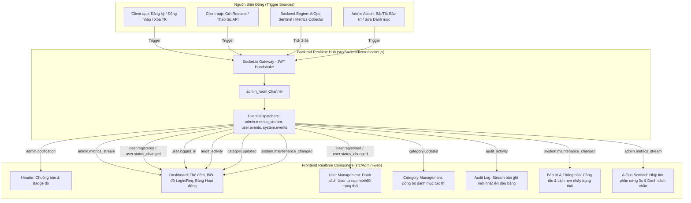

# Triển Khai Kiến Trúc Real-Time Toàn Diện Cho Admin-Web (Full Real-Time Architecture)

> **For agentic workers:** REQUIRED SUB-SKILL: Use superpowers:subagent-driven-development to implement this plan task-by-task. Steps use checkbox (`- [ ]`) syntax for tracking.

**Goal:** Chuyển đổi 100% các thông số, thẻ số liệu, bảng dữ liệu, biểu đồ xu hướng và cảnh báo trên toàn bộ Admin-web sang cơ chế Real-time tức thì thông qua Socket.io Event Bus chuyên dụng cho Quản trị viên (`admin_room`), loại bỏ hoàn toàn tình trạng phải F5 tải lại trang hoặc phụ thuộc polling gián đoạn.

**Architecture:** Xây dựng kiến trúc hướng sự kiện tập trung (Centralized Event-Driven Architecture). Mọi biến động dữ liệu từ phía người dùng Client-app (Đăng ký, Đăng nhập, Thay đổi trạng thái, Gửi request) và mọi biến động hệ thống (Chỉ số phần cứng CPU/RAM/EventLoop, Cảnh báo xâm nhập AIOps, Trạng thái bảo trì) đều được Backend phát tán tức thời (Broadcasting / Room-targeted) tới phòng quản trị `admin_room`. Phía Admin-web, các trang chuyên biệt đăng ký nhận diện sự kiện và cập nhật trực tiếp vào React State.

**Architecture Diagram:**

**Tech Stack:** Node.js, Express, Socket.io v4, React 18, Vite, Tailwind CSS v4, In-Memory Ring Buffer.

## Global Constraints

- Mọi lệnh CLI đều bắt buộc có tiền tố `rtk` (`rtk npm run build`, `rtk node --test ...`, `rtk npx codegraph build`).
- Tuyệt đối tuân thủ `Data_Security.md`: Không phát tán PII thô (Mật khẩu, Token, Raw IP) qua Socket.io; IP bắt buộc che bớt (`a.b.xx.xx`).
- Chỉ Admin đã xác thực JWT (`idrole === 1`) mới được gia nhập `admin_room` và nhận luồng dữ liệu quản trị.
- Tối ưu hiệu năng: Luồng nhịp tim thông số phần cứng (`system.metrics_stream`) phát định kỳ 3 giây/lần với kích thước payload siêu nhỏ ($< 1\text{KB}$), không gây nghẽn băng thông.
- Giữ nguyên thiết kế và phong cách UI hiện tại (Pure HTML + Tailwind CSS v4, không dùng Ant Design hay thư viện ngoài).

---

## 📊 BẢNG KHẢO SÁT HIỆN TRẠNG & DANH MỤC THÔNG SỐ CẦN REAL-TIME 100%

| Khu Vực / Trang | Các Thông Số & Thành Phần | Trạng Thái Hiện Tại | Giải Pháp Real-time Nâng Cấp | Sự Kiện Socket.io Phụ Trách |
|---|---|---|---|---|
| **1. Header & AppLayout** | • Chuông thông báo & Số đếm chưa đọc • Dải Banner Báo Động Khẩn Cấp (Threat $\ge 85$) • Cờ Chế Độ Bảo Trì Toàn Cục | Đã có một phần Socket (`admin.notification`, `admin.security_alert`) | Tự động cập nhật tức thì cờ bảo trì toàn cục và xóa banner khi nguy cơ hạ nhiệt | `system.maintenance_changed` `admin.security_alert` |
| **2. Dashboard (Tổng Quan)** | • Thẻ Thống Kê Tổng User (`totalUsers`) • Thẻ Thống Kê Tổng Danh Mục (`totalCategories`) • Thẻ Người Dùng Mới & Tăng Trưởng (`newUsers`) • Biểu đồ Tần Suất Đăng Nhập (`loginStats`) • Biểu đồ Lưu Lượng Request (`requestStats`) • Bảng Hoạt Động Gần Đây (`recentActivities`) • Bảng Sức Khỏe Máy Chủ (`ServerHealthPanel`) | Bán phần: - Hoạt động & Request stats: có nghe `audit_activity` - Thẻ User, Category, Login stats: chỉ fetch 1 lần lúc mount - Server Health: Polling 30s | **Real-time 100%:** 1. Khi user đăng ký mới $\implies$ Tổng User + Tăng trưởng tự nhảy số. 2. Khi user đăng nhập $\implies$ Biểu đồ Đăng nhập tự nảy cột giờ. 3. Khi thêm/xóa danh mục $\implies$ Thẻ Tổng danh mục cập nhật. 4. Uptime, CPU, RAM, Event Loop $\implies$ Stream từ Socket mỗi 3s. | `user.registered` `user.logged_in` `category.updated` `system.metrics_stream` `audit_activity` |
| **3. User Management** | • Bảng danh sách người dùng • Đếm tổng người dùng theo bộ lọc • Trạng thái người dùng (Active / Inactive / PendingDelete / Deleted) • Thời gian đếm ngược xóa tài khoản (`countdown`) | 🔴 Chưa có Socket.io (Phải F5 hoặc đổi filter mới thấy thay đổi) | **Real-time 100%:** 1. Khi có tài khoản đăng ký mới $\implies$ Tự chèn lên đầu danh sách. 2. Khi user đổi thông tin hoặc Admin đổi trạng thái $\implies$ Dòng tương ứng tự cập nhật Badge mà không cần tải lại trang. | `user.registered` `user.status_changed` `user.deleted` |
| **4. Category Management** | • Danh sách danh mục hệ thống • Thống kê phân loại (Thu / Chi / Vay-Nợ) • Cờ hiển thị mặc định | 🔴 Chưa có Socket.io (Chỉ cập nhật cục bộ khi chính tab đó gọi API) | **Real-time 100%:** Khi danh mục được thêm, sửa hoặc xóa (từ tab khác hoặc API) $\implies$ Bảng và các bộ đếm tự động đồng bộ. | `category.updated` |
| **5. Audit Log** | • Nhật ký truy vết toàn bộ request • Mã phản hồi HTTP (200, 401, 403, 500) • Địa chỉ IP và thời gian xử lý | 🔴 Chưa có Socket.io (Đang load tĩnh qua API getAuditLogs) | **Real-time 100%:** Lắng nghe sự kiện `audit_activity`, chèn ngay bản ghi mới vào đầu bảng khi đang ở Trang 1. | `audit_activity` |
| **6. Bảo Trì & Thông Báo** | • Trạng thái công tắc bảo trì (Bật/Tắt thường vs Khẩn cấp) • Lịch bảo trì hẹn trước (Datetime & Đếm ngược) • Lịch sử các đợt phát broadcast | 🔴 Chưa có Socket.io (Chỉ đọc trạng thái khi tải trang) | **Real-time 100%:** Khi bảo trì được kích hoạt, hủy bỏ, hoặc lịch hẹn bảo trì tự động chạy $\implies$ Giao diện tự động chuyển trạng thái công tắc và hủy card lịch hẹn. | `system.maintenance_changed` |
| **7. AIOps Sentinel** | • Đồng hồ Threat Score (0-100) • Tín hiệu xâm nhập (Brute-force, SQLi, Token replay) • Chỉ số phần cứng (CPU, RAM, Event Loop, req/p) • Biểu đồ Timeline 60 mẫu • Danh sách IP bị phong tỏa (Quarantine) | Đã có một phần Socket (`admin.security_alert`, `admin.security_blocked`), nhưng chỉ số tải vẫn phụ thuộc Polling 10s | **Real-time 100%:** Nhận luồng `system.metrics_stream` liên tục, kim đồng hồ và biểu đồ nhấp nháy cập nhật mượt mà theo giây. | `system.metrics_stream` `admin.security_alert` `admin.security_blocked` |

---

## 📋 KẾ HOẠCH TRIỂN KHAI CHI TIẾT (TASKS)

### Task 1: Xây Dựng Tầng Phát Sự Kiện Tập Trung & Metric Streamer Phía Backend
- **Tập tin liên quan:**
  - Chỉnh sửa: `src/Backend/core/socket.js`
  - Chỉnh sửa: `src/Backend/index.js`
  - Tạo mới test: `src/Backend/tests/unit/admin.realtime.socket.test.js`
- **Công việc cụ thể:**
  1. Bổ sung các dispatcher chuyên dụng trong `socket.js`:
     - `emitUserRegistered(userData, stats)`
     - `emitUserLoggedIn(loginData)`
     - `emitUserStatusChanged(statusData)`
     - `emitCategoryUpdated(categoryData)`
     - `emitMaintenanceChanged(maintenanceStatus)`
     - `emitSystemMetricsStream(metrics)`
  2. Xây dựng **System Metrics Streamer Timer** (chạy mỗi 3 giây trong `index.js`):
     - Thu thập: Uptime, CPU (%), RAM (%), Event Loop Lag (ms), Requests/min, Active DB Connections, Threat Score.
     - Phát tới `io.to('admin_room').emit('system.metrics_stream', payload)`.
     - Giới hạn payload $< 500$ bytes, tối ưu hóa zero-allocation.

---

### Task 2: Tích Hợp Hook Sự Kiện Nghiệp Vụ Tại Các Service Backend
- **Tập tin liên quan:**
  - Chỉnh sửa: `src/Backend/modules/auth/auth.service.js` (Phát `user.registered` khi đăng ký, `user.logged_in` khi đăng nhập, `user.status_changed` khi xóa/khôi phục tài khoản).
  - Chỉnh sửa: `src/Backend/modules/admin/admin.service.js` (Phát `user.status_changed` khi admin đổi Active/Inactive; phát `category.updated` khi CRUD category).
  - Chỉnh sửa: `src/Backend/core/resilience/maintenance.manager.js` (Phát `system.maintenance_changed` mỗi khi trạng thái bật/tắt hoặc lịch hẹn thay đổi).
- **Kiểm thử:** Đảm bảo test case kiểm tra việc phát sinh event chính xác khi gọi method.

---

### Task 3: Nâng Cấp DashboardPage Real-time 100% (Số Liệu, Biểu Đồ & Server Health)
- **Tập tin liên quan:**
  - Chỉnh sửa: `src/Admin-web/src/pages/dashboard/DashboardPage.jsx`
  - Chỉnh sửa: `src/Admin-web/src/components/common/ServerHealthPanel.jsx`
- **Logic cập nhật tức thì:**
  - Khi nhận `system.metrics_stream`:
    + Cập nhật tức thời Uptime, CPU, RAM, Event Loop của `ServerHealthPanel` (bỏ hoàn toàn polling 30s).
  - Khi nhận `user.registered`:
    + Tăng `totalUsers` lên 1.
    + Tăng `newUsers.current` lên 1 và tính lại tỷ lệ tăng trưởng.
  - Khi nhận `user.logged_in`:
    + Tăng tổng số lượt đăng nhập trong ngày.
    + Nảy cột timeline tương ứng trên biểu đồ `loginStats`.
  - Khi nhận `category.updated`:
    + Cập nhật số lượng trên thẻ `totalCategories`.
  - Khi nhận `system.maintenance_changed`:
    + Đồng bộ trạng thái cảnh báo trên bảng điều khiển.

---

### Task 4: Nâng Cấp UserListPage & CategoryPage Sang Cơ Chế Real-time
- **Tập tin liên quan:**
  - Chỉnh sửa: `src/Admin-web/src/pages/users/UserListPage.jsx`
  - Chỉnh sửa: `src/Admin-web/src/pages/categories/CategoryPage.jsx`
- **Logic cập nhật tức thì:**
  - Trong `UserListPage`:
    + Lắng nghe `user.registered`: Tự động thêm tài khoản mới vào danh sách người dùng với hiệu ứng highlight xanh lá nhẹ.
    + Lắng nghe `user.status_changed`: Cập nhật trực tiếp badge `Active`, `Inactive`, hoặc `PendingDelete` của dòng người dùng đó theo `idaccount` mà không cần reload.
  - Trong `CategoryPage`:
    + Lắng nghe `category.updated`: Cập nhật bảng danh mục và các thống kê phân loại thu/chi.

---

### Task 5: Nâng Cấp AuditLogPage & BroadcastPage Sang Cơ Chế Real-time
- **Tập tin liên quan:**
  - Chỉnh sửa: `src/Admin-web/src/pages/system/AuditLogPage.jsx`
  - Chỉnh sửa: `src/Admin-web/src/pages/system/BroadcastPage.jsx`
- **Logic cập nhật tức thì:**
  - Trong `AuditLogPage`:
    + Lắng nghe `audit_activity`: Chèn request mới nhất vào đầu bảng log theo thời gian thực (nếu đang ở trang 1).
  - Trong `BroadcastPage`:
    + Lắng nghe `system.maintenance_changed`: Cập nhật trạng thái công tắc bảo trì (Bật/Tắt thường vs Khẩn cấp) và cập nhật/xóa Card lịch bảo trì đã hẹn ngay khi backend có biến động.

---

### Task 6: Nâng Cấp AIOps Sentinel Với Stream Nhịp Tim 3s & Không Cần Polling
- **Tập tin liên quan:**
  - Chỉnh sửa: `src/Admin-web/src/pages/system/AIOpsPage.jsx`
- **Logic cập nhật tức thì:**
  - Lắng nghe `system.metrics_stream`:
    + Đồng hồ Threat Score, CPU, RAM, Event Loop, Lưu lượng ước tính nhảy số mượt mà theo chu kỳ stream.
    + Bỏ polling 10s cũ, giảm tải tối đa cho trình duyệt và máy chủ.

---

### Task 7: Kiểm Thử Khép Kín, Đo Lường Hiệu Năng & Đồng Bộ CodeGraph
- **Công việc nghiệm thu:**
  1. Chạy toàn bộ test suites Backend: `rtk node --test ...` (đảm bảo 100% pass).
  2. Build kiểm tra Admin-web: `rtk npm --prefix src/Admin-web run build` (đảm bảo 0 lỗi).
  3. Cập nhật tài liệu nguồn sự thật `Project.md` (Mục 11.51).
  4. Cập nhật CodeGraph: `rtk npx codegraph build`.
