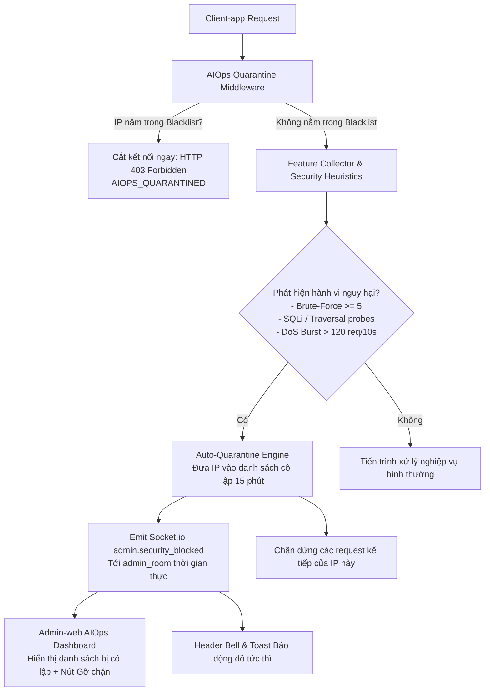

# Kế Hoạch Triển Khai: AIOps Active Quarantine & Auto-Blocking Shield

> **Mục tiêu:** Nâng cấp hệ thống AIOps Sentinel từ trạng thái "Cảnh báo & Giám sát" thành **"Phòng Vệ Tự Động Chủ Động (Active Mitigation & Quarantine)"**. Khi phát hiện các hành vi tấn công (DoS/DDoS, Brute-Force, SQLi/Traversal, Token Hijacking) có nguy cơ gây sập máy chủ hoặc lộ lọt dữ liệu, hệ thống lập tức **chặn đứng nguồn request bất thường từ Client-app** (HTTP 403 Forbidden) và **phát cảnh báo thời gian thực ngay lập tức lên Admin-web qua Socket.io**.

---

## 🏗️ Kiến Trúc Phòng Vệ Chủ Động (Architecture)

---

## 📋 Các Nhiệm Vụ Triển Khai Chi Tiết

### Task 1: Bộ Quản Lý Cô Lập & Chặn Đứng Tự Động (AIOps Quarantine Manager)
- **Tập tin:**
  - Tạo mới: `src/Backend/modules/aiops/aiops.quarantine.js`
  - Viết test TDD: `src/Backend/tests/unit/aiops.quarantine.test.js`
- **Chức năng:**
  - Duy trì danh sách IP bị cô lập trong bộ nhớ In-Memory (kèm TTL tự hủy sau 15 phút).
  - Phương thức `quarantine(ip, reason, durationMs)`: Ghi nhận IP, lý do chặn, thời hạn hết hạn, và phát sự kiện `admin.security_blocked` qua Socket.io tới room `admin_room`.
  - Phương thức `isQuarantined(ip)`: Kiểm tra siêu tốc ($O(1)$, $< 0.1\text{ms}$).
  - Phương thức `unblock(ipHash)`: Cho phép Admin giải phóng IP bị chặn nhầm.
  - Phương thức `getQuarantinedList()`: Trả về danh sách các IP đang bị chặn kèm lý do và thời gian còn lại (tuân thủ `Data_Security.md` - ẩn 2 octet cuối của IP).
  - Middleware `createQuarantineMiddleware()`: Đặt ở đầu Express pipeline; nếu IP bị chặn, ngắt request ngay lập tức với mã HTTP 403 `AIOPS_QUARANTINED` (Zero database load). Admin requests có cờ `req.isAdmin` luôn được miễn trừ 100%.

---

### Task 2: Tích Hợp Heuristic Tự Động Chặn Trong Feature Collector & Express Pipeline
- **Tập tin:**
  - Cập nhật: `src/Backend/modules/aiops/feature.collector.js`
  - Cập nhật: `src/Backend/app.js`
- **Logic tự động kích hoạt cô lập:**
  1. **Tấn công dò mật khẩu (Brute-Force Auth):** Một IP thất bại liên tiếp 5 lần đăng nhập trong 10 giây $\implies$ Tự động cô lập 15 phút.
  2. **Tấn công khai thác lỗ hổng (SQLi / Path Traversal Probes):** Một IP gửi request chứa chuỗi độc hại $\ge 3$ lần $\implies$ Tự động cô lập 30 phút.
  3. **Tấn công từ chối dịch vụ (DoS Request Burst):** Một IP gửi dồn dập $> 120$ request trong 10 giây $\implies$ Tự động cô lập 15 phút.
  4. **Tấn công chiếm đoạt Token (Token Hijacking):** Một IP gửi refresh token đã bị thu hồi $\implies$ Tự động cô lập 15 phút.

---

### Task 3: REST APIs Quản Lý Danh Sách Cô Lập Cho Admin
- **Tập tin:**
  - Cập nhật: `src/Backend/modules/aiops/aiops.controller.js`
  - Cập nhật: `src/Backend/api/admin.routes.js`
- **Endpoints:**
  - `GET /api/admin/aiops/quarantine`: Lấy danh sách toàn bộ các nguồn IP đang bị hệ thống chặn tự động.
  - `DELETE /api/admin/aiops/quarantine/:hash`: Admin mở khóa / gỡ chặn thủ công cho một IP.

---

### Task 4: Giao Diện Quản Trị Danh Sách Bị Chặn & Thông Báo Tức Thời Trên Admin-web
- **Tập tin:**
  - Cập nhật: `src/Admin-web/src/api/aiops.api.js`
  - Cập nhật: `src/Admin-web/src/pages/system/AIOpsPage.jsx`
  - Cập nhật: `src/Admin-web/src/components/layout/AppLayout.jsx`
- **Giao diện người dùng:**
  - **Khối Quản Lý Cô Lập (Active Quarantine Table):** Hiển thị danh sách các nguồn IP đang bị khóa kèm huy hiệu lý do (Brute-Force, SQLi, DoS Burst), thời gian bị chặn, đếm số lần vi phạm (Hits), và nút **"Gỡ Chặn (Unblock)"**.
  - **Toast Báo Động Real-time:** Khi Socket.io nhận sự kiện `admin.security_blocked`, hiển thị thông báo góc màn hình: `"🛡️ AIOps đã tự động chặn đứng một nguồn request bất thường [IP ... | Lý do: ...]"`.

---

### Task 5: Kiểm Thử Toàn Diện, Nghiệm Thu & Cập Nhật Tài Liệu
- **Tập tin:**
  - `src/Backend/tests/unit/aiops.*.test.js`
  - `Project.md`
- **Kiểm tra:**
  - Chạy toàn bộ test Backend: đảm bảo 100% test PASS.
  - Build Admin-web: đảm bảo `rtk npm run build` 0 lỗi.
  - Cập nhật CodeGraph bằng `rtk npx codegraph build`.
