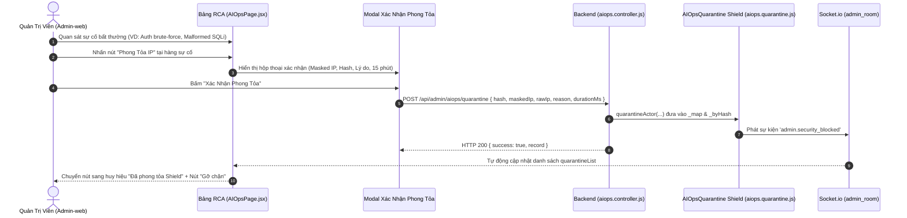

# Kế Hoạch Triển Khai: Nút Phong Tỏa IP Thủ Công Tại Tab Root Cause Analysis (RCA)

> **Dành cho Agentic Workers:** REQUIRED SUB-SKILL: Sử dụng `superpowers:subagent-driven-development` để thực thi từng bước trong plan. Các bước sử dụng cú pháp checkbox (`- [ ]`).

**Mục Tiêu:** Bổ sung tính năng cho phép Quản trị viên (Admin) chủ động bấm nút **"Phong Tỏa IP"** đối với bất kỳ nguồn request/đối tượng khả nghi nào xuất hiện trong bảng Bóc Tách & Phân Tích Nguyên Nhân Bất Thường (Root Cause Analysis) tại trang `/aiops` của Admin-web. Đồng thời cung cấp nút **"Gỡ Chặn"** ngay tại chỗ nếu IP đó đã nằm trong danh sách cô lập.

**Kiến Trúc Tổng Thể:**

**Tech Stack:**
- Backend: Node.js, Express, Socket.io, In-Memory Quarantine Shield Map (hỗ trợ hash & raw IP)
- Admin-web: React, Tailwind CSS, Material Symbols, ConfirmModal, Toast notification

---

## Danh Mục Tệp Tin Tác Động

- **Tạo mới:** Không (tận dụng kiến trúc mô-đun hiện có)
- **Chỉnh sửa Backend:**
  - `src/Backend/modules/aiops/aiops.quarantine.js`: Bổ sung lưu trữ theo `_byHash` để phong tỏa được cả khi chỉ có `actor_hash` từ CSDL, và hàm `quarantineActor(...)`.
  - `src/Backend/modules/aiops/aiops.controller.js`: Bổ sung action `quarantineActor(req, res)`.
  - `src/Backend/api/admin.routes.js`: Định tuyến `POST /api/admin/aiops/quarantine`.
  - `src/Backend/tests/v2/aiops.multivector.test.js`: Thêm test case 3.4 kiểm thử phong tỏa thủ công từ Admin.
- **Chỉnh sửa Frontend (Admin-web):**
  - `src/Admin-web/src/api/aiops.api.js`: Thêm API `quarantineActor(data)`.
  - `src/Admin-web/src/pages/system/AIOpsPage.jsx`: Thêm nút "Phong Tỏa IP", `ConfirmModal` xác nhận, xử lý cô lập và mở khóa trực tiếp tại cột Phòng Vệ.
  - `src/Admin-web/src/tests/aiops.page.test.jsx`: Thêm test case 5.11 kiểm thử click nút phong tỏa tại bảng RCA.
- **Tài liệu dự án:**
  - `docs/Admin-web/09-aiops-sentinel-and-quarantine.md`: Cập nhật đặc tả API & UI.
  - `Project.md`: Bổ sung Mục 11.57.

---

## Chi Tiết Các Nhiệm Vụ (Tasks)

### Nhiệm Vụ 1: Nâng Cấp Backend Quarantine Shield & Tuyến API Phong Tỏa Thủ Công

**Files:**
- Sửa: `src/Backend/modules/aiops/aiops.quarantine.js`
- Sửa: `src/Backend/modules/aiops/aiops.controller.js`
- Sửa: `src/Backend/api/admin.routes.js`
- Test: `src/Backend/tests/v2/aiops.multivector.test.js`

- [ ] **Bước 1.1: Viết test case thất bại (Red) trong `aiops.multivector.test.js`**
  - Viết test `3.4. Cho phép Admin chủ động phong tỏa IP từ Actor Hash/IP và kiểm tra chặn 403`:
    - Tạo instance `AIOpsQuarantine`.
    - Gọi phương thức phong tỏa thủ công với hash/IP.
    - Kiểm tra `isQuarantined` trả về `quarantined: true`.
    - Kiểm tra gọi `unblock` giải phóng phong tỏa thành công.
- [ ] **Bước 1.2: Cập nhật `aiops.quarantine.js`**
  - Thêm cấu trúc `this._byHash = new Map()` trong `AIOpsQuarantine`.
  - Thêm phương thức `quarantineActor({ rawIp, ipHash, maskedIp, reason, durationMs })`:
    - Nếu có `rawIp`, gọi `this.quarantine(rawIp, reason, durationMs)`.
    - Nếu chỉ có `ipHash`, tạo record hợp lệ với `hash: ipHash`, `maskedIp`, đưa vào `this._byHash` và phát socket `admin.security_blocked`.
  - Cập nhật `isQuarantined(rawIp)`: tính `clientHash = hashIp(ip)`, kiểm tra cả `this._map.get(ip)` và `this._byHash.get(clientHash)`.
  - Cập nhật `unblock(ipHashOrIp)`: xóa ở cả `this._map` và `this._byHash`.
  - Cập nhật `getQuarantinedList()`: hợp nhất các bản ghi từ cả 2 Map.
- [ ] **Bước 1.3: Cập nhật `aiops.controller.js` & `admin.routes.js`**
  - Thêm controller method `quarantineActor(req, res)`:
    - Nhận `{ hash, ip, maskedIp, reason, durationMinutes }` từ `req.body`.
    - Đặt thời gian hết hạn `durationMs = (durationMinutes || 15) * 60 * 1000`.
    - Gọi `defaultAIOpsQuarantine.quarantineActor(...)`.
    - Đặt `req.auditActionName = 'Phong tỏa IP thủ công (' + (maskedIp || hash) + ')'`.
    - Trả về `ResponseHandler.success(...)`.
  - Khai báo route `POST /api/admin/aiops/quarantine` trong `admin.routes.js`.
- [ ] **Bước 1.4: Chạy test xác nhận Pass (Green)**
  - Chạy `rtk npm run test:v2` trong `src/Backend`.

---

### Nhiệm Vụ 2: Nâng Cấp Giao Diện Bảng RCA Admin-Web

**Files:**
- Sửa: `src/Admin-web/src/api/aiops.api.js`
- Sửa: `src/Admin-web/src/pages/system/AIOpsPage.jsx`
- Test: `src/Admin-web/src/tests/aiops.page.test.jsx`

- [ ] **Bước 2.1: Thêm API gọi Backend trong `aiops.api.js`**
  - Khai báo hàm `quarantineActor: (payload) => client.post('/admin/aiops/quarantine', payload)`.
- [ ] **Bước 2.2: Tích hợp nút Phong Tỏa & Modal Xác Nhận vào `AIOpsPage.jsx`**
  - Khai báo state:
    - `quarantineModalTarget`: chứa đối tượng sự cố muốn phong tỏa (`null` hoặc object).
    - `quarantining`: boolean trạng thái loading khi đang gửi request.
  - Tại cột "Phòng vệ" của bảng RCA:
    - Nếu đối tượng là tài nguyên hệ thống (`vector === 'resource'` hoặc `actorHash === 'system_host'`): hiển thị huy hiệu `Nội bộ hệ thống` (không hiển thị nút phong tỏa để tránh hiểu nhầm).
    - Nếu `isQuarantined`:
      - Hiển thị huy hiệu `Đã cách ly Shield` (màu đỏ).
      - Kèm nút hành động nhỏ **"Gỡ chặn"** (icon `lock_open`), click gọi `handleUnblock(actorHash)`.
    - Nếu chưa bị cách ly (`!isQuarantined`):
      - Hiển thị nút **"Phong Tỏa IP"** (icon `block`, tông màu cảnh báo đỏ `bg-red-50 hover:bg-red-100 text-red-700 border border-red-200 font-bold px-2 py-1 rounded-lg text-[10px] inline-flex items-center gap-1 active:scale-95 transition-all`).
  - Thêm `ConfirmModal`:
    - Hiển thị khi `quarantineModalTarget !== null`.
    - Tiêu đề: "Xác nhận phong tỏa nguồn IP"
    - Nội dung hiển thị rõ: IP đối tượng (`maskedIp`), Hash nhận diện (`actorHash`), Endpoint tấn công và cảnh báo ngắt kết nối HTTP 403 trong 15 phút.
    - Xử lý khi xác nhận: gọi `aiopsApi.quarantineActor`, cập nhật `quarantineList`, thông báo thành công và đóng modal.
- [ ] **Bước 2.3: Viết test case trong `aiops.page.test.jsx`**
  - Viết test `5.11`: Kiểm thử hiển thị nút "Phong Tỏa IP" trong bảng RCA, nhấn nút kích hoạt modal và gọi API phong tỏa thành công.
- [ ] **Bước 2.4: Kiểm thử giao diện & Build**
  - Chạy `rtk npm test` trong `src/Admin-web`.
  - Chạy `rtk npm run build` trong `src/Admin-web`.

---

### Nhiệm Vụ 3: Cập Nhật Tài Liệu Kỹ Thuật & CodeGraph

**Files:**
- Sửa: `docs/Admin-web/09-aiops-sentinel-and-quarantine.md`
- Sửa: `Project.md`

- [ ] **Bước 3.1: Cập nhật `docs/Admin-web/09-aiops-sentinel-and-quarantine.md`**
  - Thêm đặc tả API `POST /api/admin/aiops/quarantine` vào bảng REST API (Mục 8).
  - Thêm mô tả cơ chế phong tỏa IP thủ công từ bảng RCA vào Mục 6 (mục con 6.5).
- [ ] **Bước 3.2: Cập nhật `Project.md`**
  - Thêm Mục 11.57 ghi nhận tính năng nút phong tỏa IP thủ công từ RCA.
- [ ] **Bước 3.3: Tái tạo CodeGraph**
  - Chạy `rtk npx codegraph build`.
