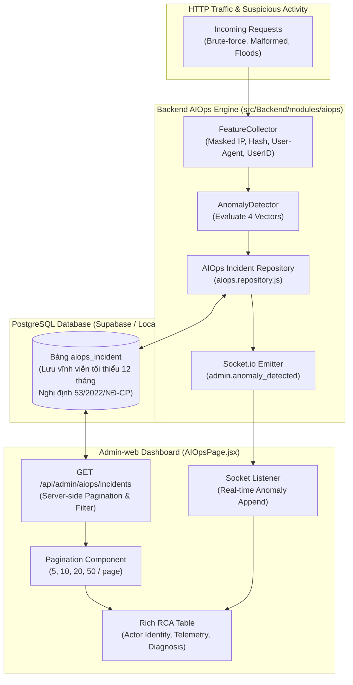

# Nâng Cấp Root Cause Analysis (RCA) — Lưu Trữ CSDL PostgreSQL Vĩnh Viễn, Định Danh Đối Tượng & Phân Trang

> **For agentic workers:** REQUIRED SUB-SKILL: Use `superpowers:subagent-driven-development` or `superpowers:executing-plans` to implement this plan task-by-task. Steps use checkbox (`- [ ]`) syntax for tracking.

**Goal:** Chuyển đổi tab Bóc Tách & Phân Tích Nguyên Nhân Bất Thường (Root Cause Analysis - RCA) sang cơ chế lưu trữ bền vững vĩnh viễn trong Cơ sở dữ liệu PostgreSQL (Bảng `aiops_incident`), định danh đối tượng vi phạm tuân thủ 100% `Data_Security.md`, hỗ trợ phân trang Server-side & Client UI mượt mà, bảo toàn toàn vẹn dữ liệu điều tra kể cả khi tắt máy chủ hay tải lại trang web.

**Architecture:** 
1. **Database PostgreSQL (`database/15_create_aiops_incident_table.sql` & Prisma):** Tạo bảng `aiops_incident` để lưu trữ nhật ký sự cố bất thường vĩnh viễn (tối thiểu 12 tháng theo NĐ 53/2022/NĐ-CP). Bảng có các cột: `id`, `code`, `vector`, `severity`, `message`, `status` (`ACTIVE`/`MITIGATED`), thông tin đối tượng `actor` (`actor_type`, `actor_identity`, `actor_hash`, `user_id`, `username`, `user_agent`, `target_endpoint`), `metrics`, `mitigation_taken`, `root_cause_diagnosis`, `hits`, `first_detected_at`, `last_seen_at`, `mitigated_at`.
2. **Backend Engine (`src/Backend/modules/aiops/`):** 
   - `feature.collector.js`: Thu thập định danh an toàn (Masked IP `113.161.xx.xx`, IP Hash 16 ký tự, User-Agent, Endpoint, User ID/Username nếu đã xác thực).
   - `aiops.repository.js`: Tầng DAO đọc/ghi CSDL PostgreSQL cho các sự cố (Upsert khi đang diễn ra, update `MITIGATED` khi kiểm soát, phân trang `SELECT ... LIMIT ... OFFSET ...`). Tự động khởi tạo bảng nếu chưa có (`CREATE TABLE IF NOT EXISTS`).
   - `aiops.service.js`: Ghi nhận sự cố vào DB ngay khi máy học phát hiện, cập nhật trạng thái vòng đời, phát sự kiện Socket.io `admin.anomaly_detected` tới `admin_room`.
   - `aiops.routes.js`: Cung cấp API `GET /api/admin/aiops/incidents` (phân trang + lọc theo vector, status, search) và `POST /api/admin/aiops/incidents/clear`.
3. **Admin-web (`src/Admin-web/src/pages/system/AIOpsPage.jsx`):** 
   - Tải dữ liệu sự cố từ CSDL qua API phân trang.
   - Lắng nghe Socket `admin.anomaly_detected` để tự động chèn thêm sự cố mới vào đầu danh sách tức thời.
   - Bảng hiển thị 6 cột giàu dữ liệu, thanh công cụ bộ lọc (Vector, Trạng thái, Tìm kiếm), và tích hợp component `Pagination.jsx` (5, 10, 20, 50 dòng/trang).

**Architecture Diagram:**



**Tech Stack:** 
- Database: PostgreSQL, SQL DDL, pg Client / Prisma Client
- Backend: Node.js, Express, Socket.io, Node Native Test Runner (`node --test`)
- Admin-web: React 18, Vite 5, TailwindCSS, Material Symbols, Vitest, React Testing Library
- Compliance: `Data_Security.md`, Nghị định 13/2023/NĐ-CP, Nghị định 53/2022/NĐ-CP, Luật An ninh mạng 2018

## Global Constraints
- **Lưu trữ CSDL 100%:** Tuyệt đối không chỉ lưu trong bộ nhớ tạm hay website state; mọi sự cố phải được ghi vào CSDL PostgreSQL để phục vụ điều tra, thanh tra, kiểm toán lâu dài.
- **Tuân thủ pháp luật & `Data_Security.md`:** Masked IP (`113.161.xx.xx`) + IP Hash (16 ký tự). Tuyệt đối không ghi mật khẩu thô (dù gõ sai), mã OTP, hoặc thông tin thẻ ngân hàng CVV.
- Scoped Admin-only: Chỉ trả dữ liệu sự cố qua API có xác thực Quản trị viên (`idrole === 1`).
- RTK CLI prefix cho mọi lệnh shell (`rtk npm run test:v2`, `rtk npm test`).
- Giữ vững 77/77 tests hiện có pass 100%.

---

### Task 1: Thiết Lập Bảng CSDL `aiops_incident` & Tầng Dữ Liệu `AIOpsIncidentRepository` (Backend)

**Files:**
- Create: `src/Backend/database/15_create_aiops_incident_table.sql`
- Create: `src/Backend/modules/aiops/aiops.repository.js`
- Modify: `src/Backend/prisma/schema.prisma`
- Test: `src/Backend/tests/v2/aiops.multivector.test.js`

**Interfaces:**
- `aiopsRepository.initTable()`: Thực thi `CREATE TABLE IF NOT EXISTS aiops_incident ...` đảm bảo CSDL luôn sẵn sàng trên cả Local và Cloud.
- `aiopsRepository.upsertIncident(incidentData)`: Chèn sự cố mới hoặc cập nhật `hits`, `last_seen_at`, `metric_current` nếu sự cố cùng loại đang `ACTIVE`.
- `aiopsRepository.markMitigated(id, mitigatedAt)`: Cập nhật trạng thái sự cố sang `MITIGATED`.
- `aiopsRepository.getIncidents({ page, limit, vector, status, search })`: Truy vấn phân trang, trả về `{ incidents, total, page, limit, totalPages }`.
- `aiopsRepository.clearIncidents()`: Xóa sạch hoặc đánh dấu lưu trữ nhật ký sự cố khi Admin yêu cầu.

- [ ] **Step 1: Viết test kiểm tra Repository tương tác với CSDL / Mock CSDL**
  Thêm test suite trong `aiops.multivector.test.js` kiểm tra các phương thức `upsertIncident`, `getIncidents` (phân trang, filter), `markMitigated`.
- [ ] **Step 2: Chạy test để xác nhận FAIL (Red)**
  `rtk npm run test:v2`
- [ ] **Step 3: Tạo file SQL migration `15_create_aiops_incident_table.sql`**
  Định nghĩa bảng `aiops_incident` với đầy đủ indexes trên `status`, `vector`, `first_detected_at`, `actor_hash`.
- [ ] **Step 4: Cập nhật `schema.prisma` với model `aiops_incident`**
  Đồng bộ model Prisma và chạy `npx prisma generate` để hỗ trợ type-checking.
- [ ] **Step 5: Triển khai `aiops.repository.js`**
  Hiện thực hóa các hàm truy vấn qua `pool` (PostgreSQL connection pool) có cơ chế auto-fallback an toàn:
  - `initTable()`: chạy câu lệnh `CREATE TABLE IF NOT EXISTS ...`.
  - `upsertIncident()`: tìm kiếm sự cố cùng `code` và `actor_hash` đang `ACTIVE` trong vòng 5 phút gần nhất; nếu có thì tăng `hits` và gia hạn `last_seen_at`; nếu không thì INSERT mới.
  - `getIncidents()`: sinh câu lệnh `SELECT ... FROM aiops_incident WHERE ... ORDER BY first_detected_at DESC LIMIT $1 OFFSET $2` và `SELECT COUNT(*)`.
- [ ] **Step 6: Chạy test xác nhận PASS (Green)**
  `rtk npm run test:v2`

---

### Task 2: Thu Thập Định Danh Đối Tượng & Tích Hợp CSDL Vào `AIOpsService` (Backend)

**Files:**
- Modify: `src/Backend/modules/aiops/feature.collector.js`
- Modify: `src/Backend/modules/aiops/anomaly.detector.js`
- Modify: `src/Backend/modules/aiops/aiops.service.js`
- Modify: `src/Backend/modules/aiops/aiops.routes.js`
- Test: `src/Backend/tests/v2/aiops.multivector.test.js`

**Interfaces:**
- `feature.collector.js`: Thu thập `suspectActors` gồm Masked IP, Hash, User-Agent, Endpoint, User ID/Username nếu có token.
- `aiops.service.js`: Trong mỗi chu kỳ `tick()`, nếu phát hiện anomaly thì gọi `aiopsRepository.upsertIncident(...)`. Sau 60s không còn vi phạm, tự động cập nhật sang `MITIGATED` trong DB.
- `GET /api/admin/aiops/incidents`: Endpoint trả về danh sách sự cố có phân trang và bộ lọc từ CSDL.
- `POST /api/admin/aiops/incidents/clear`: Endpoint xóa/lưu trữ nhật ký sự cố.
- Socket `admin.anomaly_detected`: Phát sự cố mới tới `admin_room`.

- [ ] **Step 1: Viết test cho luồng lưu CSDL & phát Socket trong `aiops.multivector.test.js`**
  Kiểm tra khi anomaly phát sinh, hàm ghi nhận DB được gọi và bản ghi có `status = 'ACTIVE'`.
- [ ] **Step 2: Chạy test để xác nhận FAIL**
  `rtk npm run test:v2`
- [ ] **Step 3: Cập nhật `feature.collector.js` & `anomaly.detector.js`**
  Trích xuất thông tin đối tượng vi phạm (`actor`) và gắn vào từng `anomaly`.
- [ ] **Step 4: Cập nhật `aiops.service.js` đồng bộ trực tiếp với CSDL PostgreSQL**
  - Tích hợp `aiopsRepository` vào chu trình `tick()`.
  - Khởi tạo bảng CSDL khi service khởi động (`await this.repository.initTable()`).
  - Khi có sự cố mới hoặc cập nhật trạng thái trong CSDL, phát socket `admin.anomaly_detected`.
- [ ] **Step 5: Bổ sung routes vào `aiops.routes.js`**
  - `GET /incidents`: gọi `aiopsRepository.getIncidents({ page, limit, vector, status, search })`.
  - `POST /incidents/clear`: gọi `aiopsRepository.clearIncidents()`.
- [ ] **Step 6: Chạy test suite xác nhận PASS**
  `rtk npm run test:v2`

---

### Task 3: Cập Nhật API Client & Quản Lý State Phân Trang Từ CSDL (Admin-Web)

**Files:**
- Modify: `src/Admin-web/src/api/aiops.api.js`
- Modify: `src/Admin-web/src/pages/system/AIOpsPage.jsx`
- Test: `src/Admin-web/src/tests/aiops.page.test.jsx`

**Interfaces:**
- `aiopsApi.getIncidents({ page, limit, vector, status, search })`: Gọi `GET /admin/aiops/incidents`.
- `aiopsApi.clearIncidents()`: Gọi `POST /admin/aiops/incidents/clear`.
- `AIOpsPage.jsx`: State quản lý phân trang `currentPage`, `pageSize`, `totalIncidents`, `incidentsList`, `filters`.

- [ ] **Step 1: Viết test trong `aiops.page.test.jsx` kiểm tra gọi API phân trang từ CSDL**
  - Giả lập API trả về `{ incidents: [...], pagination: { total: 25, page: 1, limit: 10 } }`.
  - Kiểm tra giao diện render đúng danh sách từ CSDL.
  - Kiểm tra sự kiện Socket `admin.anomaly_detected` cập nhật danh sách realtime.
- [ ] **Step 2: Chạy test xác nhận FAIL**
  `rtk npm test`
- [ ] **Step 3: Cập nhật `aiops.api.js`**
  Thêm hàm `getIncidents(params)` và `clearIncidents()`.
- [ ] **Step 4: Cập nhật logic fetch dữ liệu trong `AIOpsPage.jsx`**
  - Thêm `fetchIncidents()` gọi API có tham số phân trang & bộ lọc.
  - Tự động gọi lại `fetchIncidents()` khi thay đổi trang, kích thước trang, hoặc bộ lọc.
  - Socket `admin.anomaly_detected`: chèn sự cố mới vào đầu danh sách và tăng `totalIncidents += 1`.
- [ ] **Step 5: Chạy test xác nhận PASS**
  `rtk npm test`

---

### Task 4: Nâng Cấp Giao Diện Bảng RCA, Thanh Công Cụ Bộ Lọc & Tích Hợp Phân Trang (Admin-Web)

**Files:**
- Modify: `src/Admin-web/src/pages/system/AIOpsPage.jsx`
- Uses: `src/Admin-web/src/components/common/Pagination.jsx`
- Uses: `src/Admin-web/src/components/common/ConfirmModal.jsx`
- Test: `src/Admin-web/src/tests/aiops.page.test.jsx`

- [ ] **Step 1: Viết test kiểm thử chuyển trang, đổi số lượng hiển thị (5, 10, 20, 50), lọc và modal xác nhận xóa**
- [ ] **Step 2: Chạy test xác nhận FAIL**
  `rtk npm test`
- [ ] **Step 3: Thiết kế lại khối RCA Table trong `AIOpsPage.jsx`**
  - Thêm Toolbar:
    + Nút lọc 4 Vector: Tất cả, Xác thực & Danh tính, Lưu lượng & DoS, Rà quét lỗ hổng, Tài nguyên hệ thống.
    + Nút lọc Trạng thái: Tất cả, 🔴 Đang diễn ra (`ACTIVE`), 🟢 Đã kiểm soát (`MITIGATED`).
    + Ô tìm kiếm: Tìm kiếm theo IP, Mã sự cố hoặc Tên người dùng.
    + Nút "Làm sạch nhật ký" kèm `ConfirmModal` cảnh báo trước khi xóa.
  - Bảng dữ liệu 6 cột chuẩn an toàn thông tin:
    1. **Thời điểm & Trạng thái:** Thời gian `firstDetectedAt`, `lastSeenAt` + Badge `ACTIVE` / `MITIGATED`.
    2. **Đối tượng thực hiện (Actor Identity):** Phân loại Icon (Người dùng / IP vãng lai / Hệ thống), Masked IP (`113.161.xx.xx`), Badge Hash (`#a1b2..`), Username/UserID (nếu có), User-Agent & Endpoint mục tiêu.
    3. **Vector & Mức độ:** Huy hiệu 4 vector màu + Mức độ HIGH/MEDIUM/LOW + Mã kỹ thuật font mono (`AUTH_BRUTE_FORCE`, v.v.).
    4. **Chỉ số đo được vs Ngưỡng:** Hiển thị số đo cụ thể kèm bội số vượt (ví dụ: `18 lần/10s` vs ngưỡng `8`, vượt `2.25x`).
    5. **Bóc tách nguyên nhân & Hành động xử lý:** AI Root Cause Diagnosis + Thẻ hành động tự động hệ thống đã làm (Quarantine, Load shedding, Bulkhead...).
    6. **Thao tác:** Nút xem nhanh trong Khiên Cách Ly (nếu có IP bị chặn) hoặc nút Chi tiết.
  - Tích hợp component `Pagination.jsx`:
    ```jsx
    <Pagination
      currentPage={currentPage}
      pageSize={pageSize}
      total={totalIncidents}
      pageSizeOptions={[5, 10, 20, 50]}
      onPageChange={handlePageChange}
      onPageSizeChange={handlePageSizeChange}
      itemLabel="sự cố bất thường"
    />
    ```
- [ ] **Step 4: Chạy test xác nhận PASS**
  `rtk npm test`

---

### Task 5: Kiểm Định Khép Kín Toàn Hệ Thống, Đồng Bộ Tài Liệu & Cập Nhật CodeGraph

**Files:**
- Modify: `docs/Admin-web/09-aiops-sentinel-and-quarantine.md`
- Modify: `docs/Deploy/CloudDeploy.md`
- Modify: `Project.md`

- [ ] **Step 1: Chạy toàn bộ Backend test suites v2**
  `rtk npm run test:v2` (Bảo đảm 100% test suites pass)
- [ ] **Step 2: Chạy toàn bộ Admin-web test suites**
  `rtk npm test` (Bảo đảm 100% test suites pass)
- [ ] **Step 3: Kiểm tra Admin-web production build**
  `rtk npm run build` tại `src/Admin-web` (Kiểm tra 0 lỗi biên dịch)
- [ ] **Step 4: Cập nhật tài liệu kỹ thuật nguồn sự thật**
  - Cập nhật [09-aiops-sentinel-and-quarantine.md](file:///d:/Tai_Lieu_IUH/Tailieu_Nam5_HK1/DoAnTotNghiep/Personal_Finance_Management/docs/Admin-web/09-aiops-sentinel-and-quarantine.md): Bổ sung kiến trúc bảng CSDL `aiops_incident`, cơ chế phân trang Server-side và định danh đối tượng hợp pháp.
  - Cập nhật [Project.md](file:///d:/Tai_Lieu_IUH/Tailieu_Nam5_HK1/DoAnTotNghiep/Personal_Finance_Management/Project.md): Ghi nhận hoàn thành mục 11.55.
- [ ] **Step 5: Build lại CodeGraph theo Rule 8**
  `rtk npx codegraph build`

---

### Acceptance Criteria (Tiêu Chí Nghiệm Thu)
1. **Lưu trữ CSDL 100%:** Toàn bộ sự cố bất thường được lưu vĩnh viễn trong bảng CSDL PostgreSQL `aiops_incident`, không bao giờ bị mất khi khởi động lại server hoặc tải lại trang web.
2. **Server-side Pagination & Filtering:** Hỗ trợ phân trang mượt mà (5, 10, 20, 50 dòng/trang) và lọc theo Vector, Trạng thái (`ACTIVE`/`MITIGATED`), tìm kiếm trực tiếp từ CSDL.
3. **Real-time Synchronized:** Khi có sự cố mới, hệ thống vừa ghi vào CSDL vừa bắn Socket.io đẩy thẳng lên đầu bảng tại Admin-web.
4. **Định danh hợp pháp theo `Data_Security.md`:** Hiển thị rõ ràng Masked IP (`113.161.xx.xx`), IP Hash, User-Agent, Username/UserID (nếu có), tuyệt đối không lưu dữ liệu nhạy cảm thô.
5. 100% test suites vượt qua thành công, không có bất kỳ regression bug nào.
