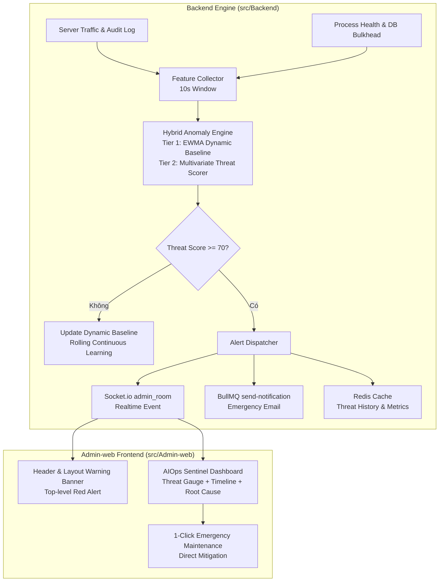

# AIOps Sentinel — Real-time Anomaly & Intrusion Detection System Implementation Plan

> **For agentic workers:** REQUIRED SUB-SKILL: Use superpowers:subagent-driven-development to implement this plan task-by-task. Steps use checkbox (`- [ ]`) syntax for tracking.

**Goal:** Xây dựng hệ thống AIOps Sentinel chạy ngầm tại Backend và hiển thị real-time trên Admin-web, liên tục học hỏi 12 chỉ số động của hệ thống, tự động phát hiện xâm nhập (Brute-Force, Token Hijacking, DDoS, Lỗ hổng API) và sự cố quá tải phần cứng (Event Loop Lag, Memory Leak, DB Starvation), đồng thời phát cảnh báo tức thì qua Socket.io và hỗ trợ 1-click kích hoạt Bảo trì khẩn cấp.

**Architecture:** 
- **Tầng Thu Thập & Trích Xuất Chỉ Số (Feature Collector):** Chạy chu kỳ 10 giây trong Node.js, lấy 12 thông số cốt lõi từ Memory, Event Loop, DB Bulkhead, Redis Token Limiter và Traffic Window.
- **Tầng Máy Học Lai (Hybrid 2-Tier AI Engine):**
  - *Tier 1:* Dynamic Rolling Baseline (EWMA & Dynamic IQR) tự thích ứng theo chu kỳ giờ cao điểm/thấp điểm Việt Nam GMT+7.
  - *Tier 2:* Multivariate Anomaly & Threat Scorer tính toán hệ số nguy hiểm (Threat Score 0 - 100) và bóc tách nguyên nhân gốc rễ (Root Cause Analysis).
- **Tầng Báo Động Real-time & Phản Ứng:** Đẩy sự kiện qua Socket.io vào phòng `admin_room`, tự động hiển thị Banner Báo động đỏ trên toàn bộ Admin-web, gửi email khẩn cấp qua BullMQ khi nguy cấp (`threatScore >= 85`), và cung cấp nút 1-click kích hoạt Bảo trì khẩn cấp.
- **Tầng Trực Quan Hóa (Admin-web AIOps Dashboard):** Đồng hồ đo rủi ro (Threat Gauge), biểu đồ SVG xu hướng nguy cơ thời gian thực, bảng phân tích sự cố bất thường kèm giải thích tiếng Việt.

**Architecture Diagram:**



**Tech Stack:** Node.js, Express, Socket.io, BullMQ, Redis (Upstash), React 18, Vite, Pure HTML + Tailwind CSS v4, SVG Charts.

## Global Constraints
- **Tuân thủ pháp lý & Data Security:** Tuyệt đối không log hoặc lưu trữ PII thô (mật khẩu, OTP, SĐT, STK) trong các feature vectors ([Data_Security.md](../../Rule_Project/Data_Security.md)).
- **Tối ưu tài nguyên (Low Overhead):** Thuật toán máy học online chạy trong tiến trình Node.js tiêu tốn $< 15\text{MB}$ RAM và $< 2\%$ CPU.
- **Múi giờ chuẩn:** Mọi phân tích chu kỳ giờ cao điểm/thấp điểm đồng bộ theo múi giờ Việt Nam `Asia/Ho_Chi_Minh` (GMT+7).
- **Độc lập chống SPOF:** Nếu Redis hoặc Socket.io ngắt quãng, bộ tính toán AIOps vẫn tự duy trì trong in-memory buffer mà không làm crash máy chủ.
- **Giao diện Admin-web:** 100% Pure HTML + Tailwind CSS v4, không dùng Ant Design hay thư viện chart nặng.

---

### Task 1: Bộ Thu Thập & Trích Xuất Chỉ Số Hệ Thống (Feature Collector)

**Files:**
- Create: `src/Backend/modules/aiops/feature.collector.js`
- Test: `src/Backend/tests/unit/aiops.collector.test.js`

**Interfaces:**
- Produces: `collector.getSample()` trả về object 12 chỉ số chuẩn hóa:
  ```javascript
  {
    timestamp: ISOString,
    requestsPerMin: number,
    errorRate4xx: number,       // 0.0 - 1.0
    errorRate5xx: number,       // 0.0 - 1.0
    failedLogins: number,
    tokenReuseAttacks: number,
    malformedRequests: number,
    eventLoopLagMs: number,
    cpuPercent: number,
    ramPercent: number,
    dbPoolActive: number,
    loadSheddingCount: number,
    distinctIpsCount: number
  }
  ```

- [x] **Step 1: Viết test kiểm tra Feature Collector trích xuất đầy đủ 12 chỉ số**
- [x] **Step 2: Chạy test kiểm tra lỗi ban đầu (Red)**
- [x] **Step 3: Hiện thực `feature.collector.js` gắn middleware đếm request và kết nối `health.service.js`**
- [x] **Step 4: Chạy test xác nhận pass 100% (Green)**
- [x] **Step 5: Kiểm tra code style và commit**

---

### Task 2: Bộ Não Máy Học Tự Thích Ứng & Tính Điểm Đe Dọa (Hybrid Anomaly Detector)

**Files:**
- Create: `src/Backend/modules/aiops/anomaly.detector.js`
- Test: `src/Backend/tests/unit/aiops.detector.test.js`

**Interfaces:**
- Consumes: Mẫu 12 chỉ số từ `feature.collector.js`.
- Produces: `detector.evaluate(sample)` trả về:
  ```javascript
  {
    threatScore: number,        // 0 - 100
    status: 'NORMAL' | 'WARNING' | 'CRITICAL',
    isAnomaly: boolean,
    anomalies: [
      { code: string, metric: string, current: number, baseline: number, severity: 'LOW'|'MEDIUM'|'HIGH', message: string }
    ],
    recommendedAction: null | 'INVESTIGATE' | 'EMERGENCY_MAINTENANCE'
  }
  ```

- [x] **Step 1: Viết test TDD kiểm chứng:**
  - Phát hiện Brute-Force khi số lần đăng nhập sai tăng đột biến.
  - Phân biệt giữa người dùng đông tự nhiên (Safe) vs. DDoS/Scraping (Threat).
  - Phát hiện rò rỉ bộ nhớ (Memory Leak) và nghẽn Event Loop Lag.
  - Tính đúng Threat Score thang điểm 0-100.
- [x] **Step 2: Chạy test kiểm tra lỗi ban đầu (Red)**
- [x] **Step 3: Hiện thực `anomaly.detector.js` với thuật toán EWMA Rolling Baseline & Multivariate Threat Scoring**
- [x] **Step 4: Chạy test xác nhận pass 100% (Green)**
- [x] **Step 5: Commit mã nguồn**

---

### Task 3: Bộ Điều Phối AIOps & Cơ Chế Báo Động Real-time (AIOps Service & APIs)

**Files:**
- Create: `src/Backend/modules/aiops/aiops.service.js`
- Create: `src/Backend/modules/aiops/aiops.controller.js`
- Modify: `src/Backend/api/admin.routes.js:20-25`
- Modify: `src/Backend/index.js:50-60`
- Test: `src/Backend/tests/unit/aiops.service.test.js`

**Interfaces:**
- Endpoints:
  - `GET /api/admin/aiops/status`: Trả về Threat Score tức thời, trạng thái, danh sách nguy cơ và khuyến nghị.
  - `GET /api/admin/aiops/history`: Trả về danh sách 60 mẫu gần nhất phục vụ vẽ biểu đồ.
  - `POST /api/admin/aiops/calibrate`: Reset/tái hiệu chuẩn ngưỡng học máy.
- Socket.io: Phát sự kiện `admin.security_alert` vào `admin_room` khi Threat Score $\ge 70$.

- [x] **Step 1: Viết test TDD cho `aiops.service.js` (Sampling loop, History buffer 60 mẫu, Socket.io alert trigger)**
- [x] **Step 2: Hiện thực `aiops.service.js`, `aiops.controller.js` và gắn router trong `admin.routes.js`**
- [x] **Step 3: Kết nối kích hoạt AIOps sampler trong `index.js` khi server khởi động**
- [x] **Step 4: Chạy bộ test kiểm tra liên thông Backend pass 100%**
- [x] **Step 5: Commit mã nguồn**

---

### Task 4: Giao Diện Quản Trị AIOps Sentinel Trên Admin-web

**Files:**
- Create: `src/Admin-web/src/api/aiops.api.js`
- Create: `src/Admin-web/src/pages/system/AIOpsPage.jsx`
- Modify: `src/Admin-web/src/components/layout/Sidebar.jsx:10-15`
- Modify: `src/Admin-web/src/router/routes.jsx:15-30`

**Interfaces:**
- Giao diện bao gồm:
  - **Threat Score Gauge:** Đồng hồ đo rủi ro thời gian thực với kim xoay mượt mà (Xanh 0-30, Vàng 31-70, Đỏ 71-100).
  - **Biểu đồ SVG Threat Timeline:** Đường biểu diễn mức độ nguy cơ theo chu kỳ 60 mẫu gần nhất.
  - **Bảng Anomaly Root Cause Analysis:** Danh sách các bất thường kèm giải thích tiếng Việt và mức độ nghiêm trọng.
  - **1-Click Mitigation Button:** Nút kích hoạt Bảo trì khẩn cấp ngay khi phát hiện nguy cơ cao.

- [x] **Step 1: Xây dựng API client `aiops.api.js`**
- [x] **Step 2: Xây dựng màn hình `AIOpsPage.jsx` bằng Pure HTML + Tailwind CSS v4**
- [x] **Step 3: Thêm mục menu `AIOps Sentinel` vào `Sidebar.jsx` (icon `shield` / `security`)**
- [x] **Step 4: Đăng ký route `/aiops` trong router**
- [x] **Step 5: Kiểm tra build với `rtk npm run build` đảm bảo 0 lỗi**

---

### Task 5: Banner Cảnh Báo Nguy Hiểm Toàn Cục (Global Real-time Threat Banner)

**Files:**
- Modify: `src/Admin-web/src/components/layout/AppLayout.jsx:10-25`
- Modify: `src/Admin-web/src/components/layout/Header.jsx:40-55`

**Interfaces:**
- Khi nhận sự kiện Socket.io `admin.security_alert` hoặc khi `threatScore >= 85`:
  - Hiển thị dải Banner Báo Động Đỏ nhấp nháy ở đỉnh giao diện toàn bộ các trang.
  - Cung cấp nút xem chi tiết dẫn đến `/aiops` và nút bật bảo trì khẩn cấp nhanh.

- [x] **Step 1: Thêm hook lắng nghe `admin.security_alert` trong `AppLayout.jsx`**
- [x] **Step 2: Render Banner cảnh báo khẩn cấp toàn cục có nút tắt tạm thời hoặc 1-click xử lý**
- [x] **Step 3: Kiểm tra hot-reload trên trình duyệt**
- [x] **Step 4: Kiểm tra build `rtk npm run build`**

---

### Task 6: Kiểm Thử Tích Hợp Toàn Diện, Nghiệm Thu & Cập Nhật Nguồn Sự Thật

**Files:**
- Modify: `Project.md`
- Test: `src/Backend/tests/unit/aiops.*.test.js`

- [x] **Step 1: Chạy toàn bộ test suite của Backend: đảm bảo 100% tests PASS**
- [x] **Step 2: Chạy build production Admin-web: `rtk npm run build` thành công 100%**
- [x] **Step 3: Cập nhật tài liệu nguồn sự thật `Project.md` ghi nhận tính năng AIOps Sentinel**
- [x] **Step 4: Cập nhật CodeGraph toàn hệ thống bằng lệnh `rtk npx codegraph build`**
- [x] **Step 5: Báo cáo nghiệm thu hoàn tất tới PO**
