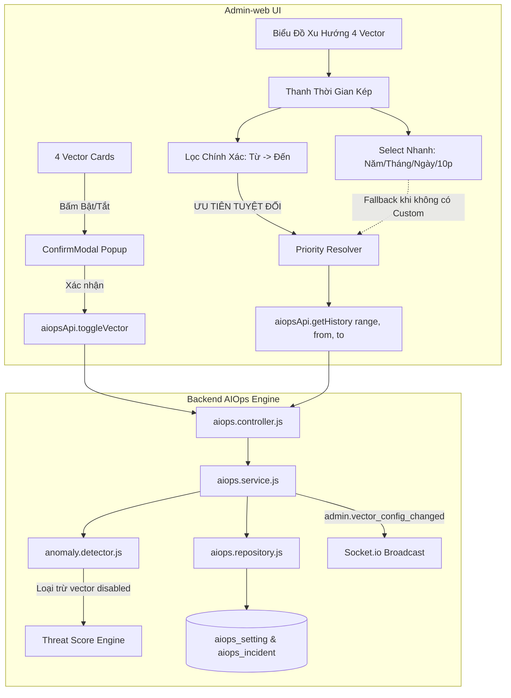

# AIOps Multi-Vector Toggles & Trend Chart Time Range Filters Implementation Plan

> **For agentic workers:** REQUIRED SUB-SKILL: Use superpowers:subagent-driven-development to implement this plan task-by-task. Steps use checkbox (`- [ ]`) syntax for tracking.

**Goal:** 
1. Thêm công tắc BẬT/TẮT cho từng vector trong 4 Vector rủi ro (Auth, Traffic, Exploit, Resource). Khi tắt: vẫn đo lường nhưng KHÔNG tính vector bị tắt vào Threat Score; luôn có popup xác nhận khi bật/tắt; lưu cấu hình bền vững vào CSDL.
2. Thêm bộ chọn thời gian quan sát xu hướng cho Biểu Đồ 4 Vector: Bộ select nhanh (Năm / Tháng / Ngày / Thời gian thực 10 phút) và Bộ lọc tùy biến chính xác (Từ năm/tháng/ngày đến năm/tháng/ngày). Áp dụng quy tắc ưu tiên tuyệt đối cho bộ lọc chính xác khi cả hai cùng được kích hoạt.

**Architecture:**
- **Backend Core Resilience & Machine Learning:** `AnomalyDetector` được bổ sung cấu hình `vectorToggles: { auth, traffic, exploit, resource }`. Khi tính `evaluate(sample)`, điểm của các vector bị tắt vẫn được đo đạc và trả về trong `vectorScores` (cho mục đích giám sát), nhưng bị loại trừ hoàn toàn khỏi công thức tổng hợp `threatScore` (`rawMax`, `corroborationBonus`, `severeResourceCrisis` và `recommendedAction`).
- **Database Persistence & Sync:** `aiops.repository.js` lưu trạng thái `vector_toggles` vào bảng `aiops_setting`. Bổ sung API `POST /api/admin/aiops/vectors/toggle` và `GET /api/admin/aiops/vectors`.
- **Trend Time Horizon Engine:** `AIOpsService.getHistory({ range, from, to })` cung cấp dữ liệu chuỗi thời gian cho 4 dải: `realtime` (60 mẫu/10p), `day` (24 giờ), `month` (30 ngày), `year` (12 tháng), hoặc `custom` (khoảng `from` -> `to` tùy biến kết hợp phân bổ sự cố từ `aiops_incident`).
- **Admin-web Frontend:**
  * Khối 4 Vector: Nút Toggle trên từng thẻ vector, mở `ConfirmModal` xác nhận trước khi bật/tắt; hiển thị nhãn "Bỏ qua khỏi Threat Score" khi tắt.
  * Khối Biểu Đồ Xu Hướng: Thanh công cụ kép gồm Dropdown Preset (10 phút, 24 giờ, 30 ngày, 12 tháng) và Bộ lọc khoảng thời gian tùy biến chi tiết (Custom Precision Range Picker). Áp dụng logic ưu tiên: Khi có khoảng thời gian chính xác, tự động ưu tiên và làm mờ preset.

**Architecture Diagram:**



**Tech Stack:** Node.js, Express, PostgreSQL/Supabase, React, TailwindCSS, Vitest, Node Test Runner.

## Global Constraints
- Bắt buộc dùng tiền tố `rtk` cho mọi lệnh CLI terminal.
- Tuân thủ 100% `Data_Security.md`: Không lộ PII, mã hóa token/mật khẩu, IP masking.
- Luôn có popup modal xác nhận khi bật hoặc tắt bất kỳ vector nào.
- Ưu tiên bộ lọc khoảng thời gian chính xác khi cả hai bộ lọc cùng được thiết lập.

---

### Task 1: Backend - Hỗ Trợ Bật/Tắt Từng Vector Trong AnomalyDetector & CSDL

**Files:**
- Modify: `src/Backend/modules/aiops/anomaly.detector.js`
- Modify: `src/Backend/modules/aiops/aiops.service.js`
- Modify: `src/Backend/modules/aiops/aiops.controller.js`
- Modify: `src/Backend/api/admin.routes.js`
- Test: `src/Backend/tests/unit/aiops.detector.test.js`
- Test: `src/Backend/tests/v2/aiops.multivector.test.js`

**Interfaces:**
- Consumes: `sample` metrics
- Produces: `vectorConfig: { auth: boolean, traffic: boolean, exploit: boolean, resource: boolean }`, API `POST /api/admin/aiops/vectors/toggle`

- [ ] **Step 1.1: Viết test kiểm tra loại trừ vector bị tắt khỏi Threat Score**
  - Viết test trong `tests/unit/aiops.detector.test.js` chứng minh: Khi `exploitScore = 95` nhưng vector `exploit` bị TẮT (`enabled = false`), `evaluate()` vẫn trả về `vectorScores.exploit = 95`, NHƯNG `threatScore` chỉ tính trên 3 vector còn lại (không bị vọt lên 95), trạng thái không bị chuyển thành CRITICAL do exploit, và `vectorDefenses.exploit.disabled = true`.

- [ ] **Step 1.2: Triển khai cấu hình Vector Toggles trong `anomaly.detector.js`**
  - Khởi tạo `this.vectorConfig = { auth: true, traffic: true, exploit: true, resource: true }`.
  - Hàm `setVectorConfig(newConfig)` và `toggleVector(vectorName, isEnabled)`.
  - Trong `evaluate(sample)`:
    * Tính toán 4 điểm vector như bình thường để đo lường.
    * Lọc các điểm số tham gia tính composite `threatScore`:
      ```javascript
      const activeScores = [];
      if (this.vectorConfig.auth) activeScores.push(authScore);
      if (this.vectorConfig.traffic) activeScores.push(trafficScore);
      if (this.vectorConfig.exploit) activeScores.push(exploitScore);
      if (this.vectorConfig.resource) activeScores.push(resourceScore);
      const rawMax = activeScores.length > 0 ? Math.max(...activeScores) : 5;
      const highVectorsCount = activeScores.filter(s => s >= 65).length;
      ```
    * Nếu vector `resource` bị tắt, không kích hoạt `severeResourceCrisis`.

- [ ] **Step 1.3: Tích hợp Service, Controller, CSDL lưu cứng và Routes**
  - Trong `aiops.service.js`: nạp `vector_toggles` từ `aiops_setting` khi khởi động; phát socket `admin.vector_config_changed` khi có cập nhật.
  - Trong `aiops.controller.js`: thêm handler `toggleVector` và `getVectorConfig`.
  - Trong `admin.routes.js`: đăng ký `router.post('/aiops/vectors/toggle', ...)` và `router.get('/aiops/vectors', ...)`.

- [ ] **Step 1.4: Chạy test Backend xác nhận pass 100%**
  - Lệnh: `rtk node --test tests/unit/aiops.detector.test.js` và `rtk node --test tests/v2/aiops.multivector.test.js`.

---

### Task 2: Backend - API Lịch Sử Xu Hướng Theo Khung Thời Gian (Presets & Custom Range)

**Files:**
- Modify: `src/Backend/modules/aiops/aiops.service.js`
- Modify: `src/Backend/modules/aiops/aiops.controller.js`
- Test: `src/Backend/tests/unit/aiops.service.test.js`

**Interfaces:**
- Consumes: `req.query: { range, from, to }`
- Produces: Mảng các điểm lịch sử `[{ timestamp, threatScore, vectorScores: { auth, traffic, exploit, resource } }]`

- [ ] **Step 2.1: Viết test cho `getHistory` với các tham số `range`**
  - Test `range = 'realtime'` trả về bộ đệm mẫu 60 phần tử.
  - Test `range = 'day'` trả về 24 điểm theo giờ.
  - Test `range = 'month'` trả về 30 điểm theo ngày.
  - Test `range = 'year'` trả về 12 điểm theo tháng.
  - Test `from` & `to` trả về các điểm nội suy tương ứng theo khoảng thời gian tùy biến.

- [ ] **Step 2.2: Triển khai bộ phân giải khung thời gian trong `aiops.service.js`**
  - Xử lý các mode `day`, `month`, `year`, và `custom`:
    * Tổng hợp dữ liệu từ mẫu nền (baselines) kết hợp dữ liệu sự cố `aiops_incident` đã lưu trong khoảng thời gian đó.
    * Đảm bảo cấu trúc điểm số tương thích 100% với hàm vẽ SVG của Frontend.

- [ ] **Step 2.3: Chạy test Backend kiểm chứng**
  - Lệnh: `rtk node --test tests/unit/aiops.service.test.js`.

---

### Task 3: Admin-web - Bổ Sung Nút Bật/Tắt 4 Vector Kèm Popup Xác Nhận

**Files:**
- Modify: `src/Admin-web/src/pages/system/AIOpsPage.jsx`
- Modify: `src/Admin-web/src/api/aiops.api.js`
- Test: `src/Admin-web/src/tests/aiops.page.test.jsx`

**Interfaces:**
- Consumes: `adminApi.toggleVector`, `adminApi.getVectorConfig`
- Produces: Giao diện bật/tắt từng vector, Popup xác nhận, trạng thái UI khi vector tắt.

- [ ] **Step 3.1: Bổ sung API client trong `aiops.api.js`**
  - Thêm `getVectorConfig()` và `toggleVector({ vector, enabled })`.

- [ ] **Step 3.2: Thêm UI nút Bật/Tắt và Modal Xác Nhận trên từng thẻ Vector**
  - Thêm state `vectorToggles: { auth: true, traffic: true, exploit: true, resource: true }`.
  - Thêm state `toggleModal: { open: boolean, vectorKey: string, targetState: boolean, vectorName: string }`.
  - Tại từng thẻ trong 4 thẻ vector:
    * Thêm Switch toggle hoặc nút Bật/Tắt trực quan.
    * Khi bấm, mở Popup xác nhận với thông điệp giải thích rõ ràng (vẫn đo lường nhưng bỏ qua khỏi Threat Score khi tắt).
    * Khi vector tắt: hiển thị badge xám "Đã tắt tính rủi ro", đường viền mờ nhẹ, biểu thị rõ ràng cho quản trị viên.

- [ ] **Step 3.3: Lắng nghe Socket `admin.vector_config_changed`**
  - Tự động cập nhật `vectorToggles` realtime giữa các tab trình duyệt của quản trị viên.

---

### Task 4: Admin-web - Bộ Lọc Thời Gian Kép Cho Biểu Đồ 4 Vector & Quy Tắc Ưu Tiên

**Files:**
- Modify: `src/Admin-web/src/pages/system/AIOpsPage.jsx`
- Test: `src/Admin-web/src/tests/aiops.page.test.jsx`

**Interfaces:**
- Consumes: `timePreset` ('realtime' | 'day' | 'month' | 'year'), `customRange` ({ from, to })
- Produces: Thanh điều khiển thời gian, cơ chế ưu tiên bộ lọc chính xác, nhãn hiển thị trực quan.

- [ ] **Step 4.1: Xây dựng Thanh Điều Khiển Thời Gian Kép trên đầu Biểu đồ**
  - **Bộ select nhanh (Presets):**
    * Dropdown/Buttons: `Thời gian thực (10 phút)` | `24 Giờ qua (Theo ngày)` | `30 Ngày qua (Theo tháng)` | `12 Tháng qua (Theo năm)`.
  - **Bộ lọc khoảng thời gian tùy biến chi tiết (Precision Range Picker):**
    * Panel hỗ trợ chọn `Từ ngày/tháng/năm` đến `Đến ngày/tháng/năm`.
    * Nút "Áp dụng" và nút "Xóa bộ lọc tùy biến".

- [ ] **Step 4.2: Triển khai Quy Tắc Ưu Tiên Tuyệt Đối (PO Rule)**
  - Logic xác định phạm vi đang kích hoạt:
    ```javascript
    const isCustomActive = Boolean(customRange.applied && customRange.from && customRange.to);
    // ƯU TIÊN TUYỆT ĐỐI BỘ LỌC CHÍNH XÁC:
    const effectiveTimeFilter = isCustomActive 
      ? { type: 'custom', from: customRange.from, to: customRange.to }
      : { type: 'preset', preset: quickPreset };
    ```
  - Khi `isCustomActive === true`:
    * Làm mờ hoặc hiển thị nhãn báo hiệu bộ select nhanh đang tạm nhường quyền cho bộ lọc tùy biến.
    * Hiển thị thanh thông báo: *"Đang áp dụng khoảng thời gian chính xác: [Từ ...] đến [Đến ...] (Ưu tiên thay cho bộ select nhanh)"* kèm nút bấm "Xóa lọc".
    * Tiêu đề biểu đồ tự động đổi thành: `Biểu Đồ Xu Hướng 4 Vectơ Rủi Ro (Tùy biến: dd/mm/yyyy - dd/mm/yyyy)`.
  - Khi xóa bộ lọc tùy biến: tự động hoàn trả quyền điều khiển về bộ select nhanh được chọn trước đó.

---

### Task 5: Kiểm Định TDD Toàn Diện, Cập Nhật Tài Liệu & CodeGraph (Rule 8)

**Files:**
- Modify: `Project.md`
- Test: `src/Admin-web/src/tests/aiops.page.test.jsx`
- Test: `src/Backend/tests/unit/aiops.detector.test.js`
- Test: `src/Backend/tests/unit/aiops.service.test.js`

- [ ] **Step 5.1: Bổ sung các test cases kiểm thử mới trong `aiops.page.test.jsx`**
  - Test mở Modal xác nhận khi bấm nút Bật/Tắt vector.
  - Test gọi API toggle và cập nhật UI loại trừ khỏi Threat Score.
  - Test chuyển đổi bộ select nhanh (Năm / Tháng / Ngày / Thời gian thực).
  - Test nhập bộ lọc chính xác và kiểm chứng quy tắc ưu tiên bộ lọc chính xác ghi đè bộ select.

- [ ] **Step 5.2: Chạy toàn bộ test suites hệ thống**
  - Backend: `rtk npm test` và `rtk npm run test:v2`.
  - Admin-web: `rtk npm test`.

- [ ] **Step 5.3: Cập nhật tài liệu `Project.md` (Mục 11.62)**
  - Ghi nhận đầy đủ kiến trúc Vector Toggles, cơ chế loại trừ Threat Score, và hệ thống lọc thời gian đa tầng có ưu tiên.

- [ ] **Step 5.4: Chạy `rtk npx codegraph build` đồng bộ đồ thị dự án.**
