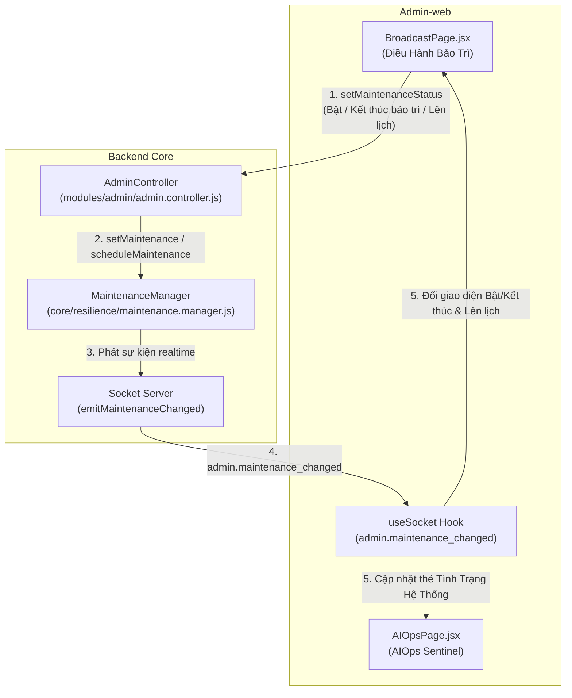

# Kế Hoạch Triển Khai: Hiển Thị Tình Trạng Hệ Thống AIOps & Đồng Bộ Trạng Thái Bảo Trì Broadcast

> **Dành cho Agentic Workers:** BẮT BUỘC tuân thủ Rule 6 & Karpathy Guidelines. Kế hoạch này được đệ trình lên Product Owner (PO) để duyệt trước khi thực thi mã nguồn.

**Mục tiêu:**
1. **AIOps Sentinel:** Bổ sung 1 thẻ/tab phía trên tab "Quy Mô Người Dùng Mục Tiêu & Mô Hình Chịu Tải (Target Concurrency Scaler)" hiển thị trực quan tình trạng hệ thống: nếu bình thường là **"Đang hoạt động"** với **Badge xanh lá nhạt**, nếu bảo trì là **"Đang bảo trì"** (kèm thông tin chi tiết và cập nhật realtime qua Socket.io).
2. **Broadcast & Maintenance Management:**
   - Tab "Kích Hoạt Bảo Trì Tức Thì": Khi đang bảo trì, ẩn các nút bật bảo trì, hiển thị trạng thái đang bảo trì và bổ sung nút rõ ràng **"Kết thúc bảo trì"**.
   - Tab "Lên Lịch Thời Điểm Bảo Trì": Bổ sung trường input **"Thời điểm kết thúc bảo trì (Dự kiến)"**.
   - **Kiểm soát chặt chẽ trạng thái & chống xung đột thời gian:** Khi hệ thống đang bảo trì, vô hiệu hóa form lên lịch mới trùng lặp; kiểm tra chặt chẽ thời điểm kết thúc phải diễn ra sau thời điểm bắt đầu; backend hỗ trợ tự động kết thúc bảo trì đúng thời điểm đã hẹn.

---

## Kiến Trúc Hệ Thống & Luồng Dữ Liệu

---

## Chi Tiết Các Nhiệm Vụ Triển Khai (Bite-Sized Tasks)

### Nhiệm Vụ 1: Nâng Cấp Backend MaintenanceManager & Admin Controller
**Mục tiêu:** Bổ sung hỗ trợ `scheduledEndAt`, ngăn chặn lên lịch khi đang bảo trì, và tự động tắt bảo trì khi đến thời điểm kết thúc đã hẹn.

**Tệp tin tác động:**
- Sửa đổi: `src/Backend/core/resilience/maintenance.manager.js`
- Sửa đổi: `src/Backend/modules/admin/admin.controller.js`
- Kiểm thử: `src/Backend/tests/unit/admin.priority.maintenance.test.js`

**Các bước thực hiện:**
- [ ] **Bước 1.1:** Cập nhật hàm `scheduleMaintenance({ scheduledAt, scheduledEndAt, reason, isEmergency, createdBy })` trong `maintenance.manager.js`:
  - Kiểm tra nếu `this.active === true`: ném lỗi `'Hệ thống hiện đang trong phiên bảo trì trực tiếp. Vui lòng kết thúc bảo trì trước khi lên lịch trình mới.'`
  - Nếu có `scheduledEndAt`: kiểm tra `new Date(scheduledEndAt).getTime() <= new Date(scheduledAt).getTime()`, nếu vi phạm ném lỗi `'Thời điểm kết thúc bảo trì phải sau thời điểm bắt đầu bảo trì!'`.
  - Lưu `scheduledEndAt` vào cấu trúc `this.scheduled`.
  - Trong callback timer khởi động bảo trì: nếu có `scheduledEndAt`, lập timer phụ tự động gọi `this.setMaintenance(false, 'Hết thời gian bảo trì định kỳ theo lịch hẹn', 'Hệ thống tự động')` khi đến `scheduledEndAt`.
- [ ] **Bước 1.2:** Cập nhật `admin.controller.js`: trích xuất `scheduledEndAt` từ `req.body` và truyền vào `defaultMaintenanceManager.scheduleMaintenance(...)`.
- [ ] **Bước 1.3:** Viết unit test mới trong `admin.priority.maintenance.test.js` kiểm chứng:
  - Lên lịch có cả `scheduledAt` và `scheduledEndAt` hợp lệ.
  - Bắt lỗi khi `scheduledEndAt <= scheduledAt`.
  - Bắt lỗi khi cố lên lịch trong lúc `active === true`.
- [ ] **Bước 1.4:** Chạy kiểm thử: `rtk node --test tests/unit/admin.priority.maintenance.test.js`.

---

### Nhiệm Vụ 2: Nâng Cấp BroadcastPage (Nút "Kết Thúc Bảo Trì" & Input "Thời Điểm Kết Thúc")
**Mục tiêu:**
- Bổ sung nút **"Kết thúc bảo trì"** rõ ràng ở tab Bật tức thì khi đang bảo trì, ẩn các nút bật bảo trì trùng lặp.
- Bổ sung input **"Thời điểm kết thúc bảo trì"** ở tab Lên lịch.
- Chặn lên lịch khi hệ thống đang trong phiên bảo trì.

**Tệp tin tác động:**
- Sửa đổi: `src/Admin-web/src/pages/system/BroadcastPage.jsx`
- Kiểm thử: `src/Admin-web/src/tests/broadcast.page.test.jsx`

**Các bước thực hiện:**
- [ ] **Bước 2.1:** Thêm state `scheduleEndDatetime` trong `BroadcastPage.jsx`.
- [ ] **Bước 2.2:** Cập nhật Cột Trái ("Kích Hoạt Bảo Trì Tức Thì"):
  - Khi `maintenance.active === true`:
    * Hiển thị bảng chi tiết trạng thái bảo trì (Lý do, loại bảo trì Khẩn cấp/Kỹ thuật, người kích hoạt, thời điểm bắt đầu).
    * Tuyệt đối không hiển thị nút "Bật bảo trì".
    * Hiển thị nút bấm to, rõ ràng: **"Kết thúc bảo trì — Khôi phục hệ thống"** (Màu xanh emerald hoặc đỏ an toàn, icon `power_settings_new` / `check_circle`).
- [ ] **Bước 2.3:** Cập nhật Cột Phải ("Lên Lịch Thời Điểm Bảo Trì"):
  - Khi `maintenance.active === true`:
    * Hiển thị cảnh báo: `⚠️ Hệ thống hiện đang trong chế độ bảo trì trực tiếp. Không thể thiết lập lịch bảo trì mới để tránh xung đột thời gian. Vui lòng kết thúc phiên bảo trì hiện tại trước khi lên lịch.`
    * Vô hiệu hóa nút Submit hoặc ẩn form lên lịch.
  - Khi `maintenance.active === false`:
    * Bổ sung input `datetime-local`: `Thời điểm kết thúc bảo trì (Dự kiến)` với `min={scheduleDatetime || currentLocalIso}`.
    * Khi submit `handleSaveSchedule`: kiểm tra `new Date(scheduleEndDatetime) <= new Date(scheduleDatetime)` thì hiển thị thông báo lỗi ngay trên giao diện, không gửi request sai lên server.
    * Gửi `scheduledEndAt: new Date(scheduleEndDatetime).toISOString()` lên server.
- [ ] **Bước 2.4:** Cập nhật hiển thị lịch hẹn hiện có: hiển thị cả thời điểm bắt đầu và thời điểm kết thúc dự kiến (`scheduledEndAt`).
- [ ] **Bước 2.5:** Bổ sung test cases trong `broadcast.page.test.jsx`:
  - Test hiển thị nút "Kết thúc bảo trì" khi `maintenance.active = true` và gọi `setMaintenanceStatus({ active: false })`.
  - Test nhập và gửi `scheduleEndDatetime`.
  - Test cảnh báo và vô hiệu hóa lên lịch khi đang bảo trì.
- [ ] **Bước 2.6:** Chạy kiểm thử: `rtk npm test` trong `src/Admin-web`.

---

### Nhiệm Vụ 3: Thêm Tab/Thẻ "Tình Trạng Hệ Thống" Phía Trên Target Concurrency Scaler trong AIOpsPage
**Mục tiêu:** Hiển thị tình trạng hệ thống theo đúng chuẩn PO: **"Đang hoạt động"** với **Badge xanh lá nhạt** khi bình thường, **"Đang bảo trì"** khi có bảo trì; đồng bộ realtime.

**Tệp tin tác động:**
- Sửa đổi: `src/Admin-web/src/pages/system/AIOpsPage.jsx`
- Kiểm thử: `src/Admin-web/src/tests/aiops.page.test.jsx`

**Các bước thực hiện:**
- [ ] **Bước 3.1:** Thêm state `maintenanceStatus` trong `AIOpsPage.jsx`.
- [ ] **Bước 3.2:** Tích hợp `adminApi.getMaintenanceStatus()` vào `fetchAIOpsData()` để lấy trạng thái bảo trì ngay khi vào trang.
- [ ] **Bước 3.3:** Đăng ký lắng nghe sự kiện Socket.io:
  - `socket.on('admin.maintenance_changed', (mState) => setMaintenanceStatus(mState))`
  - `socket.on('system.maintenance_changed', (mState) => setMaintenanceStatus(mState))`
- [ ] **Bước 3.4:** Thiết kế và chèn Thẻ **"Tình Trạng Hệ Thống"** ngay phía trên `KHỐI 0: BỘ ĐIỀU KHIỂN QUY MÔ NGƯỜI DÙNG & MÔ HÌNH CHỊU TẢI DUNG LƯỢNG (Target Concurrency Scaler)`:
  - **Trường hợp 1: Hệ thống hoạt động bình thường (`!maintenanceStatus?.active`):**
    * Thẻ nền `border border-emerald-300 bg-emerald-50/80 p-4 rounded-2xl shadow-xs`.
    * Tiêu đề: **TÌNH TRẠNG HỆ THỐNG: ĐANG HOẠT ĐỘNG**
    * Badge: **Xanh lá nhạt** (`bg-emerald-100 text-emerald-800 border border-emerald-300 font-bold px-3 py-1 rounded-full text-xs flex items-center gap-1.5` với chấm tròn xanh `w-2 h-2 rounded-full bg-emerald-500`).
    * Mô tả: "Các tiến trình lõi, lưu lượng và kết nối Client-app & Admin-web đang vận hành trơn tru không bị giới hạn."
    * Các chip thông tin nhanh: `Quy mô: ${targetConcurrency} CCU`, `Chỉ số đe dọa: ${threatScore}/100 (An toàn)`, `Bảo trì: Sẵn sàng`.
  - **Trường hợp 2: Hệ thống đang bảo trì (`maintenanceStatus?.active === true`):**
    * Thẻ nền `border border-amber-300 bg-amber-50/90 text-amber-950 p-4 rounded-2xl shadow-xs` (hoặc viền đỏ nếu là Khẩn cấp).
    * Tiêu đề: **TÌNH TRẠNG HỆ THỐNG: ĐANG BẢO TRÌ**
    * Badge: `bg-amber-200 text-amber-900 border border-amber-400 font-bold px-3 py-1 rounded-full text-xs flex items-center gap-1.5` (hoặc `bg-red-200 text-red-900` nếu khẩn cấp).
    * Mô tả: Hiển thị lý do bảo trì, người kích hoạt, thời điểm kích hoạt.
    * Nút hành động trực tiếp: "Chuyển tới Điều Hành Bảo Trì" (Link `/broadcast`) hoặc nút "Kết Thúc Bảo Trì Ngay".
- [ ] **Bước 3.5:** Bổ sung test cases trong `aiops.page.test.jsx`:
  - Test hiển thị thẻ "Đang hoạt động" kèm Badge xanh lá nhạt khi không bảo trì.
  - Test hiển thị thẻ "Đang bảo trì" khi nhận dữ liệu hoặc sự kiện Socket bảo trì.
- [ ] **Bước 3.6:** Chạy kiểm thử: `rtk npm test` trong `src/Admin-web`.

---

### Nhiệm Vụ 4: Tự Kiểm Tra Toàn Diện, Cập Nhật Tài Liệu & CodeGraph (Rule 8)
- [ ] **Bước 4.1:** Chạy toàn bộ test suites:
  - `rtk npm run test:v2` trong `src/Backend`.
  - `rtk node --test tests/unit/*.test.js` trong `src/Backend`.
  - `rtk npm test` trong `src/Admin-web`.
- [ ] **Bước 4.2:** Cập nhật mục 11.61 trong `Project.md`.
- [ ] **Bước 4.3:** Chạy `rtk npx codegraph build` đồng bộ codebase.
- [ ] **Bước 4.4:** Báo cáo nghiệm thu tới PO.
