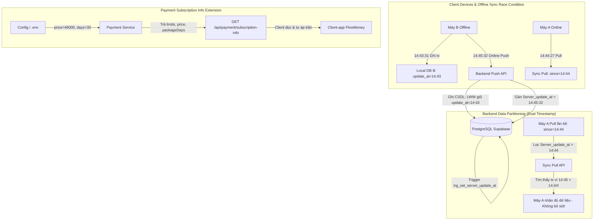

# Giải Quyết Dứt Điểm Tồn Đọng CAN-LAM (Mục 37 Đồng Bộ Đẩy Muộn & Mục 38 PayOS Premium) Implementation Plan

> **For agentic workers:** REQUIRED SUB-SKILL: Use superpowers:subagent-driven-development to implement this plan task-by-task. Steps use checkbox (`- [x]`) syntax for tracking.

**Goal:** Khắc phục triệt để lỗi bỏ sót bản ghi đẩy muộn khi kéo về (`/sync/pull`) bằng cột giờ server `Server_update_at` cho 6 bảng đồng bộ, bổ sung cấu hình đặc quyền (`limits`, `price`, `packageDays`) vào API `/subscription-info`, đính chính 5 điểm tài liệu PayOS và đóng hoàn tất các mục tồn đọng trong `CAN-LAM`.

**Architecture:** 
- Phân định rạch ròi 2 mốc thời gian: `update_at` (giờ máy do client cấp, làm khoá phân xử Last-Write-Wins LWW) và `Server_update_at` (giờ server ghi nhận thực tế trên Cloud PostgreSQL, dùng làm điều kiện lọc delta `/sync/pull` và checkpoint `maxSince`). Bổ sung cột và index `(Idaccount, Server_update_at)` trên 6 bảng đồng bộ (`category`, `wallet`, `transaction`, `budget`, `bill`, `goal`) kèm trigger tự động cập nhật khi update.
- Mở rộng payload `GET /api/payment/subscription-info` trả thêm `limits: { wallets: 3, budgets: 3, goals: 3 }`, `price` và `packageDays` từ cấu hình hệ thống, cho phép client tự thi hành trần gói mà không cần hardcode. Đính chính tài liệu tích hợp PayOS khớp 100% với mã nguồn hiện tại.
- Di chuyển các mục đã hoàn tất sang thư mục lưu trữ `DA-XONG/`, cập nhật `Project.md` và tái lập chỉ mục CodeGraph.

**Architecture Diagram:**



**Tech Stack:** Node.js, Express, Prisma ORM, PostgreSQL (Supabase Cloud), Jest/Node:test, Socket.IO.

## Global Constraints

- Tuân thủ **Rule 10 (DB Guard)**: CẤM chạy `prisma migrate dev` hoặc `prisma db push` trên Supabase Cloud. Mọi thay đổi DDL CSDL phải qua file SQL trong `src/Backend/database/` và script thực thi có kiểm soát.
- Tuân thủ **Rule 2 (RTK)**: Mọi lệnh shell/CLI bắt buộc dùng tiền tố `rtk`.
- Tuân thủ **Rule 9 (Data Security & Nghị định 13/2023/NĐ-CP)**: Dữ liệu nhạy cảm được bảo vệ, mọi truy vấn đều user-scoped.
- **Không thay đổi cơ chế LWW**: `update_at` giữ nguyên giá trị máy gửi lên để so sánh bản ghi nào mới hơn.

---

### Task 1: Tạo Migration DDL SQL 20 và Script Áp Dụng Cột `Server_update_at` Cho 6 Bảng Đồng Bộ

**Files:**
- Create: [`src/Backend/database/20_add_server_update_at_sync_tables.sql`](file:///d:/Tai_Lieu_IUH/Tailieu_Nam5_HK1/DoAnTotNghiep/Personal_Finance_Management/src/Backend/database/20_add_server_update_at_sync_tables.sql)
- Create: [`src/Backend/scripts/apply_migration_20.js`](file:///d:/Tai_Lieu_IUH/Tailieu_Nam5_HK1/DoAnTotNghiep/Personal_Finance_Management/src/Backend/scripts/apply_migration_20.js)

**Interfaces:**
- Consumes: CSDL PostgreSQL Supabase hiện tại qua `DATABASE_URL` / `DIRECT_URL`.
- Produces: Cột `Server_update_at TIMESTAMP(6) NOT NULL DEFAULT CURRENT_TIMESTAMP` và các index trên 6 bảng: `category`, `wallet`, `transaction`, `budget`, `bill`, `goal`.

- [x] **Step 1: Viết file SQL DDL Migration 20**

Viết file [`src/Backend/database/20_add_server_update_at_sync_tables.sql`](file:///d:/Tai_Lieu_IUH/Tailieu_Nam5_HK1/DoAnTotNghiep/Personal_Finance_Management/src/Backend/database/20_add_server_update_at_sync_tables.sql):

```sql
-- ============================================================================
-- Migration 20: Thêm cột Server_update_at cho 6 bảng đồng bộ
-- Mục đích: Tách mốc thời gian nhận của server phục vụ /sync/pull delta
-- khỏi mốc update_at của máy dùng cho Last-Write-Wins (LWW) (Mục 37 CAN-LAM)
-- ============================================================================

-- 1. Thêm cột Server_update_at (nếu chưa có)
ALTER TABLE IF EXISTS "category"
  ADD COLUMN IF NOT EXISTS "Server_update_at" TIMESTAMP(6) NOT NULL DEFAULT CURRENT_TIMESTAMP;

ALTER TABLE IF EXISTS "wallet"
  ADD COLUMN IF NOT EXISTS "Server_update_at" TIMESTAMP(6) NOT NULL DEFAULT CURRENT_TIMESTAMP;

ALTER TABLE IF EXISTS "budget"
  ADD COLUMN IF NOT EXISTS "Server_update_at" TIMESTAMP(6) NOT NULL DEFAULT CURRENT_TIMESTAMP;

ALTER TABLE IF EXISTS "bill"
  ADD COLUMN IF NOT EXISTS "Server_update_at" TIMESTAMP(6) NOT NULL DEFAULT CURRENT_TIMESTAMP;

ALTER TABLE IF EXISTS "goal"
  ADD COLUMN IF NOT EXISTS "Server_update_at" TIMESTAMP(6) NOT NULL DEFAULT CURRENT_TIMESTAMP;

ALTER TABLE IF EXISTS "transaction"
  ADD COLUMN IF NOT EXISTS "Server_update_at" TIMESTAMP(6) NOT NULL DEFAULT CURRENT_TIMESTAMP;

-- 2. Đồng bộ giá trị ban đầu cho các bản ghi cũ từ Update_at
UPDATE "category" SET "Server_update_at" = "Update_at" WHERE "Server_update_at" = CURRENT_TIMESTAMP AND "Update_at" IS NOT NULL;
UPDATE "wallet" SET "Server_update_at" = "Update_at" WHERE "Server_update_at" = CURRENT_TIMESTAMP AND "Update_at" IS NOT NULL;
UPDATE "budget" SET "Server_update_at" = "Update_at" WHERE "Server_update_at" = CURRENT_TIMESTAMP AND "Update_at" IS NOT NULL;
UPDATE "bill" SET "Server_update_at" = "Update_at" WHERE "Server_update_at" = CURRENT_TIMESTAMP AND "Update_at" IS NOT NULL;
UPDATE "goal" SET "Server_update_at" = "Update_at" WHERE "Server_update_at" = CURRENT_TIMESTAMP AND "Update_at" IS NOT NULL;
UPDATE "transaction" SET "Server_update_at" = "Update_at" WHERE "Server_update_at" = CURRENT_TIMESTAMP AND "Update_at" IS NOT NULL;

-- 3. Tạo chỉ mục hỗ trợ truy vấn kéo delta theo account và Server_update_at
CREATE INDEX IF NOT EXISTS "idx_category_server_updated" ON "category" ("Create_by", "Server_update_at");
CREATE INDEX IF NOT EXISTS "idx_wallet_server_updated" ON "wallet" ("Idaccount", "Server_update_at");
CREATE INDEX IF NOT EXISTS "idx_budget_server_updated" ON "budget" ("Idaccount", "Server_update_at");
CREATE INDEX IF NOT EXISTS "idx_bill_server_updated" ON "bill" ("Idaccount", "Server_update_at");
CREATE INDEX IF NOT EXISTS "idx_goal_server_updated" ON "goal" ("Idaccount", "Server_update_at");
CREATE INDEX IF NOT EXISTS "idx_transaction_server_updated" ON "transaction" ("Idaccount", "Server_update_at");

-- 4. Tạo Trigger Function tự động gán Server_update_at = CURRENT_TIMESTAMP khi bản ghi được UPDATE
CREATE OR REPLACE FUNCTION set_server_update_at()
RETURNS TRIGGER AS $$
BEGIN
  NEW."Server_update_at" = CURRENT_TIMESTAMP;
  RETURN NEW;
END;
$$ LANGUAGE plpgsql;

-- 5. Gắn Trigger vào 6 bảng đồng bộ
DROP TRIGGER IF EXISTS trg_set_server_update_at_category ON "category";
CREATE TRIGGER trg_set_server_update_at_category
BEFORE UPDATE ON "category"
FOR EACH ROW EXECUTE FUNCTION set_server_update_at();

DROP TRIGGER IF EXISTS trg_set_server_update_at_wallet ON "wallet";
CREATE TRIGGER trg_set_server_update_at_wallet
BEFORE UPDATE ON "wallet"
FOR EACH ROW EXECUTE FUNCTION set_server_update_at();

DROP TRIGGER IF EXISTS trg_set_server_update_at_budget ON "budget";
CREATE TRIGGER trg_set_server_update_at_budget
BEFORE UPDATE ON "budget"
FOR EACH ROW EXECUTE FUNCTION set_server_update_at();

DROP TRIGGER IF EXISTS trg_set_server_update_at_bill ON "bill";
CREATE TRIGGER trg_set_server_update_at_bill
BEFORE UPDATE ON "bill"
FOR EACH ROW EXECUTE FUNCTION set_server_update_at();

DROP TRIGGER IF EXISTS trg_set_server_update_at_goal ON "goal";
CREATE TRIGGER trg_set_server_update_at_goal
BEFORE UPDATE ON "goal"
FOR EACH ROW EXECUTE FUNCTION set_server_update_at();

DROP TRIGGER IF EXISTS trg_set_server_update_at_transaction ON "transaction";
CREATE TRIGGER trg_set_server_update_at_transaction
BEFORE UPDATE ON "transaction"
FOR EACH ROW EXECUTE FUNCTION set_server_update_at();
```

- [x] **Step 2: Viết script Node.js thực thi và kiểm tra an toàn `apply_migration_20.js`**

Viết file [`src/Backend/scripts/apply_migration_20.js`](file:///d:/Tai_Lieu_IUH/Tailieu_Nam5_HK1\DoAnTotNghiep\Personal_Finance_Management\src\Backend\scripts\apply_migration_20.js):

```javascript
const path = require('path');
require('dotenv').config({ path: path.join(__dirname, '../.env') });
const { Client } = require('pg');
const fs = require('fs');

async function run() {
  const connectionString = process.env.DIRECT_URL || process.env.DATABASE_URL;
  if (!connectionString) {
    console.error('❌ DATABASE_URL or DIRECT_URL not found in .env');
    process.exit(1);
  }

  const client = new Client({ connectionString });
  try {
    await client.connect();
    console.log('✔ Connected to PostgreSQL Supabase database');

    console.log('⏳ Applying Migration 20: 20_add_server_update_at_sync_tables.sql...');
    const sqlPath = path.join(__dirname, '../database/20_add_server_update_at_sync_tables.sql');
    const sql = fs.readFileSync(sqlPath, 'utf8');
    await client.query(sql);
    console.log('✔ Migration 20 executed successfully!');

    // Xác minh kiểm tra cấu trúc CSDL thực tế
    console.log('\n🔍 Verifying Database Schema Changes on Supabase...');
    const tables = ['category', 'wallet', 'budget', 'bill', 'goal', 'transaction'];
    for (const tbl of tables) {
      const colCheck = await client.query(`
        SELECT column_name, data_type, is_nullable
        FROM information_schema.columns 
        WHERE table_name = $1 AND column_name = 'Server_update_at';
      `, [tbl]);
      if (colCheck.rows.length > 0) {
        console.log(`✔ Verified: Column "${tbl}.Server_update_at" exists.`);
      } else {
        throw new Error(`Column "${tbl}.Server_update_at" was not created!`);
      }
    }

    console.log('\n🎉 ALL MIGRATION 20 CHANGES VERIFIED 100% SUCCESSFUL!\n');
  } catch (err) {
    console.error('❌ Migration 20 failed:', err.message);
    process.exit(1);
  } finally {
    await client.end();
  }
}

run();
```

- [x] **Step 3: Chạy script áp dụng migration vào CSDL Supabase**

Run: `rtk node scripts/apply_migration_20.js` (Cwd: `src/Backend`)  
Expected: `ALL MIGRATION 20 CHANGES VERIFIED 100% SUCCESSFUL!`

- [x] **Step 4: Commit Migration 20**

```bash
rtk git add database/20_add_server_update_at_sync_tables.sql scripts/apply_migration_20.js
rtk git commit -m "feat(db): add Server_update_at column and triggers for sync tables (migration 20)"
```

---

### Task 2: Cập Nhật Prisma Schema và Tái Tạo Prisma Client

**Files:**
- Modify: [`src/Backend/prisma/schema.prisma:122-125`](file:///d:/Tai_Lieu_IUH/Tailieu_Nam5_HK1/DoAnTotNghiep\Personal_Finance_Management\src\Backend\prisma\schema.prisma#L122-L125) (bảng `category`)
- Modify: [`src/Backend/prisma/schema.prisma:177-180`](file:///d:/Tai_Lieu_IUH/Tailieu_Nam5_HK1/DoAnTotNghiep\Personal_Finance_Management\src\Backend\prisma\schema.prisma#L177-L180) (bảng `wallet`)
- Modify: [`src/Backend/prisma/schema.prisma:211-214`](file:///d:/Tai_Lieu_IUH/Tailieu_Nam5_HK1/DoAnTotNghiep\Personal_Finance_Management\src\Backend\prisma\schema.prisma#L211-L214) (bảng `budget`)
- Modify: [`src/Backend/prisma/schema.prisma:244-247`](file:///d:/Tai_Lieu_IUH/Tailieu_Nam5_HK1/DoAnTotNghiep\Personal_Finance_Management\src\Backend\prisma\schema.prisma#L244-L247) (bảng `bill`)
- Modify: [`src/Backend/prisma/schema.prisma:284-287`](file:///d:/Tai_Lieu_IUH/Tailieu_Nam5_HK1/DoAnTotNghiep\Personal_Finance_Management\src\Backend\prisma\schema.prisma#L284-L287) (bảng `goal`)
- Modify: [`src/Backend/prisma/schema.prisma:313-316`](file:///d:/Tai_Lieu_IUH/Tailieu_Nam5_HK1/DoAnTotNghiep\Personal_Finance_Management\src\Backend\prisma\schema.prisma#L313-L316) (bảng `transaction`)

**Interfaces:**
- Consumes: CSDL PostgreSQL đã có cột `Server_update_at`.
- Produces: Prisma Client types có field `server_update_at` trên cả 6 models.

- [x] **Step 1: Cập nhật `schema.prisma` cho 6 model**

Thêm trường:
```prisma
  server_update_at DateTime @default(now()) @db.Timestamp(6) @map("Server_update_at")
```
vào các model: `category`, `wallet`, `budget`, `bill`, `goal`, `transaction`. Đồng thời thêm index:
```prisma
  @@index([create_by, server_update_at], map: "idx_category_server_updated") // model category
  @@index([idaccount, server_update_at], map: "idx_wallet_server_updated")   // model wallet
  @@index([idaccount, server_update_at], map: "idx_budget_server_updated")   // model budget
  @@index([idaccount, server_update_at], map: "idx_bill_server_updated")     // model bill
  @@index([idaccount, server_update_at], map: "idx_goal_server_updated")     // model goal
  @@index([idaccount, server_update_at], map: "idx_transaction_server_updated") // model transaction
```

- [x] **Step 2: Chạy `prisma:generate` để cập nhật Prisma Client**

Run: `rtk npm run prisma:generate` (Cwd: `src/Backend`)  
Expected: `✔ Generated Prisma Client` thành công, không gặp cảnh báo lỗi cú pháp.

- [x] **Step 3: Commit cập nhật schema**

```bash
rtk git add prisma/schema.prisma
rtk git commit -m "feat(prisma): add server_update_at to sync models in schema.prisma"
```

---

### Task 3: Cập Nhật `sync.repository.js` và `sync.service.js` Phục Vụ Kéo Delta Theo Giờ Server

**Files:**
- Modify: [`src/Backend/modules/sync/sync.repository.js`](file:///d:/Tai_Lieu_IUH/Tailieu_Nam5_HK1/DoAnTotNghiep\Personal_Finance_Management\src\Backend\modules\sync\sync.repository.js)
- Modify: [`src/Backend/modules/sync/sync.service.js`](file:///d:/Tai_Lieu_IUH/Tailieu_Nam5_HK1/DoAnTotNghiep\Personal_Finance_Management\src\Backend\modules\sync\sync.service.js)
- Test: [`src/Backend/tests/v2/sync.engine.test.js`](file:///d:/Tai_Lieu_IUH/Tailieu_Nam5_HK1/DoAnTotNghiep\Personal_Finance_Management\src\Backend\tests\v2\sync.engine.test.js)

**Interfaces:**
- Consumes: `since` (mốc ISO thời gian pull từ client).
- Produces:
  - `get*ByAccount(idaccount, since)`: lọc `server_update_at: since ? { gt: new Date(since) } : undefined`, `orderBy: { server_update_at: 'asc' }`.
  - Mọi thao tác ghi (`create`, `update`, `softDelete`): gán `server_update_at: new Date()`.
  - `processPull(idaccount, since, entities)`: tính `maxSince` từ `server_update_at`.

- [x] **Step 1: Viết test kiểm tra tính đúng đắn của delta pull với `server_update_at`**

Thêm describe block vào [`src/Backend/tests/v2/sync.engine.test.js`](file:///d:/Tai_Lieu_IUH/Tailieu_Nam5_HK1/DoAnTotNghiep\Personal_Finance_Management\src\Backend\tests\v2\sync.engine.test.js):

```javascript
  // ─── 5. SERVER_UPDATE_AT DELTA PULL (MỤC 37 FIX) ────────────────────────
  describe('5. Delta Pull Sync với Server_update_at (Khắc phục bỏ sót bản ghi đẩy muộn)', () => {
    it('5.1. processPull tính maxSince dựa trên server_update_at lớn nhất của batch', async () => {
      const syncRepo = require('../../modules/sync/sync.repository');
      const origGetWallets = syncRepo.getWalletsByAccount;

      const serverTime1 = new Date('2026-10-05T07:45:00.000Z');
      const serverTime2 = new Date('2026-10-05T07:45:32.000Z');

      syncRepo.getWalletsByAccount = async (idaccount, since) => [
        { idwallet: validUUID1, name: 'Ví 1', update_at: new Date('2026-10-05T07:43:00.000Z'), server_update_at: serverTime1 },
        { idwallet: validUUID2, name: 'Ví 2', update_at: new Date('2026-10-05T07:43:30.000Z'), server_update_at: serverTime2 },
      ];

      try {
        const pullRes = await syncService.processPull(1, '2026-10-05T07:44:00.000Z', ['wallet']);
        assert.strictEqual(pullRes.data.wallets.length, 2);
        assert.strictEqual(pullRes.maxSince.wallet, serverTime2);
      } finally {
        syncRepo.getWalletsByAccount = origGetWallets;
      }
    });

    it('5.2. getWalletsByAccount lọc theo server_update_at thay vì update_at', async () => {
      // Test kiểm tra tham số gọi prisma findMany của repository
      const { prisma } = require('../../config/db');
      let capturedQuery = null;
      const origFindMany = prisma.wallet.findMany;
      prisma.wallet.findMany = async (args) => {
        capturedQuery = args;
        return [];
      };

      try {
        const syncRepo = require('../../modules/sync/sync.repository');
        await syncRepo.getWalletsByAccount(10, '2026-10-05T07:44:27.000Z');
        assert.ok(capturedQuery.where.server_update_at, 'Query phải lọc theo server_update_at');
        assert.strictEqual(capturedQuery.where.update_at, undefined, 'Query không được lọc theo update_at');
        assert.deepStrictEqual(capturedQuery.orderBy, { server_update_at: 'asc' });
      } finally {
        prisma.wallet.findMany = origFindMany;
      }
    });
  });
```

- [x] **Step 2: Chạy test để xác nhận FAIL trước khi sửa code (Red Phase)**

Run: `rtk npm test -- --testPathPattern="sync.engine"` (Cwd: `src/Backend`)  
Expected: Test 5.1 hoặc 5.2 FAIL (vì repository hiện vẫn query theo `update_at`).

- [x] **Step 3: Sửa `sync.repository.js`**

1. Cập nhật 6 hàm `get*ByAccount`:
   - `getCategoriesByAccount`:
     ```javascript
     return prisma.category.findMany({
       where: {
         OR: [{ is_default: true }, { create_by: idaccount }],
         server_update_at: since ? { gt: new Date(since) } : undefined,
       },
       select: {
         idcategory: true,
         create_by: true,
         name_category: true,
         classify: true,
         is_default: true,
         is_group: true,
         idgroup: true,
         keyword: true,
         icon: true,
         color: true,
         delete_at: true,
         update_at: true,
         server_update_at: true,
       },
       orderBy: { server_update_at: 'asc' },
     });
     ```
   - Tương tự cho `getWalletsByAccount`, `getTransactionsByAccount`, `getBudgetsByAccount`, `getBillsByAccount`, `getGoalsByAccount`: đổi `update_at: since ? ...` thành `server_update_at: since ? ...` và `orderBy: { server_update_at: 'asc' }`.
2. Trong các hàm `upsert*` và `softDelete`:
   - Bổ sung `server_update_at: new Date()` vào mọi khối `create`, `update`, `updateMany` (bên cạnh `update_at`).
   - Giữ nguyên biểu thức LWW: `if (new Date(mapped.update_at) > new Date(existing.update_at))` để máy nào ghi mới hơn thì thắng.

- [x] **Step 4: Sửa `sync.service.js`**

Tại dòng 271-274 của [`src/Backend/modules/sync/sync.service.js`](file:///d:/Tai_Lieu_IUH/Tailieu_Nam5_HK1/DoAnTotNghiep\Personal_Finance_Management\src\Backend\modules\sync\sync.service.js#L271-L274):
```javascript
      // Track max server_update_at per entity for client checkpoint (ưu tiên server_update_at, fallback update_at)
      if (records.length > 0) {
        const lastRecord = records[records.length - 1];
        maxSince[entity] = lastRecord.server_update_at || lastRecord.update_at;
      }
```

- [x] **Step 5: Chạy test kiểm tra PASS (Green Phase)**

Run: `rtk npm test -- --testPathPattern="sync.engine"` (Cwd: `src/Backend`)  
Expected: Toàn bộ test suite PASS 100%.

- [x] **Step 6: Commit code sync repository và service**

```bash
rtk git add modules/sync/sync.repository.js modules/sync/sync.service.js tests/v2/sync.engine.test.js
rtk git commit -m "fix(sync): filter delta pull by server_update_at to eliminate late push drops"
```

---

### Task 4: Bổ Sung Cấu Hình Đặc Quyền (`limits`, `price`, `packageDays`) Vào API `/subscription-info` (Mục 38)

**Files:**
- Modify: [`src/Backend/modules/payment/payment.service.js:234-240`](file:///d:/Tai_Lieu_IUH/Tailieu_Nam5_HK1/DoAnTotNghiep\Personal_Finance_Management\src\Backend\modules\payment\payment.service.js#L234-L240)
- Modify: [`src/Backend/tests/unit/payment.service.test.js:167-194`](file:///d:/Tai_Lieu_IUH/Tailieu_Nam5_HK1/DoAnTotNghiep\Personal_Finance_Management\src\Backend\tests\unit\payment.service.test.js#L167-L194)

**Interfaces:**
- Consumes: `config.payment.premiumPriceVnd`, `config.payment.packageDurationDays`.
- Produces: Payload `GET /api/payment/subscription-info` trả thêm `limits`, `price`, `packageDays`.

- [x] **Step 1: Viết test mở rộng kiểm tra 3 trường trong `payment.service.test.js`**

Sửa test case 5 trong [`src/Backend/tests/unit/payment.service.test.js`](file:///d:/Tai_Lieu_IUH/Tailieu_Nam5_HK1/DoAnTotNghiep\Personal_Finance_Management\src\Backend\tests\unit\payment.service.test.js):

```javascript
    // Kiểm tra các trường mở rộng phục vụ client thi hành đặc quyền (Mục 38 CAN-LAM)
    assert.deepStrictEqual(basicInfo.limits, { wallets: 3, budgets: 3, goals: 3 });
    assert.strictEqual(basicInfo.price, 49000);
    assert.strictEqual(basicInfo.packageDays, 30);
```

- [x] **Step 2: Chạy test để thấy FAIL (Red Phase)**

Run: `rtk npm test -- --testPathPattern="payment.service"` (Cwd: `src/Backend`)  
Expected: FAIL vì `basicInfo.limits` chưa có trong kết quả trả về.

- [x] **Step 3: Triển khai bổ sung 3 trường vào `getSubscriptionInfo` trong `payment.service.js`**

Sửa hàm `getSubscriptionInfo` trong [`src/Backend/modules/payment/payment.service.js`](file:///d:/Tai_Lieu_IUH/Tailieu_Nam5_HK1/DoAnTotNghiep\Personal_Finance_Management\src\Backend\modules\payment\payment.service.js):

```javascript
  return {
    accountType: account.type,
    premiumExpiresAt: account.premium_expires_at,
    daysRemaining,
    isExpired,
    limits: {
      wallets: 3,
      budgets: 3,
      goals: 3,
    },
    price: config.payment.premiumPriceVnd || 49000,
    packageDays: config.payment.packageDurationDays || 30,
  };
```

- [x] **Step 4: Chạy test xác nhận PASS (Green Phase)**

Run: `rtk npm test -- --testPathPattern="payment.service"` (Cwd: `src/Backend`)  
Expected: Toàn bộ 5/5 ca test của `Payment Service Suite` PASS 100%.

- [x] **Step 5: Commit code Payment Service**

```bash
rtk git add modules/payment/payment.service.js tests/unit/payment.service.test.js
rtk git commit -m "feat(payment): add limits, price, and packageDays to subscription-info endpoint"
```

---

### Task 5: Đính Chính 5 Điểm Lệch Mã & Bỏ Chữ "Đồng Bộ Tức Thì" Trong Hướng Dẫn Tích Hợp PayOS

**Files:**
- Modify: [`docs/Payment/CLIENT_INTEGRATION_GUIDE.md`](file:///d:/Tai_Lieu_IUH/Tailieu_Nam5_HK1/DoAnTotNghiep\Personal_Finance_Management\docs\Payment\CLIENT_INTEGRATION_GUIDE.md)
- Modify: [`docs/superpowers/backend/CAN-LAM/CLIENT_INTEGRATION_GUIDE.md`](file:///d:/Tai_Lieu_IUH/Tailieu_Nam5_HK1/DoAnTotNghiep\Personal_Finance_Management\docs\superpowers\backend\CAN-LAM\CLIENT_INTEGRATION_GUIDE.md)

**Interfaces:**
- Đính chính 5 điểm:
  1. Socket event: `account.upgraded` thay vì `payment.success`.
  2. Return URL: trỏ web Admin (`managementfinance-admin.vercel.app/payment/...`).
  3. Base URL: `http://localhost:3000` (thay vì 10000).
  4. Mẫu Flutter: Dùng `DioClient` (`sl<DioClient>().dio`), đã thêm `url_launcher`.
  5. Subscription info: trả `accountType` (thay vì `type`) kèm `limits, price, packageDays`.
  6. Bỏ cụm từ ", đồng bộ đa thiết bị tức thì" ở checklist mục 2.

- [x] **Step 1: Cập nhật tài liệu `docs/Payment/CLIENT_INTEGRATION_GUIDE.md`**

Chỉnh sửa các vị trí tương ứng theo đúng bảng đối soát trong `CLIENT_PREMIUM_PAYOS.md`.

- [x] **Step 2: Cập nhật bản sao `docs/superpowers/backend/CAN-LAM/CLIENT_INTEGRATION_GUIDE.md`**

Đồng bộ nội dung để 2 file tài liệu khớp nhau hoàn toàn.

- [x] **Step 3: Commit cập nhật tài liệu hướng dẫn**

```bash
rtk git add docs/Payment/CLIENT_INTEGRATION_GUIDE.md docs/superpowers/backend/CAN-LAM/CLIENT_INTEGRATION_GUIDE.md
rtk git commit -m "docs(payment): rectify client guide for socket event, return url, dio, and limits"
```

---

### Task 6: Lưu Trữ Mục Đã Xong Vào `DA-XONG/` và Cập Nhật Danh Sách Còn Làm

**Files:**
- Move: [`docs/superpowers/backend/CAN-LAM/CLIENT_NHAC_SAU_APP_NGAN_HANG.md`](file:///d:/Tai_Lieu_IUH/Tailieu_Nam5_HK1/DoAnTotNghiep\Personal_Finance_Management\docs\superpowers\backend\CAN-LAM\CLIENT_NHAC_SAU_APP_NGAN_HANG.md) $\rightarrow$ [`docs/superpowers/backend/DA-XONG/CLIENT_NHAC_SAU_APP_NGAN_HANG.md`](file:///d:/Tai_Lieu_IUH/Tailieu_Nam5_HK1/DoAnTotNghiep\Personal_Finance_Management\docs\superpowers\backend\DA-XONG\CLIENT_NHAC_SAU_APP_NGAN_HANG.md)
- Move: [`docs/superpowers/backend/CAN-LAM/KEO_VE_BO_SOT_BAN_GHI_DAY_MUON.md`](file:///d:/Tai_Lieu_IUH/Tailieu_Nam5_HK1/DoAnTotNghiep\Personal_Finance_Management\docs\superpowers\backend\CAN-LAM\KEO_VE_BO_SOT_BAN_GHI_DAY_MUON.md) $\rightarrow$ [`docs/superpowers/backend/DA-XONG/KEO_VE_BO_SOT_BAN_GHI_DAY_MUON.md`](file:///d:/Tai_Lieu_IUH/Tailieu_Nam5_HK1/DoAnTotNghiep\Personal_Finance_Management\docs\superpowers\backend\DA-XONG\KEO_VE_BO_SOT_BAN_GHI_DAY_MUON.md)
- Move: [`docs/superpowers/backend/CAN-LAM/CLIENT_PREMIUM_PAYOS.md`](file:///d:/Tai_Lieu_IUH/Tailieu_Nam5_HK1/DoAnTotNghiep\Personal_Finance_Management\docs\superpowers\backend\CAN-LAM\CLIENT_PREMIUM_PAYOS.md) $\rightarrow$ [`docs/superpowers/backend/DA-XONG/CLIENT_PREMIUM_PAYOS.md`](file:///d:/Tai_Lieu_IUH/Tailieu_Nam5_HK1/DoAnTotNghiep\Personal_Finance_Management\docs\superpowers\backend\DA-XONG\CLIENT_PREMIUM_PAYOS.md)
- Modify: [`docs/superpowers/backend/CAN-LAM/README.md`](file:///d:/Tai_Lieu_IUH/Tailieu_Nam5_HK1/DoAnTotNghiep\Personal_Finance_Management\docs\superpowers\backend\CAN-LAM\README.md)
- Modify: [`docs/superpowers/backend/DA-XONG/README.md`](file:///d:/Tai_Lieu_IUH/Tailieu_Nam5_HK1/DoAnTotNghiep\Personal_Finance_Management\docs\superpowers\backend\DA-XONG\README.md)

- [x] **Step 1: Di chuyển các file đã hoàn tất sang thư mục `DA-XONG/`**
- [x] **Step 2: Cập nhật `CAN-LAM/README.md` (ghi nhận 0 mục còn tồn đọng)**
- [x] **Step 3: Cập nhật `DA-XONG/README.md` (bổ sung mục 34, 37, 38 vào danh mục đã hoàn thành)**
- [x] **Step 4: Commit lưu trữ tài liệu**

```bash
rtk git add docs/superpowers/backend/
rtk git commit -m "docs: archive items 34, 37, 38 to DA-XONG and update CAN-LAM README"
```

---

### Task 7: Xác Minh Toàn Diện Toàn Bộ Hệ Thống & Cập Nhật Nguồn Sự Thật

**Files:**
- Modify: [`Project.md`](file:///d:/Tai_Lieu_IUH/Tailieu_Nam5_HK1/DoAnTotNghiep\Personal_Finance_Management\Project.md)

- [x] **Step 1: Chạy toàn bộ test suite Backend để đảm bảo 100% PASS**

Run: `rtk npm test` (Cwd: `src/Backend`)  
Expected: Tất cả các test suites PASS (không có regression nào).

- [x] **Step 2: Kiểm tra sức khỏe chỉ mục CSDL**

Run: `rtk npm run db:verify-indexes` (Cwd: `src/Backend`)  
Expected: Toàn bộ Partial Indexes và Triggers an toàn.

- [x] **Step 3: Cập nhật `Project.md`**

Ghi nhận các cải tiến kỹ thuật tại mục 11:
- Cột `Server_update_at` và cơ chế chống bỏ sót bản ghi đẩy muộn của Offline Sync.
- Mở rộng API `/subscription-info` và hoàn tất tích hợp PayOS Client.

- [x] **Step 4: Chạy CodeGraph Build**

Run: `rtk npx codegraph build` (Cwd: thư mục gốc)  
Expected: Chỉ mục CodeGraph cập nhật mới nhất.

- [x] **Step 5: Commit cập nhật cuối cùng**

```bash
rtk git add Project.md
rtk git commit -m "docs: update Project.md with sync late-push fix and payos client completion"
```
