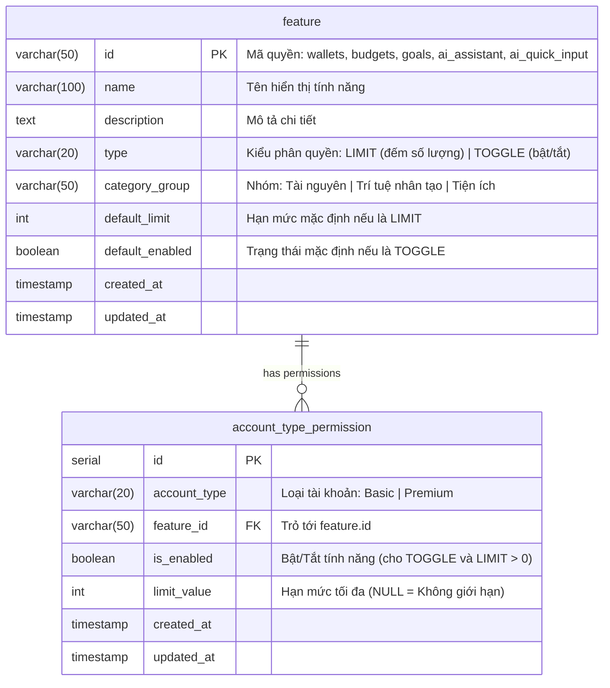

# Kế Hoạch Triển Khai: Bước 3 — Xây Dựng CSDL Khớp Với Bảng Phân Quyền Chức Năng Theo Loại Tài Khoản

> **Dành cho Agentic Workers:** REQUIRED SUB-SKILL: Sử dụng `superpowers:subagent-driven-development` để triển khai kế hoạch này theo từng tác vụ. Các bước sử dụng cú pháp checkbox (`- [ ]`) để theo dõi tiến độ.

**Mục tiêu:** Xây dựng cấu trúc CSDL quan hệ chuẩn mực, an toàn và linh hoạt lưu trữ Danh mục tính năng (`feature`) và Ma trận phân quyền theo loại tài khoản (`account_type_permission`) trên Supabase Cloud, nạp dữ liệu mẫu (seed) khớp 100% với khảo sát của Client-app (Mục 39), và kết nối Backend đọc động cấu hình từ CSDL thay cho hardcode.

---

## 1. Thiết Kế Lược Đồ CSDL (ERD & Data Dictionary)



### Dữ Liệu Khởi Tạo (Seed Data) Khớp Khảo Sát Bước 1 & 2:
| `feature_id` | `name` | `type` | `category_group` | Cấu hình cho `Basic` | Cấu hình cho `Premium` |
|---|---|---|---|---|---|
| `wallets` | Tạo ví | `LIMIT` | Tài nguyên | `limit_value = 3`, `is_enabled = true` | `limit_value = NULL`, `is_enabled = true` |
| `budgets` | Tạo ngân sách | `LIMIT` | Tài nguyên | `limit_value = 3`, `is_enabled = true` | `limit_value = NULL`, `is_enabled = true` |
| `goals` | Tạo mục tiêu tiết kiệm | `LIMIT` | Tài nguyên | `limit_value = 3`, `is_enabled = true` | `limit_value = NULL`, `is_enabled = true` |
| `ai_assistant` | Trợ lý AI & Lệnh tạo | `TOGGLE` | Trí tuệ nhân tạo | `limit_value = NULL`, `is_enabled = false` | `limit_value = NULL`, `is_enabled = true` |
| `ai_quick_input` | Nhập nhanh bằng câu | `TOGGLE` | Trí tuệ nhân tạo | `limit_value = NULL`, `is_enabled = false` | `limit_value = NULL`, `is_enabled = true` |

---

## 2. Hợp Đồng Dữ Liệu API Phía Backend (Đáp ứng Bước 4 & Bước 5)

Mở rộng `GET /api/payment/subscription-info` trả về cấu hình đọc trực tiếp từ CSDL theo gói của tài khoản:
```json
{
  "accountType": "Basic",
  "premiumExpiresAt": null,
  "daysRemaining": 0,
  "isExpired": true,
  "limits": {
    "wallets": 3,
    "budgets": 3,
    "goals": 3
  },
  "features": {
    "ai_assistant": false,
    "ai_quick_input": false
  },
  "price": 49000,
  "packageDays": 30
}
```
* Nếu tài khoản là `Premium` và còn hạn: `limits` trả `{ wallets: null, budgets: null, goals: null }` (hoặc không giới hạn), `features` trả `{ ai_assistant: true, ai_quick_input: true }`.
* Nếu tài khoản là `Basic` (hoặc `Premium` đã hết hạn): đọc trực tiếp cấu hình của gói `Basic` trong CSDL.

---

## 3. Ràng Buộc Kỹ Thuật

- **Rule 10 (DB Guard):** CẤM `prisma migrate dev` hay `prisma db push` trên Supabase Cloud. Thực thi DDL qua script `scripts/apply_migration_22.js`.
- **Rule 2 (RTK):** Dùng prefix `rtk` cho mọi lệnh CLI.
- **Rule 9 (Data Security):** Không làm ảnh hưởng tới partial indexes hay các triggers bảo mật hiện hữu.

---

## 4. Danh Sách Tác Vụ Chi Tiết

### Tác Vụ 1: Viết File Migration DDL SQL 22 Kèm Seed Data
**Files:**
- Create: `src/Backend/database/22_create_feature_permission_tables.sql`

- [x] Tạo bảng `feature` và `account_type_permission` với đầy đủ ràng buộc khóa ngoại, unique index `(account_type, feature_id)`.
- [x] Chèn seed data cho 5 tính năng cốt lõi cho cả 2 loại tài khoản `Basic` và `Premium`.

### Tác Vụ 2: Thực Thi Migration 22 Lên CSDL Cloud Supabase
**Files:**
- Create: `src/Backend/scripts/apply_migration_22.js`

- [x] Viết script thực thi giao tác `BEGIN ... COMMIT` an toàn trên `DIRECT_URL` / `DATABASE_URL`.
- [x] Chạy lệnh `rtk node src/Backend/scripts/apply_migration_22.js`.
- [x] Kiểm tra xác nhận bảng và dữ liệu đã nạp đầy đủ vào Supabase Tokyo Database.

### Tác Vụ 3: Cập Nhật Prisma Schema & Sinh Prisma Client
**Files:**
- Modify: `src/Backend/prisma/schema.prisma`

- [x] Khai báo 2 model `feature` và `account_type_permission`.
- [x] Chạy `rtk npx prisma generate`.

### Tác Vụ 4: Xây Dựng Tầng Repository/Service Đọc Quyền Động Tại Backend
**Files:**
- Create: `src/Backend/modules/payment/permission.repository.js`
- Modify: `src/Backend/modules/payment/payment.service.js`

- [x] Xây dựng hàm `getPermissionsByAccountType(accountType)` đọc CSDL và nhóm thành `limits` + `features`.
- [x] Cập nhật `getSubscriptionInfo(idaccount)` trong `payment.service.js` gọi repository để lấy cấu hình động, có cơ chế fallback an toàn.

### Tác Vụ 5: Viết Test Tự Động & Thẩm Định
**Files:**
- Create: `src/Backend/tests/unit/permission.repository.test.js`
- Modify: `src/Backend/tests/unit/payment.service.test.js`

- [x] Kiểm thử trường hợp Basic: nhận đúng `limits 3/3/3` và `ai_* false`.
- [x] Kiểm thử trường hợp Premium: nhận đúng `limits null` và `ai_* true`.
- [x] Kiểm thử trường hợp CSDL rỗng/lỗi: kích hoạt fallback an toàn.
- [x] Chạy `rtk npm test` toàn bộ backend (251/251 tests PASS 100%).

### Tác Vụ 6: Cập Nhật Tài Liệu Nguồn Sự Thật & CodeGraph
**Files:**
- Modify: `Project.md`

- [x] Cập nhật mục 11.71 trong `Project.md`.
- [x] Chạy `rtk npx codegraph build`.
