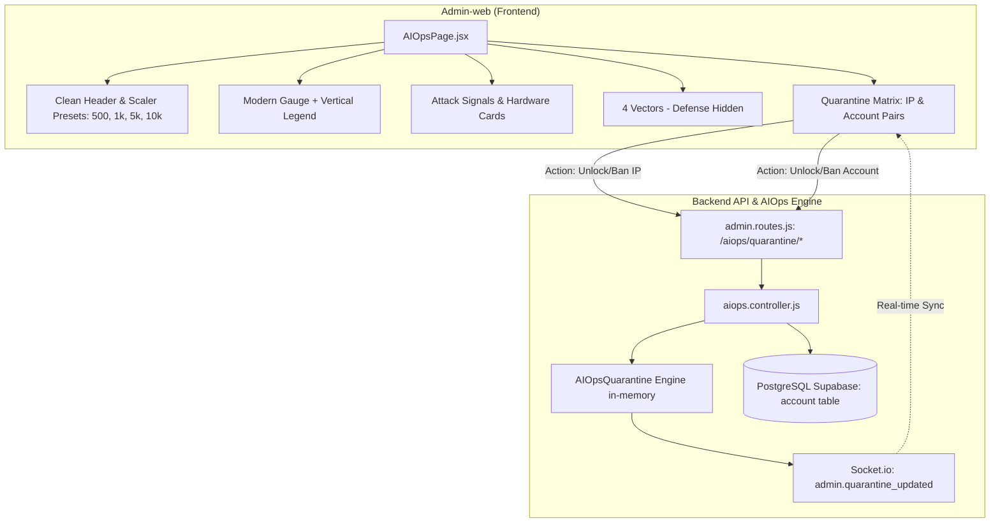

# AIOps Sentinel UI Refinement & Quarantine Matrix Implementation Plan

> **For agentic workers:** REQUIRED SUB-SKILL: Use superpowers:subagent-driven-development to implement this plan task-by-task. Steps use checkbox (`- [ ]`) syntax for tracking.

**Goal:** Hoàn thiện 15 điểm tinh chỉnh thẩm mỹ giao diện trang AIOps của `Admin-web` (loại bỏ text rườm rà, tái cấu trúc layout hiện đại, che giấu cơ chế phòng vệ nội bộ) và nâng cấp nghiệp vụ `Active Quarantine` ở cả Backend lẫn Frontend quản lý theo cặp `(IP, Tài khoản)` với khả năng khóa/mở khóa độc lập và đồng bộ hóa đa liên kết thời gian thực.

**Architecture:**
- **Frontend (`src/Admin-web`):** Tái cấu trúc layout [AIOpsPage.jsx](file:///d:/Tai_Lieu_IUH/Tailieu_Nam5_HK1/DoAnTotNghiep/Personal_Finance_Management/src/Admin-web/src/pages/system/AIOpsPage.jsx) và cập nhật từ điển [vi.js](file:///d:/Tai_Lieu_IUH/Tailieu_Nam5_HK1/DoAnTotNghiep/Personal_Finance_Management/src/Admin-web/src/locales/vi.js), [en.js](file:///d:/Tai_Lieu_IUH/Tailieu_Nam5_HK1/DoAnTotNghiep/Personal_Finance_Management/src/Admin-web/src/locales/en.js). Tái thiết kế Threat Score Gauge card với vertical/compact legend, hiện đại hóa 4 metric cards (Signals) và 4 hardware cards (Resilience) với format RAM mới; tinh chỉnh 4 Vector Cards loại bỏ badge trạng thái và box phòng vệ; xây dựng bảng điều khiển Quarantine Matrix hỗ trợ hiển thị cặp `(IP, Tài khoản)` và các nút hành động độc lập (Mở khóa IP / Khóa IP vĩnh viễn, Mở khóa TK / Khóa TK vĩnh viễn) kèm đồng bộ trạng thái trực quan.
- **Backend (`src/Backend`):** Nâng cấp `AIOpsQuarantine` engine ([aiops.quarantine.js](file:///d:/Tai_Lieu_IUH/Tailieu_Nam5_HK1/DoAnTotNghiep/Personal_Finance_Management/src/Backend/modules/aiops/aiops.quarantine.js)) để theo dõi các bản ghi theo cặp `(IP, Tài khoản)`. Cung cấp các phương thức và API: `unblockIp`, `permanentBanIp`, `unblockAccount`, `permanentBanAccount` với cơ chế đồng bộ toàn bộ các dòng có cùng IP hoặc cùng Tài khoản, liên kết cập nhật trực tiếp trạng thái trong CSDL PostgreSQL bảng `account` (`status = 'Active'` / `'Locked'` / `'TemporarilyLocked'`). Phát sự kiện Socket.io `admin.quarantine_updated` tới Admin-web.

**Architecture Diagram:**



**Tech Stack:** React 19, Tailwind CSS, Express.js, Prisma ORM (Client-only / DB Guard compliant), Socket.io, Node.js Test Runner.

## Global Constraints
- Bắt buộc dùng `rtk` cho mọi lệnh CLI terminal (`rtk npm test`, `rtk git status`, v.v.).
- Tuân thủ Data Security (`Data_Security.md`): Tuyệt đối không log thông tin nhạy cảm, IP trả về client bắt buộc được mask (`203.162.xx.xx`) và hash (`ipHash`).
- Tuân thủ DB Guard (Rule 10): CẤM TUYỆT ĐỐI chạy `prisma migrate dev` hoặc `prisma db push` trên Supabase Cloud.
- Tuân thủ 2-Tier Testing (Rule 11): Tầng 1 kiểm tra hiển thị & tương tác UI; Tầng 2 kiểm tra tác động thực tế hệ thống (CSDL, Engine memory, API calls, đồng bộ đa liên kết).

---

### Task 1: Backend Quarantine Engine & API Architecture (IP & Account Matrix)

**Files:**
- Modify: [aiops.quarantine.js](file:///d:/Tai_Lieu_IUH/Tailieu_Nam5_HK1/DoAnTotNghiep/Personal_Finance_Management/src/Backend/modules/aiops/aiops.quarantine.js)
- Modify: [aiops.controller.js](file:///d:/Tai_Lieu_IUH/Tailieu_Nam5_HK1/DoAnTotNghiep/Personal_Finance_Management/src/Backend/modules/aiops/aiops.controller.js)
- Modify: [admin.routes.js](file:///d:/Tai_Lieu_IUH/Tailieu_Nam5_HK1/DoAnTotNghiep/Personal_Finance_Management/src/Backend/api/admin.routes.js)
- Modify: [feature.collector.js](file:///d:/Tai_Lieu_IUH/Tailieu_Nam5_HK1/DoAnTotNghiep/Personal_Finance_Management/src/Backend/modules/aiops/feature.collector.js)
- Test: [aiops.quarantine.matrix.test.js](file:///d:/Tai_Lieu_IUH/Tailieu_Nam5_HK1/DoAnTotNghiep/Personal_Finance_Management/src/Backend/tests/unit/aiops.quarantine.matrix.test.js)

**Interfaces:**
- Consumes: Prisma client (`account` model), Express req/res.
- Produces:
  + `defaultAIOpsQuarantine.quarantinePair({ ip, username, idaccount, reason, durationMs })`
  + `defaultAIOpsQuarantine.unblockIp(ipOrHash)`: gỡ chặn IP, đồng bộ mọi dòng có cùng IP.
  + `defaultAIOpsQuarantine.permanentBanIp(ipOrHash)`: khóa IP vĩnh viễn, đồng bộ mọi dòng có cùng IP.
  + `defaultAIOpsQuarantine.unblockAccount(usernameOrId)`: gỡ chặn tài khoản in-memory & cập nhật CSDL `account.status = 'Active'`.
  + `defaultAIOpsQuarantine.permanentBanAccount(usernameOrId)`: khóa tài khoản vĩnh viễn in-memory & cập nhật CSDL `account.status = 'Locked'`.
  + Endpoints:
    * `GET /api/v1/admin/aiops/quarantine` -> trả về danh sách các cặp `{ id, ip, maskedIp, ipHash, idaccount, username, ipStatus, accountStatus, banType, reason, bannedAt, expiresAt, hits }`
    * `POST /api/v1/admin/aiops/quarantine/unblock-ip` `{ ipHash }`
    * `POST /api/v1/admin/aiops/quarantine/permanent-ip` `{ ipHash }`
    * `POST /api/v1/admin/aiops/quarantine/unblock-account` `{ username, idaccount }`
    * `POST /api/v1/admin/aiops/quarantine/permanent-account` `{ username, idaccount }`

- [ ] **Step 1: Viết test 2 tầng cho Quarantine Engine Matrix (Tầng 1: Method call & validation; Tầng 2: State persistence & multi-link synchronization)**

Tạo file `src/Backend/tests/unit/aiops.quarantine.matrix.test.js`:
```javascript
const test = require('node:test');
const assert = require('node:assert');
const { AIOpsQuarantine, hashIp } = require('../../modules/aiops/aiops.quarantine');

test('AIOps Quarantine Matrix Suite (IP & Account Pairs)', async (t) => {
  await t.test('1. Đăng ký cách ly cặp (IP, Tài khoản) ở mức Tạm khóa', () => {
    const q = new AIOpsQuarantine();
    const rec1 = q.quarantinePair({
      ip: '198.51.100.10',
      username: 'user_victim',
      reason: 'Brute-force login attack',
      durationMs: 15 * 60 * 1000,
    });
    assert.ok(rec1);
    assert.strictEqual(rec1.ipStatus, 'temporary');
    assert.strictEqual(rec1.accountStatus, 'temporary');
    assert.strictEqual(rec1.username, 'user_victim');

    const check = q.isQuarantined('198.51.100.10');
    assert.strictEqual(check.quarantined, true);
  });

  await t.test('2. Hỗ trợ 1 IP liên kết nhiều Tài khoản & đồng bộ khi mở/khóa IP', () => {
    const q = new AIOpsQuarantine();
    const ip = '198.51.100.20';
    q.quarantinePair({ ip, username: 'user_a', reason: 'Attack 1' });
    q.quarantinePair({ ip, username: 'user_b', reason: 'Attack 2' });

    let list = q.getQuarantinedList();
    const ipRows = list.filter((r) => r.ipHash === hashIp(ip));
    assert.strictEqual(ipRows.length, 2, 'Cùng 1 IP có 2 bản ghi cho 2 tài khoản');

    // Mở khóa IP -> Cả 2 dòng đều phải chuyển ipStatus = "unlocked"
    q.unblockIp(hashIp(ip));
    list = q.getQuarantinedList();
    const updatedRows = list.filter((r) => r.ipHash === hashIp(ip));
    assert.strictEqual(updatedRows[0].ipStatus, 'unlocked');
    assert.strictEqual(updatedRows[1].ipStatus, 'unlocked');

    // Kiểm tra IP không còn bị chặn bởi Middleware
    assert.strictEqual(q.isQuarantined(ip).quarantined, false);
  });

  await t.test('3. Hỗ trợ 1 Tài khoản liên kết nhiều IP & đồng bộ khi mở/khóa Tài khoản', () => {
    const q = new AIOpsQuarantine();
    const targetUser = 'victim_corp';
    q.quarantinePair({ ip: '198.51.100.31', username: targetUser, reason: 'Probe from IP 1' });
    q.quarantinePair({ ip: '198.51.100.32', username: targetUser, reason: 'Probe from IP 2' });

    let list = q.getQuarantinedList();
    const userRows = list.filter((r) => r.username === targetUser);
    assert.strictEqual(userRows.length, 2);

    // Khóa vĩnh viễn Tài khoản -> Cả 2 dòng đều phải chuyển accountStatus = "permanent"
    q.permanentBanAccount(targetUser);
    list = q.getQuarantinedList();
    const updatedUserRows = list.filter((r) => r.username === targetUser);
    assert.strictEqual(updatedUserRows[0].accountStatus, 'permanent');
    assert.strictEqual(updatedUserRows[1].accountStatus, 'permanent');
  });
});
```

- [ ] **Step 2: Chạy test để xác nhận FAIL**
Run: `rtk node --test src/Backend/tests/unit/aiops.quarantine.matrix.test.js`
Expected: FAIL vì các method `quarantinePair`, `unblockIp`, `permanentBanAccount` chưa được implement.

- [ ] **Step 3: Cập nhật `aiops.quarantine.js` triển khai kiến trúc Quarantine Matrix**
Bổ sung `_pairsMap` (Map key: `${ipHash}_${username || 'anon'}`), các methods:
- `quarantinePair({ ip, username, idaccount, reason, durationMs })`
- `unblockIp(ipHashOrIp)`
- `permanentBanIp(ipHashOrIp)`
- `unblockAccount(usernameOrId)`
- `permanentBanAccount(usernameOrId)`
- Cập nhật `isQuarantined(rawIp)`: kiểm tra xem IP có bất kỳ bản ghi nào còn hiệu lực mà `ipStatus !== 'unlocked'`.
- Cập nhật `getQuarantinedList()`: trả về danh sách các cặp với đầy đủ `ipStatus`, `accountStatus`, `maskedIp`, `username`, v.v.

- [ ] **Step 4: Cập nhật `aiops.controller.js` và `admin.routes.js`**
Thêm các handlers:
- `unblockIp`: gọi `defaultAIOpsQuarantine.unblockIp(ipHash)`, phát socket `admin.quarantine_updated`.
- `permanentBanIp`: gọi `defaultAIOpsQuarantine.permanentBanIp(ipHash)`, phát socket.
- `unblockAccount`: gọi `defaultAIOpsQuarantine.unblockAccount(username)`, đồng thời dùng Prisma cập nhật `prisma.account.updateMany({ where: { username }, data: { status: 'Active', reason_inactive: null } })`, phát socket.
- `permanentBanAccount`: gọi `defaultAIOpsQuarantine.permanentBanAccount(username)`, đồng thời dùng Prisma cập nhật `prisma.account.updateMany({ where: { username }, data: { status: 'Locked', reason_inactive: 'Quản trị viên khóa vĩnh viễn tài khoản qua AIOps Sentinel' } })`, phát socket.
- Cập nhật `feature.collector.js`: khi phát hiện vi phạm có `targetAccount` hoặc `username`, truyền vào `quarantinePair`.

- [ ] **Step 5: Chạy lại test suite để xác nhận PASS**
Run: `rtk node --test src/Backend/tests/unit/aiops.quarantine.matrix.test.js`
Expected: PASS 100%.

---

### Task 2: Frontend AIOps UI - 15 Điểm Tinh Chỉnh Thẩm Mỹ Layout

**Files:**
- Modify: [AIOpsPage.jsx](file:///d:/Tai_Lieu_IUH/Tailieu_Nam5_HK1/DoAnTotNghiep/Personal_Finance_Management/src/Admin-web/src/pages/system/AIOpsPage.jsx)
- Modify: [vi.js](file:///d:/Tai_Lieu_IUH/Tailieu_Nam5_HK1/DoAnTotNghiep/Personal_Finance_Management/src/Admin-web/src/locales/vi.js)
- Modify: [en.js](file:///d:/Tai_Lieu_IUH/Tailieu_Nam5_HK1/DoAnTotNghiep/Personal_Finance_Management/src/Admin-web/src/locales/en.js)

**Chi tiết 15 điểm sửa đổi:**
1. **Header (Mục 1):** Bỏ thẻ `<p>` subtitle "Học baseline trực tuyến, tự động phát hiện xâm nhập & chặn đứng nguồn request bất thường từ Client-app".
2. **Scaler Card Subtitle (Mục 2):** Bỏ `<p>` subtitle "Admin cập nhật số lượng người dùng đồng thời kỳ vọng (1,000 - 2,000+)...".
3. **Scaler Card Preset Label (Mục 3):** Bỏ `<span>` "Mẫu chọn nhanh:".
4. **Scaler CCU Input Card (Mục 4):** Bỏ dòng "Quy mô đang áp dụng: 100 CCU" ở đáy card input.
5. **Scaler Card Title (Mục 5):** Sửa tiêu đề card bỏ "(Target Concurrency Scaler)", chỉ còn "Quy Mô Người Dùng Mục Tiêu & Mô Hình Chịu Tải".
6. **Scaler Presets (Mục 6):** Cập nhật danh sách mẫu chọn thành `500 Người`, `1.000 Người`, `5.000 Người`, `10.000 Người` (loại bỏ hoàn toàn các chữ trong ngoặc như "(Chuẩn)", "(Cao điểm)", "(Lớn)").
7. **Threat Score Legend (Mục 7):** Thay vì dàn 4 nhãn `0 (An toàn)`, `60 (Tăng cao)`, `80 (Cảnh báo)`, `90+ (Nguy cấp)` thành 1 hàng ngang phía dưới gauge (chật chội, chữ đè nhau), bố trí dạng vertical list / pill badges gọn gàng, thanh thoát cạnh đồng hồ gauge hoặc 2x2 grid rõ ràng.
8. **Threat Score Details (Mục 8):** Bỏ dòng "Công thức tổng hợp: max(Vectơ) + Bonus kết hợp" và dòng "Phòng vệ Sentinel: ✅ HỆ THỐNG AN TOÀN — CƠ CHẾ PHÒNG VỆ 4 VECTOR ĐANG HOẠT ĐỘNG ỔN ĐỊNH".
9. **Tín Hiệu Xâm Nhập Window Title (Mục 9):** Đổi nhãn "Cửa sổ 10 giây" ở góc phải thành `Tần suất: ${statusData?.windowSeconds || 10} Giây`.
10. **Tín Hiệu Xâm Nhập Subtext (Mục 10):** Bỏ các text dòng dưới trong 4 ô:
    - Bỏ "Brute-Force Auth (Auto-ban ≥ 5)"
    - Bỏ "Token Hijacking (Auto-ban)"
    - Bỏ "Injection (Auto-ban ≥ 3)"
    - Bỏ "IP Entropy (Zero PII)"
11. **Sức Chịu Tải & Phần Cứng Text (Mục 11):**
    - Bỏ nhãn "Node.js Engine" ở góc phải card.
    - Bỏ "Trễ vòng lặp sự kiện" ở ô Event Loop Lag.
    - Bỏ "Tải đa nhân xử lý" ở ô CPU.
12. **RAM Metric Card Format (Mục 12):**
    - Đưa dung lượng RAM (`7,332 / 7,860 MB`) lên làm giá trị chính ở hàng trên.
    - Đưa số % xuống dòng dưới thành: `Nguy cơ Memory Leak: ${sample.ramPercent ?? 0}%`.
13. **4 Vectơ Header (Mục 13):**
    - Bỏ subtitle "Tách biệt hoàn toàn cơ chế tính điểm và biện pháp phòng vệ theo từng đặc trưng riêng...".
    - Bỏ badge "4 Sub-scores độc lập [0 - 100]".
14. **4 Vectơ Cards (Mục 14):**
    - Bỏ box/badge hiển thị trạng thái "Bình thường | Chỉ đo lường" cạnh toggle switch.
    - Bỏ hoàn toàn box log cơ chế phòng vệ `Phòng vệ: ...` ở đáy cả 4 thẻ vector (không để lộ cơ chế phòng vệ lên admin-web).
    - Cân chỉnh lại layout, padding và flex container để 4 card vector trông cân đối, sắc nét, không bị khoảng trống hổng.
15. **Quarantine Section Subtitle (Mục 15):** Bỏ subtitle "Các nguồn IP có hành vi tấn công DoS/DDoS, Brute-Force, hoặc SQLi bị cắt kết nối tức thì (HTTP 403)".

- [ ] **Step 1: Cập nhật file locales (`vi.js`, `en.js`) loại bỏ và chuẩn hóa các chuỗi text tương ứng.**
- [ ] **Step 2: Cập nhật `AIOpsPage.jsx` thực hiện chuẩn xác 15 điểm tinh chỉnh thẩm mỹ.**
- [ ] **Step 3: Kiểm tra hot-reload trên trình duyệt hoặc chạy linter để đảm bảo không có cú pháp lỗi.**

---

### Task 3: Frontend Quarantine Matrix Dashboard & Multi-action Controls (Mục 16)

**Files:**
- Modify: [aiops.api.js](file:///d:/Tai_Lieu_IUH/Tailieu_Nam5_HK1/DoAnTotNghiep/Personal_Finance_Management/src/Admin-web/src/api/aiops.api.js)
- Modify: [AIOpsPage.jsx](file:///d:/Tai_Lieu_IUH/Tailieu_Nam5_HK1/DoAnTotNghiep/Personal_Finance_Management/src/Admin-web/src/pages/system/AIOpsPage.jsx)
- Modify: [vi.js](file:///d:/Tai_Lieu_IUH/Tailieu_Nam5_HK1/DoAnTotNghiep/Personal_Finance_Management/src/Admin-web/src/locales/vi.js)

**Interfaces & UI Actions:**
- `aiopsApi.unblockIp(ipHash)`
- `aiopsApi.permanentBanIp(ipHash)`
- `aiopsApi.unblockAccount(username, idaccount)`
- `aiopsApi.permanentBanAccount(username, idaccount)`
- Bảng Active Quarantine hiển thị các cột:
  1. `Địa chỉ IP (Masked)`: Icon shield, hiển thị `maskedIp` kèm badge trạng thái IP (`Tạm khóa` | `Khóa vĩnh viễn` | `Đã mở`).
  2. `Tài khoản`: Username mục tiêu / người dùng vi phạm kèm badge trạng thái Tài khoản (`Tạm khóa` | `Khóa vĩnh viễn` | `Đã mở`).
  3. `Nguyên nhân & Thời điểm`: Lý do phát hiện, thời gian ghi nhận.
  4. `Thời hạn còn lại`: Số phút còn lại (nếu tạm khóa) hoặc `Vĩnh viễn`.
  5. `Thao tác cho IP`:
     - Nếu IP đang tạm khóa: Nút "Mở khóa IP" (xanh lá).
     - Nếu IP chưa khóa vĩnh viễn: Nút "Khóa IP vĩnh viễn" (đỏ đậm).
  6. `Thao tác cho Tài khoản`:
     - Nếu TK đang tạm khóa: Nút "Mở khóa TK" (xanh dương).
     - Nếu TK chưa khóa vĩnh viễn: Nút "Khóa TK vĩnh viễn" (đỏ rượu).

- [ ] **Step 1: Bổ sung các hàm API trong `aiops.api.js`**
- [ ] **Step 2: Cập nhật component bảng Quarantine trong `AIOpsPage.jsx`**
- [ ] **Step 3: Thêm logic đồng bộ giao diện lạc quan (Optimistic Update) khi click Mở/Khóa:**
  - Khi Admin click Mở khóa IP `X`: Duyệt qua toàn bộ state `quarantineList`, mọi dòng có cùng `ipHash` đều cập nhật `ipStatus: 'unlocked'`.
  - Khi Admin click Khóa IP vĩnh viễn: Mọi dòng có cùng `ipHash` cập nhật `ipStatus: 'permanent'`.
  - Khi Admin click Mở khóa TK `U`: Mọi dòng có cùng `username` đều cập nhật `accountStatus: 'unlocked'`.
  - Khi Admin click Khóa TK vĩnh viễn: Mọi dòng có cùng `username` đều cập nhật `accountStatus: 'permanent'`.
- [ ] **Step 4: Lắng nghe socket event `admin.quarantine_updated` để re-fetch danh sách mới nhất tự động.**

---

### Task 4: 2-Tier Testing & Comprehensive Verification

**Files:**
- Test: [aiops.quarantine.matrix.test.js](file:///d:/Tai_Lieu_IUH/Tailieu_Nam5_HK1/DoAnTotNghiep/Personal_Finance_Management/src/Backend/tests/unit/aiops.quarantine.matrix.test.js)
- Test: [AIOpsPage.layout.test.jsx](file:///d:/Tai_Lieu_IUH/Tailieu_Nam5_HK1/DoAnTotNghiep/Personal_Finance_Management/src/Admin-web/src/tests/AIOpsPage.layout.test.jsx)

- [ ] **Step 1: Viết test 2 tầng cho Frontend (`AIOpsPage.layout.test.jsx`)**
  - **Tầng 1 (UI Rendering):** Kiểm tra tất cả 15 điểm text bị xóa/thay đổi: Không còn subtitle cũ, không còn "(Target Concurrency Scaler)", preset có đủ 4 nút `500, 1000, 5000, 10000`, gauge không dàn ngang, RAM hiển thị đúng định dạng mới, 4 vector không còn box phòng vệ.
  - **Tầng 2 (System Impact):** Mô phỏng click "Mở khóa IP" trên 1 dòng -> Kiểm tra API `unblockIp` được gọi với đúng payload, và tất cả các dòng có cùng IP trên bảng đều được chuyển trạng thái sang "Đã mở". Mô phỏng click "Khóa TK vĩnh viễn" -> Kiểm tra API `permanentBanAccount` được gọi và các dòng có cùng username được đồng bộ sang "Khóa vĩnh viễn".
- [ ] **Step 2: Chạy kiểm thử toàn bộ Backend & Admin-web**
  - Run: `rtk npm test` trong `src/Backend`
  - Run: `rtk npm test` trong `src/Admin-web`
- [ ] **Step 3: Kiểm tra type / lint check**
  - Run: `rtk npm run build` (hoặc build dry-run) để xác nhận không có compile error.

---

### Task 5: Cập nhật Nguồn Sự Thật & CodeGraph (Rule 8)

**Files:**
- Modify: [Project.md](file:///d:/Tai_Lieu_IUH/Tailieu_Nam5_HK1/DoAnTotNghiep/Personal_Finance_Management/Project.md)

- [ ] **Step 1: Cập nhật tài liệu `Project.md` phản ánh kiến trúc AIOps mới (Quarantine Matrix IP-Account, Modernized UI Layout).**
- [ ] **Step 2: Chạy lệnh cập nhật CodeGraph: `rtk npx codegraph build` tại Backend và Admin-web.**
- [ ] **Step 3: Tự kiểm tra Self-check checklist theo Rule 7.**
