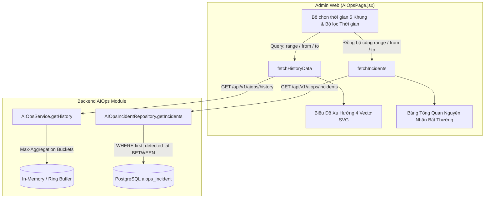

# Kế Hoạch Triển Khai: Sửa Lỗi Toàn Diện Giao Diện AIOps Sentinel (Biểu Đồ Xu Hướng & Bảng Tổng Quan Nguyên Nhân Bất Thường)

> **For agentic workers:** REQUIRED SUB-SKILL: Use `superpowers:executing-plans` to implement this plan task-by-task. Steps use checkbox (`- [ ]`) syntax for tracking.

**Goal:** Hoàn thiện và chuẩn hóa 100% giao diện giám sát an ninh AIOps Sentinel tại 2 khu vực trọng yếu: (1) Biểu Đồ Xu Hướng 4 Vectơ Rủi Ro (chuẩn hóa 5 khung thời gian với cơ chế lấy giá trị Max theo bucket, bộ lọc thời gian datetime-local, sửa triệt để lỗi đè chữ đơn vị trục X) và (2) Bảng Tổng Quan Nguyên Nhân Bất Thường (đồng bộ thời gian với Biểu đồ, xóa bỏ hoàn toàn nút làm sạch CSDL bảo vệ tính vĩnh viễn của audit log, tái cấu trúc bảng hiển thị tinh gọn & chuyên nghiệp).

**Architecture:** 
- **Backend Layer:** Cập nhật `aiops.service.js` phương thức `getHistory({ range, from, to })` thực hiện gom nhóm dữ liệu (downsampling aggregation) theo từng bucket thời gian và lấy giá trị MAX đo được cho từng vectơ rủi ro; cập nhật `aiops.repository.js` và `aiops.controller.js` hỗ trợ query tham số thời gian (`range`, `from`, `to`) cho endpoint `GET /api/v1/aiops/incidents` để bảng RCA đồng bộ với biểu đồ.
- **Frontend Layer:** Cập nhật `AIOpsPage.jsx` và các file ngôn ngữ `vi.js`, `en.js`:
  - Biểu đồ xu hướng: Rút gọn tiêu đề, xóa bỏ các dòng mô tả và footer dư thừa, thay thế preset cũ bằng 5 preset chuẩn (`10m`, `1h`, `24h`, `7d`, `30d`), chuyển bộ lọc chính xác sang bộ lọc datetime-local với icon search, sửa thuật toán vạch trục X (bước 5 cho 10m/1h, bước 4 cho 24h/7d/30d) và dời nhãn đơn vị thời gian để không bị đè lên số trục X.
  - Bảng RCA: Đổi tên thành "Tổng quan nguyên nhân bất thường", bỏ dòng mô tả phụ, đổi tên box thành "X sự cố", bỏ hoàn toàn nút và modal "Làm sạch CSDL", tái cấu trúc 7 cột (Tình trạng, Đối tượng, Vector, Chỉ số, Nguyên nhân, Xử lý, Phòng vệ) với text phòng vệ an toàn là chữ thuần túy không viền box.
- **Database Status:** Đã khảo sát và xác nhận bảng `aiops_incident` đã tồn tại trong CSDL PostgreSQL Supabase (`first_detected_at`, `code`, `vector`, `severity`, `actor_identity`, `username`, `metric_current`, `metric_baseline`, `message`, `root_cause_diagnosis`, `mitigation_taken`), lưu trữ vĩnh viễn không cần tạo thêm bảng mới.

**Architecture Diagram:**

**Tech Stack:** React 19, TailwindCSS, Heroicons / Material Symbols, PostgreSQL (Supabase), Vitest, RTL.

## Global Constraints
- Tuân thủ nghiêm ngặt quy tắc Karpathy: Simplicity first, Think before coding, Không thêm tính năng suy đoán.
- Mọi lệnh CLI đều dùng prefix `rtk`.
- Không chạy migration dev/push phá hủy CSDL Supabase (DB Guard / Rule 10).
- Áp dụng nguyên tắc Kiểm thử 2 Tầng (2-Tier Testing Architecture - Rule 11).

---

## Danh Mục Công Việc Chi Tiết

### Task 1: Khảo Sát & Khẳng Định Tình Trạng Cơ Sở Dữ Liệu (Mục 2.5)

**Files:**
- Tham chiếu: `src/Backend/modules/aiops/aiops.repository.js`
- Tham chiếu: `src/Backend/database/migrations/15_create_aiops_incident_table.sql`

**Chi tiết khảo sát:**
- [x] Đã kiểm tra: Bảng `aiops_incident` đã được khởi tạo trong CSDL PostgreSQL Supabase và mã nguồn repository đã có sẵn.
- [x] Cấu trúc bảng `aiops_incident` đã chứa đầy đủ:
  - `id` (UUID)
  - `code` VARCHAR(100)
  - `vector` VARCHAR(50)
  - `severity` VARCHAR(20)
  - `message` TEXT
  - `status` VARCHAR(20)
  - `actor_type`, `actor_identity`, `actor_hash`, `username`, `actor_role`, `target_endpoint`
  - `metric_current`, `metric_baseline`, `metric_unit`
  - `mitigation_taken`, `root_cause_diagnosis`
  - `hits`, `first_detected_at`, `last_seen_at`, `resolved_at`
- [x] **Kết luận:** ĐÃ CÓ BẢNG GHI NHẬN BẤT THƯỜNG TRONG CSDL. Không cần tạo thêm bảng CSDL mới. Chỉ cần loại bỏ hoàn toàn tính năng xóa/làm sạch CSDL để bảo vệ tính bất biến.

---

### Task 2: Nâng Cấp Backend Hỗ Trợ 5 Khung Thời Gian (Aggregation Max) & Lọc RCA Theo Thời Gian (Mục 1.3 & 2.4)

**Files:**
- Modify: `src/Backend/modules/aiops/aiops.service.js`
- Modify: `src/Backend/modules/aiops/aiops.repository.js`
- Modify: `src/Backend/modules/aiops/aiops.controller.js`
- Test: `src/Backend/modules/aiops/__tests__/aiops.history.filter.test.js`

**Interfaces:**
- `getHistory({ range, from, to })`: Trả về mảng mẫu đã được gom nhóm (downsampled) theo bucket và lấy giá trị MAX đo được cho mỗi vector.
  * `10m`: 60 mẫu dàn trải trong 10 phút (mỗi mẫu 10s, lấy max 10s).
  * `1h`: 60 mẫu dàn trải trong 60 phút (mỗi mẫu 1 phút, lấy max trong 1 phút).
  * `24h`: 48 mẫu dàn trải trong 24 giờ (mỗi mẫu 30 phút, lấy max trong 30 phút).
  * `7d`: 48 mẫu dàn trải trong 7 ngày (mỗi mẫu 4 giờ, lấy max trong 4 giờ).
  * `30d`: ~60 mẫu dàn trải trong 1 tháng (mỗi mẫu 12 giờ, lấy max trong 12 giờ).
- `getIncidents({ page, limit, vector, status, search, from, to, range })`: Bổ sung điều kiện SQL `WHERE "first_detected_at" >= $from AND "first_detected_at" <= $to` (hoặc tính theo `range`).

- [ ] **Step 1: Viết test Tầng 2 cho Backend getHistory aggregation và getIncidents time filter**
- [ ] **Step 2: Chạy test kiểm tra xem test fail (Red state)**
- [ ] **Step 3: Cập nhật hàm `getHistory` trong `aiops.service.js` thực hiện logic phân bucket và lấy MAX**
- [ ] **Step 4: Cập nhật hàm `getIncidents` trong `aiops.repository.js` và `aiops.controller.js` hỗ trợ time filter**
- [ ] **Step 5: Xóa bỏ endpoint hoặc chặn hành động `clearIncidents` trong backend**
- [ ] **Step 6: Chạy lại test backend xác nhận pass 100% (Green state)**

---

### Task 3: Cải Tạo Biểu Đồ Xu Hướng 4 Vectơ Rủi Ro (Mục 1.1 -> 1.8)

**Files:**
- Modify: `src/Admin-web/src/pages/system/AIOpsPage.jsx`
- Modify: `src/Admin-web/src/locales/vi.js`
- Modify: `src/Admin-web/src/locales/en.js`

**Các thay đổi cụ thể:**
- [ ] **1.1: Tiêu đề & Mô tả:**
  - Tiêu đề chỉ hiển thị: `Biểu Đồ Xu Hướng 4 Vectơ Rủi Ro` (kèm icon `show_chart`). Bỏ chuỗi `(60 Mẫu Gần Nhất — 10 Phút)` và các chuỗi phụ.
  - Bỏ dòng mô tả phụ: `Tách biệt đường cong riêng cho từng vectơ: Xác thực, Lưu lượng, Khai thác và Tài nguyên. Loại bỏ hoàn toàn sự sai lệch do gộp chung điểm.`
- [ ] **1.2: Header biểu đồ kéo dài sang trái:**
  - Bỏ đoạn text mô tả giúp header gọn gàng; kéo dài phần tiêu đề và căn bố cục flex hợp lý sang bên trái, tạo không gian thoáng đãng.
- [ ] **1.3: Bộ chọn thời gian mới (5 presets):**
  - Thay thế danh sách preset cũ bằng:
    1. `10 phút qua` (id: `10m`)
    2. `1 giờ qua` (id: `1h`)
    3. `24 giờ qua` (id: `24h`)
    4. `7 ngày qua` (id: `7d`)
    5. `1 tháng qua` (id: `30d`)
  - Bỏ hoàn toàn preset `Năm (12 tháng qua)`.
- [ ] **1.4: Bộ lọc thời gian (Thay thế Bộ lọc chính xác):**
  - Đổi tên: `Bộ lọc chính xác` -> `Bộ lọc thời gian`.
  - Bỏ cụm nút chọn loại: `Theo Ngày`, `Theo Tháng`, `Theo Năm`.
  - Từ -> Đến: Sử dụng input `type="datetime-local"` (cho phép chọn ngày, tháng, năm, giờ, phút).
  - Nút lọc: Đổi icon thành `search` (kính lúp), đổi text thành `Lọc`.
- [ ] **1.5: Bỏ chú thích ngưỡng:**
  - Bỏ cụm text `Ngưỡng Khẩn cấp (85), Ngưỡng Cảnh báo (70)` trên thanh legend.
  - Vẫn giữ lại 2 đường nét đứt 85 và 70 trên SVG cùng chỉ số 85, 70 tại biên phải trục Y để biểu thị vạch ngưỡng trực quan.
- [ ] **1.6: Đơn vị thời gian động (Ưu tiên Bộ lọc thời gian):**
  - Tự động xác định đơn vị thời gian theo preset hoặc theo khoảng `from` - `to` của bộ lọc (phút / giờ / ngày).
  - Ưu tiên bộ lọc thời gian nếu đang được áp dụng.
- [ ] **1.7: Bỏ khối chú thích footer:**
  - Bỏ hoàn toàn dòng: `Trục X: Ngày (1 -> 24 Giờ) 🕒 Mẫu đầu: ... 🕒 Giữa kỳ: ... 🕒 Mẫu mới nhất: ...`
  - Bỏ hoàn toàn dòng: `🛡️ Nguyên tắc: Phòng vệ được kích hoạt độc lập theo từng vectơ. Tuyệt đối không dùng điểm gộp chung để ngắt kết nối hệ thống.`
- [ ] **1.8: Sửa lỗi đè chữ đơn vị trục X & Bước nhảy vạch số (Ticks):**
  - Tách vị trí hiển thị đơn vị thời gian ra khỏi tọa độ tick cuối cùng (đặt ở góc phải trên hoặc vị trí độc lập không trùng `y=174, x=775`).
  - Quy tắc đánh số vạch trục X:
    * `10 phút qua`, `1 giờ qua`: 5 mẫu đánh 1 lần (0 -> 5 -> 10 -> 15 -> 20 -> ...).
    * `24 giờ qua`, `7 ngày qua`, `1 tháng qua`: 4 mẫu đánh 1 lần (0 -> 4 -> 8 -> 12 -> 16 -> ...).

---

### Task 4: Cải Tạo Bảng Tổng Quan Nguyên Nhân Bất Thường (Mục 2.1 -> 2.12)

**Files:**
- Modify: `src/Admin-web/src/pages/system/AIOpsPage.jsx`
- Modify: `src/Admin-web/src/locales/vi.js`
- Modify: `src/Admin-web/src/locales/en.js`

**Các thay đổi cụ thể:**
- [ ] **2.1: Tiêu đề bảng:**
  - Đổi tên: `Bóc Tách & Phân Tích Nguyên Nhân Bất Thường (Root Cause Analysis - RCA)` -> `Tổng quan nguyên nhân bất thường`.
- [ ] **2.2: Bỏ dòng mô tả phụ:**
  - Bỏ dòng: `Nhật ký sự cố lưu trữ bền vững trong CSDL (PostgreSQL) — Lưu vĩnh viễn phục vụ điều tra truy vết...`.
- [ ] **2.3: Box thống kê sự cố:**
  - Đổi text: `93 sự cố ghi nhận trong CSDL` -> `93 sự cố` (hiển thị tổng số sự cố theo khoảng thời gian đang lọc).
- [ ] **2.4: Đồng bộ thời gian với Biểu đồ:**
  - Khi người dùng đổi preset hoặc bấm `Lọc` tại Bộ lọc thời gian, gọi `fetchIncidents` với các tham số thời gian tương ứng (`range`, `from`, `to`).
- [ ] **2.5: Xóa bỏ nút và modal Làm sạch CSDL:**
  - Bỏ nút `Làm sạch CSDL` và modal xác nhận `showClearIncidentsModal`.
  - Dữ liệu được ghi nhận vĩnh viễn vào CSDL, không cung cấp cơ chế xóa từ giao diện.
- [ ] **2.6: Đổi tên cột 1:**
  - `Thời điểm & Trạng thái` -> `Tình trạng`.
- [ ] **2.7: Cột Đối tượng (Actor):**
  - Đổi tên header: vi: `Đối tượng` | en: `Actor`.
  - Rút gọn nội dung: CHỈ hiển thị tài khoản ở phía trên (VD: `TK: System Core Engine` hoặc `TK: tieubao`), đi kèm địa chỉ IP vi phạm tương ứng ở phía dưới (VD: `IP: 192.168.1.15`). Bỏ các badge vai trò, endpoint mục tiêu và user-agent dài dòng.
- [ ] **2.8: Cột Vector:**
  - Đổi tên header: `Vector & Mã Bất Thường` -> `Vector`.
  - Giữ lại badge mã vector (VD: `resource`, `auth`, `traffic`, `exploit`).
  - Bỏ badge đánh giá mức độ `HIGH` / `MEDIUM` / `LOW`.
  - Bỏ text mã lỗi phía dưới (VD: bỏ `MEMORY_EXHAUSTION`).
- [ ] **2.9: Cột Chỉ số:**
  - Đổi tên header: `Chỉ số đo VS Ngưỡng` -> `Chỉ số`.
  - Giữ nguyên các thông số chỉ số đo được, ngưỡng và tỷ lệ vượt ngưỡng.
- [ ] **2.10: Cột Nguyên nhân:**
  - Đổi tên header: `Bóc tách nguyên nhân & Xử lý` -> `Nguyên nhân`.
  - Giữ nguyên đoạn text nguyên nhân chính (message).
  - Bỏ box cảnh báo 1 dư thừa phía dưới (icon `psychology`).
  - Bỏ box cảnh báo 2 phía dưới (icon `security`).
- [ ] **2.11: Thêm cột mới "Xử lý":**
  - Thêm header cột mới `Xử lý` (nằm giữa cột "Nguyên nhân" và "Phòng vệ").
  - Hiển thị cách hệ thống xử lý / biện pháp khắc phục (lấy từ trường `mitigation` / box cảnh báo 2).
- [ ] **2.12: Cột Phòng vệ:**
  - Đổi tên header: `Thao tác & Phòng vệ` -> `Phòng vệ`.
  - Bỏ dòng chữ `🛡️ An toàn tuyệt đối` và `Sentinel giám sát`.
  - Với trường hợp phòng vệ an toàn (nội bộ / protected actor): hiển thị text thuần túy (VD: "Nội bộ hệ thống" hoặc "IP Được bảo vệ"), KHÔNG đóng gói trong button hoặc box có viền, tránh gây hiểu nhầm là nút bấm.
  - Với trường hợp IP cần phong tỏa / mở khóa: giữ nút thao tác rõ ràng.

---

### Task 5: Viết Bộ Test 2 Tầng Toàn Diện & Kiểm Tra Tác Động Hệ Thống (Rule 11)

**Files:**
- Create: `src/Admin-web/src/tests/aiops.trend.chart.and.rca.fixes.test.jsx`

**Nội dung kiểm thử 2 tầng:**
- [ ] **Tầng 1 (UI Rendering & Interaction):**
  - Kiểm tra tiêu đề biểu đồ hiển thị đúng `Biểu Đồ Xu Hướng 4 Vectơ Rủi Ro` và không còn các dòng mô tả cũ.
  - Kiểm tra 5 nút preset thời gian (`10 phút qua`, `1 giờ qua`, `24 giờ qua`, `7 ngày qua`, `1 tháng qua`) hiển thị đầy đủ; không có preset Năm.
  - Kiểm tra bộ lọc thời gian có 2 input `datetime-local` và nút `Lọc` với icon `search`.
  - Kiểm tra bảng RCA đổi tên thành `Tổng quan nguyên nhân bất thường`, box đếm `X sự cố`, không còn nút `Làm sạch CSDL`.
  - Kiểm tra bảng có đủ 7 cột theo đúng tên mới: `Tình trạng`, `Đối tượng`, `Vector`, `Chỉ số`, `Nguyên nhân`, `Xử lý`, `Phòng vệ`.
  - Kiểm tra text phòng vệ an toàn là text thuần, không có class border/box dạng nút.
- [ ] **Tầng 2 (Real System Impact & Behavioral Verification):**
  - Kiểm tra khi bấm chọn preset hoặc bấm nút Lọc: cả API history và API incidents đều được gọi với cùng tham số thời gian (`range`, `from`, `to`).
  - Kiểm tra trục X sinh đúng số lượng vạch ticks (bước 5 mẫu cho 10m/1h, bước 4 mẫu cho 24h/7d/30d) và nhãn đơn vị thời gian không bị đè lên vạch cuối cùng.
  - Kiểm tra dữ liệu cột Xử lý hiển thị chính xác biện pháp khắc phục được hệ thống thực hiện.

---

### Task 6: Thẩm Tra Cuối Cùng, Cập Nhật Tài Liệu & CodeGraph (Rule 8)

- [ ] Chạy toàn bộ test suite: `rtk npm test` tại `src/Admin-web` và `src/Backend`.
- [ ] Chạy kiểm tra type/lint: `rtk npm run build` hoặc lint kiểm tra lỗi cú pháp.
- [ ] Cập nhật tài liệu: `Project.md` và `docs/Admin-web/09-aiops-sentinel-and-quarantine.md`.
- [ ] Chạy lệnh cập nhật CodeGraph: `rtk npx codegraph build`.
