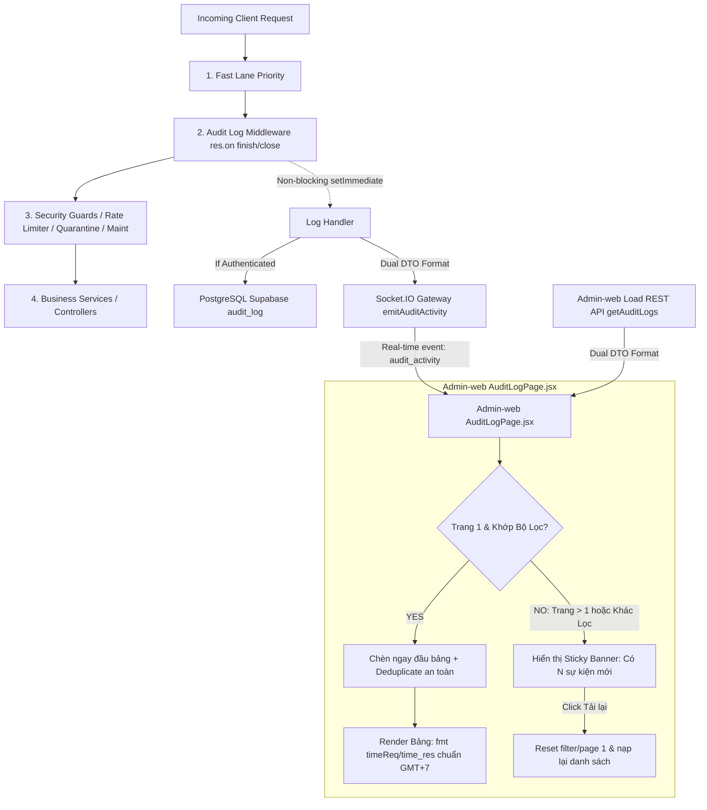

# Audit Log Real-time & Data Integrity Implementation Plan

> **For agentic workers:** REQUIRED SUB-SKILL: Use superpowers:subagent-driven-development to implement this plan task-by-task. Steps use checkbox (`- [ ]`) syntax for tracking.

**Goal:** Khắc phục triệt để lỗi mất mát dữ liệu thời gian (`—`), đồng bộ DTO giữa REST API và Socket.IO, xử lý phân trang & bộ lọc thông minh khi nhận log real-time, và tối ưu vị trí Middleware kiểm toán trên Backend để bảo toàn 100% dữ liệu audit log.

**Architecture:** Chuẩn hóa cấu trúc bản ghi Audit Log lưỡng tính (hỗ trợ cả camelCase và snake_case: `timeReq`/`time_req`, `id`/`idlog`, `request`/`action`, `req_status`/`status`) trên cả 3 tầng: `admin.repository.js`, `auth.service.js` (Socket Gateway), và `AuditLogPage.jsx`. Tích hợp Real-time Event Queue Banner trên Admin-web để khi Admin ở trang `> 1` hoặc đang áp dụng bộ lọc thì không bị drop sự kiện âm thầm. Di chuyển `auditLogMiddleware` lên trước các tầng phòng vệ để ghi nhận cả các request bị Rate Limit (429), Bảo trì (503), hay Quarantine (403).

**Architecture Diagram:**



**Tech Stack:**
- Frontend: React 18, Vite, Socket.io-client, TailwindCSS, Vitest, Testing Library.
- Backend: Node.js, Express, Socket.io, Prisma ORM, PostgreSQL (Supabase), node:test.

## Global Constraints
- Tuân thủ quy tắc bất di bất dịch của dự án (`.agents/AGENTS.md`): Mọi CLI phải có prefix `rtk`.
- Tuân thủ Rule 10 (DB Guard): Tuyệt đối KHÔNG chạy `prisma migrate dev` hay `prisma db push` trên Supabase Cloud.
- Tuân thủ Rule 11 (2-Tier Testing Architecture): Bắt buộc kiểm thử cả Tầng 1 (UI Render/Interaction) và Tầng 2 (Real System Impact/Data Persistence/Event Handling).
- Tuân thủ Rule 9 (Data Security): Không log thông tin nhạy cảm (token, mật khẩu, CVV).

---

### Task 1: Chuẩn hóa DTO & Format thời gian trong `AuditLogPage.jsx` và Locales (Admin-web)

**Files:**
- Modify: [src/Admin-web/src/pages/system/AuditLogPage.jsx](file:///d:/Tai_Lieu_IUH/Tailieu_Nam5_HK1/DoAnTotNghiep/Personal_Finance_Management/src/Admin-web/src/pages/system/AuditLogPage.jsx)
- Modify: [src/Admin-web/src/locales/vi.js](file:///d:/Tai_Lieu_IUH/Tailieu_Nam5_HK1/DoAnTotNghiep/Personal_Finance_Management/src/Admin-web/src/locales/vi.js)
- Modify: [src/Admin-web/src/locales/en.js](file:///d:/Tai_Lieu_IUH/Tailieu_Nam5_HK1/DoAnTotNghiep/Personal_Finance_Management/src/Admin-web/src/locales/en.js)
- Test: [src/Admin-web/src/tests/audit.page.test.jsx](file:///d:/Tai_Lieu_IUH/Tailieu_Nam5_HK1/DoAnTotNghiep/Personal_Finance_Management/src/Admin-web/src/tests/audit.page.test.jsx)

**Interfaces:**
- Consumes: Socket event `audit_activity` từ Socket.IO (`data.time_req`, `data.time_res`, `data.id`, `data.action`, `data.status`, `data.user`, `data.username`).
- Produces: State `logs` chứa các bản ghi chuẩn hóa cả `timeReq` lẫn `time_req`, `id` lẫn `idlog`, `request` lẫn `action`, hiển thị chuẩn GMT+7 không bị `'—'`.
- Produces: State `newLogsCount` và Banner thông báo khi có log mới trong lúc Admin đang phân trang hoặc lọc.

- [x] **Step 1: Viết test thất bại (Failing Tests) trong `src/Admin-web/src/tests/audit.page.test.jsx`**

Thêm các test case kiểm tra:
1. Hiển thị thời gian chuẩn (không hiển thị `'—'`) khi nhận sự kiện Socket.
2. Lọc trùng ID an toàn giữa REST API item (`item.id`) và Socket event (`item.idlog`).
3. Khớp bộ lọc thời gian thực: khi lọc trạng thái `Rejected`, sự kiện `Rejected` được chèn vào bảng.
4. Hiển thị thông báo khi có sự kiện mới lúc Admin ở trang 2 (`page > 1`).

- [x] **Step 2: Chạy test để xác nhận test thất bại**

Run: `rtk npm test src/tests/audit.page.test.jsx` tại `src/Admin-web`
Expected: FAIL (các test 4.5, 4.6, 4.7 thất bại do `AuditLogPage.jsx` chưa có banner, chưa normalize timeReq, và chưa hỗ trợ deduplicate đa năng).

- [x] **Step 3: Cập nhật i18n locales trong `src/Admin-web/src/locales/vi.js` & `en.js`**

Thêm các khóa dịch:
```javascript
// vi.js:
    newLogsBanner: 'Có {count} hoạt động mới vừa phát sinh',
    viewNewLogs: 'Xem ngay',
    newLogsBadge: '{count} mới',

// en.js:
    newLogsBanner: '{count} new activities recorded',
    viewNewLogs: 'View now',
    newLogsBadge: '{count} new',
```

- [x] **Step 4: Cập nhật `src/Admin-web/src/pages/system/AuditLogPage.jsx`**

1. Khai báo state: `const [newLogsCount, setNewLogsCount] = useState(0);`
2. Chuẩn hóa `newLog` trong `handleRealtimeLog` (hỗ trợ cả timeReq/time_req, id/idlog, req_status/status).
3. Cập nhật hàm render bảng: `{fmt(log.timeReq || log.time_req)}` và `{fmt(log.timeRes || log.time_res)}`.
4. Thêm sticky banner thông báo hoạt động mới ngay trên bảng.

- [x] **Step 5: Chạy lại test `audit.page.test.jsx` để xác nhận toàn bộ test PASS**

Run: `rtk npm test src/tests/audit.page.test.jsx` tại `src/Admin-web`
Expected: PASS (Tất cả 7/7 tests đạt 100%).

- [x] **Step 6: Commit Task 1**

```bash
rtk git add src/Admin-web/src/pages/system/AuditLogPage.jsx src/Admin-web/src/locales/vi.js src/Admin-web/src/locales/en.js src/Admin-web/src/tests/audit.page.test.jsx
rtk git commit -m "fix(admin-web): normalize audit log DTO, fix time rendering and add real-time new log banner"
```

---

### Task 2: Chuẩn hóa DTO 2 chiều trong Backend (`admin.repository.js` & `auth.service.js`)

**Files:**
- Modify: [src/Backend/modules/admin/admin.repository.js](file:///d:/Tai_Lieu_IUH/Tailieu_Nam5_HK1/DoAnTotNghiep/Personal_Finance_Management/src/Backend/modules/admin/admin.repository.js)
- Modify: [src/Backend/modules/auth/auth.service.js](file:///d:/Tai_Lieu_IUH/Tailieu_Nam5_HK1/DoAnTotNghiep/Personal_Finance_Management/src/Backend/modules/auth/auth.service.js)
- Test: [src/Backend/tests/unit/admin.audit.query.test.js](file:///d:/Tai_Lieu_IUH/Tailieu_Nam5_HK1/DoAnTotNghiep/Personal_Finance_Management/src/Backend/tests/unit/admin.audit.query.test.js)

**Interfaces:**
- Consumes: Prisma database rows từ bảng `auditlog`.
- Produces: `adminRepository.queryAuditLogs` trả về các items có đầy đủ: `id`, `idlog`, `timeReq`, `time_req`, `timeRes`, `time_res`, `username`, `account.username`.
- Produces: `authService.recordAuditLog` phát Socket event có đầy đủ: `id`, `idlog`, `timeReq`, `time_req`, `timeRes`, `time_res`, `request`, `action`, `req_status`, `status`.

- [x] **Step 1: Viết test mở rộng cho `admin.audit.query.test.js`**

Kiểm tra item trả về có cả `timeReq` và `time_req`, `id` và `idlog`.

- [x] **Step 2: Chạy test để xác nhận test thất bại**

Run: `rtk node --test tests/unit/admin.audit.query.test.js` tại `src/Backend`
Expected: FAIL (do `adminRepository.queryAuditLogs` hiện chưa gán `idlog`, `time_req`, `time_res`).

- [x] **Step 3: Cập nhật `src/Backend/modules/admin/admin.repository.js`**

Tại dòng 361-373, map item với các trường tương thích 2 chiều.

- [x] **Step 4: Cập nhật `src/Backend/modules/auth/auth.service.js` trong `recordAuditLog`**

Tại dòng 905-919, bổ sung các trường tương thích khi phát socket (`timeReq`, `timeRes`, `id`, `idlog`, `request`, `req_status`).

- [x] **Step 5: Chạy lại test `admin.audit.query.test.js` để xác nhận PASS**

Run: `rtk node --test tests/unit/admin.audit.query.test.js` tại `src/Backend`
Expected: PASS (Tất cả test cases đạt 100%).

- [x] **Step 6: Commit Task 2**

```bash
rtk git add src/Backend/modules/admin/admin.repository.js src/Backend/modules/auth/auth.service.js src/Backend/tests/unit/admin.audit.query.test.js
rtk git commit -m "fix(backend): standardize dual DTO format for audit log query and socket emission"
```

---

### Task 3: Tối ưu thứ tự Middleware và Real-time Event cho Request Nặc danh/Bị chặn an ninh

**Files:**
- Modify: [src/Backend/app.js](file:///d:/Tai_Lieu_IUH/Tailieu_Nam5_HK1/DoAnTotNghiep/Personal_Finance_Management/src/Backend/app.js)
- Modify: [src/Backend/middleware/audit-log.middleware.js](file:///d:/Tai_Lieu_IUH/Tailieu_Nam5_HK1/DoAnTotNghiep/Personal_Finance_Management/src/Backend/middleware/audit-log.middleware.js)
- Test: [src/Backend/tests/unit/audit.log.test.js](file:///d:/Tai_Lieu_IUH/Tailieu_Nam5_HK1/DoAnTotNghiep/Personal_Finance_Management/src/Backend/tests/unit/audit.log.test.js)

**Interfaces:**
- Consumes: Mọi HTTP request đến Express Server.
- Produces: Ghi nhận event audit log kể cả khi request bị chặn bởi Rate Limiter (429), Maintenance (503), Quarantine (403), hoặc request không có token.

- [x] **Step 1: Viết test mở rộng cho `audit.log.test.js`**

Kiểm tra khi `targetId` là null (request chưa xác thực hoặc login sai user không tồn tại), middleware vẫn emit Socket real-time cho Admin thấy.

- [x] **Step 2: Chạy test để xác nhận test thất bại**

Run: `rtk node --test tests/unit/audit.log.test.js` tại `src/Backend`
Expected: FAIL (do dòng 87 `if (!targetId) return;` hiện đang drop log mà không phát socket).

- [x] **Step 3: Cập nhật `src/Backend/middleware/audit-log.middleware.js`**

Thay vì return im lặng khi `!targetId`, vẫn phát Real-time Socket Event lên Admin-web với `idaccount: null`, `user: identifier || 'Anonymous / Guest'`, `reason: ...`.

- [x] **Step 4: Di chuyển `auditLogMiddleware` lên trước các guards trong `src/Backend/app.js`**

Đặt `auditLogMiddleware` ngay sau `defaultAdminPriority` để `res.on('finish')` bắt trọn các request bị chặn.

- [x] **Step 5: Chạy lại test `audit.log.test.js` để xác nhận PASS**

Run: `rtk node --test tests/unit/audit.log.test.js` tại `src/Backend`
Expected: PASS (Tất cả 7/7 tests đạt 100%).

- [x] **Step 6: Commit Task 3**

```bash
rtk git add src/Backend/app.js src/Backend/middleware/audit-log.middleware.js src/Backend/tests/unit/audit.log.test.js
rtk git commit -m "fix(backend): promote audit log middleware order and emit socket events for unauthenticated/blocked requests"
```

---

### Task 4: Chạy toàn bộ Test Suite 2 Tầng, Thẩm tra Hệ thống & Cập nhật CodeGraph

**Files:**
- Test Suite: Toàn bộ test trong `src/Admin-web` và `src/Backend`.
- Doc: [Project.md](file:///d:/Tai_Lieu_IUH/Tailieu_Nam5_HK1/DoAnTotNghiep/Personal_Finance_Management/Project.md)
- CodeGraph: Cập nhật đồ thị phụ thuộc (`rtk npx codegraph build`).

- [x] **Step 1: Chạy test toàn diện trên `src/Admin-web`**

Run: `rtk npm test` tại `src/Admin-web`
Expected: Tất cả các file test pass.

- [x] **Step 2: Chạy test toàn diện trên `src/Backend`**

Run: `rtk npm run test:unit` và `rtk npm run test:v2` tại `src/Backend`
Expected: Toàn bộ test suites pass.

- [x] **Step 3: Cập nhật tài liệu `Project.md` (Rule 8)**

Ghi nhận các cải tiến kiến trúc.

- [x] **Step 4: Chạy `rtk npx codegraph build` (Rule 8)**

Run: `rtk npx codegraph build` tại thư mục gốc.

- [x] **Step 5: Báo cáo kết quả hoàn thành lên người dùng**
