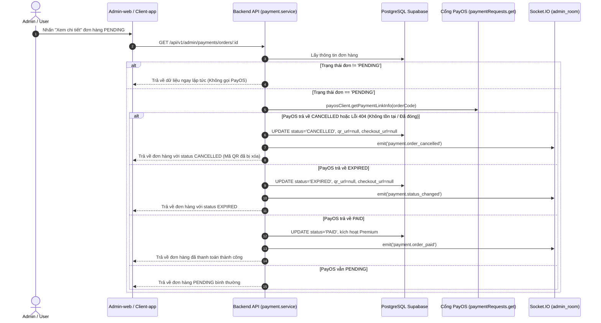

# PayOS Just-in-Time Reconciliation (JIT Sync) Implementation Plan

> **For agentic workers:** REQUIRED SUB-SKILL: Use superpowers:subagent-driven-development to implement this plan task-by-task. Steps use checkbox (`- [ ]`) syntax for tracking.

**Goal:** Xây dựng cơ chế tự động đối soát Just-in-Time Sync với PayOS mỗi khi xem chi tiết đơn hàng hoặc polling trạng thái, giúp Backend và Admin-web tự động đồng bộ ngay lập tức các đơn đã bị Hủy (`CANCELLED`), Hết hạn (`EXPIRED`) hoặc Đã thanh toán (`PAID`) trên PayOS mà không bị phụ thuộc vào Webhook.

**Architecture:** 
1. Tầng Service (`payment.service.js`) cung cấp hàm trung tâm `syncOrderWithPayOS(order)` để gọi `payosClient.getPaymentLinkInfo(order.order_code)`.
2. Khi trạng thái trên PayOS là `CANCELLED`, `EXPIRED`, `PAID`, hoặc đơn không tồn tại (đã bị hủy/xóa trên PayOS), Backend tự động cập nhật CSDL `payment_order`, triệt tiêu `qr_url` & `checkout_url`, đồng thời phát Socket thời gian thực (`admin_room` và `account:idaccount`).
3. Tích hợp JIT Sync trực tiếp vào `getOrderDetailForAdmin(orderId)` và `getOrderStatus(orderCode, idaccount)`.

**Architecture Diagram:**

**Tech Stack:** Node.js, Express, Prisma ORM, PayOS Node SDK, Socket.IO, Jest.

## Global Constraints
- Tuân thủ Quy tắc 2 Tầng Test (Rule 11): Tầng 1 (Response/Giao diện), Tầng 2 (Tác động CSDL & Socket Bus).
- Bảo vệ CSDL tuyệt đối (Rule 10 DB Guard, không chạy migrate dev trên Supabase).
- Xử lý lỗi an toàn (Graceful degradation): Nếu mạng tới PayOS bị gián đoạn, API không được crash mà trả về dữ liệu CSDL hiện tại.

---

### Task 1: Bổ sung PayOS Client Helper & Repository Update Method

**Files:**
- Modify: `src/Backend/modules/payment/payos.client.js`
- Modify: `src/Backend/modules/payment/payment.repository.js`
- Test: `src/Backend/tests/unit/payment.jit_sync.test.js`

**Interfaces:**
- `payosClient.cancelPaymentLink(orderIdOrCode, cancellationReason)`: Gọi API hủy trên PayOS.
- `paymentRepository.updateOrderSyncStatus(orderId, updateData)`: Cập nhật an toàn trạng thái, `qr_url = null`, `checkout_url = null`.

- [ ] **Step 1: Viết test Red cho Task 1**
- [ ] **Step 2: Triển khai code `cancelPaymentLink` và `updateOrderSyncStatus`**
- [ ] **Step 3: Chạy test Green và xác nhận**

---

### Task 2: Triển khai Logic `syncOrderWithPayOS` và Tích hợp vào `getOrderDetailForAdmin` & `getOrderStatus`

**Files:**
- Modify: `src/Backend/modules/payment/payment.service.js`
- Test: `src/Backend/tests/unit/payment.jit_sync.test.js`

**Interfaces:**
- `syncOrderWithPayOS(order)`: Đối soát tức thì với PayOS và cập nhật DB + Socket.
- `getOrderDetailForAdmin(orderId)`: Kích hoạt JIT Sync trước khi trả về chi tiết cho Admin.
- `getOrderStatus(orderCode, idaccount)`: Kích hoạt JIT Sync trước khi trả về cho Client.

- [ ] **Step 1: Viết test Red cho các kịch bản CANCELLED, EXPIRED, PAID, và 404 PayOS Error**
- [ ] **Step 2: Triển khai hàm `syncOrderWithPayOS` chuẩn xác, tối ưu thời gian phản hồi**
- [ ] **Step 3: Gắn `syncOrderWithPayOS` vào `getOrderDetailForAdmin` và `getOrderStatus`**
- [ ] **Step 4: Chạy test Green với 2-Tier Testing assertions**

---

### Task 3: Xác minh toàn diện & Kiểm thử hồi quy hệ thống (Rule 11)

**Files:**
- Test: `src/Backend/tests/unit/payment.jit_sync.test.js`
- Test: `src/Backend/tests/unit/payment.service.test.js`

- [ ] **Step 1: Chạy toàn bộ test suite thanh toán (`rtk npm test -- tests/unit/payment.*`)**
- [ ] **Step 2: Xác minh 2-Tier Test: Đảm bảo DB được cập nhật và mã QR được xóa hoàn toàn khi đơn hủy trên PayOS**
- [ ] **Step 3: Cập nhật tài liệu dự án và CodeGraph (`rtk npx codegraph build`)**
