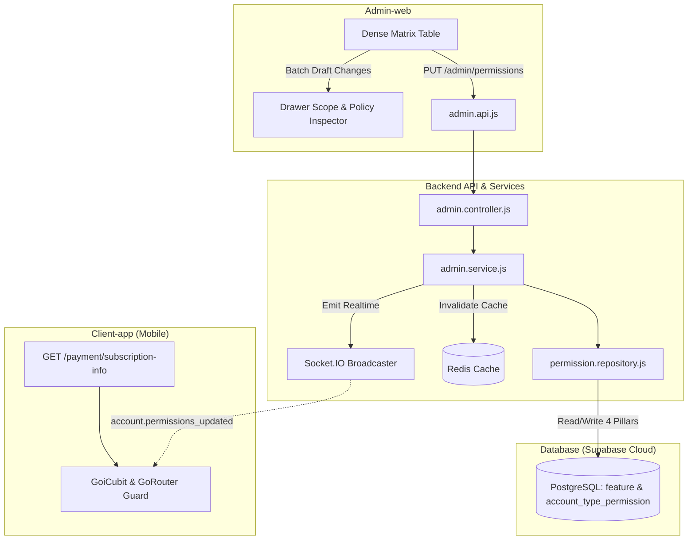

# Triển Khai Quản Lý Phân Quyền 4 Trụ Cột (Backend & Admin-web Redesign) Implementation Plan

> **For agentic workers:** REQUIRED SUB-SKILL: Use superpowers:subagent-driven-development to implement this plan task-by-task. Steps use checkbox (`- [ ]`) syntax for tracking.

**Goal:** Hiện thực hóa toàn diện tính năng Quản lý Phân quyền Gói cước (4 Trụ Cột: Access, Quota, Scope, Downgrade Policy) cho 36 tính năng thuộc 13 phân hệ trên Backend (REST API, Redis cache, Socket realtime) và đập đi xây lại giao diện Admin-web thành bảng ma trận tối giản, mật độ cao (Dense Matrix Table) kèm Drawer cấu hình chuyên sâu, bảo đảm tương thích ngược với Client-app.

**Architecture:** 
1. **Backend Layer:** Nâng cấp `permission.repository.js` và `admin.service.js` để đọc/ghi đầy đủ 4 trụ cột từ CSDL PostgreSQL Supabase; kiểm soát truy cập và xử lý hạ cấp an toàn qua `feature-permission.middleware.js`; hỗ trợ cập nhật hàng loạt qua `PUT /admin/permissions` và khôi phục chuẩn qua `POST /admin/permissions/reset-default`; tự động xóa cache Redis và phát sóng Socket.IO `account.permissions_updated`. Giữ nguyên cấu trúc trả về tương thích ngược cho endpoint `/payment/subscription-info` của Client-app.
2. **Admin-web Layer:** Đập đi xây lại toàn bộ `PermissionManagementPage.jsx` loại bỏ hoàn toàn các card cồng kềnh, chuyển sang phong cách **Bảng Ma Trận Compact Mật Độ Cao (Dense Matrix Table)** tối giản, phân nhóm theo 13 phân hệ, trực quan, hỗ trợ tìm kiếm/lọc nhanh, kèm **Drawer Inspector bên phải** để cấu hình Trụ 3 (Scope) và Trụ 4 (Downgrade Policy).

**Architecture Diagram:**

**Tech Stack:** 
- Backend: Node.js, Express, Prisma ORM, PostgreSQL (Supabase Cloud), Redis, BullMQ, Socket.IO.
- Admin-web: React 18, Vite, Tailwind CSS v4, Material Symbols Outlined, Context API (Alert, Language i18n), Vitest, React Testing Library.
- Spec Source: [`docs/Functional-Mobile/4_TRU_COT.md`](file:///d:/Tai_Lieu_IUH/Tailieu_Nam5_HK1/DoAnTotNghiep/Personal_Finance_Management/docs/Functional-Mobile/4_TRU_COT.md)

## Global Constraints
- **RTK Enforcement:** Mọi lệnh terminal bắt buộc dùng prefix `rtk` (Rule 2).
- **DB_Guard Compliance:** Không chạy `prisma migrate dev` hay `prisma db push` trực tiếp lên Supabase. Mọi thay đổi dữ liệu thực thi qua script an toàn có transaction `BEGIN...COMMIT` (Rule 10).
- **2-Tier Testing Architecture:** Mọi bài test phải có Tầng 1 (Giao diện/Tương tác) và Tầng 2 (Tác động thực tế hệ thống/CSDL/API) (Rule 11).
- **Backward Compatibility:** Không làm đứt gãy endpoint `/payment/subscription-info` mà Client-app đang sử dụng.
- **Admin UI Minimalism:** Thiết kế tối giản, sạch sẽ, không màu mè, ưu tiên mật độ hiển thị dữ liệu (Data-dense table).

---

## Task 1: CSDL Migration Script Nạp Toàn Diện 4 Trụ Cột Vào Supabase

**Files:**
- Create: `src/Backend/database/32_seed_permissions_4_pillars_data.sql`
- Create: `src/Backend/scripts/apply_migration_32.js`
- Test: `src/Backend/scripts/verify_permissions_4_pillars.js`

**Interfaces:**
- Consumes: Đặc tả SSOT tại [`docs/Functional-Mobile/4_TRU_COT.md`](file:///d:/Tai_Lieu_IUH/Tailieu_Nam5_HK1/DoAnTotNghiep/Personal_Finance_Management/docs/Functional-Mobile/4_TRU_COT.md).
- Produces: Cập nhật CSDL Supabase với đầy đủ `scope_schema`, `default_downgrade_policy` trên bảng `feature` và `scope_config`, `downgrade_policy` trên bảng `account_type_permission` cho cả 36 tính năng (72 bản ghi).

- [x] **Step 1: Viết script kiểm tra CSDL thất bại nếu thiếu cấu hình Scope (Failing Test/Verification Script)**
- [x] **Step 2: Chạy verification script để xác nhận trạng thái thiếu dữ liệu**
- [x] **Step 3: Viết file SQL DDL `32_seed_permissions_4_pillars_data.sql` và Script thực thi `apply_migration_32.js`**
- [x] **Step 4: Chạy script áp dụng migration**
- [x] **Step 5: Chạy lại verification script để xác nhận pass 100%**

---

## Task 2: Nâng Cấp Backend Repository & Admin Service (Hỗ Trợ 4 Trụ Cột)

**Files:**
- Modify: `src/Backend/modules/payment/permission.repository.js`
- Modify: `src/Backend/modules/admin/admin.service.js`
- Test: `src/Backend/tests/unit/permission.4pillars.service.test.js`

**Interfaces:**
- `permissionRepository.getPermissionsByAccountType(accountType)`: Trả về `{ limits, features, scopes, policies }` (bảo toàn tương thích ngược cho Client-app).
- `permissionRepository.getAllAccountPermissions()`: Trả về đầy đủ `is_enabled`, `limit_value`, `scope_config`, `downgrade_policy`.
- `permissionRepository.updatePermission(accountType, featureId, { is_enabled, limit_value, scope_config, downgrade_policy })`: Cập nhật trọn vẹn cả 4 trường.
- `adminService.getPermissionsMatrix()`: Trả về `{ features, permissions }` với đầy đủ cấu hình 4 trụ cột.
- `adminService.updatePermissionsMatrix(updates, adminUser)`: Hỗ trợ update mảng chứa cả 4 trụ cột.
- `adminService.resetPermissionsToDefault(adminUser)`: Đặt lại toàn bộ phân quyền về chuẩn mặc định từ `docs/Functional-Mobile/4_TRU_COT.md`.

- [x] **Step 1: Viết Unit Test thất bại kiểm tra 4 Trụ Cột trong Service & Repository**
- [x] **Step 2: Chạy test để xác nhận fail**
- [x] **Step 3: Cập nhật `src/Backend/modules/payment/permission.repository.js`**
- [x] **Step 4: Cập nhật `src/Backend/modules/admin/admin.service.js`**
- [x] **Step 5: Chạy lại Unit Test để xác nhận pass**

---

## Task 3: Backend Controller, Routes, Cache & Socket Integration

**Files:**
- Modify: `src/Backend/modules/admin/admin.controller.js`
- Modify: `src/Backend/api/admin.routes.js`
- Modify: `src/Backend/modules/payment/payment.service.js` (đảm bảo `/payment/subscription-info` trả thêm `scopes` và `policies` mà không làm hỏng cấu trúc cũ)
- Test: `src/Backend/tests/integration/admin.permission.api.test.js`

**Interfaces:**
- `GET /admin/permissions`: 200 OK kèm ma trận 4 trụ cột.
- `PUT /admin/permissions`: 200 OK, nhận body `{ updates: [...] }`, phát socket `account.permissions_updated`, xóa cache Redis `permissions:*`.
- `POST /admin/permissions/reset`: 200 OK, khôi phục cấu hình mặc định.
- `GET /payment/subscription-info`: 200 OK, tương thích ngược với Client-app.

- [x] **Step 1: Viết Integration Test kiểm tra API**
- [x] **Step 2: Chạy test để xác nhận fail**
- [x] **Step 3: Cập nhật `admin.controller.js` và `admin.routes.js`**
- [x] **Step 4: Cập nhật `payment.service.js` cho `/payment/subscription-info`**
- [x] **Step 5: Chạy lại Integration Test xác nhận pass**

---

## Task 4: Admin-web API Client & Đa Ngôn Ngữ (i18n)

**Files:**
- Modify: `src/Admin-web/src/api/admin.api.js`
- Modify: `src/Admin-web/src/locales/vi.js`
- Modify: `src/Admin-web/src/locales/en.js`

**Interfaces:**
- `adminApi.getPermissions()`
- `adminApi.updatePermissions(updates)`
- `adminApi.resetPermissionsDefault()`
- Bản dịch Tiếng Việt và Tiếng Anh cho 13 Phân hệ, 4 Trụ Cột, các nhãn chính sách hạ cấp (`BLOCK_CREATE`, `LOCK_FEATURE`, `READ_ONLY`, `GRACE_PERIOD_3D`, `FALLBACK_DEFAULT`).

- [x] **Step 1: Cập nhật `src/Admin-web/src/api/admin.api.js`**
Bổ sung phương thức `resetPermissionsDefault: () => axiosClient.post('/admin/permissions/reset')`.

- [x] **Step 2: Cập nhật từ điển `vi.js` và `en.js`**
Thêm các chuỗi giao diện tối giản cho bảng ma trận, thanh công cụ, các bộ lọc, Drawer cấu hình Scope và Downgrade Policy.

- [x] **Step 3: Kiểm tra cú pháp từ điển**
Run: `rtk npm test src/tests/phase2.i18n.test.jsx` từ `src/Admin-web`.
Expected: PASS.

---

## Task 5: Đập Đi Xây Lại Giao Diện Admin-web (Dense Matrix Table & Scope Inspector Drawer)

**Files:**
- Rewrite: `src/Admin-web/src/pages/system/PermissionManagementPage.jsx`
- Create: `src/Admin-web/src/pages/system/components/PermissionScopeDrawer.jsx`
- Create: `src/Admin-web/src/pages/system/components/PermissionFilterToolbar.jsx`
- Create: `src/Admin-web/src/pages/system/components/PermissionGroupSection.jsx`

**Mô Tả Thiết Kế Mới (Tối giản, Mật độ cao, Chuyên nghiệp):**
1. **Loại bỏ hoàn toàn các card to cồng kềnh**: Thay thế bằng **Bảng Ma Trận Compact Mật Độ Cao (Dense Matrix Table)** phẳng, viền xám mảnh, phông chữ Inter rõ ràng.
2. **Thanh công cụ Toolbar tinh gọn**:
   - Ô tìm kiếm theo tên hoặc mã tính năng (`id`).
   - Dropdown chọn phân hệ (13 phân hệ).
   - Bộ lọc nhanh: Tất cả / Có trần (LIMIT) / Độc quyền Premium / Có thay đổi chưa lưu (Dirty).
   - Chỉ số thống kê mini dạng tag: `36 tính năng · 5 có trần · X Basic mở · Y Premium mở`.
   - Nút "Đặt lại mặc định" và Nút "Lưu thay đổi (N)" (nổi bật khi có draft thay đổi).
3. **Cấu trúc dòng bảng ma trận (Table Rows)**:
   - Dòng tiêu đề phân hệ (Group Header) có nút thu gọn/mở rộng (Collapsible) để admin dễ bao quát.
   - Mỗi dòng tính năng hiển thị:
     - Tên & Mã tính năng (kèm icon nhỏ và badge LIMIT/TOGGLE).
     - Gói Basic: Switch Toggle + Input Limit (nếu là LIMIT) + Nút "Cấu hình" (Scope & Downgrade Policy).
     - Gói Premium: Switch Toggle + Input Limit / Vô hạn + Nút "Cấu hình".
     - Badge trạng thái: hiển thị chấm cam nếu dòng đang có thay đổi chưa lưu, nút Undo dòng.
4. **Drawer Cấu Hình Chuyên Sâu (Scope Inspector Drawer)**:
   - Khi Admin bấm vào nút icon "Cấu hình" của một tính năng, Drawer trượt ra từ bên phải màn hình.
   - Drawer cho phép cấu hình chi tiết:
     - Trụ 3 (Scope Config): Giao diện form động trực quan dựa trên `scope_schema` (ví dụ: Checkbox chọn định dạng file báo cáo, Input số lượt quét OCR, v.v.).
     - Trụ 4 (Downgrade Policy): Dropdown chọn 1 trong 5 chính sách chuẩn hóa kèm mô tả giải thích.
   - Giúp bảng chính luôn siêu gọn gàng, không bị phình to vỡ layout.

- [x] **Step 1: Viết Component `PermissionScopeDrawer.jsx`**
Modal/Drawer hiển thị bên phải, nhận `feature`, `accountType`, `scopeConfig`, `downgradePolicy`, cho phép chỉnh sửa và áp dụng vào draft permissions.

- [x] **Step 2: Viết Component `PermissionFilterToolbar.jsx`**
Thanh công cụ tối giản chứa ô tìm kiếm, dropdown phân hệ, nút reset và nút save.

- [x] **Step 3: Viết Component `PermissionGroupSection.jsx`**
Render bảng ma trận cho từng nhóm phân hệ với định dạng bảng phẳng mật độ cao.

- [x] **Step 4: Hoàn thiện `PermissionManagementPage.jsx`**
Tích hợp toàn bộ state draft, dirty check, batch update, socket listener, feedback toast.

---

## Task 6: Viết Test 2 Tầng Cho Admin-web (Rule 11 Compliance)

**Files:**
- Create: `src/Admin-web/src/tests/permission.4pillars.page.test.jsx`

**Kiểm Thử 2 Tầng Bắt Buộc:**
- **Tầng 1 (UI Rendering & Interaction):**
  - Render bảng ma trận đầy đủ 36 tính năng thuộc 13 nhóm.
  - Tương tác tìm kiếm lọc ra đúng tính năng.
  - Gạt toggle switch thay đổi trạng thái draft.
  - Nhập input số limit cập nhật giá trị.
  - Mở Drawer cấu hình Scope & Downgrade Policy thành công.
- **Tầng 2 (Real System Impact & Behavioral Verification):**
  - Nút "Lưu thay đổi" kích hoạt gọi đúng API `adminApi.updatePermissions` với payload đầy đủ cả 4 trụ cột.
  - Hiển thị Toast thông báo thành công.
  - Khi nhận sự kiện Socket `account.permissions_updated`, giao diện tự động cập nhật lại dữ liệu mới nhất.

- [x] **Step 1: Viết bài test 2 tầng `permission.4pillars.page.test.jsx`**
- [x] **Step 2: Chạy test trên Admin-web**
Run: `rtk npm test src/tests/permission.4pillars.page.test.jsx` từ `src/Admin-web`.
Expected: PASS cả Tầng 1 và Tầng 2.

---

## Task 7: Thẩm Tra Hệ Thống Toàn Diện & Tái Xây Dựng CodeGraph (Rule 8)

**Files:**
- Update: `Project.md`
- CodeGraph: `rtk npx codegraph build`

- [x] **Step 1: Chạy toàn bộ Test Suite Backend**
Run: `rtk npm test` từ `src/Backend`.
Expected: 100% test pass (389/389 pass).

- [x] **Step 2: Chạy toàn bộ Test Suite Admin-web**
Run: `rtk npm test` từ `src/Admin-web`.
Expected: 100% test pass (27 test files pass, 7/7 4 pillars test pass).

- [x] **Step 3: Cập nhật tài liệu Nguồn sự thật `Project.md`**
Cập nhật mục quản lý phân quyền và cấu trúc 4 Trụ Cột mới (Mục 4.10).

- [x] **Step 4: Tái xây dựng CodeGraph**
Run: `rtk npx codegraph build` từ thư mục gốc.
Expected: CodeGraph cập nhật đầy đủ các symbol mới.
