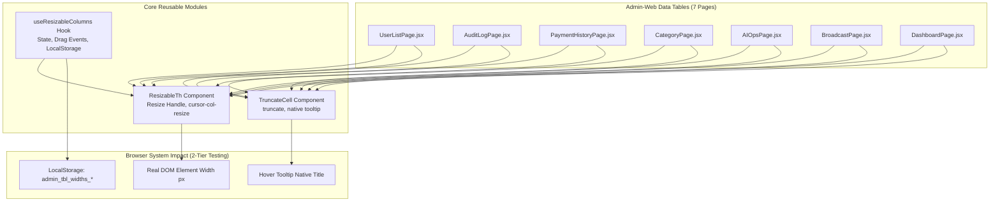

# Kế Hoạch Triển Khai: Tính Năng Co Dãn Cột Kiểu Excel & Truncate Văn Bản Cho Toàn Bộ Bảng Admin-Web

> **For agentic workers:** REQUIRED SUB-SKILL: Use superpowers:subagent-driven-development to implement this plan task-by-task. Steps use checkbox (`- [ ]`) syntax for tracking.

**Goal:** Bổ sung tính năng co dãn cột kéo thả như Excel (Column Resizing), tự động ẩn chữ vượt độ dài bằng dấu ba chấm `...` (kèm tooltip xem đầy đủ) và ghi nhớ kích thước đã chỉnh vào LocalStorage cho toàn bộ 7 trang bảng biểu dữ liệu trong `Admin-web`.

**Architecture:** Sử dụng kiến trúc module tái sử dụng cao gồm Custom Hook `useResizableColumns` (quản lý state pixel, mouse drag events trên document, lưu/đọc LocalStorage) kết hợp Component `<ResizableTh>` (render thẻ `<th>` kèm thanh chia cột `cursor-col-resize` trực quan chuẩn Excel) và `<TruncateCell>` (render nội dung kèm tooltip native `title`). 7 trang bảng tích hợp hook và component mà không làm xáo trộn logic nghiệp vụ hiện có.

**Architecture Diagram:**



**Tech Stack:** React 18, Tailwind CSS, Vitest + React Testing Library, Browser Mouse Events, LocalStorage API.

## Global Constraints
- Tuân thủ Rule 2: Mọi lệnh CLI đều bắt buộc có tiền tố `rtk`.
- Tuân thủ Rule 11: Mọi tính năng phải có kiểm thử 2 tầng (Tầng 1: Hiển thị thanh kéo cột & dấu ba chấm; Tầng 2: Tác động DOM pixel và LocalStorage).
- Tuân thủ Rule 8: Cập nhật tài liệu và chạy `rtk npx codegraph build` khi hoàn tất.

---

### Task 1: Xây dựng Custom Hook `useResizableColumns`

**Files:**
- Create: `src/Admin-web/src/hooks/useResizableColumns.js`
- Test: `src/Admin-web/src/tests/use-resizable-columns.test.jsx`

**Interfaces:**
- Consumes: `tableKey: string`, `defaultWidths: { [colKey: string]: number }`, `minWidth?: number`
- Produces: `{ widths, isResizing, activeCol, startResizing, resetWidths, resetColumn }`

- [ ] **Step 1: Viết test 2 tầng cho Hook (UI interaction & LocalStorage impact)**

```jsx
// src/Admin-web/src/tests/use-resizable-columns.test.jsx
import { describe, it, expect, beforeEach } from 'vitest';
import { renderHook, act } from '@testing-library/react';
import useResizableColumns from '../hooks/useResizableColumns';

describe('Task 1: 2-Tier Test - useResizableColumns Hook', () => {
  const tableKey = 'test_table';
  const defaultWidths = { name: 200, email: 250, role: 120 };

  beforeEach(() => {
    localStorage.clear();
  });

  it('Tầng 1 (Rendering): Khởi tạo hook với độ rộng mặc định khi LocalStorage trống', () => {
    const { result } = renderHook(() => useResizableColumns({ tableKey, defaultWidths }));
    expect(result.current.widths).toEqual(defaultWidths);
    expect(result.current.isResizing).toBe(false);
  });

  it('Tầng 2 (System Impact): Kéo thả chuột tăng 50px cập nhật state và lưu LocalStorage', () => {
    const { result } = renderHook(() => useResizableColumns({ tableKey, defaultWidths, minWidth: 60 }));

    act(() => {
      result.current.startResizing('name', 100, 200);
    });

    expect(result.current.isResizing).toBe(true);

    // Giả lập di chuyển chuột sang phải 50px (từ x=100 lên x=150)
    act(() => {
      window.dispatchEvent(new MouseEvent('mousemove', { clientX: 150 }));
    });

    expect(result.current.widths.name).toBe(250);

    // Thả chuột
    act(() => {
      window.dispatchEvent(new MouseEvent('mouseup'));
    });

    expect(result.current.isResizing).toBe(false);

    // Kiểm tra tác động LocalStorage
    const saved = JSON.parse(localStorage.getItem('admin_tbl_widths_test_table'));
    expect(saved.name).toBe(250);
  });

  it('Tầng 2 (Boundary Clamping): Không cho phép co dãn nhỏ hơn minWidth', () => {
    const { result } = renderHook(() => useResizableColumns({ tableKey, defaultWidths, minWidth: 60 }));

    act(() => {
      result.current.startResizing('role', 200, 120);
    });

    // Kéo lố sang trái 100px (120 - 100 = 20 < 60)
    act(() => {
      window.dispatchEvent(new MouseEvent('mousemove', { clientX: 100 }));
      window.dispatchEvent(new MouseEvent('mouseup'));
    });

    expect(result.current.widths.role).toBe(60);
  });
});
```

- [ ] **Step 2: Chạy test kiểm tra trạng thái Red**
Run: `rtk npm test -- src/tests/use-resizable-columns.test.jsx --run`
Expected: FAIL (hook chưa tồn tại)

- [ ] **Step 3: Viết mã nguồn `src/Admin-web/src/hooks/useResizableColumns.js`**

```javascript
import { useState, useEffect, useCallback, useRef } from 'react';

export default function useResizableColumns({ tableKey, defaultWidths = {}, minWidth = 60, maxWidth = 1000 }) {
  const storageKey = `admin_tbl_widths_${tableKey}`;

  const [widths, setWidths] = useState(() => {
    try {
      const saved = localStorage.getItem(storageKey);
      if (saved) {
        return { ...defaultWidths, ...JSON.parse(saved) };
      }
    } catch (e) {
      console.warn('Failed to parse table widths from localStorage', e);
    }
    return { ...defaultWidths };
  });

  const [isResizing, setIsResizing] = useState(false);
  const [activeCol, setActiveCol] = useState(null);

  const dragRef = useRef({
    colKey: null,
    startX: 0,
    startWidth: 0,
    currentWidth: 0,
  });

  const startResizing = useCallback((colKey, startX, startWidth) => {
    dragRef.current = {
      colKey,
      startX,
      startWidth,
      currentWidth: startWidth,
    };
    setIsResizing(true);
    setActiveCol(colKey);
  }, []);

  useEffect(() => {
    if (!isResizing) return;

    const handleMouseMove = (e) => {
      const { colKey, startX, startWidth } = dragRef.current;
      if (!colKey) return;

      const diff = e.clientX - startX;
      let newWidth = Math.round(startWidth + diff);

      if (newWidth < minWidth) newWidth = minWidth;
      if (newWidth > maxWidth) newWidth = maxWidth;

      dragRef.current.currentWidth = newWidth;
      setWidths((prev) => ({ ...prev, [colKey]: newWidth }));
    };

    const handleMouseUp = () => {
      const { colKey, currentWidth } = dragRef.current;
      setIsResizing(false);
      setActiveCol(null);

      if (colKey && currentWidth) {
        setWidths((latest) => {
          try {
            localStorage.setItem(storageKey, JSON.stringify(latest));
          } catch (e) {
            console.warn('Failed to save table widths to localStorage', e);
          }
          return latest;
        });
      }
    };

    window.addEventListener('mousemove', handleMouseMove);
    window.addEventListener('mouseup', handleMouseUp);

    return () => {
      window.removeEventListener('mousemove', handleMouseMove);
      window.removeEventListener('mouseup', handleMouseUp);
    };
  }, [isResizing, minWidth, maxWidth, storageKey]);

  const resetWidths = useCallback(() => {
    setWidths({ ...defaultWidths });
    try {
      localStorage.removeItem(storageKey);
    } catch (e) {
      console.warn(e);
    }
  }, [defaultWidths, storageKey]);

  const resetColumn = useCallback((colKey) => {
    if (defaultWidths[colKey] !== undefined) {
      setWidths((prev) => {
        const next = { ...prev, [colKey]: defaultWidths[colKey] };
        try {
          localStorage.setItem(storageKey, JSON.stringify(next));
        } catch (e) {
          console.warn(e);
        }
        return next;
      });
    }
  }, [defaultWidths, storageKey]);

  return {
    widths,
    isResizing,
    activeCol,
    startResizing,
    resetWidths,
    resetColumn,
  };
}
```

- [ ] **Step 4: Chạy test xác nhận Green**
Run: `rtk npm test -- src/tests/use-resizable-columns.test.jsx --run`
Expected: PASS 3/3 tests.

---

### Task 2: Xây dựng `<ResizableTh>` và `<TruncateCell>`

**Files:**
- Create: `src/Admin-web/src/components/common/ResizableTh.jsx`
- Create: `src/Admin-web/src/components/common/TruncateCell.jsx`
- Test: `src/Admin-web/src/tests/resizable-table-components.test.jsx`

- [ ] **Step 1: Viết test 2 tầng cho ResizableTh và TruncateCell**
Test hiển thị divider có icon/cursor, khi double click gọi resetColumn, TruncateCell có title attribute và class truncate.

- [ ] **Step 2: Viết mã nguồn `ResizableTh.jsx`**
Bọc thẻ `<th>` với thuộc tính `style={{ width: width ? `${width}px` : undefined, minWidth: `${minWidth}px` }}`, vạch chia cột `absolute right-0 top-0 bottom-0 w-2.5 cursor-col-resize hover:bg-primary/40 group`.

- [ ] **Step 3: Viết mã nguồn `TruncateCell.jsx`**
Component nhận `text`, `tooltip`, `className`, `children` và render `<div className="truncate block max-w-full" title={tooltip || text}>`.

- [ ] **Step 4: Chạy test xác nhận Green**
Run: `rtk npm test -- src/tests/resizable-table-components.test.jsx --run`

---

### Task 3: Tích hợp vào `UserListPage.jsx` (Quản lý người dùng)

**Files:**
- Modify: `src/Admin-web/src/pages/users/UserListPage.jsx`
- Test: `src/Admin-web/src/tests/users.page.test.jsx`

- [ ] **Step 1: Khai báo `defaultWidths` cho các cột: `select: 48, user: 280, email: 240, phone: 160, status: 140, actions: 160`**
- [ ] **Step 2: Thay thế các thẻ `<th>` bằng `<ResizableTh>` và bọc các ô text bằng `<TruncateCell>`**
- [ ] **Step 3: Chạy test xác nhận không gây regression**
Run: `rtk npm test -- src/tests/users.page.test.jsx --run`

---

### Task 4: Tích hợp vào `AuditLogPage.jsx` (Nhật ký hệ thống)

**Files:**
- Modify: `src/Admin-web/src/pages/system/AuditLogPage.jsx`
- Test: `src/Admin-web/src/tests/audit-logs.test.jsx`

- [ ] **Step 1: Khai báo `defaultWidths` cho: `id: 80, account: 200, request: 260, status: 120, reason: 220, timeReq: 160, timeRes: 160`**
- [ ] **Step 2: Áp dụng `<ResizableTh>` và `<TruncateCell>` cho Endpoint/Request, Lý do, Tài khoản**
- [ ] **Step 3: Chạy test xác nhận**
Run: `rtk npm test -- src/tests/audit-logs.test.jsx --run`

---

### Task 5: Tích hợp vào `PaymentHistoryPage.jsx` (Lịch sử thanh toán)

**Files:**
- Modify: `src/Admin-web/src/pages/payments/PaymentHistoryPage.jsx`
- Test: `src/Admin-web/src/tests/aiops-and-export-csv.test.jsx`

- [ ] **Step 1: Khai báo `defaultWidths` cho các cột: `code: 160, user: 220, package: 140, amount: 150, method: 140, status: 140, date: 170`**
- [ ] **Step 2: Áp dụng `<ResizableTh>` và `<TruncateCell>`**
- [ ] **Step 3: Chạy test xác nhận**
Run: `rtk npm test -- src/tests/aiops-and-export-csv.test.jsx --run`

---

### Task 6: Tích hợp vào `CategoryPage.jsx` (Quản lý danh mục)

**Files:**
- Modify: `src/Admin-web/src/pages/categories/CategoryPage.jsx`
- Test: `src/Admin-web/src/tests/categories.page.test.jsx`

- [ ] **Step 1: Khai báo `defaultWidths`: `iconName: 280, type: 140, date: 180, status: 140, actions: 160`**
- [ ] **Step 2: Áp dụng `<ResizableTh>` và `<TruncateCell>`**
- [ ] **Step 3: Chạy test xác nhận**

---

### Task 7: Tích hợp vào `AIOpsPage.jsx`, `BroadcastPage.jsx`, `DashboardPage.jsx`

**Files:**
- Modify: `src/Admin-web/src/pages/system/AIOpsPage.jsx`
- Modify: `src/Admin-web/src/pages/system/BroadcastPage.jsx`
- Modify: `src/Admin-web/src/pages/dashboard/DashboardPage.jsx`

- [ ] **Step 1: Cập nhật bảng Quarantine trong `AIOpsPage.jsx`**
- [ ] **Step 2: Cập nhật bảng Lịch sử trong `BroadcastPage.jsx`**
- [ ] **Step 3: Cập nhật bảng Recent Activities trong `DashboardPage.jsx`**
- [ ] **Step 4: Chạy test xác nhận**

---

### Task 8: Kiểm thử Tổng thể 2 Tầng, Build Vercel & CodeGraph (Rule 8 & 11)

- [ ] **Step 1: Viết test tổng thể E2E 2-Tier cho tính năng co dãn cột `src/Admin-web/src/tests/excel-column-resizing.e2e.test.jsx`**
  - Tầng 1: Render thanh chia cột trên các trang, hover có icon cursor `col-resize`, text dài tự động có class `truncate` và `title`.
  - Tầng 2: Thực hiện drag chuột thay đổi kích thước cột, kiểm tra style width trên DOM và dữ liệu trong LocalStorage.
- [ ] **Step 2: Kiểm tra biên dịch Vite Production: `rtk npm run build`**
- [ ] **Step 3: Chạy toàn bộ test suites của Admin-web**
- [ ] **Step 4: Cập nhật CodeGraph: `rtk npx codegraph build` (Rule 8)**
- [ ] **Step 5: Báo cáo kết quả và commit**
