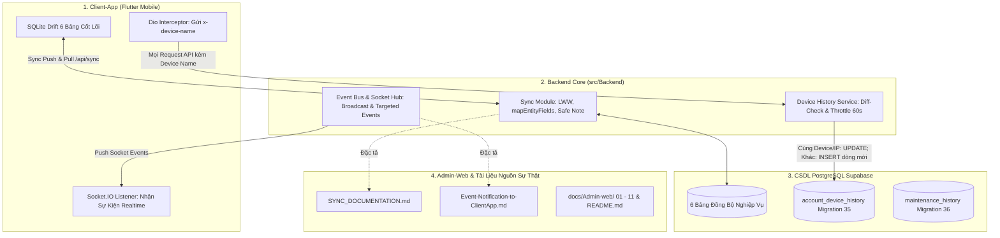

# Kế Hoạch Triển Khai: Chuẩn Hóa Module Sync, Sự Kiện Thông Báo, Thu Thập Thiết Bị & Cập Nhật Tài Liệu Admin-Web

> **Dành cho Agentic Workers:** YÊU CẦU SUB-SKILL: Sử dụng `executing-plans` hoặc `subagent-driven-development` để triển khai từng tác vụ sau khi được PO phê duyệt. Các bước sử dụng cú pháp checkbox (`- [ ]`) để theo dõi tiến độ.
> **Quy tắc tuân thủ:** Tuân thủ tuyệt đối 3 Quy tắc Tối cao, Rule 6 (Chờ PO duyệt plan), Rule 9 (Bảo mật dữ liệu), Rule 10 (DB Guard) và Rule 11 (Kiểm thử 2 tầng).

**Mục tiêu:**
1. Cập nhật Module SYNC Backend (`sync.repository.js`) khớp hoàn toàn với CSDL mới và ghi nhận vào `docs/superpowers/sync/SYNC_DOCUMENTATION.md`.
2. Ghi nhận và cập nhật đầy đủ các thông báo, sự kiện từ Backend và Admin-web vào `docs/Admin-web/Event-Notification-to-ClientApp.md`.
3. Thẩm tra ràng buộc CSDL PostgreSQL cho việc thu thập thông tin thiết bị (`x-device-name`) và địa chỉ IP của Client-app (`account_device_history`), đảm bảo không xung đột ràng buộc CSDL và thực thi đúng logic Diff-Check (không ghi đè).
4. Cập nhật toàn diện 11 tài liệu chức năng (từ `01` đến `11`) và `README.md` tại thư mục `docs/Admin-web/`.

**Kiến trúc tổng quan:**

---

## Danh Sách Tác Vụ Cụ Thể

### Tác Vụ 1: Rà Soát & Cập Nhật Mã Nguồn Module SYNC Backend (`src/Backend/modules/sync/`)
- **Tập tin:**
  - Sửa đổi: `src/Backend/modules/sync/sync.repository.js`
  - Sửa đổi: `src/Backend/modules/sync/sync.validation.js`
  - Kiểm thử: `src/Backend/tests/unit/sync.engine.v2.test.js`
- **Mục tiêu:**
  - Trong `mapEntityFields`: Bổ sung nhận diện alias `is_deleted` (snake_case) bên cạnh `isDeleted` cho cả 6 entities (`wallet`, `transaction`, `budget`, `bill`, `goal`, `category`) để tương thích hoàn toàn với payload Client-app.
  - Bảo đảm `transaction.deleted_at` nhận diện đúng cả `is_deleted`, `isDeleted`, `delete_at`, `deleted_at`.
  - Bảo đảm bảo toàn `time_notification: null` (đã triển khai, rà soát lại không bị phá vỡ).
  - Bảo đảm `prepareSafeNote` và `restoreSafeNote` bọc try-catch không làm crash API khi gặp bản ghi cũ chưa mã hóa.
- [ ] **Bước 1.1:** Viết ca kiểm thử mở rộng cho alias `is_deleted` trong `src/Backend/tests/unit/sync.engine.v2.test.js`.
- [ ] **Bước 1.2:** Cập nhật `mapEntityFields` trong `src/Backend/modules/sync/sync.repository.js`.
- [ ] **Bước 1.3:** Chạy `rtk npm test -- tests/unit/sync.engine.v2.test.js` xác nhận 100% tests PASS.

---

### Tác Vụ 2: Cập Nhật Tài Liệu Đồng Bộ `docs/superpowers/sync/SYNC_DOCUMENTATION.md`
- **Tập tin:**
  - Sửa đổi: `docs/superpowers/sync/SYNC_DOCUMENTATION.md`
- **Mục tiêu:**
  - Bảo toàn toàn bộ các ghi chú lịch sử phát triển quý giá mà đội ngũ Client-app đang sử dụng (G67 mốc server, G85 neo ví, G34 socket, G28 ví lưu trữ, v.v.).
  - Cập nhật bảng hợp đồng 6 thực thể khớp 100% với mã nguồn Backend và `sync_payload_contract_test.dart`:
    1. **Wallets (13 trường):** `id`, `idaccount`, `name`, `type`, `balance` (Hợp đồng 1 chiều Push), `currency`, `icon`, `color`, `is_default`, `is_deleted`, `include_in_total`, `status` ('Active'/'Inactive'), `update_at`.
    2. **Categories (12 trường + AI keyword):** `id`, `create_by`/`idaccount`, `name_category`/`name`, `classify` ('Thu'/'Chi'/'Vay/no'), `is_default`, `is_group`/`isGroup`, `idgroup`/`parentId`, `icon`, `color`, `keyword`, `is_deleted`, `update_at`.
    3. **Goals (22 trường):** `id`, `idaccount`, `idwallet`, `name`, `target_amount`, `current_amount`, `start_date`, `target_date`, `cycle_take_money`, `time_cycle_take_money`, `status_complete` ('True'/'False'), `recurrence`, `time_recurrence`, `icon`, `color`, `note`, `auto_deposit_amount`, `auto_deposit_wallet_id`, `auto_deposit_last_run`, `priority` (null/int), `is_deleted`, `update_at`.
    4. **Bills (21 trường):** `id`, `idaccount`, `idwallet`, `idcategory`, `name`, `amount`, `start_date`, `due_date`, `pay_status` ('Pending'/'Payed'/'Overdue'/'Skipped'), `recurrence`, `time_recurrence`, `time_notification` (hỗ trợ `null` tắt nhắc), `icon`, `color`, `note`, `previous_bill_id`, `period_end`, `auto_pay`, `anchor_day`, `is_deleted`, `update_at`.
    5. **Budgets (17 trường):** `id`, `idaccount`, `idcategory`, `total_amount`, `spent`, `threshold_warning_amount`, `threshold_warning_percent`, `over_spending` ('Stop'/'Over'), `over_amount`, `start`, `end`, `recurrence`, `time_recurrence`, `nexttime_recurrence`, `note`, `is_deleted`, `update_at`.
    6. **Transactions (13 trường):** `id`, `idaccount`, `walletId`/`idwallet`, `categoryId`/`idcategory`, `idwallet_transfer`, `amount` (số âm là Chi, số dương là Thu), `type` ('Transaction'/'Transfer'), `note` (mã hóa At-Rest an toàn), `dateTransaction`/`date_transaction`, `idgoal`, `idbill`, `is_deleted`, `update_at`.
  - Bổ sung hướng dẫn chi tiết về các thay đổi gần đây: Hóa đơn tắt nhắc (`time_notification = null`), `period_end`, `auto_pay`, mã hóa an ninh `note`, và xử lý ngoại lệ `DECRYPT_FAILED`.
- [ ] **Bước 2.1:** Cập nhật nội dung `docs/superpowers/sync/SYNC_DOCUMENTATION.md`.
- [ ] **Bước 2.2:** Rà soát tính nhất quán giữa tài liệu và `sync_payload_contract_test.dart`.

---

### Tác Vụ 3: Thẩm Tra Ràng Buộc CSDL Cho Thu Thập Thiết Bị & IP Người Dùng (Client-App)
- **Tập tin:**
  - Đối chiếu: `src/Backend/database/35_create_account_device_history_table.sql`
  - Đối chiếu: `src/Backend/modules/auth/device-history.service.js`
  - Đối chiếu: `src/Backend/middleware/auth.js`
  - Tài liệu: `docs/Admin-web/IP-Device-ClientApp.md`
- **Nội dung thẩm tra:**
  1. **Kiểm tra xung đột ràng buộc CSDL (Constraint Conflict Audit):**
     - Bảng `account_device_history` chỉ có Khóa chính `id BIGSERIAL` và Khóa ngoại `fk_device_history_account` liên kết `account(Idaccount)`.
     - **KHÔNG CÓ UNIQUE CONSTRAINT** trên `(idaccount, device_name, ip_address)` hoặc `(idaccount, device_name)`.
     - **Kết luận kỹ thuật:** Việc `INSERT` dòng mới mỗi khi có thay đổi IP hoặc Thiết bị diễn ra hoàn toàn thuận lợi, không bao giờ xảy ra lỗi xung đột khóa duy nhất (Zero Constraint Violations).
  2. **Quy tắc nghiệp vụ Diff-Check:**
     - Nếu IP và Device Name KHÔNG đổi: `UPDATE last_active_at` trên bản ghi gần nhất.
     - Nếu IP hoặc Device Name CÓ thay đổi (hoặc chưa từng có lịch sử): `INSERT` dòng mới (Append-only), bảo toàn 100% lịch sử vết.
     - Throttle Cache: 60s In-memory tránh bão ghi CSDL cho các request thông thường; bỏ qua throttle khi Login để ghi nhận tức thì.
  3. **Mặt nạ hóa IP (Rule 9 Data Security & Nghị định 13/2023/NĐ-CP):**
     - Backend tự động trích xuất IP từ kết nối mạng và chạy qua `maskIp()` (`113.161.xx.xx`) trước khi ghi nhận CSDL.
     - Client-app KHÔNG cần tự gọi API bên thứ ba để lấy IP.
  4. **Hướng dẫn cho Client-App:**
     - Bổ sung header `x-device-name` (ví dụ: `Samsung Galaxy S24 Ultra (Android 14)`) vào Dio `BaseOptions.headers` hoặc `AuthInterceptor`.
- [ ] **Bước 3.1:** Thẩm tra toàn diện CSDL và xác nhận tính an toàn của `account_device_history`.
- [ ] **Bước 3.2:** Bổ sung ghi chú và hướng dẫn tích hợp chi tiết trong `docs/Admin-web/IP-Device-ClientApp.md` và `docs/Admin-web/Event-Notification-to-ClientApp.md`.

---

### Tác Vụ 4: Cập Nhật Tài Liệu Sự Kiện & Thông Báo `docs/Admin-web/Event-Notification-to-ClientApp.md`
- **Tập tin:**
  - Sửa đổi: `docs/Admin-web/Event-Notification-to-ClientApp.md`
- **Nội dung cập nhật:**
  - Danh mục 18 Sự kiện Socket.io thời gian thực (bao gồm cập nhật bảo trì có `isUpgrade`, `type`, `actual_duration_seconds`, phân quyền 4 trụ cột, nâng/hạ cấp gói, đếm ngược xóa tài khoản, JIT Sync thanh toán, hoàn tiền...).
  - Danh mục 9 Tín hiệu chốt chặn HTTP/API (`ACCOUNT_LOCKED`, `AIOPS_QUARANTINED`, `FEATURE_LOCKED`, `QUOTA_EXCEEDED`, `MAINTENANCE_MODE`, `LOAD_SHEDDING`, `RETRY_GUARD`, `DECRYPT_FAILED`).
  - Hướng dẫn thu thập thiết bị (`x-device-name`) qua Dio Interceptor.
  - Phương thức tiếp nhận, lưu trữ hộp thư offline và phản ứng trạng thái UI phía Client-app.
- [ ] **Bước 4.1:** Cập nhật nội dung toàn diện cho `docs/Admin-web/Event-Notification-to-ClientApp.md`.

---

### Tác Vụ 5: Cập Nhật 11 Tài Liệu Chức Năng (01 -> 11) và `README.md` tại `docs/Admin-web/`
- **Tập tin:**
  - `docs/Admin-web/01-authentication-and-authorization.md` (Admin Auth, mã PIN cấp 2, `is_first_login`, `created_by_admin_id`, thiết bị & IP)
  - `docs/Admin-web/02-dashboard-and-analytics.md` (Uptime thực tế trừ bảo trì, bảng hoạt động mở rộng cột x2, bỏ hiệu ứng lượn sóng)
  - `docs/Admin-web/03-server-health-and-sla-monitoring.md` (Phần cứng thực tế CPU delta ticks/RAM, Event loop lag, Uptime đồng bộ)
  - `docs/Admin-web/04-user-management-and-lifecycle.md` (Lịch sử thiết bị `account_device_history`, diff-check không ghi đè, che mờ IP NĐ 13, xóa mềm 30 ngày)
  - `docs/Admin-web/05-category-management.md` (Xóa mềm & khôi phục danh mục, giữ nguyên từ khóa AI `keyword`)
  - `docs/Admin-web/06-audit-logging-and-traceability.md` (Chuẩn hóa 7 trạng thái log, che mờ PII, IP & Thiết bị)
  - `docs/Admin-web/07-maintenance-and-resilience.md` (Thời lượng `actual_duration_seconds` Migration 36, phân biệt `CANCELLED` vs `ONGOING` Live Timer, tách biệt Nâng cấp hệ thống `UPGRADE` tím vs Khẩn cấp đỏ)
  - `docs/Admin-web/08-broadcast-and-notification.md` (Phát sóng thông báo đa kênh, loại bỏ icon construction)
  - `docs/Admin-web/09-aiops-sentinel-and-quarantine.md` (Đã hoàn thiện: Bỏ Threat Score tổng, 2 cột cân xứng, Little's Law / Amdahl's Law, đồng bộ baseline)
  - `docs/Admin-web/10-ai-copilot-and-financial-health.md` (Bảo lưu cho Mobile Client-app On-Device SLM Gemma, SSE keepalive ping 15s)
  - `docs/Admin-web/11-full-realtime-architecture.md` (Hạ tầng 13+ sự kiện Socket.io, triệt tiêu trùng lặp 3 tầng)
  - `docs/Admin-web/README.md` (Tổng quan kiến trúc, sơ đồ Mermaid, mục lục 11 chức năng cập nhật mới nhất)
- [ ] **Bước 5.1:** Lần lượt cập nhật các tài liệu từ `01` đến `08`.
- [ ] **Bước 5.2:** Rà soát và cập nhật các tài liệu `10`, `11` và `README.md`.

---

### Tác Vụ 6: Kiểm Định Chất Lượng 2 Tầng (Rule 11) & Cập Nhật CodeGraph (Rule 8)
- [ ] **Bước 6.1:** Chạy toàn bộ test suite Backend: `rtk npm test` (đảm bảo 438/438 tests PASS).
- [ ] **Bước 6.2:** Chạy test suite Data Security: `rtk node Test/test_data_security_encryption_and_masking.js` (13/13 tests PASS).
- [ ] **Bước 6.3:** Chạy build Admin-web: `rtk npm run build` (0 lỗi).
- [ ] **Bước 6.4:** Cập nhật `Project.md` và chạy `rtk npx codegraph build`.
